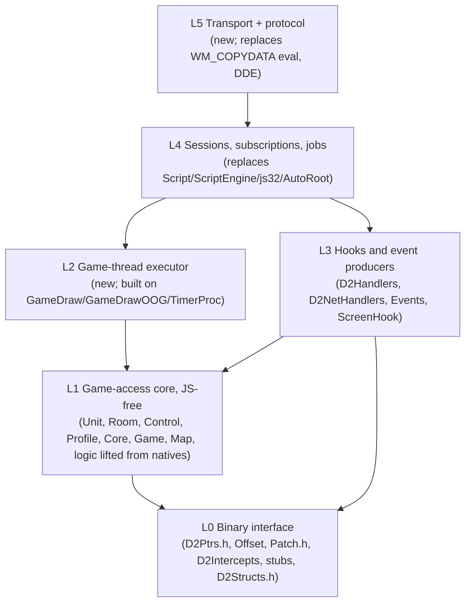

# Next steps toward a next-generation D2BS (suggestions)

Scope: a planning aid for the owner. It suggests how to use the documentation under `docs/` to get from today's D2BS (a DLL injected into Diablo II 1.14d `Game.exe` that embeds SpiderMonkey and exposes a JS API) to a simplified next-generation D2BS controlled through an external, networked RPC API. **Everything here is a suggestion or an option to evaluate. Nothing is a decision or a commitment.** Where there are alternatives they are listed with trade-offs and with links to the evidence. Facts are cited as `File.cpp:LINE` (source of truth: the C++ in the repository root) or linked to the doc section that establishes them. One caveat applies throughout: no address, patch site or struct layout in the repository has been checked against a real 1.14d binary ([offsets.md §3](memory/offsets.md#3-stale-and-suspect-entries-what-depends-on-them), [ghidra/README.md §12](ghidra/README.md#12-known-limitations)), so the validation work in [§2](#2-suggested-validation-work-before-design) comes before the design work.

## Contents

1. [How to use these docs](#1-how-to-use-these-docs)
2. [Suggested validation work before design](#2-suggested-validation-work-before-design)
3. [Possible decomposition of the DLL into layers](#3-possible-decomposition-of-the-dll-into-layers)
4. [Possible shape of the RPC surface](#4-possible-shape-of-the-rpc-surface)
5. [Transport and protocol options](#5-transport-and-protocol-options)
6. [Suggested incremental migration path](#6-suggested-incremental-migration-path)
7. [Testing and tooling suggestions](#7-testing-and-tooling-suggestions)
8. [Risks and unknowns to track](#8-risks-and-unknowns-to-track)

---

## 1. How to use these docs

### 1.1 Which doc answers which design question

| Design question | Start here | Then |
|---|---|---|
| What does the API surface contain, and how is it classified (query, action, OOG, rendering, runtime, host utility, diagnostics)? | [rpc-considerations.md §1](rpc-considerations.md#1-api-surface-census) | [js-api/README.md](js-api/README.md) (index of every name), the per-family js-api pages |
| Which thread runs what, and which locks exist? | [architecture.md §2](architecture.md#2-threads-and-the-hooks-that-bridge-them), [§4](architecture.md#4-locks-and-synchronisation) | [rpc-considerations.md §2](rpc-considerations.md#2-execution-context-constraints), [embedding.md §9](spidermonkey/embedding.md#9-locks-and-synchronisation-objects) |
| Where may an RPC executor touch game memory? | [rpc-considerations.md §2.5](rpc-considerations.md#25-options-for-where-an-rpc-executor-runs-game-calls-trade-offs-only) | [architecture.md §2.5](architecture.md#25-constraints-any-replacement-control-layer-inherits), [call-stubs.md §7](memory/call-stubs.md#7-thread-and-lock-context), [OQ-THR-07](OPEN_QUESTIONS.md#oq-thr-07) |
| Which calls block or wait, and for how long? | [rpc-considerations.md §3](rpc-considerations.md#3-synchronous-and-blocking-semantics) | [events.md §10.6](js-api/events.md#106-blocking-handshake), [patches-and-hooks.md §6.2](memory/patches-and-hooks.md#62-blocking-and-timeouts) |
| How do handles and lifetimes work today? | [rpc-considerations.md §4](rpc-considerations.md#4-object-identity-and-lifetimes) | [unit-properties.md](js-api/unit-properties.md#identity-resolution-and-lifetime), [world.md](js-api/world.md#races-and-thread-safety-summary), [out-of-game.md](js-api/out-of-game.md#facts-for-an-rpc-replacement), [screenhooks.md](js-api/screenhooks.md#facts-relevant-to-an-rpc-replacement) |
| Which events exist, at what volume, and which can veto? | [rpc-considerations.md §5](rpc-considerations.md#5-event-streams) | [events.md §1](js-api/events.md#1-summary-table), [§12](js-api/events.md#12-facts-that-constrain-an-rpc-replacement) |
| What do existing managers talk to? | [rpc-considerations.md §6](rpc-considerations.md#6-existing-external-control-surfaces) | [architecture.md §7](architecture.md#7-external-control-surfaces), [OQ-EXT-01](OPEN_QUESTIONS.md#oq-ext-01) |
| How much code is SpiderMonkey-coupled, and what logic hides in natives? | [jsapi-inventory.md §4](spidermonkey/jsapi-inventory.md#4-per-file-coupling-map), [§5](spidermonkey/jsapi-inventory.md#5-logic-living-inside-natives) | [embedding.md §10](spidermonkey/embedding.md#10-removal-impact-checklist), [rpc-considerations.md §7](rpc-considerations.md#7-coupling-hotspots-for-removing-spidermonkey) |
| Which game addresses, patches, stubs and structs does each API depend on? | [rpc-considerations.md §8](rpc-considerations.md#8-game-internals-dependencies) | [memory/README.md](memory/README.md), [offsets.md §9](memory/offsets.md#9-js-entry-points-per-symbol), [patches-and-hooks.md](memory/patches-and-hooks.md), [call-stubs.md](memory/call-stubs.md), [structs.md](memory/structs.md) |
| Which defects would a reuse of the current code inherit? | [rpc-considerations.md §9](rpc-considerations.md#9-known-defects-that-matter-for-the-redesign) | the "Defects" sections of each js-api page, [jsapi-inventory.md §8](spidermonkey/jsapi-inventory.md#8-findings) |
| What is still unknown, and how would one find out? | [OPEN_QUESTIONS.md](OPEN_QUESTIONS.md#summary-table) | [rpc-considerations.md §10.2](rpc-considerations.md#102-open-questions-that-affect-an-rpc-design) |
| How do I check addresses against the binary? | [ghidra/README.md](ghidra/README.md) | [memory/README.md §9](memory/README.md#9-porting-to-another-game-build) |

### 1.2 Suggested reading order for the RPC effort

1. [rpc-considerations.md, Summary](rpc-considerations.md#summary). It is the synthesis; everything else is evidence behind it.
2. [architecture.md §2](architecture.md#2-threads-and-the-hooks-that-bridge-them) and [§4.2](architecture.md#42-the-game-lock-cgameloopsection-in-detail). The game lock is a hand-off, not a mutex, and that shapes every executor option.
3. [jsapi-inventory.md §4.1-§4.2](spidermonkey/jsapi-inventory.md#41-classification-legend) and [§5.2](spidermonkey/jsapi-inventory.md#52-embedded-logic-to-extract-hand-written) for the size and shape of the refactor.
4. [events.md §10](js-api/events.md#10-dispatch-mechanics) and [§12](js-api/events.md#12-facts-that-constrain-an-rpc-replacement) for the subscription and verdict model.
5. [memory/README.md §1](memory/README.md#1-summary), [offsets.md §3](memory/offsets.md#3-stale-and-suspect-entries-what-depends-on-them) and [patches-and-hooks.md §9](memory/patches-and-hooks.md#9-notes-for-replacing-the-js-layer-with-rpc) for the JS-free native back end and its unverified inputs.
6. [OPEN_QUESTIONS.md, Summary table](OPEN_QUESTIONS.md#summary-table), with the THR, MEM, NET and EXT categories first.
7. The per-family js-api pages, when designing the RPC methods of that family.
8. [ghidra/README.md](ghidra/README.md) before starting the validation work in [§2](#2-suggested-validation-work-before-design).

---

## 2. Suggested validation work before design

The docs grade the source's own evidence only. The suggestion is to settle the questions that change the design (threading, identity, hook coverage, address validity) before committing to an RPC shape.

### 2.1 Ghidra pass over Game.exe 1.14d

| Step | What to do | Evidence / tool |
|---|---|---|
| 1 | Import 1.14d `Game.exe` as `x86:LE:32:default`, compiler spec `windows`, image base `0x400000`; let auto-analysis finish | [ghidra/README.md §3](ghidra/README.md#3-prerequisites) |
| 2 | Run `docs/ghidra/D2BSImport.java` with `dry-run`, read the summary, then run it for real | [ghidra/README.md §5](ghidra/README.md#5-headless-usage), [§6](ghidra/README.md#6-options); the script has not yet been run inside a real Ghidra ([§11](ghidra/README.md#11-verification-performed), [§14](ghidra/README.md#14-open-questions)) |
| 3 | Review the `Warning` bookmarks (17 `stale-pre-1.14d?` rows) and every `patch site` check | [offsets.md §2](memory/offsets.md#2-summary), [ghidra/README.md §13](ghidra/README.md#13-troubleshooting) |
| 4 | Check first the entries that are live and unverified: `RealmPacketRecv_Interception` at VA `0x44B1AE` (installed unconditionally, `Patch.h:39`; expected bytes `85 F6 74 02 FF D6`), the Fog `0x4082E0` jump and its intended target `0x40576F` (`Patch.h:42`), `D2COMMON_GetMissileOwnerUnit` (`D2Ptrs.h:344`), the 19 `MPQStats.cpp` VAs and the 3 item-description VAs (`JSUnit.cpp:453-458`) | [offsets.md §3](memory/offsets.md#3-stale-and-suspect-entries-what-depends-on-them), [patches-and-hooks.md §4](memory/patches-and-hooks.md#4-displaced-instructions-and-expected-original-bytes); [OQ-MEM-01](OPEN_QUESTIONS.md#oq-mem-01), [OQ-MEM-03](OPEN_QUESTIONS.md#oq-mem-03) |
| 5 | Disassemble what the RPC layer will keep calling or hooking: stub targets and their `ret`/register contracts, the mid-function entries `Say_I`/`TakeWaypoint_I`, `ClickBeltRight_I` argument order, the `GameDraw` site `0x453B30`, the act-change sites, `D2NET_SendPacket` and the send paths that may bypass it | [call-stubs.md §5](memory/call-stubs.md#5-register-and-stack-contracts); [OQ-MEM-05](OPEN_QUESTIONS.md#oq-mem-05) to [OQ-MEM-11](OPEN_QUESTIONS.md#oq-mem-11), [OQ-NET-02](OPEN_QUESTIONS.md#oq-net-02), [OQ-NET-03](OPEN_QUESTIONS.md#oq-net-03) |
| 6 | Read the PE header: `DYNAMIC_BASE`/`.reloc` and `NX_COMPAT` | [OQ-MEM-04](OPEN_QUESTIONS.md#oq-mem-04), [OQ-MEM-14](OPEN_QUESTIONS.md#oq-mem-14) |
| 7 | At runtime, break before `InstallPatches()` (`D2BS.cpp:133`) and dump the bytes at every patch VA | [OQ-MEM-01](OPEN_QUESTIONS.md#oq-mem-01) "Resolve by" |
| 8 | Record each answer as the OQ page prescribes: move the entry to Appendix A under the same id and update the doc that raised it | [OPEN_QUESTIONS.md, How to read this page](OPEN_QUESTIONS.md#how-to-read-this-page) |

Option for step 8: the status flags are computed from source comments ([offsets.md §1](memory/offsets.md#1-reading-the-tables)), so binary-verified results have no place in the TSV today. A separate "verified against binary" column or side file, maintained by hand, would keep the generator deterministic. That is a tooling decision for the owner of `docs/ghidra/`.

### 2.2 Struct discrepancies

[structs.md](memory/structs.md#discrepancy-summary) lists 19 comment/layout disagreements. The ones on live read paths are `ItemTxt.xSize/ySize`, `BnetData.ladderflag`, `Control.wText2`, `ObjectTxt.nAutoMap` and `CollMap.pMapEnd` ([rpc-considerations.md §8.4](rpc-considerations.md#84-layout-discrepancies-on-live-read-paths), [OQ-STR-01](OPEN_QUESTIONS.md#oq-str-01)). A suggested order: resolve the first divergence in each struct, since later fields with the same shift follow from it ([structs.md](memory/structs.md#discrepancy-summary)). Use Ghidra consumers first and a memory dump in game and at the menu as the cross-check. Fields an RPC schema would newly expose also need semantics, not just offsets: [OQ-STR-05](OPEN_QUESTIONS.md#oq-str-05) to [OQ-STR-08](OPEN_QUESTIONS.md#oq-str-08).

### 2.3 One diagnostic build for the runtime questions

Many runtime questions can be answered by one instrumented build of today's D2BS, with the JS engine kept so that existing scripts can drive the scenarios. Each row needs a real game session, so none of it can run in CI.

| Experiment | What to instrument or do | Answers | Decision it informs |
|---|---|---|---|
| Thread identity of hooks | log `GetCurrentThreadId()` in every intercept and compare it with `GetWindowThreadProcessId(D2GFX_GetHwnd())` | [OQ-THR-01](OPEN_QUESTIONS.md#oq-thr-01) | where verdicts may block; which producers already hold the game lock |
| Does `TimerProc` fire? | log `Vars.uTimer` and `GetLastError()` after `SetTimer` (`Helpers.cpp:180`), count `TimerProc` calls, read `Vars.dwGameThreadId` | [OQ-THR-02](OPEN_QUESTIONS.md#oq-thr-02) | whether any game-lock hand-off exists out of game (executor option A, [§4.4](#44-threading-options)) |
| Busy states | log `ClientState()` every frame across create, join, act change and exit | [OQ-GAME-09](OPEN_QUESTIONS.md#oq-game-09) | "not ready" semantics; whether a state-change event is needed |
| Unit id reuse | log every unit id seen during long sessions | [OQ-GAME-01](OPEN_QUESTIONS.md#oq-game-01) | whether `{type, gid}` handles need a generation ([§4.3](#43-object-identity-options)) |
| Lifetimes of game lists | hardware watchpoints on `Level`/`Room2`/roster/control list heads | [OQ-GAME-11](OPEN_QUESTIONS.md#oq-game-11) | which events must invalidate handles |
| Packet coverage | break on `0x45F802` during `getPacket()`; break in `GamePacketSent_Interception` during `setSkill`, `useStatPoint` and `shop` | [OQ-NET-01](OPEN_QUESTIONS.md#oq-net-01), [OQ-NET-02](OPEN_QUESTIONS.md#oq-net-02) | completeness of a packet subscription |
| Posted input | `sendClick` on a control with the cursor elsewhere, with listeners attached and `bBlockMouse` set | [OQ-UI-09](OPEN_QUESTIONS.md#oq-ui-09), [OQ-WIN-01](OPEN_QUESTIONS.md#oq-win-01) | whether synthesised clicks work and whether they echo back as input events |
| Off-main-thread safety | call each candidate game function from a worker thread with and without the game lock under Application Verifier | [OQ-THR-07](OPEN_QUESTIONS.md#oq-thr-07), [OQ-THR-06](OPEN_QUESTIONS.md#oq-thr-06), [OQ-OOG-05](OPEN_QUESTIONS.md#oq-oog-05) | executor options A vs B vs C |
| Event-signal races | several scripts with `gamepacket`, `chatmsgblocker` and hook-click listeners under full page heap | [OQ-THR-04](OPEN_QUESTIONS.md#oq-thr-04) | baseline crash rate to compare the new design against |
| Lifecycle races | fast leave/join cycles, `0x1337` during unload | [OQ-THR-05](OPEN_QUESTIONS.md#oq-thr-05) | whether join/leave notifications can rely on today's 50 ms poll |

### 2.4 Questions that need the owner or outside sources

- Manager protocol and loader in real use: [OQ-EXT-01](OPEN_QUESTIONS.md#oq-ext-01), [OQ-EXT-02](OPEN_QUESTIONS.md#oq-ext-02). They decide the compatibility target ([§5.6](#56-compatibility-with-existing-managers)) and the thread `DllMain` runs on.
- Use of dead features by script libraries (`onHover`, `Sandbox`, DDE): [OQ-EXT-03](OPEN_QUESTIONS.md#oq-ext-03).
- Deployed build configuration: [OQ-BLD-01](OPEN_QUESTIONS.md#oq-bld-01).
- Intent: [OQ-INT-01](OPEN_QUESTIONS.md#oq-int-01) to [OQ-INT-04](OPEN_QUESTIONS.md#oq-int-04). OQ-INT-04 (which legacy-documented behaviours to keep) sets the compatibility bar for the whole schema.

---

## 3. Possible decomposition of the DLL into layers

### 3.1 Layer sketch

The seams already exist. Patches, intercepts and C++ handlers are JS-free, and the coupling points are the `Events.cpp` `*Event()` functions (through `ScriptEngine::ForEachScript`) and `ProcessCommand()` ([patches-and-hooks.md §9](memory/patches-and-hooks.md#9-notes-for-replacing-the-js-layer-with-rpc)). One possible split:

Rules this split could enforce: L0-L3 never include an RPC or serialisation header; L1 never includes `js32.h` (today `D2BS.h:16` → `ScreenHook.h:7-8` → `Script.h:8` → `js32.h:13-14` drags `jsapi.h` into 90 of 123 files, [jsapi-inventory.md §4.2](spidermonkey/jsapi-inventory.md#42-include-graph-exposure)); only L2 calls into L1 for anything that touches game memory ([§4.4](#44-threading-options)).

### 3.2 Where existing files could go

Classes a-d are from [jsapi-inventory.md §4.1](spidermonkey/jsapi-inventory.md#41-classification-legend): a = pure binding (44 files, ~11.0 kLOC), b = engine core (8 files, ~2.0 kLOC), c = mixed (11 files, ~5.2 kLOC), d = JS-free (60 files, ~10.8 kLOC).

| Suggested layer | Existing files | Class | Work |
|---|---|---|---|
| L0 Binary interface | `D2Ptrs.h`, `Offset.cpp/h`, `Patch.h`, `D2Intercepts.cpp/h`, `D2Structs.h`, `Constants.h`, `D2Skills.h`, `D2Loader.h`; the asm stubs in `D2Helpers.cpp` | d (`D2Helpers` c) | keep; validate ([§2](#2-suggested-validation-work-before-design)); fix the `D2GAME_exit0` target ([patches-and-hooks.md §2.6](memory/patches-and-hooks.md#26-the-d2game_exit0-static-initialisation-bug)) |
| L1 Game-access core | `Unit.cpp`, `Room.cpp`, `Game.cpp`, `Core.cpp`, `Control.cpp`, `Profile.cpp/h`, `MPQStats.*`, `D2Helpers.*`, `Map/` (except `JSPathReducer.h`), `TimedAlloc.h` (the A* allocator, `JSGame.cpp:280`) | d, c | split `SetSkill(JSContext*, …)` into wait and pump (`D2Helpers.cpp:238-287`); drop the JS `FillBaseStat` overload, four JS-free ones exist (`MPQStats.h:57-61`); lift the logic of [§3.3](#33-logic-to-lift-out-of-natives-first) |
| L2 Executor | new; today's only "marshal onto the main thread" pattern is the `print()` queue and the screenshot flag drained in `GameDraw`/`GameDrawOOG` (`Core.cpp:51-65`, `D2Handlers.cpp:399-434`); lock hand-off in `TimerProc` (`D2Handlers.cpp:493-504`) and `CriticalSections.h` | – | new component |
| L3 Hooks and events | `D2Handlers.cpp`, `D2NetHandlers.cpp`, `Events.cpp/h`, `ScreenHook.cpp/h`, `Console.cpp/h` | d (engine clients), c | re-target the `*Event()` fan-out to subscriptions; replace `Genhook`'s `JSObject* self` and `jsval clicked/hovered` (`ScreenHook.h:40-41`) with hook ids |
| L4 Sessions | replaces `Script.*`, `ScriptEngine.*`, `js32.*`, `AutoRoot.*` | b | new session, subscription and job model ([rpc-considerations.md §7.4](rpc-considerations.md#74-engine-responsibilities-that-need-a-non-js-home)) |
| L5 Transport | replaces the `WM_COPYDATA` eval path (`D2Handlers.cpp:176-204`) and `dde.cpp/h` | d | new ([§5](#5-transport-and-protocol-options)) |
| Lifecycle, config, diagnostics | `D2BS.cpp/h` (`Vars`), `Helpers.cpp/h`, `CommandLine.*`, `StackWalker.*` (used by the crash handler, `Helpers.cpp:396-397`, `:490-512`) | d | keep; re-target `StartScript`/`RunCommand` callers; review `InitCommandLine` ([OQ-GAME-17](OPEN_QUESTIONS.md#oq-game-17)) |
| Delete after extraction | all 44 class-a files (`JS*.cpp/h`, `JSPathReducer.h`) | a | see [§3.4](#34-delete-reimplement-client-side-or-keep) |

### 3.3 Logic to lift out of natives first

28 natives are "heavy" ([jsapi-inventory.md §5.1](spidermonkey/jsapi-inventory.md#51-native-inventory-generated)); the hand-written list of embedded game logic is [jsapi-inventory.md §5.2](spidermonkey/jsapi-inventory.md#52-embedded-logic-to-extract-hand-written). A possible grouping by destination module in L1:

| L1 module (suggested) | Lifted from | Watch out for |
|---|---|---|
| Inventory clicks | `clickItem` (`JSGame.cpp:357`) | belt argument order differs between the two branches (`JSGame.cpp:539` vs `:648`; [OQ-MEM-10](OPEN_QUESTIONS.md#oq-mem-10)); unchecked `BodyClickTable` index (`JSGame.cpp:417`) |
| Pathing | `getPath` (`JSGame.cpp:229`), `Map/` | single global `ActMap` slot (`Map/Diablo_II/ActMap.cpp:14-31`); A* under the game lock with no node cap; teleport reducer `radius ≤ 1` never terminates; reducer type 3 is JS callbacks with an uninitialised context ([rpc-considerations.md §9.3](rpc-considerations.md#93-game-lock-world-and-pathing)) |
| Unit snapshot | `unit_getProperty` (85 property ids, `JSUnit.cpp:47-525`) | `description` writes game memory and is never restored (`JSUnit.cpp:444-466`; [OQ-UI-07](OPEN_QUESTIONS.md#oq-ui-07)) |
| Stats and skills | `getStat` + `InsertStatsToGenericObject`/`InsertStatsNow`, `getSkill` | `aStatList[256]` appended without bound (`JSUnit.cpp:925`, `:934-947`); [OQ-GAME-03](OPEN_QUESTIONS.md#oq-game-03) |
| Interaction, trade, dialog, party, shop | `interact`, `cancel`, `repair`, `shop`, `acceptTrade`, `tradeOk`, `getDialogLines`, `clickParty`, `submitItem`, `transmute`, `weaponSwitch` | `DailogLine` keeps a raw pointer into game data ([rpc-considerations.md §4.1](rpc-considerations.md#41-handle-models-today)) |
| World | `Room.*`, `getRoom`, `getPresetUnit(s)`, `Area.exits`, `getParty` | `GetLevel` leaks the game lock when the game is not ready (`D2Helpers.cpp:172-176`); room load/unload semantics ([OQ-GAME-10](OPEN_QUESTIONS.md#oq-game-10)) |
| Out of game | `getControl(s)`, `Control.*`, `addProfile` (state machines already in `Control.cpp`/`Profile.cpp`) | crash-on-bad-input list ([out-of-game.md](js-api/out-of-game.md#facts-for-an-rpc-replacement)); `login` loops forever in some states ([out-of-game.md](js-api/out-of-game.md#the-login-state-machine)) |
| Packets | `sendPacket`/`getPacket` assembly (`JSCore.cpp:580-605`) | overflows the `2*argc` buffer; rewrite rather than lift ([rpc-considerations.md §9.7](rpc-considerations.md#97-units-handles-and-argument-safety)) |

A practical order is to lift one family at a time and keep the JS native as a thin wrapper over the new function. The JS layer then acts as the regression oracle ([§7.4](#74-differential-testing-while-both-engines-exist)).

### 3.4 Delete, reimplement client-side, or keep

| Item | Today | Suggestion | Evidence |
|---|---|---|---|
| `SQLite`/`DBStatement` + `sqlite3.c/h` | only consumer is `JSSQLite.cpp` | delete; clients have their own databases | [jsapi-inventory.md §7.8](spidermonkey/jsapi-inventory.md#78-classes-whose-only-consumer-is-js), `D2BS.vcxproj:271-281` |
| `File`, `FileTools`, `Folder`/`dopen`, most of `File.cpp` | JS-only consumers | delete; keep or rewrite `isValidPath`/`getPathRelScript` only if `loadMpq` or image overlays stay (`JSCore.cpp:558-567`) | [jsapi-inventory.md §7.8](spidermonkey/jsapi-inventory.md#78-classes-whose-only-consumer-is-js), [utility-classes.md](js-api/utility-classes.md#facts-relevant-to-an-rpc-replacement) |
| `Socket` (`JSSocket.cpp`) | TCP client for scripts; calls `WSACleanup` more often than `WSAStartup` (`JSSocket.cpp:114`, `:125`, `:171`) | delete; avoids carrying the Winsock imbalance into a process that will host the transport | [OQ-WIN-08](OPEN_QUESTIONS.md#oq-win-08) |
| `Sandbox` | constructor crashes (R-03) | delete unless [OQ-EXT-03](OPEN_QUESTIONS.md#oq-ext-03) finds users | [OQ-INT-02](OPEN_QUESTIONS.md#oq-int-02) |
| Hashes (`JSHash.cpp`, `Hash.cpp/h`) | JS-only consumers | reimplement client-side | [jsapi-inventory.md §7.8](spidermonkey/jsapi-inventory.md#78-classes-whose-only-consumer-is-js) |
| Script runtime: `load`, `include`, timers, `delay`, `scriptBroadcast`, `D2BSScript`, listener registration | the embedded-engine model | becomes protocol concepts (sessions, subscriptions, jobs) or client-side code | [rpc-considerations.md §1.5](rpc-considerations.md#15-what-the-census-implies), [§7.4](rpc-considerations.md#74-engine-responsibilities-that-need-a-non-js-home) |
| Console eval (`0x1337`, `.exec`, DDE execute) | unauthenticated arbitrary JS | drop; no eval endpoint without an engine | [architecture.md §7.7](architecture.md#77-other-inputs-and-outputs-that-cross-the-process-boundary) |
| DDE server and `sendDDE` | non-functional as written | drop unless a user is found ([OQ-EXT-03](OPEN_QUESTIONS.md#oq-ext-03)) | [architecture.md §7.4](architecture.md#74-dde) |
| `getIP` | synchronous WinINet GET to a third-party URL | client-side | [OQ-EXT-04](OPEN_QUESTIONS.md#oq-ext-04), `JSCore.cpp:660-675` |
| Host-local utilities: `copy`/`paste`, `keystate`, `beep`, `sendCopyData` | meaningful only on the game machine | owner decision: drop, or keep a small "host" RPC group | [rpc-considerations.md §1.5](rpc-considerations.md#15-what-the-census-implies) |
| `dependencies/` | SpiderMonkey only, ~41 MB | delete with the build entries and defines | [jsapi-inventory.md §6.3](spidermonkey/jsapi-inventory.md#63-dependencies-and-what-becomes-removable) |
| Patches, intercepts, `Map/`, OOG state machines, `Unit.cpp` search | JS-free | keep | [rpc-considerations.md §7.5](rpc-considerations.md#75-build-changes-and-removable-dependencies) |

---

## 4. Possible shape of the RPC surface

### 4.1 Queries, actions, subscriptions, session control

The census categories ([rpc-considerations.md §1.3](rpc-considerations.md#13-global-functions-108-names): Q 28, A 21, O 6, R 4, S 17, H 25, D 7 globals; 21 classes with 87 methods and 183 properties) map naturally onto five RPC groups:

| RPC group (suggested) | Comes from | Shape options |
|---|---|---|
| Queries | Q globals, all class getters, `me` (80 properties) | per-field calls (cheap to map, but every `Unit` property read today pays `ClientState()` + `D2CLIENT_FindUnit`, [rpc-considerations.md §1.5](rpc-considerations.md#15-what-the-census-implies)) · snapshot calls with a field mask (one round-trip; `description` excluded by default, [§9.7](rpc-considerations.md#97-units-handles-and-argument-safety)) · server-published per-frame snapshot (option C in [§4.4](#44-threading-options)) |
| Actions | A and O globals, `Unit` methods that act, `Control.click/setText`, `Profile.login` | request/response returning "issued", as today ([rpc-considerations.md §3.4](rpc-considerations.md#34-contracts-to-replicate-or-redesign)) · long calls as jobs ([§4.5](#45-long-calls-errors-and-not-ready)) |
| Overlays | R globals, `Frame`/`Box`/`Line`/`Text`/`Image` | explicit create/update/destroy with ids and session-scoped cleanup ([screenhooks.md](js-api/screenhooks.md#facts-relevant-to-an-rpc-replacement)) |
| Subscriptions | the 22 event names plus hook `click` ([events.md §1](js-api/events.md#1-summary-table)) | stream with sequence numbers and timestamps (none exist today, [events.md §12](js-api/events.md#12-facts-that-constrain-an-rpc-replacement)); server-side filters by packet id, key code or mode ([rpc-considerations.md §5.3](rpc-considerations.md#53-options-for-a-remote-event-stream-trade-offs-only)) |
| Session control | S globals, auto-start on join/menu, `GameLeave` cleanup | session open/close, game-joined/left/menu notifications, revoke-on-leave rules ([rpc-considerations.md §7.4](rpc-considerations.md#74-engine-responsibilities-that-need-a-non-js-home)) |

Candidates to leave out entirely, pending [OQ-INT-04](OPEN_QUESTIONS.md#oq-int-04): remote eval; `keyupblocker` and `whispermsgblocker` as verdicts (no effect today, [rpc-considerations.md §9.1](rpc-considerations.md#91-event-dispatch-and-verdicts)); hook `hover` (never produced, `D2Handlers.cpp:341-343`); `playSound` (a no-op, [rpc-considerations.md §1.3](rpc-considerations.md#13-global-functions-108-names)).

### 4.2 Blocking events: options

Today seven sources can veto, and each makes the producing game thread wait for each listening script in turn, through one process-wide event, with "allow" on timeout ([rpc-considerations.md §3.1](rpc-considerations.md#31-blocking-events-verdicts)).

| Option | Trade-offs | Docs |
|---|---|---|
| A. Synchronous remote verdict with a deadline, default allow | closest to today; RTT plus client time must fit 500/1000/3000 ms; the game thread stalls on every matching input or packet; needs per-request correlation (today's shared `Vars.eventSignal` cannot tell answers apart, `Helpers.cpp:155`) | [rpc-considerations.md §3.1](rpc-considerations.md#31-blocking-events-verdicts), [§9.1](rpc-considerations.md#91-event-dispatch-and-verdicts) |
| B. Local rules pushed into the DLL (packet-id masks, key codes, chat patterns, a per-hook "consumes clicks" attribute), notification sent asynchronously | no network wait on game threads; verdicts limited to what the rule language expresses | [patches-and-hooks.md §9](memory/patches-and-hooks.md#9-notes-for-replacing-the-js-layer-with-rpc), [screenhooks.md](js-api/screenhooks.md#facts-relevant-to-an-rpc-replacement) |
| C. Hybrid: local rules decide, the client is notified and may update the rules | bounded latency; rule updates race the traffic they govern | [rpc-considerations.md §3.1](rpc-considerations.md#31-blocking-events-verdicts) |
| D. Async-only (no vetoes) for some sources | simplest; loses packet suppression and input capture for those sources (external usage is unknown, [OQ-EXT-03](OPEN_QUESTIONS.md#oq-ext-03)) | [events.md §12](js-api/events.md#12-facts-that-constrain-an-rpc-replacement) |

Per-source observations that could guide a mix:

| Source | Today | Fits a local rule? | Note |
|---|---|---|---|
| `gamepacket` | every received packet except `0xAE`; 500 ms per listener | packet id (the handler already dispatches on `pPacket[0]`, `D2Handlers.cpp:146-169`) | a block also suppresses D2BS's own handlers and derived events (`D2Handlers.cpp:151-166`) |
| `gamepacketsent` | 500 ms; inline for the sender's own listeners | packet id | the same-thread shortcut (`Events.cpp:306-307`) has no remote counterpart |
| `realmpacket` | 500 ms; hook site unverified | packet id | [OQ-MEM-01](OPEN_QUESTIONS.md#oq-mem-01), [OQ-NET-04](OPEN_QUESTIONS.md#oq-net-04) |
| `keydownblocker` | 1000 ms, main thread holding the game lock | key code | a remote wait here freezes input and rendering |
| `chatinputblocker`, `chatmsgblocker` | 500 ms; `chatmsgblocker` ignored out of game | prefix or pattern | |
| hook `click` | 3000 ms per in-range hook, holding `Genhook::globalSection` and the game lock | per-hook attribute | [rpc-considerations.md §9.6](rpc-considerations.md#96-out-of-game-and-screen-hooks) |

If option A is kept for any source, two further suggestions: at most one verdict authority per source, so the stall is not multiplied by the number of subscribers; and verdict handlers that never need game state, because non-packet blockers wait while the main thread holds the game lock ([embedding.md §9.3](spidermonkey/embedding.md#93-deadlock-and-stall-risks-visible-in-the-code), [events.md §10.5](js-api/events.md#105-thread-and-lock-context-of-producers)).

### 4.3 Object identity options

| Scheme | Fits | Trade-offs |
|---|---|---|
| Value keys re-resolved on every call | `Unit` `{type, gid}` (already works this way), `Area` (level id), `Control` (geometry key) | no server state; staleness surfaces as "not found"; aliasing if ids are reused ([OQ-GAME-01](OPEN_QUESTIONS.md#oq-game-01)) and first-match aliasing for controls ([out-of-game.md](js-api/out-of-game.md#facts-for-an-rpc-replacement)) |
| Server-side handle table with generation counters, invalidated on events | `Room`, `Party`, dialog lines (raw pointers today, never revalidated) | detects staleness; needs invalidation hooks. Only game leave has one (`D2Handlers.cpp:506-524`); act change sets a flag but fires no event ([rpc-considerations.md §8.3](rpc-considerations.md#83-patches-that-feed-events-and-behaviour), [OQ-MEM-06](OPEN_QUESTIONS.md#oq-mem-06)); free points unknown ([OQ-GAME-11](OPEN_QUESTIONS.md#oq-game-11)) |
| Snapshots (immutable values) | `Exit`, `PresetUnit`, `Profile` (already snapshots); unit and stat bundles | safe after the object is gone; copying cost; staleness is explicit |
| Leases (owned resources, released explicitly or at session end) | overlays, long-running jobs, server-side iterators | no GC on the server side, so release needs an explicit destroy plus session-end cleanup ([rpc-considerations.md §4.2](rpc-considerations.md#42-what-a-remote-client-would-have-to-model)) |

Iteration (`getNext` rewrites its receiver in place, [unit-methods.md](js-api/unit-methods.md#concurrency-and-staleness)) has two options: snapshot lists (one round-trip; entries may vanish, which value keys already tolerate) or expiring server-side cursors. Handles from one game are meaningless in the next, since `InGame` scripts are aborted at the menu today (`ScriptEngine.cpp:315-326`); a game-session epoch in every handle is one way to make that explicit.

### 4.4 Threading options

The four executor options are in [rpc-considerations.md §2.5](rpc-considerations.md#25-options-for-where-an-rpc-executor-runs-game-calls-trade-offs-only). Evidence relevant to choosing among them:

| Option | Evidence for | Evidence against | Needs |
|---|---|---|---|
| A. Worker threads take the game lock per request | the mechanism exists (`CriticalSections.h:31-54`) | each request waits for the next hand-off; out of game the only hand-off is `TimerProc`, which may never fire ([OQ-THR-02](OPEN_QUESTIONS.md#oq-thr-02)); `GetLevel` and `ActMap` defects if reused ([rpc-considerations.md §9.3](rpc-considerations.md#93-game-lock-world-and-pathing)) | [OQ-THR-07](OPEN_QUESTIONS.md#oq-thr-07) |
| B. Queue requests, run them on the main thread from `GameDraw`/`GameDrawOOG`/`TimerProc` | no cross-thread game access; same pattern as `print()`/screenshots; `GameDrawOOG` already runs per menu frame and gates on `ClientStateMenu` (`D2Handlers.cpp:421-434`), the place [out-of-game.md](js-api/out-of-game.md#facts-for-an-rpc-replacement) suggests for OOG probes and `D2WIN_SetControlText` | latency bounded by frame cadence (`Sleep(10)` per frame, `D2Handlers.cpp:418`, `:433`); long work (A*, room scans) stalls a frame; `Sleep`-based clicks and WFGR must become multi-frame state machines | [OQ-MEM-05](OPEN_QUESTIONS.md#oq-mem-05) (what the `GameDraw` site replaces) |
| C. Main thread publishes snapshots; queries read them | consistent reads with no per-call lock | up to one frame stale; copying cost; still needs A or B for actions | a decision on what to publish |
| D. Unlocked reads as today | no added latency | keeps every race in [rpc-considerations.md §2.3](rpc-considerations.md#23-unsynchronised-game-memory-access-risk-inventory) | – |

A possible mix, for evaluation: B for every action and all out-of-game work; C (or B) for queries; and A only for operations measured to be safe under the lock. Whatever the choice, two facts from [architecture.md §4.2](architecture.md#42-the-game-lock-cgameloopsection-in-detail) constrain it. Once the first hand-off has happened, every main-thread hook already runs while holding the game lock. And any per-session lock that a game hook also takes can form the `include()`/`GameLeave` deadlock cycle ([rpc-considerations.md §9.3](rpc-considerations.md#93-game-lock-world-and-pathing)).

### 4.5 Long calls, errors and "not ready"

- **Jobs for long calls.** `login` (loops forever in some states), `getPath` (no per-call cancel), multi-click OOG actions (≈0.7-1.2 s) and `useStatPoint(n)` (`Sleep(500)` per point) have no cancellation today ([rpc-considerations.md §3.2](rpc-considerations.md#32-natives-that-sleep-poll-or-wait)). Options: request/response with a server-side deadline, or jobs with progress and cancel ([§3.4](rpc-considerations.md#34-contracts-to-replicate-or-redesign)).
- **Three outcomes instead of one.** Today errors, "not ready" warnings and script termination are mixed through `THROW_ERROR`, `THROW_WARNING` and bare `JS_FALSE`, and many natives leave the return value unset ([jsapi-inventory.md §7.7](spidermonkey/jsapi-inventory.md#77-error-semantics)). A wire schema needs an explicit encoding for each: error, not-ready (with or without a caller-supplied wait instead of `GameReadyTimeout`), and session terminated.
- **Argument validation at the boundary.** Several current paths crash the process on bad input (128-byte name filters, packet sizes, OOG arguments, `getPath` reducer parameters) ([rpc-considerations.md §9.7](rpc-considerations.md#97-units-handles-and-argument-safety), [§9.6](rpc-considerations.md#96-out-of-game-and-screen-hooks), [§9.3](rpc-considerations.md#93-game-lock-world-and-pathing)). Validating every argument against a schema before calling into L1 removes that class of crash.

---

## 5. Transport and protocol options

### 5.1 Constraints from the host process

| Constraint | Fact | Source |
|---|---|---|
| 32-bit x86 DLL inside `Game.exe` | `Win32` platform only, `MachineX86` | `D2BS.vcxproj:6`, `:122`; [architecture.md §10.1](architecture.md#101-solution-and-project) |
| Toolset | Release must use VS2010 (v100) because `js_static.lib` carries `/FAILIFMISMATCH:"_MSC_VER=1600"`; removing SpiderMonkey removes that particular reason | [OPEN_QUESTIONS.md R-07](OPEN_QUESTIONS.md#appendix-a-resolved-during-triage); what shipped is [OQ-BLD-01](OPEN_QUESTIONS.md#oq-bld-01) |
| Compiler settings a library may need | Release has `ExceptionHandling false` and `BufferSecurityCheck false`; `CharacterSet MultiByte` | `D2BS.vcxproj:143`, `:157`, `:25` |
| Where start-up runs | `Startup()` runs on the `LoadLibrary` caller inside `DllMain`; it creates the DDE server there, then `D2Thread` (`D2BS.cpp:128-141`). With remote-thread injection that thread exits, which is why the DDE server may be unreachable | [architecture.md §1.3](architecture.md#13-dllmaindll_process_attach-sequence), [OQ-THR-03](OPEN_QUESTIONS.md#oq-thr-03), [OQ-EXT-02](OPEN_QUESTIONS.md#oq-ext-02) |
| Winsock is shared with the game | D2BS already unbalances `WSAStartup`/`WSACleanup` | [OQ-WIN-08](OPEN_QUESTIONS.md#oq-win-08) |
| Hook latency budget | 500 ms (packets, chat), 1000 ms (keys), 3000 ms (hook clicks) per listening script, on the game thread | [rpc-considerations.md §3.1](rpc-considerations.md#31-blocking-events-verdicts) |
| Event volume | `gamepacket` fires for every received packet; `mousemove` for every `WM_MOUSEMOVE` with no coalescing | [rpc-considerations.md §5.1](rpc-considerations.md#51-catalogue-with-payload-and-volume) |
| Binary payloads | packets are raw bytes; `Room.getCollisionA` returns a flat `Uint16Array` (`JSRoom.cpp:153`) | [events.md `gamepacket`](js-api/events.md#gamepacket), [world.md](js-api/world.md#roomprototypegetcollisiona) |
| Strings | mixed, lossy conversions (Latin-1 widening, `CP_ACP`, UTF-8) | [events.md §2.4](js-api/events.md#24-string-encodings), [OQ-OOG-07](OPEN_QUESTIONS.md#oq-oog-07) |
| No authentication anywhere | any local process that can message the game window can run JS through `0x1337` | [architecture.md §7.7](architecture.md#77-other-inputs-and-outputs-that-cross-the-process-boundary) |

Two suggestions follow directly. Start the transport from a D2BS-owned thread (as `D2Thread` is) rather than from `DllMain`. And balance Winsock start-up and clean-up exactly once per process lifetime of the transport.

### 5.2 Transport options

| Option | For | Against |
|---|---|---|
| Named pipe per instance (e.g. a name derived from the PID, as the DDE service is today, `dde.cpp:40`) | Win32-native, no extra library; Windows ACLs can restrict it to the user; no port allocation or firewall prompts | local only, so remote control needs a gateway; overlapped pipe I/O is more code than a blocking socket |
| TCP on loopback | any client language; simple tooling | one port per instance to allocate and advertise; any local process can connect unless authenticated |
| TCP on a network interface | direct remote control | needs TLS and authentication, firewall configuration, and exposes actions such as raw packet sending to the network |
| WebSocket | browser dashboards; message framing included | an HTTP upgrade handshake and framing implementation inside the 32-bit DLL |
| Reverse connection: the DLL dials a manager endpoint given on the command line (the `-handle` convention today, `D2Handlers.cpp:43-47`) | no listening socket in the game process; the manager owns discovery | the manager must be up first; reconnect logic in the DLL |
| Thin local IPC in the DLL plus an out-of-process gateway that does networking, TLS, auth and multi-instance routing | keeps the in-process code and its 32-bit/toolset constraints small; the gateway can use any toolchain | one more hop and one more process to manage; fine for queries and async events, but it lengthens any synchronous verdict path (an argument for local rules, [§4.2](#42-blocking-events-options)) |

### 5.3 Protocol and encoding options

Whatever the encoding, the protocol needs things that do not exist today: request ids, deadlines, event sequence numbers and timestamps, an explicit encoding of not-ready and unset results, and UTF-8 strings with documented conversions ([rpc-considerations.md §5.2](rpc-considerations.md#52-ordering-metadata-and-coupling), [§4.2](rpc-considerations.md#42-what-a-remote-client-would-have-to-model)).

| Option | For | Against |
|---|---|---|
| JSON-RPC 2.0 over a length-prefixed or newline-delimited stream | human-readable; every language has a client; notifications cover events | binary payloads (packets, collision maps) need base64; no schema, which matters for a surface of 326 distinct names ([js-api/README.md §1](js-api/README.md#1-at-a-glance)) |
| MessagePack (msgpack-RPC or a custom envelope) | compact; native byte strings; small C/C++ implementations exist | no schema by default; less readable when debugging |
| Protocol Buffers with custom framing | schema and code generation for clients; byte fields | a generator in the build; the runtime library has to build for 32-bit with the chosen toolset |
| gRPC | schema, deadlines, cancellation and server streaming built in | heavy runtime and HTTP/2 inside the game process; toolset and 32-bit build need checking first; a gateway ([§5.2](#52-transport-options)) could host it out of process instead |

A possible order of decisions: toolset first (v100 or newer, [§5.1](#51-constraints-from-the-host-process)), then whether a gateway exists, then the encoding. Library availability depends on the first two.

### 5.4 Multi-instance and profile management

- **Today:** a manager starts several clients, passes its window handle with `-handle` and, with `-multi`, a title with `-title` ([architecture.md §5.4](architecture.md#54-command-line-switches), [§7.6](architecture.md#76-window-and-handle-conventions)). Scripts talk to the manager through `sendCopyData(null, handler(), …)` ([architecture.md §7.2](architecture.md#72-outbound-sendcopydata-handler)).
- **Discovery options:** an endpoint name derived from the PID (no coordination, but the controller must enumerate processes); an endpoint assigned by the manager on the command line (mirrors `-handle`); or a broker the DLL registers with (one place to list instances, one more component).
- **Profile switching:** `SwitchToProfile` works once and only with `UseProfileScript=true`, because it clears the flag (`Helpers.cpp:102`). A remote controller that switches profiles more than once needs that gate lifted ([rpc-considerations.md §6](rpc-considerations.md#6-existing-external-control-surfaces)).
- **Credentials:** profiles keep `password` in plaintext in `d2bs.ini` ([out-of-game.md](js-api/out-of-game.md#facts-for-an-rpc-replacement)). One option is to have the controller pass credentials per `login` job and never store them in the DLL's directory.

### 5.5 Security and authentication

- Default to local-only (a pipe or loopback). Treat anything that listens on a network interface as an opt-in that requires TLS and authentication.
- Per-instance secret handed over by the manager. Note that on engine start-up failure D2BS logs the full command line, which can contain raw CD keys (`D2Handlers.cpp:36`; [rpc-considerations.md §6](rpc-considerations.md#6-existing-external-control-surfaces)). A secret passed on the command line would land in the log too, unless that logging changes.
- Capability scopes, for example read-only, actions, overlays, raw packets. The last would mirror today's `EnableUnsupported` gate on `sendPacket`/`getPacket`/`moveNPC` (`JSCore.cpp:572-574`, `JSGame.cpp:1425-1427`).
- No eval endpoint ([§3.4](#34-delete-reimplement-client-side-or-keep)).
- Constrain every file path the API accepts (`loadMpq`, image overlays). Image path validation is a no-op today, and BMP headers are trusted ([screenhooks.md](js-api/screenhooks.md#facts-relevant-to-an-rpc-replacement)).

### 5.6 Compatibility with existing managers

| Option | Trade-offs |
|---|---|
| Keep a `WM_COPYDATA` bridge: inbound non-reserved `dwData` becomes an RPC event, outbound "send to manager" becomes an action | existing managers keep working; keep it non-blocking (the `0x1337` busy-wait on the window thread is a defect, `D2Handlers.cpp:184-189`) and drop `0x1337` itself |
| Replace it with the RPC API only | one authenticated surface; existing managers and script libraries stop working |
| Bridge for one release, then remove | migration window; two code paths for a while |

Which messages a bridge must carry is [OQ-EXT-01](OPEN_QUESTIONS.md#oq-ext-01). DDE can be dropped in every option ([architecture.md §7.4](architecture.md#74-dde)).

---

## 6. Suggested incremental migration path

The idea is that each milestone ships something verifiable while SpiderMonkey still runs, so the JS API stays available as a fallback and as an oracle until the last step. The order of M3 and M4 is itself an option. The event producers are already JS-free ([patches-and-hooks.md §9](memory/patches-and-hooks.md#9-notes-for-replacing-the-js-layer-with-rpc)), so events could come before actions.

| Milestone | Scope | Verify | Docs and defects touched |
|---|---|---|---|
| M0 Validation | [§2](#2-suggested-validation-work-before-design): Ghidra pass, struct dumps, diagnostic build | answered OQs moved to Appendix A; patch-site bytes match | [offsets.md §3](memory/offsets.md#3-stale-and-suspect-entries-what-depends-on-them), [OPEN_QUESTIONS.md](OPEN_QUESTIONS.md#summary-table) |
| M1 Extract the core | lift L1 functions out of natives family by family ([§3.3](#33-logic-to-lift-out-of-natives-first)); break the `D2BS.h → … → js32.h` include chain; JS natives become wrappers | no behaviour change: JS regression scenarios before and after; `jsapi_inventory.py` shows L1 files without JSAPI references | [jsapi-inventory.md §4](spidermonkey/jsapi-inventory.md#4-per-file-coupling-map), [§5.2](spidermonkey/jsapi-inventory.md#52-embedded-logic-to-extract-hand-written); fix `GetLevel` lock leak, `ActMap` global slot ([rpc-considerations.md §9.3](rpc-considerations.md#93-game-lock-world-and-pathing)) before they are reused |
| M2 Read-only RPC alongside JS | executor ([§4.4](#44-threading-options)) plus transport ([§5](#5-transport-and-protocol-options)); client state, `me` basics, unit and stat snapshots, UI flags, area/level, OOG location | RPC results equal JS results in the same session ([§7.4](#74-differential-testing-while-both-engines-exist)); frame time with and without RPC load | [rpc-considerations.md §2](rpc-considerations.md#2-execution-context-constraints), [§4](rpc-considerations.md#4-object-identity-and-lifetimes); exclude `description` from snapshots ([OQ-UI-07](OPEN_QUESTIONS.md#oq-ui-07)) |
| M3 Non-blocking events | stream with sequence numbers, timestamps, bounded queues and a drop policy; server-side filters | no lost or duplicated events against a JS listener in the same session; behaviour when a client stalls | [events.md §10](js-api/events.md#10-dispatch-mechanics), [§12](js-api/events.md#12-facts-that-constrain-an-rpc-replacement); [OQ-NET-05](OPEN_QUESTIONS.md#oq-net-05), [OQ-NET-06](OPEN_QUESTIONS.md#oq-net-06) |
| M4 Actions | in-game actions on the executor; OOG flows as jobs with cancel; overlays with ids | each action against its JS counterpart; `login` job always terminates | [call-stubs.md](memory/call-stubs.md); [OQ-MEM-09](OPEN_QUESTIONS.md#oq-mem-09) to [OQ-MEM-11](OPEN_QUESTIONS.md#oq-mem-11), [OQ-UI-09](OPEN_QUESTIONS.md#oq-ui-09); `login` infinite loops, OOG crash-on-bad-input ([rpc-considerations.md §9.6](rpc-considerations.md#96-out-of-game-and-screen-hooks)) |
| M5 Verdicts | the chosen mix from [§4.2](#42-blocking-events-options); per-request correlation if any remote verdict remains | blocked packets and keys really are blocked; game-thread stall time measured | shared `eventSignal`, `static DWORD result` ([rpc-considerations.md §9.1](rpc-considerations.md#91-event-dispatch-and-verdicts)); [OQ-NET-01](OPEN_QUESTIONS.md#oq-net-01) to [OQ-NET-03](OPEN_QUESTIONS.md#oq-net-03) |
| M6 Parity and compatibility | coverage against the census and the [OQ-INT-04](OPEN_QUESTIONS.md#oq-int-04) decisions; optional `WM_COPYDATA` bridge | every census row marked mapped, dropped or client-side | [rpc-considerations.md §1](rpc-considerations.md#1-api-surface-census), [§6](rpc-considerations.md#6-existing-external-control-surfaces) |
| M7 Remove SpiderMonkey | delete class a; replace class b; split class c; remove `dependencies/`, `sqlite3.c` and the JS defines; optionally move to a newer toolset | build without `dependencies/`; `jsapi_inventory.py` reports zero JSAPI references | [jsapi-inventory.md §6.3](spidermonkey/jsapi-inventory.md#63-dependencies-and-what-becomes-removable), [embedding.md §10](spidermonkey/embedding.md#10-removal-impact-checklist) |

Known defects worth fixing, or designing around, regardless of the milestone order (all from [rpc-considerations.md §9](rpc-considerations.md#9-known-defects-that-matter-for-the-redesign) unless noted):

| Defect | Suggested handling |
|---|---|
| One manual-reset `Vars.eventSignal` for every verdict (`Helpers.cpp:155`) | do not reuse; per-request correlation or local rules |
| `RemoveDelayedEvent` leaves `cEventSection` without entering it (`ScriptEngine.cpp:835`) | goes away with in-process timers; do not port |
| `ForEachScript` runs producers on an unlocked snapshot (`ScriptEngine.cpp:204-228`) | the subscription registry needs its own locking or a lock-free design |
| `GetLevel` leaks the game lock when not ready (`D2Helpers.cpp:172-176`) | fix in M1 |
| Single global `ActMap` slot (`Map/Diablo_II/ActMap.cpp:14-31`) | serialise path/collision requests, or make maps per request |
| `getPath` parameter hazards (invalid reducer, `radius ≤ 1`, type 3) | validate at the schema; drop the JS reducer |
| `description` mutates game state (`JSUnit.cpp:444-466`) | exclude from generic snapshots; settle [OQ-UI-07](OPEN_QUESTIONS.md#oq-ui-07) |
| Unsafe marshalling (128-byte name buffers, packet buffer overflow, unchecked table indices) | rewrite at the boundary with length checks |
| `0x1337` busy-wait on the window thread (`D2Handlers.cpp:184-189`) | never block the window thread in an IPC handler |
| `D2GAME_exit0` jump to `0x576F06` ([patches-and-hooks.md §2.6](memory/patches-and-hooks.md#26-the-d2game_exit0-static-initialisation-bug)) | fix after [OQ-MEM-03](OPEN_QUESTIONS.md#oq-mem-03) |
| `InitCommandLine` copies 176 bytes into the process command line (`Helpers.cpp:484-487`) | decide after [OQ-GAME-17](OPEN_QUESTIONS.md#oq-game-17) |
| `GameAttack_Intercept` turns every attack on a monster into a shift-attack ([patches-and-hooks.md §9](memory/patches-and-hooks.md#9-notes-for-replacing-the-js-layer-with-rpc)) | owner decision: keep, make optional, or drop |
| Release build has C++ EH disabled (`D2BS.vcxproj:157`) while code throws ([OQ-WIN-05](OPEN_QUESTIONS.md#oq-win-05)) | enable EH or remove throwing paths in the new build |

---

## 7. Testing and tooling suggestions

There are no tests and no CI configuration in the repository today. The game binary is proprietary and not in the repository (only the .NET loaders `Debug/D2BS.exe` and `Release/D2BS.exe` are, [architecture.md §1.2](architecture.md#12-how-the-dll-gets-into-the-process)). So the suggestions separate what can run anywhere from what needs a game.

### 7.1 Unit tests that need no game

| Target | Why it is testable | Prerequisite |
|---|---|---|
| A* and path reducers over synthetic maps | `Mapping::Map` is an interface and `BlankMap` exists (`Map/Map.h:12-25`, `Map/BlankMap.h`) | inject the cancellation checks that read game state (`GameReady()`, the player's level, `Vars.bQuitting`, `Map/Path/AStarPath.h:122-127`) as a predicate |
| Pure decoders lifted from natives | e.g. 8.8 fixed-point HP/MP/stamina (`JSUnit.cpp:255-271`), skill-charge decoding (`JSUnit.cpp:1022-1028`), life/mana from packet `0x95` (`D2NetHandlers.cpp:26-38`) | extraction in M1 |
| Address encoding | `DLLOFFSET` encode/decode and `GetDllOffset` (`D2Ptrs.h:40`, `Offset.cpp:21-28`) | none |
| Patch bytes | the bytes written per patch are computable from site and target ([patches-and-hooks.md §2.3](memory/patches-and-hooks.md#23-exact-bytes-written)) | none |
| Command-line parsing | `CommandLine.cpp:30-93` | none |
| Protocol codec, schema validation, event filters and local rules | new code | design |
| Executor semantics: deadlines, cancellation, frame budget | new code | a fake frame pump in place of `GameDraw` |

### 7.2 Fixtures from memory dumps

- Option: capture process memory (or selected regions) of `Game.exe` in known states (town, dungeon, each menu screen) and run L1 readers against it through a memory-provider abstraction that translates game pointers. That turns struct layouts, unit iteration and stat decoding into offline tests. The cost is that L1 must read through an accessor instead of dereferencing raw pointers.
- Option, lighter: record golden RPC responses from a live session and diff later builds against them. This catches regressions but not layout errors.
- D2BS already contains a minidump writer, but it is never registered (`D2Intercepts.cpp:383-402`, [architecture.md §9.2](architecture.md#92-crash-and-exit-handling)). It could be revived for crash fixtures.

### 7.3 Packet capture and replay

- Record received and sent packets with timestamps (from the receive and send hooks, or from today's `gamepacket`/`gamepacketsent` listeners in JS).
- Replay them into the extracted packet handlers (`0x15`, `0x26`, `0x2A`, `0x5A`, `0x18`/`0x95`, `0x9C`/`0x9D`, `0xA7`; `D2Handlers.cpp:145-170`) to test the derived events and their payload parsing ([events.md §6](js-api/events.md#6-game-state-events)). Game calls inside the handlers (data-table lookups for `0x5A`, `D2NetHandlers.cpp:91-100`) need stubs.
- The same captures can size the event stream ([§5.1](#51-constraints-from-the-host-process)) and help with [OQ-NET-04](OPEN_QUESTIONS.md#oq-net-04) to [OQ-NET-06](OPEN_QUESTIONS.md#oq-net-06).

### 7.4 Differential testing while both engines exist

From M2 to M6, one session can answer the same question through JS and through RPC. A small JS harness script plus an RPC client that compares results gives parity tests without writing expectations by hand. Known JS quirks (unset return values, slot semantics, [OQ-SM-02](OPEN_QUESTIONS.md#oq-sm-02), [OQ-SM-06](OPEN_QUESTIONS.md#oq-sm-06)) need an allow-list.

### 7.5 Ghidra-assisted offset validation

- Keep a private Ghidra project of 1.14d `Game.exe` with the import applied ([§2.1](#21-ghidra-pass-over-gameexe-114d)). Re-run `D2BSImport.java` with `dry-run` after each change to `D2Ptrs.h`, `Patch.h` or `D2Structs.h`. Re-runs are idempotent but overwrite hand-edited signatures unless `skip-signatures` is used ([ghidra/README.md §8](ghidra/README.md#8-re-running-idempotency)).
- For a future game build, the porting steps (Version Tracking from the labelled 1.14d program) are in [memory/README.md §9](memory/README.md#9-porting-to-another-game-build).

### 7.6 Keeping generated docs and data current

These run with Python 3 (and clang for layout checks) and need no game, so they could run in CI:

| Job | Command | Purpose |
|---|---|---|
| Symbol table and offsets tables | `python3 docs/ghidra/tools/gen_symbols.py --repo . --out docs/ghidra/d2bs_symbols.tsv --markdown docs/memory/offsets.md` | fails on count, VA-comment, name or range problems ([memory/README.md §10](memory/README.md#10-regenerating-the-tables-and-the-ghidra-import)) |
| Types header and layout check | `python3 docs/ghidra/tools/gen_types.py --repo . --out docs/ghidra/d2bs_types.h --check` | fails when a layout differs from clang's MSVC x86 layout ([ghidra/README.md §10](ghidra/README.md#10-regenerating-the-data)) |
| Coupling inventory | `python3 docs/spidermonkey/tools/jsapi_inventory.py --update docs/spidermonkey/jsapi-inventory.md` | progress metric for M1-M7: 7230 live JSAPI references and 90 files reaching `jsapi.h` today ([jsapi-inventory.md §2](spidermonkey/jsapi-inventory.md#2-headline-numbers)) |
| Docs links | a relative-link and anchor checker over `docs/` | keeps cross-references valid as docs move |

A further option: generate `static_assert(offsetof(...))` lines from the same layout data into the new L0 headers, so the compiler checks the layouts on every build.

### 7.7 Manual soak and stress runs

The resolution methods of [OQ-THR-04](OPEN_QUESTIONS.md#oq-thr-04) to [OQ-THR-07](OPEN_QUESTIONS.md#oq-thr-07) (Application Verifier, full page heap, fast join/leave cycles) double as the acceptance soak for each milestone. Running them once on today's build gives the baseline.

---

## 8. Risks and unknowns to track

| Risk | Why it matters | Track | Possible mitigation |
|---|---|---|---|
| Game functions are not safe off the main thread | decides the executor model; wrong guess means rare corruption | [OQ-THR-07](OPEN_QUESTIONS.md#oq-thr-07), [OQ-THR-06](OPEN_QUESTIONS.md#oq-thr-06), [OQ-OOG-05](OPEN_QUESTIONS.md#oq-oog-05) | default to executor option B ([§4.4](#44-threading-options)) until measured |
| No game-lock hand-off out of game | OOG work under option A would wait forever | [OQ-THR-02](OPEN_QUESTIONS.md#oq-thr-02) | run OOG work from `GameDrawOOG` |
| Unknown thread of BNCS, realm, channel and whisper hooks | where those producers may block | [OQ-THR-01](OPEN_QUESTIONS.md#oq-thr-01) | async-only events for them until known |
| Wrong or stale addresses and patch sites | crashes or silent corruption at injection | [OQ-MEM-01](OPEN_QUESTIONS.md#oq-mem-01) to [OQ-MEM-04](OPEN_QUESTIONS.md#oq-mem-04) | M0 Ghidra pass; do not install `RealmPacketRecv` until verified |
| Calling-contract errors in stubs and mid-function entries | stack corruption in core actions (`say`, waypoints, belt clicks) | [OQ-MEM-07](OPEN_QUESTIONS.md#oq-mem-07) to [OQ-MEM-11](OPEN_QUESTIONS.md#oq-mem-11) | disassemble before exposing each action |
| Struct layout discrepancies | wrong values in snapshots (item sizes, ladder flag, OOG text) | [OQ-STR-01](OPEN_QUESTIONS.md#oq-str-01), [OQ-STR-04](OPEN_QUESTIONS.md#oq-str-04) | expose only fields that have been verified |
| Unit id reuse and list lifetimes | stale handles alias other objects | [OQ-GAME-01](OPEN_QUESTIONS.md#oq-game-01), [OQ-GAME-11](OPEN_QUESTIONS.md#oq-game-11) | game-session epoch in handles; snapshots for world objects |
| Incomplete packet coverage | a filter that misses packets gives a false sense of control | [OQ-NET-01](OPEN_QUESTIONS.md#oq-net-01) to [OQ-NET-03](OPEN_QUESTIONS.md#oq-net-03) | document coverage per send path |
| Synthesised input does not hit-test as assumed | OOG automation and clicks fail | [OQ-UI-09](OPEN_QUESTIONS.md#oq-ui-09), [OQ-WIN-01](OPEN_QUESTIONS.md#oq-win-01), [OQ-OOG-03](OPEN_QUESTIONS.md#oq-oog-03) | test on each menu screen early (M0) |
| Verdict latency over the network | game freezes on every packet or key | [rpc-considerations.md §3.1](rpc-considerations.md#31-blocking-events-verdicts) | local rules ([§4.2](#42-blocking-events-options)) |
| Unknown manager protocol and loader | compatibility target and `DllMain` thread unknown | [OQ-EXT-01](OPEN_QUESTIONS.md#oq-ext-01), [OQ-EXT-02](OPEN_QUESTIONS.md#oq-ext-02) | ask the manager authors; bridge for one release |
| Shared Winsock state with the game | transport start-up or clean-up could break game networking | [OQ-WIN-08](OPEN_QUESTIONS.md#oq-win-08) | delete `Socket`; balanced, once-per-process Winsock use |
| Image base and DEP assumptions | live patching through a `PAGE_READWRITE` window can fault under DEP; VA-based tooling (the Ghidra import, the VAs in these docs) assumes `0x400000`, although the code itself rebases every address | [OQ-MEM-04](OPEN_QUESTIONS.md#oq-mem-04), [OQ-MEM-14](OPEN_QUESTIONS.md#oq-mem-14) | read the PE header in M0; keep the RVA + module-base scheme; patch with `PAGE_EXECUTE_READWRITE` |
| Toolset and deployed configuration unknown | library choice and behaviour parity | [OQ-BLD-01](OPEN_QUESTIONS.md#oq-bld-01), [OQ-BLD-03](OPEN_QUESTIONS.md#oq-bld-03) | decide the toolset before choosing protocol libraries ([§5.3](#53-protocol-and-encoding-options)) |
| Scope creep from legacy compatibility | the schema grows to cover documented-but-broken behaviour | [OQ-INT-04](OPEN_QUESTIONS.md#oq-int-04), [OQ-EXT-03](OPEN_QUESTIONS.md#oq-ext-03) | owner decision per item before M6 |
| Encoding of non-ASCII names | lookups and chat break for some users | [OQ-OOG-07](OPEN_QUESTIONS.md#oq-oog-07) | one documented conversion at the boundary |
