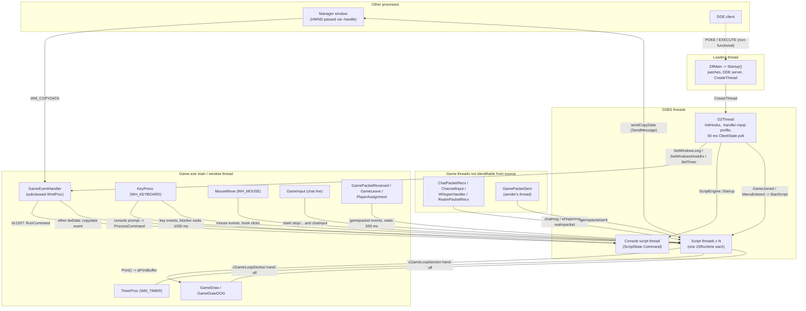
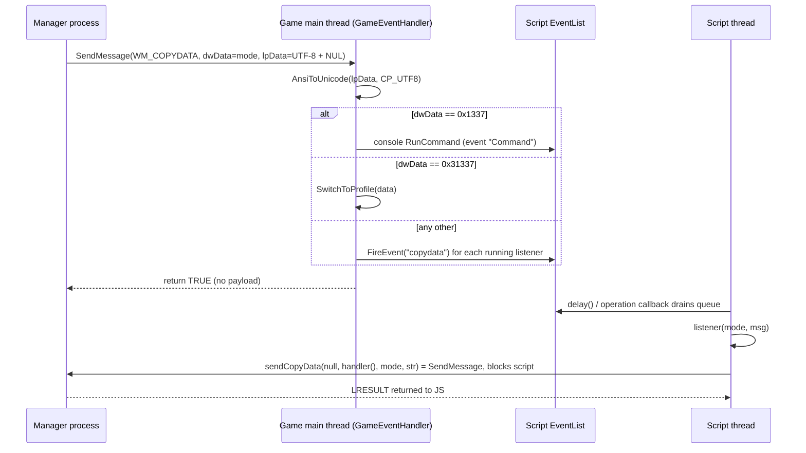

# D2BS architecture

Scope: the system-level picture of D2BS 1.6.4U (`D2BS.h:10`) as built from this repository: how `D2BS.dll` gets into `Game.exe` (Diablo II 1.14d), the startup/shutdown sequence, which code runs on the game's threads and which on D2BS's own threads, every field of the global `Vars` struct and every lock, every `d2bs.ini` key and command-line switch, the in-game console and its commands, all existing external control surfaces (WM_COPYDATA, DDE, command line, window handle conventions), the in-game / out-of-game state model, logging and crash handling, and the build. JS API details, SpiderMonkey internals, offsets and hook internals are covered by the sibling documents linked below and are only summarised here. Every claim cites the source line that supports it. A claim that the source cannot settle is listed under [Open questions](#11-open-questions).

## Contents

1. [Process and module model](#1-process-and-module-model)
2. [Threads and the hooks that bridge them](#2-threads-and-the-hooks-that-bridge-them)
3. [Global state: `Vars`](#3-global-state-vars)
4. [Locks and synchronisation](#4-locks-and-synchronisation)
5. [Configuration: `d2bs.ini` and the command line](#5-configuration-d2bsini-and-the-command-line)
6. [Console and built-in commands](#6-console-and-built-in-commands)
7. [External control surfaces](#7-external-control-surfaces)
8. [Game-state model and script lifecycle](#8-game-state-model-and-script-lifecycle)
9. [Logging and crash handling](#9-logging-and-crash-handling)
10. [Build and repository layout](#10-build-and-repository-layout)
11. [Open questions](#11-open-questions)

Related documents: [js-api/globals-core.md](js-api/globals-core.md) · [js-api/events.md](js-api/events.md) · [js-api/out-of-game.md](js-api/out-of-game.md) · [js-api/screenhooks.md](js-api/screenhooks.md) · [js-api/world.md](js-api/world.md) · [js-api/utility-classes.md](js-api/utility-classes.md) · [js-api/unit-properties.md](js-api/unit-properties.md) · [spidermonkey/embedding.md](spidermonkey/embedding.md) · [memory/README.md](memory/README.md) · [memory/patches-and-hooks.md](memory/patches-and-hooks.md) · [memory/call-stubs.md](memory/call-stubs.md) · [rpc-considerations.md](rpc-considerations.md)

Conventions: "VA" is a virtual address in `Game.exe` (image base 0x400000). `GetDllOffset()` ignores its DLL-name argument and adds the offset to `GetModuleHandle(NULL)` (`Offset.cpp:21-28`), so every "D2Client.dll + X" in `Patch.h` is really `Game.exe + X`. See [memory/README.md](memory/README.md).

---

## 1. Process and module model

### 1.1 What gets loaded

| Item | Fact | Source |
|---|---|---|
| Build output | A 32-bit DLL (`ConfigurationType DynamicLibrary`) named `D2BS.dll`. The Release post-build step also copies it to `D2BS.bin`. | `D2BS.vcxproj:24-34`, `D2BS.vcxproj:110`, `D2BS.vcxproj:185` |
| Host | `Game.exe` 1.14d. All game code is in the EXE, and offsets resolve against `GetModuleHandle(NULL)`. | `Offset.cpp:21-28` |
| Version string | `D2BS_VERSION L"1.6.4U"`. `version()` with no argument returns that string; with any argument it prints "D2BS 1.6.4U for Diablo II 1.14d." to the console instead. | `D2BS.h:10`, `JSCore.cpp:295-305` |
| Resource version | `FILEVERSION 1,6,4,0` | `version.rc:54` |

### 1.2 How the DLL gets into the process

D2BS contains no injector. `DllMain` accepts three loading modes, chosen by `lpReserved` and by compile-time flags:

| Mode | How it is detected | What D2BS does | Source |
|---|---|---|---|
| Plain `LoadLibrary`, for example remote-thread injection | `lpReserved == NULL` | Sets `Vars.hModule = hDll`, sets `Vars.szPath` to the DLL's directory plus a trailing `\`, and sets `bLoadedWithCGuard = FALSE`. | `D2BS.cpp:35-41` |
| cGuard loader, which passes a `Module` descriptor | `lpReserved != NULL`, taken to be a `Module*` | Sets `Vars.pModule = lpReserved`, copies `szPath` from `Module::szPath`, and sets `bLoadedWithCGuard = TRUE`. `Vars.hModule` stays NULL. `struct Module { HMODULE/DWORD base; DWORD _1; wchar_t szPath[MAX_PATH]; }` | `D2BS.cpp:27-34`, `D2BS.h:29-36` |
| D2Loader plugin | Compile-time `_MSVC_DEBUG` | `D2Loader.h` is included and exports `QueryInterface()`, which returns `PLUGIN_INTERFACE {0x44320000, 0x01000912, "D2BS", PluginEntry}`. `PluginEntry` is a no-op that returns TRUE, so all the work still happens in `DllMain`. | `D2BS.cpp:17-19`, `D2Loader.h:10-28` |

Notes:
- `_MSVC_DEBUG` is defined in both the Debug **and** the Release configuration, but not in Packaging. Shipped Release builds therefore export `QueryInterface` (`D2BS.vcxproj:84`, `D2BS.vcxproj:138`, `D2BS.vcxproj:206`).
- `bLoadedWithCGuard` is written but never read (`D2BS.cpp:34`, `D2BS.cpp:40`). Legacy docs say "it will terminate on Warden if not loaded with cGuard" (`resources/HISTORY.txt:39-40`), but the code terminates on every Warden packet 0xAE regardless of cGuard (`D2Handlers.cpp:147-149`).
- A DLL bound through the import table (static load) gets a non-NULL `lpReserved` for `DLL_PROCESS_ATTACH`. The code would misread that pointer as a `Module*`. Only dynamic loading or cGuard work (`D2BS.cpp:27-28`).
- In cGuard mode, `szPath` is used as given and `d2bs.ini` is appended directly (`Helpers.cpp:112`), so the loader must supply a trailing backslash.
- `Debug/D2BS.exe` and `Release/D2BS.exe` in the repo are **not** outputs of this project. They are a .NET "D2BS Loader" (`D2BSLoader`, assembly versions 1.5.5251.21837 and 1.5.4919.15846, PE timestamps 2014-05-18 and 2013-06-20). Their strings show remote `LoadLibraryA` injection (`CreateRemoteThread`, `VirtualAllocEx`, `WriteProcessMemory`), `CreateProcess`/`ResumeThread`, the switches `--pid --dll --path --exe --params`, the commands `start inject kill save`, a default DLL name of `D2BS.bin`, and the strings `cGuard.dll` and `D2Gfx.dll`. See [Open questions](#11-open-questions) for whether they work with 1.14d.

### 1.3 `DllMain(DLL_PROCESS_ATTACH)` sequence

`D2BS.cpp:23-96`, which runs on the loading thread with the loader lock held:

| # | Step | Source |
|---|---|---|
| 1 | `DisableThreadLibraryCalls(hDll)` | `D2BS.cpp:26` |
| 2 | Resolve `Vars.szPath` (see §1.2). | `D2BS.cpp:27-41` |
| 3 | Set `Vars.szLogPath = szPath + "logs\"` and call `CreateDirectoryW`. | `D2BS.cpp:43-44` |
| 4 | `InitCommandLine()` copies at most 256 wide characters of `GetCommandLineW()` into `Vars.szCommandLine`, then **overwrites the process's wide command-line buffer** with `C:\Program Files (x86)\Diablo II\Game.exe -w` (see §5.4). | `D2BS.cpp:45`, `Helpers.cpp:483-488` |
| 5 | `ParseCommandLine(Vars.szCommandLine)` (first pass) | `D2BS.cpp:46` |
| 6 | `InitSettings()` reads `[settings]` from `d2bs.ini`. | `D2BS.cpp:47`, `Helpers.cpp:107` |
| 7 | Sets `Vars.bUseRawCDKey = FALSE`, then reads the switches `-title -sleepy -cachefix -multi -ftj -d2c -d2x` into `Vars` (§5.4). | `D2BS.cpp:48-79` |
| 8 | Disabled `#if 0` block that would redirect stderr to `d2bs.log`. | `D2BS.cpp:81-90` |
| 9 | `bShutdownFromDllMain = FALSE` and `SetUnhandledExceptionFilter(ExceptionHandler)` | `D2BS.cpp:92-93` |
| 10 | `Startup()`. If it fails, `DllMain` returns FALSE. | `D2BS.cpp:94-95` |

### 1.4 `Startup()`

`D2BS.cpp:108-141`, which still runs inside `DllMain`:

1. `InitializeCriticalSection` on 15 `Vars.c*Section` fields (`D2BS.cpp:109-123`).
2. `bNeedShutdown = TRUE`, `bChangedAct = FALSE`, `bGameLoopEntered = FALSE`, `SectionCount = 0` (`D2BS.cpp:125-128`).
3. `Genhook::Initialize()` initialises the screen-hook list lock (`D2BS.cpp:131`, `ScreenHook.h:66-67`).
4. `DefineOffsets()` resolves every `D2Ptrs.h` pointer (`D2BS.cpp:132`, `Offset.cpp:14-19`). See [memory/offsets.md](memory/offsets.md).
5. `InstallPatches()` writes every entry of `Patches[]`, and `InstallConditional()` writes the entries of `Conditional[]` whose `*enabled == TRUE` (`D2BS.cpp:133-134`, `Offset.cpp:38-62`, `Patch.h:8-57`). See [memory/patches-and-hooks.md](memory/patches-and-hooks.md).
6. `CreateDdeServer()` (`D2BS.cpp:135`, `dde.cpp:31`). See §7.4.
7. `CreateThread(D2Thread)`. If that fails, it returns FALSE (`D2BS.cpp:137-138`). A commented-out `EventThread` remains (`D2BS.cpp:139`).

Consequences:
- Patching, DDE initialisation and thread creation all happen under the loader lock, on whatever thread called `LoadLibrary`.
- `WriteBytes` changes the code page to `PAGE_READWRITE`, not `PAGE_EXECUTE_READWRITE`, while it patches (`Offset.cpp:73-81`). A game thread that executes that page during the window would fault under DEP.
- If `CreateThread` fails, `DllMain` returns FALSE after the patches are installed, so the loader would unload a DLL that live code jumps into (`D2BS.cpp:94-95`, `D2BS.cpp:133-138`).
- Patch addresses are computed during static initialisation of `Patches[]` and `Conditional[]` (`Patch.h:8`, `Patch.h:47`). That initialisation runs during CRT start-up of the DLL, before `DllMain`'s body.

### 1.5 `D2Thread` (D2BS's long-lived worker)

`D2Handlers.cpp:29-119`:

1. **`InitHooks()`** (`Helpers.cpp:164-208`) loops with `Sleep(50)` until `Vars.bActive`:
   - It waits until `D2GFX_GetHwnd()` is non-NULL **and** `ClientState()` is `Menu` or `InGame` (`Helpers.cpp:174`).
   - It subclasses the game window with `SetWindowLong(hwnd, GWL_WNDPROC, GameEventHandler)` and saves the old procedure in `Vars.oldWNDPROC` (`Helpers.cpp:175-178`).
   - It calls `SetTimer(hwnd, 1, 0, TimerProc)` on every pass that gets this far (`Helpers.cpp:180`).
   - It installs the thread-local hooks `SetWindowsHookEx(WH_KEYBOARD, KeyPress, NULL, mainThread)` and `WH_MOUSE → MouseMove` on the window's thread (`Helpers.cpp:182-188`).
   - Once both hooks exist, it calls `ScriptEngine::Startup()` (§2.1), sets `Vars.bActive = TRUE`, and, if the client is at the menu and `StartAtMenu` is set, clicks the first control (`Helpers.cpp:192-200`).
   - Timeout: `i` is only incremented on passes that reach the hook step, because every `continue` skips `i++`. The "Failed to set hooks, exiting!" `MessageBox` therefore fires only after 300 such passes (about 15 s) (`Helpers.cpp:169-171`). While the window or menu has not appeared, the loop waits forever.
   - Afterwards it sets `*p_D2CLIENT_Lang = D2CLIENT_GetGameLanguageCode()` and `Vars.dwLocale` (`Helpers.cpp:205-206`).
2. If `InitHooks` fails, it overwrites **`Vars.szPath` with `L"common"`**, logs, prints, and returns (`D2Handlers.cpp:34-39`).
3. It calls `ParseCommandLine(Vars.szCommandLine)` a second time, which appends duplicate entries to `aCommand` (`D2Handlers.cpp:41`, `CommandLine.cpp:86`). Then it applies `-handle` → `Vars.hHandle` (`D2Handlers.cpp:43-47`), `-mpq` → `LoadMPQ` (`D2Handlers.cpp:49-55`) and `-profile` → `SwitchToProfile` (`D2Handlers.cpp:57-65`).
4. It logs `D2BS Engine startup complete. 1.6.4U` (`D2Handlers.cpp:67-68`).
5. **Main loop** while `Vars.bActive`, with `Sleep(50)` per pass (`D2Handlers.cpp:70-114`). It polls `ClientState()`:
   - `InGame`, first pass: sets `dwGameTime`, `Sleep(500)`, `D2CLIENT_InitInventory()`, updates every script's `me` id, sets `bQuitting = false`, calls `GameJoined()`, and sets `bInGame = true` (`D2Handlers.cpp:78-90`).
   - `InGame`, later passes: auto-exit checks (§8.5) (`D2Handlers.cpp:73-77`).
   - `Menu`: busy-waits `while (Vars.bUseProfileScript) Sleep(100)`, then `MenuEntered(beginStarter)`. `beginStarter` is true only on the first menu pass. If the client had been in game, it clears `dwGameTime` and `bInGame` (`D2Handlers.cpp:93-104`).
   - `Busy` / `Null`: no action (`D2Handlers.cpp:105-107`).
6. After the loop it calls `ScriptEngine::Shutdown()` (`D2Handlers.cpp:116`).

`D2Thread` calls game functions such as `D2CLIENT_ExitGame`, `D2CLIENT_InitInventory`, `D2COMMON_IsTownByLevelNo`, `D2CLIENT_GetPlayerUnit` and (for `-mpq`) `D2WIN_InitMPQ` without holding the game lock (§4.2) (`D2Handlers.cpp:49-55`, `D2Handlers.cpp:74-83`, `Core.cpp:181-185`). The same applies to `clickControl` and `D2CLIENT_GetGameLanguageCode` inside `InitHooks` (`Helpers.cpp:198-206`).

The join branch only runs when D2Thread's local `bInGame` is false, and `bInGame` is only cleared when a later poll sees `Menu` (`D2Handlers.cpp:73`, `D2Handlers.cpp:99-102`). A leave followed by a new join that the 50 ms poll never observes as `Menu` (for example a leave and re-join that passes only through `Null`/`Busy` states) therefore does not re-run `GameJoined()`, although `GameLeave` has already stopped the `InGame` scripts (code-path analysis).

### 1.6 Shutdown paths

`Shutdown()` (`D2BS.cpp:143-179`):
1. Returns at once if `!bNeedShutdown`.
2. Sets `bActive = FALSE`. Unless called from `DllMain`, it waits `INFINITE` for `D2Thread`, which runs `ScriptEngine::Shutdown()` (`D2BS.cpp:147-149`).
3. Restores the window procedure, `RemovePatches()`, `Genhook::Destroy()`, `ShutdownDdeServer()`, `KillTimer`, and unhooks both windows hooks (`D2BS.cpp:151-160`).
4. Deletes 14 critical sections. `cEventSection` is **not** deleted (`D2BS.cpp:162-175`).
5. Logs "D2BS Shutdown complete." and sets `bNeedShutdown = false` (`D2BS.cpp:177-178`).

| Caller | Thread | Notes | Source |
|---|---|---|---|
| `DLL_PROCESS_DETACH` | Unloading or exiting thread | `bShutdownFromDllMain = TRUE`: it does not wait for D2Thread, so `ScriptEngine::Shutdown` never runs. | `D2BS.cpp:97-101` |
| JS `quitGame()` | Script thread | Calls `D2CLIENT_ExitGame()` if not at the menu, then `Shutdown()`, then `TerminateProcess(GetCurrentProcess(), 0)`. If D2Thread is stuck in the `while (bUseProfileScript)` loop (`D2Handlers.cpp:94-96`), which does not check `bActive`, `Shutdown()` blocks forever. | `JSGame.cpp:1009-1019` |

`RemoveConditional()` exists but is never called, so conditional patches are never reverted (`Offset.cpp:64-71`, `D2BS.cpp:153`). `JS_ShutDown` is guarded by `ScriptEngine::runtime`, which is never assigned (`ScriptEngine.cpp:19`, `ScriptEngine.cpp:155-160`); the per-script runtimes are explained in [spidermonkey/embedding.md](spidermonkey/embedding.md).

---

## 2. Threads and the hooks that bridge them

### 2.1 Thread inventory

| Thread | Created by | Runs | Source |
|---|---|---|---|
| Loading thread | The loader (`LoadLibrary` caller) | `DllMain` → `Startup()`; this thread also owns the DDEML server instance (§7.4). | `D2BS.cpp:23-141` |
| Game main/window thread | `Game.exe` | Game loop, window procedure, message hooks, timer, draw intercepts and most `Patches[]` intercepts (table below). D2BS records its id in `Vars.dwGameThreadId` only on the first `TimerProc`, and only if `GameDraw` has not already set `bGameLoopEntered` (§4.2). | `D2Handlers.cpp:493-504`, `D2Handlers.cpp:410-416` |
| `D2Thread` | `Startup()` | Hook installation, command-line application, the 50 ms state poll, starting the default and starter scripts, and engine shutdown. | `D2BS.cpp:137`, `D2Handlers.cpp:29` |
| Console script thread | `ScriptEngine::Startup()` (on D2Thread) | Script `console` (`ScriptState Command`). It runs `DefaultConsoleScript`, or the built-in `function main(){print(...); while(true){delay(10000)}}`. It executes everything sent through `ScriptEngine::RunCommand`. | `ScriptEngine.cpp:117-138`, `Script.cpp:146-153` |
| Script threads ×N | `StartScript` / `load()` → `Script::BeginThread(ScriptThread)` | One OS thread per script, each with **its own `JSRuntime`** (`JS_NewRuntime(Vars.dwMemUsage, JS_NO_HELPER_THREADS)`) and context. | `Helpers.cpp:224-229`, `JSCore.cpp:198-201`, `Script.cpp:104-120`, `Script.cpp:473-484` |
| Timer callbacks | `SetWaitableTimer(..., EventTimerProc, ...)` (`setTimeout`/`setInterval`) | APCs on the script thread that armed them. They run only during alertable waits, such as `delay()`'s `WaitForSingleObjectEx(..., TRUE)`; `EventTimerProc` only queues the event with `FireEvent`. | `ScriptEngine.cpp:798-816`, `ScriptEngine.cpp:837-840`, `JSCore.cpp:140` |
| (dead) `EventThread` | Never: the `CreateThread` call is commented out; `hEventThread` stays `INVALID_HANDLE_VALUE` | none | `D2BS.cpp:22`, `D2BS.cpp:139` |
| (dead) `RunCommandThread` | Never: the only `CreateThread` for it is commented out | Would evaluate a command on a fresh thread | `Script.cpp:89`, `Script.cpp:454-471` |

No other `CreateThread`/`_beginthread` call exists in the D2BS sources (`D2BS.cpp:137` and `Script.cpp:108` are the only live ones).

See [spidermonkey/embedding.md](spidermonkey/embedding.md) for runtime and context lifecycle, the operation callback and GC.

### 2.2 Entry points on game threads (hooks, intercepts, window procedure)

Patch addresses are VAs from `Patch.h`. Assembly and calling-convention detail is in [memory/patches-and-hooks.md](memory/patches-and-hooks.md) and [memory/call-stubs.md](memory/call-stubs.md).

| Entry point | Installed by | Thread | What it feeds | Blocking behaviour | Source |
|---|---|---|---|---|---|
| `GameEventHandler` (WndProc subclass) | `InitHooks` | Window thread | `WM_COPYDATA` → `RunCommand` / `SwitchToProfile` / `copydata` event (§7.1). Every other message goes to `CallWindowProcA(oldWNDPROC)`. | `0x1337` busy-waits until the engine is `Running` | `D2Handlers.cpp:176-204` |
| `KeyPress` (`WH_KEYBOARD`) | `InitHooks` | Window thread (thread hook) | Console toggles and editing, `keyup`/`keydown`/`keydownblocker`/`keyupblocker` events | Each script with a `keydownblocker` or `keyupblocker` listener is waited for up to 1000 ms. `ExecScriptEvent` has no branch for `keyupblocker`, so it never signals and every key-up with such a listener costs the full 1000 ms and is never blocked. | `D2Handlers.cpp:206-294`, `Events.cpp:42-78`, `ScriptEngine.cpp:634-659` |
| `MouseMove` (`WH_MOUSE`) | `InitHooks` | Window thread | `mouseclick` and `mousemove` events, screen-hook click dispatch | Hook click waits up to 3000 ms | `D2Handlers.cpp:296-351`, `ScreenHook.cpp:235` |
| `TimerProc` (`WM_TIMER`, id 1, 0 ms) | `InitHooks` | Window thread | Game-lock hand-off (§4.2) and capture of `dwGameThreadId` | `Sleep(5)` when scripts are waiting | `D2Handlers.cpp:493-504` |
| `GameDraw_Intercept` → `GameDraw` | `PatchJmp` at 0x453B30 | Main thread (in-game frame) | `FlushPrint`, `Genhook::DrawAll(IG)`, logo, console, screenshot, game-lock hand-off | `Sleep(10)` per frame with no waiters, `Sleep(0)` with waiters | `Patch.h:10`, `D2Handlers.cpp:399-419` |
| `GameDrawOOG_Intercept` → `GameDrawOOG` | `PatchCall` at 0x4F9A0D, replacing a call to `D2WIN_DrawSprites` | Main thread (menu frame) | Calls `D2WIN_DrawSprites()`, then the same drawing as in game, without the lock hand-off | `Sleep(10)` per frame | `Patch.h:35`, `D2Handlers.cpp:421-434` |
| `GameInput_Intercept` → `GameInput` | `PatchCall` at 0x47C89D | Main thread | In-game chat line: `.`-commands and `chatinput` events (§6.3) | `chatinputblocker` waits up to 500 ms | `Patch.h:9`, `D2Handlers.cpp:121-131` |
| `ChannelInput_Intercept` → `ChannelInput` | `PatchCall` at 0x442A61 | Not determinable | Battle.net channel chat line: same handling as `GameInput` | same | `Patch.h:29`, `D2Handlers.cpp:133-143` |
| `Whisper_Intercept` → `WhisperHandler` | `PatchCall` at 0x448813 | Not determinable | `whispermsg` event (text decoded with `CP_ACP`) | 500 ms per `whispermsgblocker` listener; the result is discarded, so the whisper is never blocked | `Patch.h:28`, `D2Handlers.cpp:464-471` |
| `GamePacketReceived_Intercept` → `GamePacketReceived` | `PatchCall` at 0x45F802 | The code allows for the main thread (`ReleaseGameLock` checks `dwGameThreadId`) | Warden 0xAE → log + `TerminateProcess` (no event). Every other packet is offered to `gamepacket` listeners first; only if none blocks it do packets 0x15/0x26/0x2A/0x5A/0x18/0x95/0x9C/0x9D/0xA7 reach their `D2NetHandlers.cpp` handler, so a script that blocks e.g. 0x5A also suppresses the `QuitOnHostile` check and `gameevent`. | **Every** `gamepacket` listener (not only "blockers") is waited for synchronously, up to 500 ms each; the game lock is released around the wait only when running on `dwGameThreadId` | `Patch.h:11`, `D2Handlers.cpp:145-170`, `Events.cpp:293-330` |
| `GamePacketSent_Interception` → `GamePacketSent` | `PatchJmp` at 0x52AE5A | The sending thread: game or script | `gamepacketsent` event. It runs inline when the sender is the listening script's own thread. | Every other listener synchronously, up to 500 ms each; a listener returning true makes the stub zero a stack slot to suppress the send (stub semantics in [memory/call-stubs.md](memory/call-stubs.md)) | `Patch.h:12`, `D2Handlers.cpp:172-174`, `Events.cpp:306-318` |
| `ChatPacketRecv_Interception` | `PatchCall` at 0x521B20 | Not determinable | BNCS chat event (packet[1] == 0x0F): event ids 0x02/0x03 → `chatmsg` "joined/left the channel", 0x04/0x0A → `whispermsg`, 0x05/0x12/0x13/0x17 → `chatmsg` | 500 ms per blocker listener; `ChatPacketRecv` always returns TRUE (`blockPacket` is never set), so nothing is ever blocked | `Patch.h:26`, `D2Handlers.cpp:530-564` |
| `RealmPacketRecv_Interception` | `PatchCall` at 0x44B1AE | Not determinable | `realmpacket` event | Every listener synchronously, up to 500 ms each; a listener returning true blocks the packet | `Patch.h:39`, `D2Handlers.cpp:526-528`, `D2Intercepts.cpp:7-22` |
| `GameLeave_Intercept` → `GameLeave` | `PatchCall` at 0x44F57C | Main thread | Stops every `InGame` script and calls `ActMap::ClearCache()` (§8.3) | `Script::Stop(true)` waits up to 300 ms per script | `Patch.h:20`, `D2Handlers.cpp:506-524`, `Script.cpp:270-278` |
| `PlayerAssignment_Intercept` | `PatchJmp` at 0x45E4D5 | Main thread | `playerassign` event | async | `Patch.h:14`, `D2Handlers.cpp:486-491` |
| `GameActChange_Intercept` / `GameActChange2_Intercept` | `PatchCall` at 0x4547B6 / `PatchJmp` at 0x4567EB | Main thread | Toggle `Vars.bChangedAct` (§8.3) | none | `Patch.h:18-19`, `D2Intercepts.cpp:201-221` |
| `GetSelectedUnit_Intercept` | `PatchCall` at 0x462D72 | Caller of the game's selected-unit lookup | Returns `Vars.dwSelectedUnitId/Type` while `Vars.bClickAction` is set | none | `Patch.h:13`, `D2Intercepts.cpp:92-104` |
| `GameAttack_Intercept` | `PatchCall` at 0x461704 | Main thread | Converts left/right attacks on monsters to their shift variants | none | `Patch.h:21`, `D2Handlers.cpp:473-484` |
| `CongratsScreen_Intercept` → `SetMaxDiff` | `PatchCall` at 0x44EBEF | Main thread | Sets `BnetData::nMaxDiff = 10` when `D2CLIENT_GetDifficulty() == 1` and `*p_D2CLIENT_ExpCharFlag` is set | none | `Patch.h:17`, `D2Handlers.cpp:436-442` |
| Fog error and exit patches | `Patch.h:41-44` | Thread that crashed | §9.2 | process exits | `D2Intercepts.cpp:374-420` |
| Conditional-patch callbacks: `ClassicSTUB`, `LodSTUB`, `FailToJoin`, `Multi`, `Windowname`, `CacheFix` | `InstallConditional()`, only when the controlling `Vars` flag is TRUE at `DllMain` time | Not determinable | CD-key pointers, fail-to-join threshold, multi-instance window creation, BNCS cache file (§5.4) | none | `Patch.h:47-57`, `D2Intercepts.cpp:273-369` |
| `GameCrashFix_Intercept` | `PatchCall` at 0x6091E5 | Not determinable | Null-pointer guard (§9.2) | none | `Patch.h:37`, `D2Intercepts.cpp:175-184` |

`Patches[]` also contains two plain byte patches that are not entry points (`0x468770` ← `0xC3`, `0x44EBFB` ← `0x75`; `Patch.h:15-16`); see [memory/patches-and-hooks.md](memory/patches-and-hooks.md).

How the "Thread" column was determined:
- For the WndProc, the hooks and `TimerProc`, the thread follows from Win32 semantics: a subclassed procedure, thread-local hooks installed for `GetWindowThreadProcessId(hwnd)`, and `WM_TIMER`.
- For `GameDraw`, the code itself requires the same thread as `TimerProc`, because both leave and re-enter the same critical section (`D2Handlers.cpp:410-416`, `D2Handlers.cpp:493-504`).
- "Main thread" for the other game-code intercepts is an inference from the client game loop, not something the source proves.
- "Not determinable" means the source gives no indication at all.

See [Open questions](#11-open-questions).

### 2.3 Diagram

### 2.4 Cross-thread mechanisms

| Mechanism | How it works | Source |
|---|---|---|
| **Game lock** (`cGameLoopSection`) | The main thread takes the lock on its first `TimerProc` (or on the first in-game `GameDraw` that sees `SectionCount > 0`, whichever comes first) and holds it. On each `TimerProc` it releases and re-takes it, sleeping 5 ms if `SectionCount > 0`; an in-game `GameDraw` does the same with `Sleep(0)`, but only when `SectionCount > 0`. A script thread wraps game access in `AutoCriticalRoom`, which increments `SectionCount`, takes the lock, then decrements `SectionCount`. Packet events release the lock around their wait only when they run on `dwGameThreadId`. | `D2Handlers.cpp:410-418`, `D2Handlers.cpp:493-504`, `CriticalSections.h:31-54`, `Events.cpp:347-354` |
| **Per-script event queue** | Producers call `Script::FireEvent`, which `push_front`s onto `EventList` under `cEventSection`, triggers the operation callback and sets `Script::eventSignal`. The consumer, on the script's own thread, `pop_back`s (FIFO) in `operationCallback` and in the `delay()` loop. | `Script.cpp:419-430`, `ScriptEngine.cpp:315-322`, `JSCore.cpp:145-150` |
| **Blocking round-trip** | A producer `ResetEvent(Vars.eventSignal)`s, fires an event whose `arg4` is a result slot, then `WaitForSingleObject(Vars.eventSignal, timeout)`. The consumer writes the result and `SetEvent`s. **There is one global manual-reset event for every blocking event type.** | `Helpers.cpp:155`, `Events.cpp:62-75`, `ScriptEngine.cpp:567-569`, `ScriptEngine.cpp:682-683` |
| **Deferred main-thread work** | `Print()` queues lines in `qPrintBuffer`, drained by `FlushPrint` on the draw path. `takeScreenshot()` sets `bTakeScreenshot`, which the next draw consumes. | `Core.cpp:51-65`, `D2Handlers.cpp:353-397`, `JSGame.cpp:1416-1419`, `D2Handlers.cpp:406-409` |
| **Script command queue** | `ScriptEngine::RunCommand` (a no-op unless the engine is `Running`) posts a `"Command"` event to the console script. The console thread evaluates `try{ <cmd> } catch (error){print(error)}` and prints a result that is neither null nor undefined. Nothing is returned to the caller. The `"Command"` branch of `ExecScriptEvent` has no `return`: after freeing `evt->name` it keeps comparing the freed `evtName` against later event names (use-after-free read). | `ScriptEngine.cpp:56-69`, `Script.cpp:77-102`, `ScriptEngine.cpp:687-709` |

Full event semantics are in [js-api/events.md](js-api/events.md).

### 2.5 Constraints any replacement control layer inherits

These are facts taken from the sections below. The design discussion is in [rpc-considerations.md](rpc-considerations.md).

- **Where game state can be touched.** Game state is safe to touch only on the main thread or under `cGameLoopSection`. Today's natives do not consistently take the lock (§4.2).
- **Main-thread entry points.** The only places where the main thread runs D2BS code on a regular schedule are `TimerProc` (`WM_TIMER`), `GameDraw` (each in-game frame) and `GameDrawOOG` (each out-of-game frame, without the lock hand-off) (§2.2).
- **Inbound IPC.** Today's inbound IPC is a synchronous `SendMessage` into the window thread, so the handler must not block. The `0x1337` busy-wait shows the hazard (§7.1).
- **Event delivery.** Delivery to scripts is asynchronous, except for the `*blocker` events, screen-hook clicks and **all packet events** (`gamepacket`, `gamepacketsent`, `realmpacket`, which wait for every listener). These hold the producing game thread for up to 500, 1000 or 3000 ms per listening script and all share one event object (§2.2, §2.4, §4.1).
- **Script lifecycle.** Script start and stop are tied to client state through a 50 ms poll (join) and the `GameLeave` hook (leave) (§8.3, §8.4).
- **Authentication.** None of the external surfaces authenticate their caller (§7.7).

---

## 3. Global state: `Vars`

`struct Variables` is declared at `D2BS.h:38-124` and defined as `Variables Vars = {};` at `D2NetHandlers.cpp:16`. No field is `volatile` and no field has its own lock unless §4 says so. "JSUnit" setters and getters are `me.*` properties; see [js-api/unit-properties.md](js-api/unit-properties.md).

| Field | Type | Meaning | Written at | Read at |
|---|---|---|---|---|
| `nChickenHP` | int | HP at or below which D2Thread exits the game, outside town | `JSUnit.cpp:533` (`me.chickenhp`) | `D2Handlers.cpp:75`, `JSUnit.cpp:79` |
| `nChickenMP` | int | MP threshold. Applies **in town as well** (see §8.5). | `JSUnit.cpp:537` (`me.chickenmp`) | `D2Handlers.cpp:76`, `JSUnit.cpp:82` |
| `dwInjectTime` | DWORD | Unused | none | none |
| `dwGameTime` | DWORD | `GetTickCount()` at game join. `InitSettings` also sets it at DLL load, so before the first game it holds the load time, not 0; it is cleared to 0 only when D2Thread sees `Menu` after a game | `Helpers.cpp:142`, `D2Handlers.cpp:79`, `D2Handlers.cpp:100` | `D2Handlers.cpp:74`, `JSUnit.cpp:106` (`me.gamestarttime`) |
| `bDontCatchNextMsg` | BOOL | Set by `Say()` so that the echoed line is not treated as a command or event. One global flag cleared by whichever of four paths runs next (chat input, channel input, whisper, received 0x26 chat), so an unrelated message arriving first consumes it | `Core.cpp:93`; cleared `D2Handlers.cpp:125`, `D2Handlers.cpp:137`, `D2Handlers.cpp:470`, `D2NetHandlers.cpp:62` | `D2Handlers.cpp:124`, `D2Handlers.cpp:136`, `D2Handlers.cpp:465`, `D2NetHandlers.cpp:61` |
| `bClickAction` | BOOL | `ClickMap` in progress, so the intercepted selected-unit lookup is forced | `Core.cpp:159`, `Core.cpp:164`, `Core.cpp:171`, `Core.cpp:173` | `D2Intercepts.cpp:93` |
| `bNeedShutdown` | BOOL | `Startup()` ran and `Shutdown()` is pending | `D2BS.cpp:125`, `D2BS.cpp:178` | `D2BS.cpp:98`, `D2BS.cpp:144` |
| `bUseGamePrint` | BOOL | ini `UseGamePrint` | `Helpers.cpp:150` | `D2Handlers.cpp:374` |
| `bShutdownFromDllMain` | BOOL | `Shutdown` called from `DLL_PROCESS_DETACH` | `D2BS.cpp:92`, `D2BS.cpp:99` | `D2BS.cpp:148` |
| `bChangedAct` | BOOL | Act-change flag; its comparison result is consumed by game code after the intercept | `D2BS.cpp:126`, `D2Intercepts.cpp:208`, `D2Intercepts.cpp:218` | `D2Intercepts.cpp:207` |
| `bGameLoopEntered` | BOOL | The main thread has taken `cGameLoopSection` | `D2BS.cpp:127`, `D2Handlers.cpp:414`, `D2Handlers.cpp:497` | `D2Handlers.cpp:411`, `D2Handlers.cpp:494`, `Events.cpp:348`, `Events.cpp:353` |
| `dwGameThreadId` | DWORD | Id of the thread that first ran `TimerProc`; stays 0 if `GameDraw` set `bGameLoopEntered` first (§4.2) | `D2Handlers.cpp:498` | `Events.cpp:348`, `Events.cpp:353` |
| `dwLocale` | DWORD | Game language code | `Helpers.cpp:206` | `JSUnit.cpp:152` (`me.locale`) |
| `dwMaxGameTime` | DWORD | Maximum game length in **ms**; 0 = off | `Helpers.cpp:143` (`abs(ini seconds * 1000)`), `JSUnit.cpp:549` (`me.maxgametime`, raw ms) | `D2Handlers.cpp:74`, `JSUnit.cpp:161` |
| `dwGameTimeout` | DWORD | `WaitForGameReady` timeout in ms; 0 = wait forever | `Helpers.cpp:144` | `D2Helpers.cpp:164` |
| `bTakeScreenshot` | BOOL | Screenshot request flag | `JSGame.cpp:1417`; cleared `D2Handlers.cpp:407`, `D2Handlers.cpp:430` | `D2Handlers.cpp:406`, `D2Handlers.cpp:429` |
| `bQuitOnError` | BOOL | Exit the game on a JS error (not warnings) | `Helpers.cpp:147`, `JSUnit.cpp:545` | `ScriptEngine.cpp:446`, `JSUnit.cpp:158` |
| `bQuitOnHostile` | BOOL | Exit the game when a player turns hostile (0x5A mode 7, param 3) | `Helpers.cpp:146`, `JSUnit.cpp:541` | `D2NetHandlers.cpp:111`, `JSUnit.cpp:129` |
| `bStartAtMenu` | BOOL | Click `*p_D2WIN_FirstControl` at engine start | `Helpers.cpp:148` | `Helpers.cpp:198` |
| `bActive` | BOOL | Engine up; D2Thread loop condition | `Helpers.cpp:196`, `D2BS.cpp:147` | `Helpers.cpp:166`, `D2Handlers.cpp:70`, `D2Handlers.cpp:186`, `D2Handlers.cpp:400`, `D2Handlers.cpp:423` |
| `bBlockKeys` | BOOL | Swallow all keyboard input except Alt+F4 | `Profile.cpp:112`, `Profile.cpp:277`, `Profile.cpp:283`, `Profile.cpp:294`, `JSUnit.cpp:553` | `D2Handlers.cpp:223`, `JSUnit.cpp:167` |
| `bBlockMouse` | BOOL | Swallow all mouse input; coordinates are still recorded | Same as `bBlockKeys` plus `JSUnit.cpp:557` | `D2Handlers.cpp:305`, `JSUnit.cpp:170` |
| `bDisableCache` | BOOL | Dispose a script when its thread ends; makes `FlushCache` a no-op | `Helpers.cpp:149` | `Helpers.cpp:236`, `Helpers.cpp:275`, `ScriptEngine.cpp:187`, `Script.cpp:480` |
| `bUseProfileScript` | BOOL | Defer auto-starting scripts until a profile switch, and gate `SwitchToProfile` | `Helpers.cpp:151`, `Helpers.cpp:102` (→ FALSE) | `Helpers.cpp:81`, `Helpers.cpp:243`, `Helpers.cpp:316`, `Helpers.cpp:329`, `D2Handlers.cpp:94` |
| `bLoadedWithCGuard` | BOOL | `lpReserved != NULL` at attach | `D2BS.cpp:34`, `D2BS.cpp:40` | never |
| `bLogConsole` | BOOL | Copy console lines to the log | `Helpers.cpp:152` | `Console.cpp:112` |
| `bEnableUnsupported` | BOOL | Gate for "unsupported" natives | `Helpers.cpp:153` | `JSCore.cpp:572`, `JSCore.cpp:617`, `JSGame.cpp:1425`, `JSUnit.cpp:173` |
| `bForwardMessageBox` | BOOL | ini `ForwardMessageBox`; **never used** | `Helpers.cpp:154` | never |
| `bUseRawCDKey` | BOOL | Set by `-d2c`; gates `ClassicSTUB`/`LodSTUB` | `D2BS.cpp:49`, `D2BS.cpp:69` | `Patch.h:48-49` via `Offset.cpp:55` |
| `bQuitting` | BOOL | `quit()` was requested; aborts A* pathing | `JSGame.cpp:1023`, `D2Handlers.cpp:86`, `D2Handlers.cpp:519` | `Map/Path/AStarPath.h:126` |
| `bCacheFix` | BOOL | `-cachefix` | `D2BS.cpp:60` | `Patch.h:53-54`, `D2Intercepts.cpp:351` |
| `bMulti` | BOOL | `-multi` | `D2BS.cpp:63` | `Patch.h:51-52` |
| `bSleepy` | BOOL | `-sleepy` | `D2BS.cpp:57` | `Patch.h:55-56` |
| `bReduceFTJ` | BOOL | `-ftj`; **never set in practice** (§5.4) | `D2BS.cpp:66` | `Patch.h:50` |
| `dwMemUsage` | int | Byte limit passed to **each** script's `JS_NewRuntime` | `Helpers.cpp:156-160` | `Script.cpp:120` |
| `dwConsoleFont` | int | D2 font number used by the console | `Helpers.cpp:157` | `Console.cpp:207`, `Console.cpp:222`, `Console.cpp:236`, `Console.cpp:242`, `Console.cpp:245`, `Core.cpp:22`, `Core.cpp:29`, `Core.cpp:220` |
| `eventSignal` | HANDLE | Shared manual-reset event for blocking events (§2.4) | `Helpers.cpp:155` | `Events.cpp:63-66`, `Events.cpp:197-200`, `Events.cpp:309-313`, `ScreenHook.cpp:230-235`, `ScriptEngine.cpp:569`, `ScriptEngine.cpp:652`, `ScriptEngine.cpp:683`, `ScriptEngine.cpp:765` |
| `pModule` | Module* | cGuard module descriptor | `D2BS.cpp:28` | `D2BS.cpp:30-33`, `Helpers.cpp:401` |
| `hModule` | HMODULE | DLL handle (plain load) | `D2BS.cpp:36` | `Helpers.cpp:401` |
| `hHandle` | HWND | Manager window from `-handle` | `D2Handlers.cpp:46` | `JSCore.cpp:554` (`handler()`) |
| `szPath` | wchar_t[260] | D2BS directory with a trailing `\`; overwritten with `"common"` if `InitHooks` fails | `D2BS.cpp:33`, `D2BS.cpp:37-39`, `D2Handlers.cpp:35` | `D2BS.cpp:43`, `Helpers.cpp:86`, `Helpers.cpp:94`, `Helpers.cpp:112`, `Helpers.cpp:133`, `Profile.cpp:16`, `Profile.cpp:61`, `JSMenu.cpp:53`, `JSMenu.cpp:142`, `ScriptEngine.cpp:436`; also `JSGame.cpp:292`, compiled only under `_TIME`, which formats the wide path with a narrow `%s` |
| `szLogPath` | wchar_t[260] | `<szPath>logs\` | `D2BS.cpp:43` | `D2BS.cpp:44`, `D2Helpers.cpp:41` |
| `szScriptPath` | wchar_t[260] | `<szPath><ScriptPath>`, with no trailing `\` | `Helpers.cpp:94`, `Helpers.cpp:133` | `Helpers.cpp:226`, `ScriptEngine.cpp:126`, `Script.cpp:248`, `Script.cpp:261`, `JSCore.cpp:179-189` (`load`), `JSCore.cpp:223-229` (`include`), `JSCore.cpp:283-289` (`isIncluded`), `JSSandbox.cpp:195`, `JSSandbox.cpp:221`, `JSSQLite.cpp:96`, `JSDirectory.cpp:49-197`, `JSHash.cpp:81-153`, `File.cpp:226-238`, `D2Helpers.cpp:534`; path-security details in [js-api/utility-classes.md](js-api/utility-classes.md) |
| `szProfile` | wchar_t[256] | Active profile name | `Helpers.cpp:93`, `JSMenu.cpp:25` (`login(name)`, written before the existence check) | `D2Helpers.cpp:41` (log file name), `JSUnit.cpp:61` (`me.profile`), `JSProfile.cpp:31`, `JSMenu.cpp:19-20`, `Profile.h:39` |
| `szStarter` | wchar_t[256] | Out-of-game starter script name | `Helpers.cpp:100`, `Helpers.cpp:134` | `Helpers.cpp:211` |
| `szConsole` | wchar_t[256] | Console script name; empty = built-in | `Helpers.cpp:96`, `Helpers.cpp:135` | `ScriptEngine.cpp:124-126`, `Script.cpp:147` |
| `szDefault` | wchar_t[256] | In-game default script name | `Helpers.cpp:98`, `Helpers.cpp:136` | `Helpers.cpp:211` |
| `szHosts` | char[256] | Socket host allow-list, matched with `strstr` | `Helpers.cpp:139` | `JSSocket.cpp:80` |
| `szClassic` / `szLod` | char[30] | Raw CD keys from `-d2c` / `-d2x` | `D2BS.cpp:71`, `D2BS.cpp:77` | `D2Intercepts.cpp:274`, `D2Intercepts.cpp:282` |
| `szTitle` | wchar_t[256] | Window title from `-title`; applied only with `-multi` | `D2BS.cpp:53` | `D2Intercepts.cpp:335-336` |
| `szCommandLine` | wchar_t[256] | Saved original command line, truncated to 256 wide characters. Terminated only by the zero-initialised remainder of `Vars`; a line of 256 or more characters leaves it unterminated, so readers run into `oldWNDPROC` | `Helpers.cpp:485` | `D2BS.cpp:46`, `D2Handlers.cpp:36`, `D2Handlers.cpp:41` |
| `oldWNDPROC` | WNDPROC | Original game window procedure | `Helpers.cpp:161`, `Helpers.cpp:176` | `Helpers.cpp:175-177`, `D2Handlers.cpp:203`, `D2BS.cpp:151` |
| `hKeybHook` / `hMouseHook` | HHOOK | Thread hooks | `Helpers.cpp:185`, `Helpers.cpp:187` | `Helpers.cpp:184`, `Helpers.cpp:186`, `Helpers.cpp:192`, `D2BS.cpp:159-160` |
| `uTimer` | UINT_PTR | `SetTimer` result | `Helpers.cpp:180` | `D2BS.cpp:157` |
| `SectionCount` | long | Number of threads waiting for the game lock | `D2BS.cpp:128`, `CriticalSections.h:17`, `CriticalSections.h:20`, `CriticalSections.h:35`, `CriticalSections.h:38` | `D2Handlers.cpp:410`, `D2Handlers.cpp:500` |
| `qPrintBuffer` | queue&lt;wstring&gt; | Pending `Print()` lines | `Core.cpp:61` | `D2Handlers.cpp:357`, `D2Handlers.cpp:363` |
| `mCachedCellFiles` | map&lt;u32, CellFile*&gt; | Image cache, never freed and **unlocked** | `D2Helpers.cpp:514`, `D2Helpers.cpp:553` | `D2Helpers.cpp:511-512`, `D2Helpers.cpp:547-548` |
| `vUnitList` | vector&lt;pair&gt; | Unused; only commented-out code refers to it | none | none |
| `c*Section` (15) | CRITICAL_SECTION | §4 | `D2BS.cpp:109-123` | §4 |
| `dwSelectedUnitId` / `dwSelectedUnitType` | DWORD | Target unit for `GetSelectedUnit_Intercept` | `Core.cpp:156-157`, `Core.cpp:165-169`, `JSGame.cpp:95-96` | `D2Intercepts.cpp:94-95` |
| `pMouseCoords` | POINT | Last mouse position in client coordinates; **never read** | `D2Handlers.cpp:304` | never |

Further module-level statics that act as global state: `ScriptEngine::scripts`, `state`, `console` and `DelayedExecList` (`ScriptEngine.cpp:18-26`); `Console::*` (`Console.cpp:10-20`); `Genhook::visible/invisible` (`ScreenHook.cpp:11-14`); `ActMap::cache` (`Map/Diablo_II/ActMap.cpp:11`); `aCommand` (`CommandLine.cpp:27`).

---

## 4. Locks and synchronisation

### 4.1 Inventory

| Lock | Init / delete | Actually protects | Users | Defects |
|---|---|---|---|---|
| `Vars.cEventSection` | `D2BS.cpp:109` / **never deleted** | Push and pop on every script's `EventList` (one lock for all scripts); `DelayedExecList` push | `Script.cpp:97`, `Script.cpp:421`, `ScriptEngine.cpp:317`, `ScriptEngine.cpp:380`, `ScriptEngine.cpp:810`, `JSCore.cpp:146`, `D2Helpers.cpp:276`, `JSScript.cpp:124` | `RemoveDelayedEvent` calls `LeaveCriticalSection` without entering (`ScriptEngine.cpp:835`); `EventList.size()` is checked unlocked (`ScriptEngine.cpp:316`, `JSCore.cpp:145`) |
| `Vars.cRoomSection`, `cMiscSection`, `cScreenhookSection`, `cUnitListSection` | `D2BS.cpp:110-112`, `D2BS.cpp:122` / `D2BS.cpp:162-164`, `D2BS.cpp:174` | Nothing | none; only commented-out code (`Unit.cpp:56`, `D2Handlers.cpp:445`) | dead |
| `Vars.cPrintSection` | `D2BS.cpp:113` | `qPrintBuffer` | `Core.cpp:60-62`; `TryEnterCriticalSection` in `D2Handlers.cpp:354` | If contended, the queue is drained on a later frame |
| `cTextHookSection`, `cImageHookSection`, `cLineHookSection`, `cBoxHookSection`, `cFrameHookSection` | `D2BS.cpp:114-118` | A single draw call each | `ScreenHook.cpp:324`, `ScreenHook.cpp:357`, `ScreenHook.cpp:400`, `ScreenHook.cpp:422`, `ScreenHook.cpp:446` | Taken only on the draw path, so they do not serialise anything across threads |
| `Vars.cFlushCacheSection` | `D2BS.cpp:119` | `FlushCache` body | `ScriptEngine.cpp:192-200` | none |
| `Vars.cConsoleSection` | `D2BS.cpp:120` | Console buffers | Every `Console::` mutator and `Draw` (`Console.cpp:23-254`) | `ExecuteCommand` reads and clears `cmd` unlocked (`Console.cpp:28-36`); `NextCommand`, `ScrollUp` and `ScrollDown` check bounds before locking (`Console.cpp:67`, `Console.cpp:82`, `Console.cpp:92`) |
| `Vars.cGameLoopSection` | `D2BS.cpp:121` | The **game lock** (§4.2) | `D2Handlers.cpp:410-416`, `D2Handlers.cpp:493-504`, `CriticalSections.h:5-54`, `Events.cpp:347-354` | See §4.2 |
| `Vars.cFileSection` | `D2BS.cpp:123` | `FileTools.writeText/appendText` | `JSFileTools.cpp:192-211`, `JSFileTools.cpp:221-240` | none |
| `ScriptEngine::scriptListLock` | `ScriptEngine.cpp:120` / never deleted | `ScriptEngine::scripts` map (via `LockScriptList`) | `ScriptEngine.cpp:72`, `ScriptEngine.cpp:102`, `ScriptEngine.cpp:123`, `ScriptEngine.cpp:144`, `ScriptEngine.cpp:210`, `JSScript.cpp:54`, `JSScript.cpp:113`, `JSScript.cpp:170`, `JSScript.cpp:195` | `CompileFile` inserts into the map **without** it (`ScriptEngine.cpp:39-43`) and is called from the main thread, D2Thread and script threads |
| `ScriptEngine::lock` | **Never initialised** (`ScriptEngine.cpp:22`; init commented at `ScriptEngine.cpp:121`) | none | `LeaveCriticalSection` in the `CompileFile` catch block (`ScriptEngine.cpp:47`); `DeleteCriticalSection` (`ScriptEngine.cpp:163`) | Undefined behaviour |
| `Script::lock` (per script) | `Script.cpp:18` / `Script.cpp:66` | Thread handle, stop state, include sets, listener map | `Script.cpp:105`, `Script.cpp:225`, `Script.cpp:255`, `Script.cpp:298`, `Script.cpp:353`, `Script.cpp:382`, `Script.cpp:402`, `Script.cpp:413`, `Script.cpp:51` | The `Run()` catch block leaves the lock without entering it (`Script.cpp:170`); `Include` returns while holding it if `_wcsdup` fails (`Script.cpp:298-301`) |
| `Genhook::globalSection` | `ScreenHook.h:67` / `ScreenHook.h:72` | Screen-hook lists | `ScreenHook.cpp:60-208` | See [js-api/screenhooks.md](js-api/screenhooks.md) |
| `ActMap::lock` (per map) | `Map/Diablo_II/ActMap.cpp:42-43` / `ActMap.cpp:69` | Map caches (`GetExits`, path/collision queries) | `ActMap.cpp:205-226`, `ActMap.cpp:560-623`, `ActMap.cpp:627-731`; see [js-api/world.md](js-api/world.md) | none |
| `ActMap::actCrit` (`CriticalRoom` on `cGameLoopSection`) | `ActMap.cpp:44-45` / `delete` in `~ActMap` (`ActMap.cpp:68-74`) | The game lock for the lifetime of a map, from `ActMap::GetMap` until `CleanUp()` | `getPath`, `getCollision`, `Area.exits` (`JSGame.cpp:255`, `JSGame.cpp:343`, `JSArea.cpp:38`) | §4.2 |
| `LevelMap::lock` | `Map/Diablo_II/LevelMap.cpp:29-30` / `LevelMap.cpp:60-62` | `LevelMap` internals | `LevelMap.cpp:156` | `LevelMap` is compiled (`D2BS.vcxproj:325`) but no file outside `Map/Diablo_II/LevelMap.*` references it |
| `p_D2NET_CriticalPacketSection` | Game-owned (`VARPTR` at `D2Ptrs.h:370`) | The game's own packet lock (by its name) | none; its comment reads "unused but we need to use it" | Not taken by D2BS, so D2BS packet hooks do not synchronise with the game's packet code |
| `CSyncObj` | `SyncObj.h:13-43` | **Nothing**: `Lock()` and `Unlock()` are commented out | Base class of `CArrayEx` (`ArrayEx.h:56`) and `Matrix` (`Matrix.h:33`) | No real protection |
| `Vars.eventSignal` | `Helpers.cpp:155` (manual-reset, initially non-signalled) | Blocking event round-trips | §2.4 | One event for every type and thread, so concurrent blockers can wake each other or consume each other's signal |
| `Script::eventSignal` | `Script.cpp:22` (manual-reset) / `Script.cpp:61` | Per-script wake-up | Set: `Script.cpp:101`, `Script.cpp:221`, `Script.cpp:237`, `Script.cpp:267`, `Script.cpp:428`. Waited/reset: `JSCore.cpp:140-141`, `D2Helpers.cpp:273-274` | none |

### 4.2 The game lock (`cGameLoopSection`) in detail

- **Main-thread side.** On the first `TimerProc`, `bGameLoopEntered` and `dwGameThreadId` are set and the lock is taken (unless `GameDraw` took it first; see Defects). Every later `TimerProc` leaves the lock, sleeps 5 ms if `SectionCount > 0`, and enters it again (`D2Handlers.cpp:493-504`). `GameDraw` does the same with `Sleep(0)` when `SectionCount > 0`, and otherwise `Sleep(10)` without releasing (`D2Handlers.cpp:410-418`). Once the first hand-off has happened, the main thread therefore holds the lock everywhere except inside those hand-off windows. Every hook that runs on the main thread after that point (key, mouse, WndProc, chat input, `GameLeave`) runs **while holding the game lock**. Before the first `TimerProc`/`GameDraw` hand-off the main thread does not hold it at all.
- **Script-thread side.** `AutoCriticalRoom` (RAII, but always allocated with `new` and freed with `delete` by hand) and `CriticalRoom` (manual) (`CriticalSections.h:5-54`). Users: `Room.getPresetUnits`, `Room.getCollisionA`, `Room.getCollision`, `Room.getStat`, `Room.reveal`, `getRoom` (`JSRoom.cpp:89`, `JSRoom.cpp:142`, `JSRoom.cpp:219`, `JSRoom.cpp:340`, `JSRoom.cpp:443`, `JSRoom.cpp:460`); `getPresetUnits` and `getPresetUnit` (`JSPresetUnit.cpp:79`, `JSPresetUnit.cpp:162`); `GetLevel` (`D2Helpers.cpp:173`); `unit.description` (`JSUnit.cpp:448`); `unit.shop` (`JSUnit.cpp:1470`); `acceptTrade`, `tradeOk`, `getDialogLines`, `clickItem`, `revealLevel` (`JSGame.cpp:125`, `JSGame.cpp:151`, `JSGame.cpp:181`, `JSGame.cpp:364`, `JSGame.cpp:1474`); `RevealRoom` (`Room.cpp:14`); `ActMap` construction (`Map/Diablo_II/ActMap.cpp:44-45`, released in `CleanUp` at `ActMap.cpp:195`), which covers `getPath`, `getCollision` and `Area.exits` (`JSGame.cpp:255`, `JSGame.cpp:343`, `JSArea.cpp:38`). Most other natives touch game memory **without** the lock. `AutoCriticalRoom` enters in its constructor; `CriticalRoom` needs an explicit `EnterSection()`; both leave in the destructor if still entered.
- **Packet events** release the lock around their wait, but only if they run on `dwGameThreadId` (`Events.cpp:312-314`, `Events.cpp:347-354`).
- **Defects.**
  - `GetLevel` returns `nullptr` on `!GameReady()` without `delete cRoom`, so the calling script thread keeps `cGameLoopSection` forever and the main thread blocks at its next hand-off (`D2Helpers.cpp:172-176`).
  - `ActMap` enters the lock in its constructor and leaves it in `CleanUp`/`AllowCritSpace`. A critical section must be released by the thread that owns it, and the cached `ActMap` objects (`ActMap::cache`) can be cleaned up from another thread (`Map/Diablo_II/ActMap.cpp:11-37`, `ActMap.cpp:44-45`, `ActMap.cpp:188-201`).
  - In `Shutdown()`, `cGameLoopSection` is deleted while the main thread may own it (`D2BS.cpp:173`).
  - `dwGameThreadId` is written only in `TimerProc`'s first-entry branch. If the first hand-off happens in `GameDraw` (an in-game frame with `SectionCount > 0` before any `TimerProc`), `GameDraw` sets `bGameLoopEntered` without recording the thread id, every later `TimerProc` takes the "already entered" branch, and `dwGameThreadId` stays 0. `ReleaseGameLock`/`TakeGameLock` then never release the lock for packet events on the main thread, so a listening script that needs the game lock stalls each packet for the full 500 ms (`D2Handlers.cpp:410-416`, `D2Handlers.cpp:494-499`, `Events.cpp:347-354`; code-path analysis).
  - `GameDrawOOG` never hands the lock off. Out of game the only hand-off is `TimerProc` (`D2Handlers.cpp:421-434`).

Any RPC executor that runs game calls off the main thread inherits this hand-off model. The alternative used today for screenshots and printing is to queue work and run it from `GameDraw`/`TimerProc` on the main thread.

---

## 5. Configuration: `d2bs.ini` and the command line

### 5.1 `d2bs.ini` basics

- **Path**: `Vars.szPath + "d2bs.ini"`, next to the DLL (`Helpers.cpp:112`). It is read with `GetPrivateProfileStringW`. Defaults apply when a key is missing.
- **Read once**, in `DllMain`, before any profile is known (`D2BS.cpp:47`). Profile-specific keys are read when a profile switch happens (`Helpers.cpp:80-105`). `MaxLoginTime` and `MaxCharSelectTime` are read each time a `Profile` object is built (`Profile.cpp:25-26`).
- **Booleans**: `StringToBool` looks only at the first character. `t`, `T` and `1` are true; anything else is false, so for example `yes` is false (`Helpers.cpp:42-52`).
- **Buffers**: boolean and numeric values are read into `wchar_t[6]`, so at most 5 characters are kept (`Helpers.cpp:108-110`). Numbers are parsed with `_wtoi` and `abs()`.
- **Sections**: `[settings]`, plus one section per profile. `Profile::ProfileExists` treats **every** section name as a profile, including `settings` (`Profile.cpp:59-74`).

### 5.2 `[settings]` keys

"Sample" refers to `resources/d2bs.ini`.

| Key | Code default | Parsed into | Effect | Source | Sample / legacy notes |
|---|---|---|---|---|---|
| `ScriptPath` | `scripts` | `szScriptPath = szPath + value` | Root for scripts and for the file sandbox | `Helpers.cpp:114`, `Helpers.cpp:133` | `scripts` |
| `DefaultConsoleScript` | (empty) | `szConsole` | If non-empty, the console script loads `<ScriptPath>\<value>`. **A missing file throws out of `ScriptEngine::Startup` and is uncaught on `D2Thread`.** | `Helpers.cpp:115`, `ScriptEngine.cpp:124-127`, `Script.cpp:27-30` | Absent from the sample |
| `DefaultGameScript` | `default.dbj` | `szDefault` | Started in state `InGame` on each game join | `Helpers.cpp:116`, `Helpers.cpp:210-212` | `default.dbj` |
| `DefaultStarterScript` | `starter.dbj` | `szStarter` | Started in state `OutOfGame` on the first menu entry | `Helpers.cpp:117`, `Helpers.cpp:210-212` | `starter.dbj` |
| `Hosts` | (empty) | `szHosts` (UTF-8) | Allow-list for `Socket.open`. The check is `strstr(szHosts, host)`: the requested host must occur as a substring of the setting, so an empty setting rejects everything, an empty host string passes, and a non-string host passes NULL to `strstr`. | `Helpers.cpp:118`, `Helpers.cpp:138-140`, `JSSocket.cpp:80` | Absent from the sample (added in `159b4bb`) |
| `MaxGameTime` | `0` | `dwMaxGameTime = abs(n*1000)` | Auto-exit after n seconds in game; 0 = off | `Helpers.cpp:119`, `Helpers.cpp:143`, `D2Handlers.cpp:74` | `0` |
| `Debug` | `false` | (local `debug`) | **Read and ignored** | `Helpers.cpp:120` | Absent |
| `QuitOnHostile` | `false` | `bQuitOnHostile` | §8.5 | `Helpers.cpp:121`, `Helpers.cpp:146` | `false` |
| `QuitOnError` | `false` | `bQuitOnError` | §8.5 | `Helpers.cpp:122`, `Helpers.cpp:147` | `false` |
| `StartAtMenu` | **`true`** | `bStartAtMenu` | At engine start in the menu, clicks the first control | `Helpers.cpp:123`, `Helpers.cpp:198-199` | The sample sets `false` and describes it as a "developer toggle" |
| `DisableCache` | **`true`** | `bDisableCache` | true: a script is disposed when its thread ends (`Script.cpp:480-481`) and `flush` does nothing (`ScriptEngine.cpp:187`) | `Helpers.cpp:124`, `Helpers.cpp:149` | The sample comment says "defaults to false"; the code default is true |
| `MemoryLimit` | **`100`** | `dwMemUsage = n MB` (`n < 1` → 50 MB) | `JS_NewRuntime` max bytes, **per script** | `Helpers.cpp:125`, `Helpers.cpp:156-160`, `Script.cpp:120` | The sample says "0 for default (50MB)". A missing key gives 100 MB. Values of 2048 or more overflow `int`. |
| `UseGamePrint` | `false` | `bUseGamePrint` | In game, also print console lines to the game chat (`D2CLIENT_PrintGameString`) | `Helpers.cpp:126`, `D2Handlers.cpp:374-383` | `false` |
| `GameReadyTimeout` | `5` | `dwGameTimeout = abs(n*1000)` | `WaitForGameReady` limit in seconds; 0 = infinite | `Helpers.cpp:127`, `Helpers.cpp:144`, `D2Helpers.cpp:153-166` | `5` |
| `UseProfileScript` | `false` | `bUseProfileScript` | §7.5. While true, no script is auto-started and D2Thread waits at the menu. It also gates `SwitchToProfile`. | `Helpers.cpp:128`, `Helpers.cpp:151` | `false`; the sample says "requires external support" |
| `LogConsoleOutput` | `false` | `bLogConsole` | Copies console lines to the log file | `Helpers.cpp:129`, `Console.cpp:112-113` | The sample says "to d2bs.log"; the file is now `logs\d2bs-<profile>-<date>.log` (§9.1) |
| `EnableUnsupported` | `false` | `bEnableUnsupported` | Gate for selected natives | `Helpers.cpp:130`, `Helpers.cpp:153` | `false` |
| `ForwardMessageBox` | `false` | `bForwardMessageBox` | **No effect**: `LogMessageBoxA_Intercept` always shows the box | `Helpers.cpp:131`, `D2Intercepts.cpp:374-380` | `false` |
| `ConsoleFont` | `0` | `dwConsoleFont` | Font for the console | `Helpers.cpp:132`, `Helpers.cpp:157` | Absent |
| `MaxLoginTime` | `5` (seconds) | `Profile::maxLoginTime = abs(n*1000)` ms | `login()` timeout: fails with "login time out" once `timeout*100 > maxLoginTime`. The counter rises by one per 100 ms poll, but only on the login screen and in waiting states (`Profile.cpp:164`, `Profile.cpp:246`). Read from a 10-character buffer. | `Profile.cpp:25`, `Profile.cpp:28`, `Profile.cpp:282-286` | `5` |
| `MaxCharSelectTime` | `5` (seconds) | `Profile::maxCharTime = abs(n*1000)` ms | Only exposed to JS as the `Profile` property `maxCharacterSelectTime`; no login logic reads it | `Profile.cpp:26`, `Profile.cpp:29`, `JSProfile.h:38`, `JSProfile.cpp:147` | `5` |

`InitSettings` also sets `dwGameTime = GetTickCount()`, creates `Vars.eventSignal`, and sets `oldWNDPROC = NULL` (`Helpers.cpp:142`, `Helpers.cpp:155`, `Helpers.cpp:161`).

### 5.3 Profile section keys

| Key | Default | Read by | Notes |
|---|---|---|---|
| `mode` | `single` | `Profile::init` (`Profile.cpp:18`) | The first letter decides: `s` single, `b` battle.net, `o` open battle.net, `h` TCP/IP host, `j` TCP/IP join (`Profile.cpp:40-56`). The sample lists only "single, battle.net, other multiplayer". |
| `character` | `ERROR` | `Profile.cpp:19`, `JSMenu.cpp:54` | `selectCharacter()` reads it into `wchar_t charname[24]` but passes `_countof(file)` as the buffer size, so a long value overflows the stack (`JSMenu.cpp:52-54`). |
| `spdifficulty` | `0` | `Profile.cpp:20` | 0–3, where 3 = highest available (`Profile.cpp:31-34`, `Profile.cpp:185-192`). The sample documents only 0–2. |
| `username` | `ERROR` | `Profile.cpp:21` | Shares a `union` with `ip[16]` (`Profile.h:11-14`), so a TCP/IP-join profile's IP is read from `username`. |
| `password`, `gateway` | `ERROR` | `Profile.cpp:22-23` | |
| `ScriptPath` | `scripts` | `SwitchToProfile` (`Helpers.cpp:88`) | The default ignores `[settings] ScriptPath`. |
| `DefaultConsoleScript`, `DefaultGameScript`, `DefaultStarterScript` | (empty, which keeps the current value) | `Helpers.cpp:89-91`, `Helpers.cpp:95-100` | A console override arriving after engine start has no effect, because the console script already exists. |

`addProfile()` writes `mode, gateway, username, password, character, spdifficulty` with `WritePrivateProfileSectionW`, and only when no section of that name exists yet (`JSMenu.cpp:142-150`). Login itself is covered in [js-api/out-of-game.md](js-api/out-of-game.md).

### 5.4 Command-line switches

**Source of the string.** `GetCommandLineW()` of `Game.exe`, truncated to 256 wide characters. `memcpy` with `min(512 bytes, 2*len)` adds no explicit terminator (`Helpers.cpp:483-485`). Switches beyond character 256 are lost.

**Sanitisation.** `InitCommandLine` then copies `L"C:\Program Files (x86)\Diablo II\Game.exe -w"` over the buffer that `GetCommandLineW()` returned, using `sizeof(LPWSTR) * wcslen(cline)` bytes. That is 4 bytes per character instead of 2: 176 bytes for a 44-character string. It therefore over-reads the literal and **overflows the process command-line buffer if that buffer is shorter than 176 bytes** (`Helpers.cpp:486-487`). This was introduced in commit `630fa1b` "sanitize commandline".

**Parser semantics** (`CommandLine.cpp:30-93`):
- Only the 9 names in `CLine[]` are recognised: `-d2c -d2x -title -mpq -profile -handle -multi -sleepy -cachefix` (`CommandLine.cpp:30`). `GetCommand()` returns NULL for any other name.
- A switch matches if its text appears **anywhere** in the command line, case-insensitively, including inside the exe path or another switch's value (`CommandLine.cpp:32-49`).
- Every entry has `isBool = 0`, so a value is captured for every switch. **Values must be in double quotes.** The parser scans from the end of the switch name to the first `"` and captures up to the next `"` (`CommandLine.cpp:63-79`).
  - An unquoted value yields an empty string.
  - A switch with no quoted value captures the next quoted value anywhere later in the line: `-profile x -title "t"` gives profile `t`.
  - For `""` the parser captures a `"` character plus whatever follows.
- The temporary buffer is `WCHAR szText[200]` (`CommandLine.cpp:58`), so a value longer than 199 characters overflows the stack.
- The line is parsed twice, in `DllMain` and in D2Thread, producing duplicate entries (`D2BS.cpp:46`, `D2Handlers.cpp:41`).

| Switch | Applied in | Effect | Source | Notes |
|---|---|---|---|---|
| `-title "<text>"` | DllMain | `wcsncat_s` into `Vars.szTitle` | `D2BS.cpp:51-54` | Takes effect only through the `Windowname` intercept, which is installed only with `-multi`, and only if `wcslen(szTitle) > 1`; otherwise the title is `"D2"` (`Patch.h:52`, `D2Intercepts.cpp:330-343`). The value is bounded by the 256-character saved command line and the 200-character parse buffer. |
| `-sleepy` | DllMain | `bSleepy` → NOPs at 0x451C31 (in-game "Sleep") and `JMP` at 0x4FA66F (OOG "Sleep") | `D2BS.cpp:56-57`, `Patch.h:55-56` | |
| `-cachefix` | DllMain | `bCacheFix` → `CacheFix` replaces two `CreateFileA` calls in the BNCLIENT code | `D2BS.cpp:59-60`, `Patch.h:53-54`, `D2Intercepts.cpp:345-369` | `CacheFix` first deletes **every `*.dat` file in the current directory** (`D2Intercepts.cpp:297-324`, `D2Intercepts.cpp:347`). It then opens `bncache<N>.dat`, where `N` should come from the window title, but `sprintf_s("%d", szTitle)` prints the pointer value (`D2Intercepts.cpp:357`). |
| `-multi` | DllMain | `bMulti` → `Multi()` (a `(LPSTR class, LPSTR window)` replacement that always returns 0, i.e. "no existing window found", which allows a second instance) and `Windowname()` (a `CreateWindowExA`-shaped replacement that creates the window with `CreateWindowExW`, the original class name, and `szTitle` or `"D2"` as the title) | `D2BS.cpp:62-63`, `Patch.h:51-52`, `D2Intercepts.cpp:326-343` | Judging by the replacement signatures, both patched call sites are on the window-creation path, so they can only matter if D2BS is loaded before the game window exists (inference; the patched game code is not in the repo). |
| `-ftj` | DllMain | Would set `bReduceFTJ` → `FailToJoin` patch at 0x44EF28 (`cmp esi, 4000`) | `D2BS.cpp:65-66`, `Patch.h:50`, `D2Intercepts.cpp:289-295` | **Dead: `-ftj` is not in `CLine[]`**, so `GetCommand(L"-ftj")` is always NULL (`CommandLine.cpp:30`). Commit `a1f0409` advertises the switch. |
| `-d2c "<key>"` | DllMain | `bUseRawCDKey = TRUE`; the key goes into `szClassic` (char[30]) → `ClassicSTUB`/`LodSTUB` patches set the BNCLIENT key pointers | `D2BS.cpp:68-73`, `Patch.h:48-49`, `D2Intercepts.cpp:273-287` | `strncat_s` into `char[30]`: a key of 30 or more bytes hits the CRT invalid-parameter handler. The same applies to `-d2x`. |
| `-d2x "<key>"` | DllMain | Key goes into `szLod` | `D2BS.cpp:75-79` | Has **no effect without `-d2c`**, because only `-d2c` sets `bUseRawCDKey`. |
| `-mpq "<file>"` | D2Thread | `LoadMPQ` → `D2WIN_InitMPQ(file,0,0,3000)` and NULLs the BNCLIENT key pointers | `D2Handlers.cpp:49-55`, `Core.cpp:181-185` | Intended for switching CD-key MPQs (HISTORY 1.4 on the equivalent `loadMpq()`, `resources/HISTORY.txt:8`). Runs on D2Thread without the game lock. |
| `-profile "<name>"` | D2Thread, after `InitHooks` | `SwitchToProfile(name)` | `D2Handlers.cpp:57-65` | **Works only if `UseProfileScript=true`**; otherwise it prints "Profile <name> not found" and leaves `szProfile` empty (`Helpers.cpp:81-82`). |
| `-handle "<decimal HWND>"` | D2Thread | `Vars.hHandle = (HWND)_wtoi(text)` | `D2Handlers.cpp:43-47` | Exposed only as `handler()` (`JSCore.cpp:553-556`). Unquoted or hex values give 0. |

Legacy docs: `doc/` and `README.md` do not document these switches. `resources/HISTORY.txt` does not mention `-ftj`, `-sleepy`, `-cachefix` or `-multi`.

---

## 6. Console and built-in commands

### 6.1 Console UI

| Aspect | Behaviour | Source |
|---|---|---|
| Drawn from | `GameDraw` and `GameDrawOOG`, after the screen hooks and the logo, only while `bActive` and in the matching client state | `D2Handlers.cpp:400-405`, `D2Handlers.cpp:423-428` |
| Geometry | Top of the screen. Height ≈ 30% of the screen, rounded to whole lines. Width = screen width − 2 characters. Background drawn with `D2GFX_DrawRectangle(..., 0xdf, 0)`. | `Console.cpp:200-229` |
| History | Lines are wrapped with `SplitLines` at `MaxWidth()`. **The last 300 lines are kept.** | `Console.cpp:101-119` |
| Toggle | `HOME` toggles the buffer and `Alt+HOME` toggles the prompt (showing the prompt also shows the buffer), both ignored while the in-game chat box or Esc menu is open; the HOME keystroke is still passed on to the game. `ESC` hides the console when it is visible and is swallowed. | `D2Handlers.cpp:226-240`, `Console.cpp:186-192` |
| Prompt keys (only while the prompt is enabled) | `TAB` (on key up) adds 5 spaces. `ENTER` (on key up, Esc menu closed) runs `ExecuteCommand`. `BACK` deletes. `UP`/`DOWN` (key up) walk the command history. `PGUP`/`PGDN` scroll. `ALT` is passed to scripts and to the game. Other keys go through `ToAscii` and are appended. **All other keys are swallowed from the game.** | `D2Handlers.cpp:241-288` |
| Precedence | Alt+F4 always reaches the game. `bBlockKeys` swallows everything else, including the console toggles. | `D2Handlers.cpp:220-224` |
| Characters | `AddKey` narrows to `char` before appending to a `wstringstream`, so only ANSI input is possible | `Console.cpp:22-26` |
| Typed history | `commands` deque, unbounded | `Console.cpp:28-36` |
| JS access | `showConsole()` shows buffer **and** prompt (`Console::Show`); `hideConsole()` hides both | `JSCore.cpp:541-551`, `Console.cpp:158-184` |

### 6.2 Built-in commands (`ProcessCommand`)

`ProcessCommand(command, unprocessedIsCommand)` (`Helpers.cpp:252-313`) splits the first token on spaces and compares it case-insensitively.

| Command | Console prompt (`unprocessedIsCommand=true`) | In-game or channel chat `.cmd` (`false`) | Behaviour | Source |
|---|---|---|---|---|
| `start` | yes | `.start` | Starts `GetStarterScriptName()` (`szDefault` in game, `szStarter` in the menu, NULL otherwise) in state `GetStarterScriptState()` | `Helpers.cpp:262-268`, `Helpers.cpp:210-217` |
| `stop` | yes | `.stop` | `ScriptEngine::StopAll()` (not forced). Command-state scripts, that is the console, are skipped. Each non-forced `Script::Stop` busy-waits up to 500 ms for the script's context to go away, on the calling thread (the main thread when typed). | `Helpers.cpp:269-273`, `ScriptEngine.cpp:247-252`, `Script.cpp:269-278` |
| `flush` | yes | `.flush` | `ScriptEngine::FlushCache()`; no-op while `DisableCache` is true. With `DisableCache=false` it disposes **every** map entry, including the console. The console's map key (`console`) differs from its file name, so the entry stays in the map while the object is deleted on its own thread through a `DisposeMe` event, leaving `ScriptEngine::console` dangling (code-path analysis). | `Helpers.cpp:274-278`, `ScriptEngine.cpp:181-202`, `ScriptEngine.cpp:71-90`, `ScriptEngine.cpp:131`, `ScriptEngine.cpp:792-794` |
| `load <file>` | yes | `.load <file>` | Starts `<ScriptPath>\<file>`. The name is taken from `command + 5`, so it assumes exactly one space and reads past the end for a bare `load`. | `Helpers.cpp:279-285` |
| `reload` | yes | `.reload` | `StopAll`, `FlushCache`, **`Sleep(500)` on the calling thread** (the main thread when typed), then starts the starter or default script unless `bUseProfileScript` | `Helpers.cpp:286-288`, `Helpers.cpp:231-250` |
| `exec <js>` | **no**: the whole line `exec <js>` is evaluated as JS, which is a syntax error | `.exec <js>` | `ScriptEngine::RunCommand(command + 5)`, asynchronous on the console thread | `Helpers.cpp:304-306` |
| anything else | Evaluated as JS (`ExecCommand` → `RunCommand`) | Not consumed; falls through to the `chatinput` event and, if no script blocks it, is **sent to the game or server as chat** | none | `Helpers.cpp:307-310`, `D2Handlers.cpp:127` |
| `crash` | `DEBUG` builds only | `.crash` | Integer divide by zero | `Helpers.cpp:290-294` |
| `profile <name>` | `DEBUG` builds only | `.profile <name>` | `SwitchToProfile(command + 8)` | `Helpers.cpp:295-302` |

`DEBUG` is defined only in the Debug configuration (`D2BS.vcxproj:84`). `buf` is leaked when the line is empty (`Helpers.cpp:254-260`). Legacy docs: the HISTORY entry for version 1.1 names the command `flushcache` (`resources/HISTORY.txt:400`); the code accepts only `flush`.

### 6.3 How typed input reaches scripts

| Origin | Path | Thread | Source |
|---|---|---|---|
| Console prompt + ENTER | `KeyPress` → `Console::ExecuteCommand` → `ProcessCommand(cmd, true)` → built-in command, or `ScriptEngine::RunCommand` → console script `"Command"` event → `JS_EvaluateUCScript` wrapped in `try{...}catch(error){print(error)}` | Main thread enqueues; console thread evaluates | `D2Handlers.cpp:250-253`, `Console.cpp:28-36`, `ScriptEngine.cpp:687-708` |
| In-game chat line | `GameInput_Intercept` → `GameInput`. If `bDontCatchNextMsg` is set, it is cleared and the line passes. Otherwise a leading `.` goes to `ProcessCommand(msg+1, false)`; if that returns false, `ChatInputEvent(msg)` fires `chatinput` (async) and `chatinputblocker` (sync, 500 ms). Returning −1 blocks the line. | Main thread | `D2Handlers.cpp:121-131`, `Events.cpp:173-221` |
| Battle.net channel chat line | `ChannelInput_Intercept` → `ChannelInput`, with the same logic; returning false blocks | not determinable | `D2Handlers.cpp:133-143` |
| Received chat and whispers | In-game packet 0x26 → `ChatEventHandler` → `chatmsg` (a `chatmsgblocker` returning true drops the packet). D2Multi whisper → `whispermsg`. BNCS 0x0F → `chatmsg`/`whispermsg`. The whisper and BNCS paths ignore blocker results (§2.2). **Received text is never passed to `ProcessCommand`.** | various | `D2NetHandlers.cpp:55-69`, `D2Handlers.cpp:464-471`, `D2Handlers.cpp:530-564` |
| `say()` from JS | Copies the text into `p_D2CLIENT_ChatMsg` and calls the game's chat-send stub in game (`D2MULTI_DoChat` OOG). Sets `bDontCatchNextMsg` first. | Script thread | `Core.cpp:85-132` |

---

## 7. External control surfaces

### 7.1 Inbound `WM_COPYDATA`

The handler is `GameEventHandler` (`D2Handlers.cpp:176-204`), the subclassed procedure of `D2GFX_GetHwnd()`. It is installed by `InitHooks` (`Helpers.cpp:176`). Before that, `WM_COPYDATA` goes to the game's own procedure.

| `dwData` | Payload (`lpData`) | Effect | Thread / blocking | Source |
|---|---|---|---|---|
| `0x1337` | JS source text | Busy-waits with `Sleep(100)` **on the window thread** until `bActive && ScriptEngine::GetState() == Running`, then calls `ScriptEngine::RunCommand(text)`. The code is queued to the console script and runs asynchronously; no result goes back to the sender. | Main thread; the game freezes until the engine is up. Once `Shutdown()` has cleared `bActive` (`D2BS.cpp:147`) the subclass is still installed until D2Thread exits, and a `0x1337` arriving then spins the window thread forever (code-path analysis). | `D2Handlers.cpp:184-189` |
| `0x31337` | Profile name | `SwitchToProfile(name)`, then prints "Switched to profile" or "Profile … not found". Works once, and only with `UseProfileScript=true` (§7.5). | Main thread | `D2Handlers.cpp:190-194` |
| any other | String | `CopyDataEvent(dwData, text)` queues a `copydata(mode, msg)` event to **every running script with a `copydata` listener** | Async | `D2Handlers.cpp:195-196`, `Events.cpp:228-246` |

Common to all codes:
- `lpData` is treated as a **NUL-terminated UTF-8 string**: `AnsiToUnicode(..., CP_UTF8)` (`D2Handlers.cpp:183`, `Helpers.h:9`). `cbData` is never checked, so a payload without a terminator is over-read. `lpData == NULL` is not checked either; `AnsiToUnicode` then returns a zero-length, unterminated buffer (`Helpers.cpp:16-22`).
- `wParam` (the sender HWND) is ignored. There is no sender authentication.
- The handler returns `TRUE` for every `WM_COPYDATA`, including `pCopy == NULL`, and never forwards it to the original procedure (`D2Handlers.cpp:200`).
- `0x1337` and `0x31337` never reach scripts.

Legacy docs: `doc/globalFuncs.h:967` documents the event as `copydata (int32_t dwMode, String lpszMsg)`, which matches `ScriptEngine.cpp:522-545`.

### 7.2 Outbound: `sendCopyData`, `handler()`

`sendCopyData(className, windowNameOrHwnd, mode, data)` (`JSCore.cpp:365-417`, registered at `JSGlobalFuncs.h:45`):
- `argv[0]` is a class name (string) or null.
- `argv[1]` is either a **number**, used as the HWND (the class name is then ignored), or a **string** window name resolved with `FindWindowW(class, name)`. If the name is not found, the call returns false.
- `argv[2]` → `dwData` if it is a number, otherwise 0. `argv[3]` is UTF-8 encoded and sent with `cbData = strlen+1`.
- If `argv[1]` is null, 0 or neither number nor string, the message goes to `hWnd = NULL` and `SendMessage` returns 0.
- The message goes out with `SendMessage(hWnd, WM_COPYDATA, (WPARAM)D2GFX_GetHwnd(), ...)`, **synchronously from the script thread**. The receiver's `LRESULT` is the return value.
- With fewer than 4 arguments the call returns false.
- If `data` is not a string, the string literal `""` is later passed to `JS_free` (`JSCore.cpp:406-415`).

Legacy docs: `doc/globalFuncs.h:874` documents `sendCopyData(windowClassName, windowName, nModeId, data)`, which matches the code. `doc/globalFuncs.h:892` also documents a form `sendCopyData(HWND hWnd, String dummy, ...)`; in the code a numeric HWND is accepted only as the **second** argument, and the first is always the class name.

`handler()` returns `(uint32)Vars.hHandle`, which is the `-handle` value (`JSCore.cpp:553-556`). It is not documented in `doc/globalFuncs.h`. **No native D2BS code ever sends to `hHandle`.** All manager communication is done by scripts, typically `sendCopyData(null, handler(), mode, msg)`.

Round trip:

### 7.3 Dead debug channel

`operationCallback` contains a disabled path (`debug_wnd = NULL`) that would `SendMessage(WM_COPYDATA, dwData=164344)` with the JS stack to a window named "JavaZone" (`ScriptEngine.cpp:272-303`).

### 7.4 DDE

**Server** (`dde.cpp:9-55`):
- `DdeInitialize(APPCLASS_STANDARD | APPCMD_FILTERINITS | CBF_FAIL_ADVISES | CBF_FAIL_REQUESTS | CBF_SKIP_*)`.
- Service name **`d2bs-<pid>`** (`dde.cpp:40`), registered with `DNS_REGISTER | DNS_FILTERON` (`dde.cpp:44`).
- It is created in `Startup()`, that is on the loading thread inside `DllMain` (`D2BS.cpp:135`).

| Transaction | Handling | Source |
|---|---|---|
| `XTYP_CONNECT` | Accepts any topic | `dde.cpp:13-14` |
| `XTYP_POKE` | Intended as `SwitchToProfile(data)` and a log line | `dde.cpp:15-21` |
| `XTYP_EXECUTE` | Intended as `ScriptEngine::RunCommand(data)` | `dde.cpp:22-25` |
| `XTYP_REQUEST`, `XTYP_ADVSTART` | Rejected by the `CBF_FAIL_REQUESTS`/`CBF_FAIL_ADVISES` flags | `dde.cpp:36` |

**Defect: the server cannot work as written.** `pslzItem = AnsiToUnicode(pszItem)` is computed **before** `DdeGetData` fills `pszItem`, so POKE and EXECUTE always act on an empty string (`dde.cpp:10-11`, `dde.cpp:16`, `dde.cpp:23`). The callback also puts a 64 KB buffer on the stack for every transaction (`dde.cpp:10`), and returns 0 for POKE/EXECUTE instead of `DDE_FACK`, so a client sees every transaction as not processed (`dde.cpp:28`). `CreateDdeServer`'s return value (0 or `GetLastError()`) is ignored by `Startup()` (`dde.cpp:49`, `D2BS.cpp:135`).

**Client** `SendDDE(mode, server, topic, item, data, result, size)` (`dde.cpp:57-102`): each call creates its own client-only DDEML instance (registered with the server's `DdeCallback`), connects, issues one transaction with a 5000 ms timeout on the calling script thread, and `DdeUninitialize`s, which also ends the conversation. Mode 0 = `XTYP_REQUEST` (reply copied into the buffer; the returned data handle is never freed), 1 = `XTYP_POKE` of `data`, 2 = `XTYP_EXECUTE` of `data`. Neither the `DdeConnect` result nor the transaction result is checked, so the call returns TRUE even when the connection fails. Empty server/topic/item names are replaced by the literal `""` (`dde.cpp:70-72`). From JS, `sendDDE(mode, server, topic, item, data)` (`JSCore.cpp:419-458`) has these defects:
- `mode` is read from **`argv[1]`** (the server name), so it is NaN → 0, or uninitialised when `argv[0]` is not an int (`JSCore.cpp:425-426`). As written, only REQUEST is ever issued.
- Arguments that are not strings default to the literal `"\"\""`, which is later passed to `JS_free` (`JSCore.cpp:422`, `JSCore.cpp:444-447`).

Legacy docs: `doc/globalFuncs.h:915` lists 4 parameters and says POKE and EXECUTE send `""`; the code takes a 5th `data` argument. HISTORY 1.4 says the first DDE POKE selects the profile (`resources/HISTORY.txt:50-56`), which cannot happen with the current code.

### 7.5 Profile selection

| Trigger | Source | Condition |
|---|---|---|
| `-profile "<name>"` | `D2Handlers.cpp:57-65` | `UseProfileScript=true` and the section exists |
| `WM_COPYDATA 0x31337` | `D2Handlers.cpp:190-194` | same |
| DDE `XTYP_POKE` | `dde.cpp:15-21` | Broken (empty name) |
| Console or chat `profile <name>` | `Helpers.cpp:295-302` | `DEBUG` build only |
| `login(name)` | `JSMenu.cpp:24-25` | Sets only `Vars.szProfile`, and does so before `ProfileExists` is checked, so a bad name still renames the log file (§9.1); script paths and `bUseProfileScript` are not changed |

`SwitchToProfile` (`Helpers.cpp:80-105`):
- It returns false unless `bUseProfileScript == TRUE` and `ProfileExists(name)`.
- It reads the per-profile `ScriptPath` and `Default*Script` keys and sets `szProfile`, `szScriptPath` and the non-empty script names.
- It then sets **`bUseProfileScript = FALSE`**. That releases D2Thread's menu wait (`D2Handlers.cpp:94-96`) and enables auto-start, and it means **any later switch fails** with "Profile … not found".

Legacy docs: HISTORY 1.4 says the profile is activated by the first `login()` call, 0x31337, DDE POKE or console `profile` command, and that a later `login()` with a different profile does not update `me.profile` (`resources/HISTORY.txt:50-57`). In the code `login()` never calls `SwitchToProfile` (so it activates nothing), but it does copy the name into `Vars.szProfile` (`JSMenu.cpp:25`), which `me.profile` returns (`JSUnit.cpp:61`); the console `profile` command exists only in Debug builds.

### 7.6 Window and handle conventions

| Item | Fact | Source |
|---|---|---|
| D2BS's own window | `D2GFX_GetHwnd()` (VA 0x4F59A0). It is the target for inbound `WM_COPYDATA` and is passed as `wParam` on outbound messages. | `D2Ptrs.h:382`, `JSCore.cpp:412` |
| Title | Set only through `-multi` (`Windowname`, `CreateWindowExW`): the `-title` value if longer than one character, otherwise `"D2"`. Without `-multi` the game's own title is kept. `me.windowtitle` reads it back with `GetWindowTextW` | `D2Intercepts.cpp:330-343`, `JSUnit.cpp:140-144`, `JSUnit.h:194` |
| DDE service | `d2bs-<pid>` | `dde.cpp:40` |
| Manager handle | `-handle "<decimal>"` → `handler()` | `D2Handlers.cpp:43-47` |
| Log file | `logs\d2bs-<profile>-<YYYYMMDD>.log`, with the PID in every line | `D2Helpers.cpp:41`, `D2Helpers.cpp:50` |

### 7.7 Other inputs and outputs that cross the process boundary

| Surface | Direction | Notes | Source |
|---|---|---|---|
| Keyboard and mouse (thread hooks) | in | Events and console; `bBlockKeys`/`bBlockMouse` | `D2Handlers.cpp:206-351` |
| `sendKey`, `sendClick` | out to own window | `PostMessage` to `D2GFX_GetHwnd()` with 100 ms sleeps: `sendKey` posts `WM_KEYDOWN`/`WM_KEYUP` (hiding the console prompt meanwhile), `sendClick` posts `WM_LBUTTONDOWN`/`WM_LBUTTONUP` only | `JSCore.cpp:677-716`, `D2Helpers.cpp:305-334` |
| `sendPacket()`, `getPacket()` | out to the game server / injected as if received | `D2NET_SendPacket` / `D2NET_ReceivePacket` from the script thread; both require `EnableUnsupported` | `JSCore.cpp:569-657` |
| `loadMpq()` | file system | `LoadMPQ` (same as `-mpq`) if `isValidPath` | `JSCore.cpp:558-567` |
| Network chat, whispers, packets | in | Exposed to scripts only, as events | §6.3, [js-api/events.md](js-api/events.md) |
| `Socket` class | out (TCP client) | Host must be a substring of `Hosts` | `JSSocket.cpp:69-110` |
| `getIP()` | out (HTTP) | WinINet GET to `http://ipv4bot.whatismyipaddress.com` | `JSCore.cpp:660-675` |
| `copy()` / `paste()` | clipboard | CF_TEXT | `JSCore.cpp:335-363` |
| `keystate()` | in | `GetAsyncKeyState` | `JSCore.cpp:460-468` |
| Files, SQLite, `dopen` | file system | Kept inside `ScriptPath`; see [js-api/utility-classes.md](js-api/utility-classes.md) | |
| `d2bs.ini` writes | file | `addProfile()` | `JSMenu.cpp:149` |

Security facts relevant to going networked: any local process that can send window messages to the game window can execute arbitrary JS through `0x1337`. There is no authentication, size check or reply channel (`D2Handlers.cpp:176-204`).

---

## 8. Game-state model and script lifecycle

### 8.1 `ClientState()`

`D2Helpers.cpp:125-147` (comment: "Do not edit without the express consent of bsdunx or lord2800"):

| `D2CLIENT_GetPlayerUnit()` | `*p_D2WIN_FirstControl` | Extra condition | Result |
|---|---|---|---|
| non-NULL | NULL | `player->pUpdateUnit` set | `ClientStateBusy` |
| non-NULL | NULL | `pInventory`, `pPath`, `pRoom1`, `pRoom2`, `pLevel` and `dwLevelNo` all non-zero | `ClientStateInGame` |
| non-NULL | NULL | otherwise | `ClientStateBusy` |
| NULL | non-NULL | none | `ClientStateMenu` |
| NULL | NULL | none | `ClientStateNull` |
| non-NULL | non-NULL | none | `ClientStateNull` (falls through) |

`enum ClientGameState { ClientStateNull, ClientStateMenu, ClientStateInGame, ClientStateBusy }` (`D2Helpers.h:12`). The function reads game memory without the game lock and is called from every thread.

### 8.2 `GameReady()` / `WaitForGameReady()`

- `GameReady()` is `ClientState() == InGame` (`D2Helpers.cpp:149-151`), exposed as `me.gameReady` (`JSUnit.h:186`).
- `WaitForGameReady()` polls every 10 ms. It returns false at once on `Null`/`Menu`, true on `InGame`, and keeps looping while `Busy` until `dwGameTimeout` expires. **With a timeout of 0 it loops forever** (`D2Helpers.cpp:153-166`). Many in-game natives call it first (for example `JSGame.cpp:107`, `JSUnit.cpp:1467`), so on the calling script thread each such call can block for up to `GameReadyTimeout` while the client is `Busy`.
- `me.ingame` is `ClientState() != Menu`, so it is also true in `Null` and `Busy` (`JSUnit.h:195`, `JSUnit.cpp:154-156`). `login()`, `createGame()` and `getOOGLocation()` return immediately unless the state is `Menu` (`JSMenu.cpp:12-13`, `JSMenu.cpp:63-64`, `JSMenu.cpp:157-158`).

### 8.3 Join, leave and act change

| Transition | Detected by | Actions | Source |
|---|---|---|---|
| Join (→ `InGame`) | **Polling** in D2Thread every 50 ms, so a join is noticed up to ~50 ms late and scripts start ≥ 500 ms after that; see §1.5 for transitions the poll can miss | `dwGameTime = now`, `Sleep(500)`, `D2CLIENT_InitInventory()`, `UpdatePlayerGid` on all scripts and the console, `bQuitting = false`, `GameJoined()` | `D2Handlers.cpp:78-90` |
| Leave | **Hook** `GameLeave_Intercept`, run on the main thread before the original `D2CLIENT_GameLeave_I` | `bQuitting = false`, `StopIngameScript` on all scripts (`Stop(true)`: up to 300 ms wait each, with the main thread holding the game lock), `ActMap::ClearCache()` | `D2Intercepts.cpp:223-229`, `D2Handlers.cpp:506-524`, `ScriptEngine.cpp:254-258` |
| Leave, later | Polling: D2Thread sees `Menu` | `dwGameTime = NULL`, `bInGame = false` | `D2Handlers.cpp:99-102` |
| Leave, safety net | Every operation callback | An `InGame` script returns false (abort) when `ClientState() == Menu` | `ScriptEngine.cpp:315-326` |
| Act change | `GameActChange_Intercept` (`CMP` then clear `bChangedAct`) and `GameActChange2_Intercept` (set `bChangedAct = 1`) | No D2BS-side action and no script event; the flag only alters game control flow. `ClientState()` reports `Busy` whenever `player->pUpdateUnit` is set (`D2Helpers.cpp:131-134`); whether that is the case for the whole act change is not shown by the source. | `D2Intercepts.cpp:201-221` |

### 8.4 Which scripts run when

| Script | State | Started by | Stopped by | Source |
|---|---|---|---|---|
| Console (`szConsole` or built-in) | `Command` | `ScriptEngine::Startup` (D2Thread, at engine start) | `ScriptEngine::Shutdown` (`console->Stop(true, true)`). `StopAll` skips it, and so does `GameLeave` (it is not `InGame`). JS `stop(1)`/`stop(true)` evaluated in the console context stops the console itself (`JSCore.cpp:237-247`). Its thread then ends; with the default `DisableCache=true` `ScriptThread` deletes the object while the `console` map entry and `ScriptEngine::console` still point at it, and with `DisableCache=false` later `RunCommand`s only log "Console Aborted HELP!" and queue events nobody consumes (`Script.cpp:82-101`, `Script.cpp:479-481`; code-path analysis). With `DisableCache=false`, `flush`/`reload` dispose it (§6.2). | `ScriptEngine.cpp:117-147`, `ScriptEngine.cpp:249` |
| Default game script `szDefault` | `InGame` | `GameJoined()` on every join; `.start`/`reload` in game | `GameLeave`, the operation-callback menu check, `.stop`/`stop()`, `reload` | `Helpers.cpp:315-326` |
| Starter `szStarter` | `OutOfGame` | `MenuEntered(true)`, only on the **first** menu state after engine start; `.start`/`reload` in the menu | `.stop`/`reload`/`stop()`. **It survives games** because only `InGame` scripts are stopped on leave. | `Helpers.cpp:328-339`, `D2Handlers.cpp:97-98` |
| `load(file)` children | Parent's state; a console parent gives `InGame` or `OutOfGame` depending on the current state | `load()` | as above | `JSCore.cpp:184-186` |
| `.load file` | `GetStarterScriptState()`: `InGame` if in game, `OutOfGame` in the menu, `InGame` otherwise | console or chat | as above | `Helpers.cpp:214-217`, `Helpers.cpp:279-285` |

While `bUseProfileScript` is TRUE, `GameJoined`, `MenuEntered` and `Reload` start nothing, and D2Thread spins at the menu (`Helpers.cpp:243`, `Helpers.cpp:316`, `Helpers.cpp:329`, `D2Handlers.cpp:94-96`). Starting a script whose lowercased full path is already in `ScriptEngine::scripts` stops the old instance (non-forced `Stop()`, up to 500 ms wait) and replaces the map entry, without `scriptListLock` (`ScriptEngine.cpp:35-43`). With `DisableCache=true` the old instance's thread later calls `DisposeScript`, which erases the map entry **by file name**; if the old thread outlives the 500 ms wait, that erase removes the *new* instance from the map, so it stops receiving events through `ForEachScript` (`Script.cpp:479-481`, `ScriptEngine.cpp:71-79`; code-path analysis). `CompileFile` returns NULL unless the engine is `Running` (`ScriptEngine.cpp:32-33`).

### 8.5 Automatic game exit

All of these call `D2CLIENT_ExitGame()`. Only the hostile check runs inside a game hook; the others run on D2Thread or a script thread without the game lock.

| Condition | Evaluated on | Source |
|---|---|---|
| `dwMaxGameTime && dwGameTime && now - dwGameTime > dwMaxGameTime` | D2Thread | `D2Handlers.cpp:74` |
| Not in town **and** `nChickenHP && nChickenHP >= HP` | D2Thread | `D2Handlers.cpp:75` |
| `nChickenMP && nChickenMP >= MP`. **Not limited to outside town**: `&&` binds tighter than `\|\|`, so the MP term is OR-ed at top level. | D2Thread | `D2Handlers.cpp:75-76` |
| Hostile declared (`0x5A`, mode 0x07, param2 0x03) with `QuitOnHostile`, unless a `gamepacket` listener blocked the packet first | Packet handler | `D2NetHandlers.cpp:104-112`, `D2Handlers.cpp:157-158` |
| A non-warning JS error in game with `QuitOnError`; otherwise the console buffer is shown | Erroring script's thread | `ScriptEngine.cpp:446-449` |
| `quit()` / `quitGame()` from JS | Script thread | `JSGame.cpp:1009-1028` |

---

## 9. Logging and crash handling

### 9.1 Logging

| Facility | Behaviour | Source |
|---|---|---|
| `Log(fmt, ...)` | `vswprintf` formatting; strips one trailing `\n`; calls `LogNoFormat` | `D2Helpers.cpp:17-31` |
| `LogNoFormat(text)` | Path `"<szLogPath>d2bs-<szProfile>-<YYYYMMDD>.log"`. Opens with `_wfsopen(path, "a+", _SH_DENYNO)`, writes `"[%x %X] D2BS <pid>: <UTF-8 text>\n"`, then `fflush` and `fclose` **on every call**. There is no lock and no NULL check, so if the open fails, `fprintf(NULL, ...)` crashes. | `D2Helpers.cpp:33-56` |
| `DEBUG` builds | `log = stderr`, so **nothing goes to a file**. The redirect block in `DllMain` is `#if 0`. | `D2Helpers.cpp:42-46`, `D2BS.cpp:81-90` |
| Rotation | The file name changes with the local date and with `szProfile`; old files are never deleted. Before a profile is set the name is `d2bs--YYYYMMDD.log`. Added in commit `fbf3709`. | `D2Helpers.cpp:37-41` |
| Log directory | `<D2BS dir>\logs\`, created in `DllMain` | `D2BS.cpp:43-44` |
| `Print(fmt, ...)` | Console only, through `qPrintBuffer` (§2.4), plus the in-game chat buffer with `UseGamePrint`. The queue is drained by `FlushPrint` only from `GameDraw`/`GameDrawOOG` while `bActive` and in `InGame`/`Menu`, so lines printed in `Busy`/`Null` (or before engine start) wait. Copied to the log only with `LogConsoleOutput`, and only when drained. | `Core.cpp:51-65`, `D2Handlers.cpp:353-397`, `D2Handlers.cpp:400-401`, `D2Handlers.cpp:423-424`, `Console.cpp:112-113` |
| JS errors | `reportError` logs `[Strict ][Warning\|Error] Code(n) File(path:line) msg\nLine: src` and prints a coloured short form | `ScriptEngine.cpp:428-450` |
| JS `debugLog(...)` | Converts each non-null argument to a string and calls `Log` for it | `JSCore.cpp:307-334` |
| `DEBUG_LOG(msg)` | `Log(L"%s (%s, %d)", msg, __FILE__, __LINE__)`; `__FILE__` is a narrow string formatted with a wide `%s`, so the file name is garbled | `D2Helpers.h:8` |
| Fixed messages | "D2BS Engine startup complete. 1.6.4U", "D2BS Engine startup failed. <cmdline>", "D2BS Shutdown complete.", "Warden activity detected! ..." | `D2Handlers.cpp:67`, `D2Handlers.cpp:36`, `D2BS.cpp:177`, `D2Handlers.cpp:148` |
| DDE | Server: a `DdeNameService` failure goes to `OutputDebugString` only; other server set-up failures are silent. Client: `SendDDE` logs every call with all its arguments, and its errors, through `Log`. | `dde.cpp:37-48`, `dde.cpp:62-77` |

Note: `D2Handlers.cpp:36` logs `Vars.szCommandLine`, which can contain raw CD keys (`-d2c`/`-d2x`) and profile names.

### 9.2 Crash and exit handling

| Mechanism | Trigger | Behaviour | Source |
|---|---|---|---|
| `SetUnhandledExceptionFilter(ExceptionHandler)` | Any unhandled SEH exception, including C++ exceptions that escape | `GetStackWalk()`, then logs the exception code and address, the D2BS base, the registers and the "loaded at" lines, and returns `EXCEPTION_EXECUTE_HANDLER`, so the process terminates | `D2BS.cpp:93`, `Helpers.cpp:396-433` |
| `DllLoadAddrStrs()` | Used by `ExceptionHandler` and `LogMessageBoxA_Intercept` | Prints `GetModuleHandle` for 13 **1.13 DLL names** (D2Client.DLL ... D2Multi.DLL). On 1.14d, where these modules are merged into `Game.exe`, every line reads `0x00000000`. | `Helpers.cpp:372-394` |
| `_purecall` override | Pure virtual call | `GetStackWalk()`, then returns 0 and continues | `Helpers.cpp:435-438` |
| `LogMessageBoxA_Intercept` | Fog error message box (`PatchCall` at 0x408CC4) | Stack walk and log, then **always** shows `MessageBoxA` (ignores `ForwardMessageBox`) | `Patch.h:41`, `D2Intercepts.cpp:374-380` |
| Fog 0x4082E0 → `D2GAME_exit0` | `PatchJmp` | Redirects that Fog routine to the game's exit stub at VA 0x40576F | `Patch.h:42`, `D2Ptrs.h:481` |
| `ErrorReportLaunch` | `PatchJmp` at 0x401790, the game's crash-report launcher | Stack walk, logs `Crash File: <path>`, `exit(0)` | `Patch.h:44`, `D2Intercepts.cpp:416-420` |
| `GameCrashFix_Intercept` | `PatchCall` at 0x6091E5 | Null-check guard around a store (`[ECX+0x10]`) | `Patch.h:37`, `D2Intercepts.cpp:175-184` |
| Warden | Game packet 0xAE | Log, then `TerminateProcess(GetCurrentProcess(), 0)` | `D2Handlers.cpp:147-150` |
| `stacktrace()` (JS) | On demand | `GetStackWalk()` | `JSCore.cpp:249-253` |
| Dead code | none | `MyUnhandledExceptionFilter` (minidump `Crash%03d.dump`, comment "NOT WORKING ONE") is never registered (`D2Intercepts.cpp:383-402`). `FogException`'s patch is commented out (`D2Intercepts.cpp:405-414`, `Patch.h:43`). `ResumeProcess` is never called (`Helpers.cpp:473-481`). | |

`GetStackWalk()` (`Helpers.cpp:490-512`):
- It walks every thread of the process, then the current one, through `MyStackWalker`, whose output goes to `Log` (`Helpers.cpp:440-449`).
- It uses `StackWalker`'s default `OptionsAll`, which includes `SymUseSymSrv`, the public Microsoft symbol server (`StackWalker.h:89`, `StackWalker.h:95-98`).
- Defects:
  - `OpenThread` failure is checked against `INVALID_HANDLE_VALUE` instead of NULL (`Helpers.cpp:499-502`).
  - The handle is opened with `THREAD_GET_CONTEXT` only, while `StackWalker::ShowCallstack` calls `SuspendThread`, which needs `THREAD_SUSPEND_RESUME` (`StackWalker.cpp:1075`). Other threads are therefore walked while they are still running.
  - Thread handles are never closed.

---

## 10. Build and repository layout

### 10.1 Solution and project

| Item | Fact | Source |
|---|---|---|
| Solution | `D2BS.sln`, "Format Version 11.00 / Visual Studio 2010". Configurations `Debug`, `Release` and `Packaging`, Win32 only. Contains AnkhSVN SCC metadata. | `D2BS.sln:2-3`, `D2BS.sln:7-10` |
| Project | `ToolsVersion="4.0"`, `WindowsTargetPlatformVersion 10.0` (added in `159b4bb`), **no `<PlatformToolset>` element**, `CharacterSet MultiByte` (so un-suffixed Win32 calls such as `MessageBox`, `GetWindowText`, `CreateFile` and `OutputDebugString` resolve to the ANSI versions) | `D2BS.vcxproj:2`, `D2BS.vcxproj:20`, `D2BS.vcxproj:23-34` |
| `build.bat` | Calls the VS **9.0** (2008) `vcvarsall.bat` x86, then `msbuild /p:configuration=debug` and `release` | `build.bat:1-3` |
| `Release/Build Instructions.txt` | "unzip bob-18\dependencies\libs\release\js_static.zip into that folder; use visual studio 2010" | file |
| Formatting | `.clang-format`: LLVM base, `IndentWidth 4`, `ColumnLimit 170`, `SortIncludes false`, left pointer alignment, no short functions on one line | `.clang-format` |

| | Debug | Release | Packaging |
|---|---|---|---|
| Defines | `WIN32;_WINDOWS;DEBUG;_DEBUG;_MSVC_DEBUG;WIN32_LEAN_AND_MEAN;_SECURE_SCL#0;...` (`D2BS.vcxproj:84`) | `WIN32;XP_WIN;_WINDOWS;NDEBUG;_NDEBUG;WIN32_LEAN_AND_MEAN;STATIC_JS_API;_MSVC_DEBUG;_LIB;MOZILLA_STRICT_API` (`D2BS.vcxproj:138`) | `WIN32;_WINDOWS;NDEBUG;_NDEBUG;WIN32_LEAN_AND_MEAN;_SECURE_SCL#0;...` (`D2BS.vcxproj:206`) |
| CRT | `/MDd` (`D2BS.vcxproj:89`) | `/MD` (`D2BS.vcxproj:142`) | `/MD` (`D2BS.vcxproj:210`) |
| Optimisation | Disabled, Edit&Continue PDB | Full; `BufferSecurityCheck false`; **`ExceptionHandling false`** although the code uses `try`/`throw` (warning 4530 is suppressed) (`D2BS.vcxproj:136-157`) | Full |
| SpiderMonkey | `dependencies\libs\debug\mozjs.lib`, the import library for `mozjs.dll` (11.8 MB, shipped alongside) (`D2BS.vcxproj:109`) | `dependencies\libs\release\js_static.lib`, which must be extracted from `js_static.zip`; built from `c:\moz22\mozilla-release\js\src` (see `js_static.lib.desc`) (`D2BS.vcxproj:164`) | `dependencies\libs\release\mozjs.lib`, **not present in the repository** (`D2BS.vcxproj:230`) |
| Other libs | kernel32, user32, gdi32, shlwapi, advapi32, dbghelp | same + Winmm | same as Debug |
| Output | `$(SolutionDir)Debug\D2BS.dll` (+ `.pdb`) (`D2BS.vcxproj:50`, `D2BS.vcxproj:110`) | `$(SolutionDir)Release\D2BS.dll`; post-build `COPY ... D2BS.bin` (`D2BS.vcxproj:53`, `D2BS.vcxproj:185`) | `Packaging\release-pkg\D2BS.bin` + `XCOPY resources` (`D2BS.vcxproj:249-252`) |
| Oddities | `Culture 0x0409` | `Culture 0x0407` (German) for the resource compiler; `IncludePath` points at `$(SolutionDir)\Engine` and boost 1.46.1, neither of which exists (`D2BS.vcxproj:69`, `D2BS.vcxproj:161`) | `Culture 0x0407` as in Release (`D2BS.vcxproj:227`); `UACExecutionLevel RequireAdministrator` and `UACUIAccess` on a DLL (`D2BS.vcxproj:232-233`) |
| Linker | `RandomizedBaseAddress false` (no ASLR for `D2BS.dll`), `MachineX86` (`D2BS.vcxproj:118`) | same (`D2BS.vcxproj:174`) | same (`D2BS.vcxproj:242`) |

Further notes:
- Libraries are also pulled in through `#pragma comment(lib, ...)`: `wininet` (`JSCore.cpp:659`), `Crypt32` (`Hash.h:2`), `version.lib` (`StackWalker.cpp:91`), `psapi.lib` (`js32.h:1`), `Ws2_32`, `Mswsock` and `AdvApi32` (`JSSocket.cpp:16-18`).
- `sqlite3.c` is compiled at warning level 3 with `_CRT_SECURE_NO_WARNINGS` (`D2BS.vcxproj:271-281`).
- The `ClInclude` list references files that do not exist (`..\bob-18_ff20\Pipe.h`, `Socket.h`, `Stream.h`, and `dependencies\include\jscompat.h`, `jsinttypes.h`, `jsotypes.h`, `jsval.h`, `jsproto.tbl`) (`D2BS.vcxproj:328-330`, `D2BS.vcxproj:362-369`, `D2BS.vcxproj:418`). These entries only affect the IDE listing, not compilation.
- `Map/Diablo_II/Points.cpp` is empty and not compiled.
- SpiderMonkey headers are included by relative path (`js32.h:13-14`). JSAPI coupling is covered in [spidermonkey/jsapi-inventory.md](spidermonkey/jsapi-inventory.md).

### 10.2 Repository layout

| Path | Contents |
|---|---|
| `*.cpp`, `*.h` (root) | All sources. Core and lifecycle: `D2BS.*`, `D2Handlers.*`, `Helpers.*`, `Core.*`, `CommandLine.*`, `Console.*`, `dde.*`, `Events.*`, `CriticalSections.h`. Engine: `ScriptEngine.*`, `Script.*`, `js32.*`, `AutoRoot.*`. JS bindings: `JS*.cpp/h`. Game access: `D2Ptrs.h`, `D2Structs.h`, `Offset.*`, `Patch.h`, `D2Intercepts.*`, `D2Helpers.*`, `D2NetHandlers.*`, `Unit.*`, `Room.*`, `Game.*`, `Control.*`, `MPQStats.*`, `Constants.h`, `D2Skills.h`. Third party: `sqlite3.c/.h`, `StackWalker.*`, `ArrayEx.h`, `SyncObj.h` (Abin), `TimedAlloc.h`. |
| `Map/` | Pathing and collision (`Map/Diablo_II/ActMap.*`, `LevelMap.*`, `Map/Path/*`); see [js-api/world.md](js-api/world.md) |
| `dependencies/include` | SpiderMonkey headers, `JS_VERSION 185` (`dependencies/include/jsversion.h:14`) |
| `dependencies/libs/{debug,release}` | `mozjs.dll` + `mozjs.lib` (debug); `js_static.zip`, `js_static.lib.desc`, `generated.pdb` (release) |
| `Debug/`, `Release/` | The prebuilt .NET loader `D2BS.exe` (§1.2) and the build output folders |
| `resources/` | `d2bs.ini` sample, `HISTORY.txt` (versions 0.1 → 1.4 only; nothing for 1.5/1.6), `api.html` (generated API page), `LICENSE.txt` (GPL v2; source headers such as `CommandLine.cpp:1-16` say AGPL), `version.bmp` (not referenced by `version.rc`) |
| `doc/` | Doxygen stubs (`*.h`), `D2BS.conf` (Doxyfile), `Makefile`, which runs `doxygen` and copies the HTML to `/var/www/d2bsDocs/htdocs/`. `MainPage.h` says the docs "are based on code from /branches/patch-113d r1725". |
| `README.md` | 278 KB of Markdown generated from `doc/*.h` |
| `version.rc`, `resource.h` | Version resource 1.6.4.0 |
| `D2BS.sln`, `D2BS.vcxproj(.filters)`, `build.bat`, `.clang-format` | Build |

Recent history (from `git log --oneline -30`): `f4b99bb` version bump and walk-path optimisation; `159b4bb` the `Hosts` option and the OOG difficulty fix; `fbf3709` per-profile daily log files; `a1f0409` conditional patches and `-ftj`; `630fa1b`/`54101d2` command-line sanitising and its length fix; `7637dd8`/`7ba4f5d`/`434fa80` StackWalker for XP; `854894e` per-thread debugging, larger JS stack, preventing multiple default scripts.

---

## 11. Open questions

1. **Thread identity of BNCS, MCP, channel and whisper intercepts.** It cannot be determined from source which game thread runs `ChatPacketRecv_Interception` (0x521B20), `RealmPacketRecv_Interception` (0x44B1AE), `ChannelInput_Intercept` (0x442A61) and `Whisper_Intercept` (0x448813). The only hint in the code is that `PacketEventCallback`, used for `gamepacket`, `gamepacketsent` and `realmpacket`, releases the game lock around its wait when it runs on `dwGameThreadId` (`Events.cpp:312-314`, `Events.cpp:347-354`), so the authors allowed for any of them to run on the main thread. A debugger or Ghidra session ([ghidra/README.md](ghidra/README.md)) is needed to confirm.
2. **DDE server thread.** DDEML delivers callbacks through the message loop of the thread that called `DdeInitialize`, which is the `LoadLibrary` caller here (`D2BS.cpp:135`). With remote-thread injection that thread exits after `LoadLibrary` returns, so the server would be unreachable even if the empty-buffer bug were fixed; a loader that calls `LoadLibrary` on the game's main thread (as a plugin loader would) would instead get callbacks on the main thread. This is inferred from Win32 semantics, not from the source, and which loader is used for 1.14d is itself open (item 5).
3. **Cross-thread `SetTimer`.** `SetTimer` is called from D2Thread for a window owned by the main thread (`Helpers.cpp:180`). Win32 documentation requires the window to belong to the calling thread. The game-lock design depends on `TimerProc` actually firing. Whether it does on supported Windows versions cannot be shown from source. If it does not, the consequences follow from the code: `uTimer` is 0, the lock is first taken by an in-game `GameDraw`, `dwGameThreadId` stays 0 (§4.2), and out of game there is no hand-off at all.
4. **Effect of the command-line overwrite on the game.** It is not determinable whether `Game.exe` 1.14d reads the wide or the ANSI command line, or whether it has already parsed its switches before D2BS is loaded, so the effect of `Helpers.cpp:486-487` on game options (only "-w" would remain) is unknown. The wide buffer's capacity, and therefore whether the 176-byte write overflows, depends on how the process was started.
5. **Prebuilt loader and 1.14d.** The prebuilt `D2BS.exe` loaders predate 1.14d (2013/2014) and contain the string `D2Gfx.dll`, a DLL that does not exist in 1.14d. Whether they still inject correctly cannot be determined without decompiling them. The repo contains no other loader and no 1.14d D2Loader.
6. **Toolset.** No `PlatformToolset` is set, so the effective compiler depends on the Visual Studio version that opens the project. `build.bat` references VS 2008, which cannot build a `.vcxproj`. The intended toolchain for current builds is not recorded.
7. **Meaning of `bChangedAct`.** The flag's role in game control flow (the comparison consumed after `GameActChange_Intercept` returns) depends on the surrounding game code at 0x4547B6 and 0x4567EB, which is not in this repository.
8. **Manager protocol.** The `dwData` values and payloads that external managers (for example a D2Bot-style manager) send as generic `copydata` events, and what scripts reply through `handler()`, are defined by the script libraries, not by this repository.
