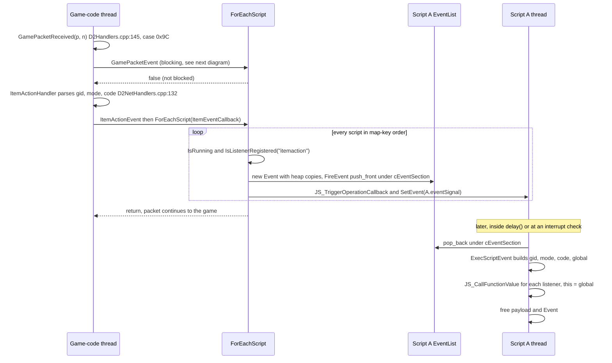
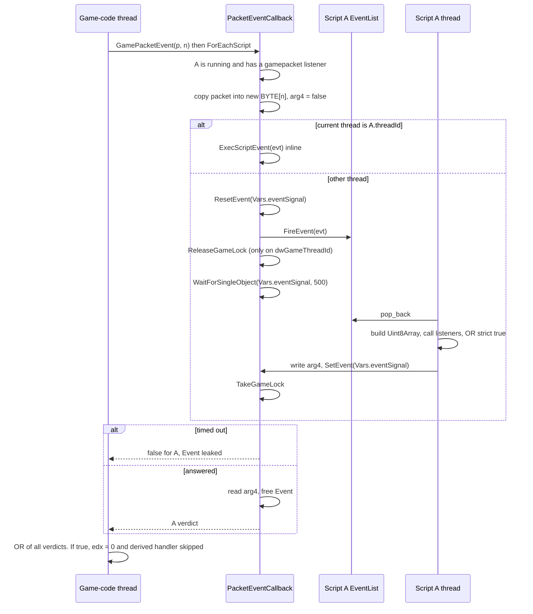

# Events (`addEventListener` catalogue and dispatch)

Scope: every event name a D2BS script can receive through `addEventListener`, including the `*blocker` variants, plus the screen-hook `click`/`hover` callbacks, which travel through the same per-script queue. For each event this page gives the listener signature, the full origin chain (game patch or window message, then handler, then `Fire*Event`), the producing thread, how it is delivered, what the return value does, and how the payload is copied. It then explains the dispatch machinery (`Event`, `ForEachScript`, `FireEvent`, the drain points, the blocking handshake). The registration functions (`addEventListener`, `removeEventListener`, `clearEvent`, `clearAllEvents`) and timers are documented in [globals-core.md](globals-core.md#event-listener-registration); engine-level context and locks are in [../spidermonkey/embedding.md](../spidermonkey/embedding.md#6-events-and-timers-integration). Source of truth is the C++ in the repo root; line numbers are `File.cpp:N`.

## Contents

1. [Summary table](#1-summary-table)
2. [Conventions](#2-conventions)
3. [Input events](#3-input-events): `keydown`, `keyup`, `keydownblocker`, `keyupblocker`, `mouseclick`, `mousemove`
4. [Chat events](#4-chat-events): `chatmsg`, `chatmsgblocker`, `chatinput`, `chatinputblocker`, `whispermsg`, `whispermsgblocker`
5. [Packet events](#5-packet-events): `gamepacket`, `gamepacketsent`, `realmpacket`
6. [Game-state events](#6-game-state-events): `melife`, `memana`, `itemaction`, `gameevent`, `playerassign`
7. [IPC and inter-script events](#7-ipc-and-inter-script-events): `copydata`, `scriptmsg`
8. [Screen-hook callbacks](#8-screen-hook-callbacks): `ScreenHookClick`, `ScreenHookHover`
9. [Reserved, internal and phantom names](#9-reserved-internal-and-phantom-names)
10. [Dispatch mechanics](#10-dispatch-mechanics)
11. [Hook-to-event map](#11-hook-to-event-map)
12. [Facts that constrain an RPC replacement](#12-facts-that-constrain-an-rpc-replacement)
13. [Legacy-doc discrepancies](#13-legacy-doc-discrepancies)
14. [Defects and quirks](#14-defects-and-quirks)
15. [Open questions](#15-open-questions)

---

## 1. Summary table

Thread labels are defined in [§2.1](#21-threads). Delivery: **Q** = queued to the script, the producer does not wait; **B*n*** = queued, and the producer waits up to *n* ms per script for a verdict; **I** = run inline when the producer is already on the listening script's thread.

| Event | Listener args | Origin (hook → producer) | Thread | Delivery | Return effect |
|---|---|---|---|---|---|
| `keydown` | `vk` | WH_KEYBOARD `KeyPress` → `KeyDownUpEvent` (`Events.cpp:80`) | W | Q | ignored |
| `keyup` | `vk` | same | W | Q | ignored |
| `keydownblocker` | `vk` | same | W | B1000 | `true` → keystroke swallowed (hook returns 1) |
| `keyupblocker` | `vk` | same | W | B1000 | **broken**: never dispatched, always times out ([details](#keyupblocker)) |
| `mouseclick` | `button, x, y, up` | WH_MOUSE `MouseMove` → `MouseClickEvent` (`Events.cpp:121`) | W | Q | ignored |
| `mousemove` | `x, y` | WH_MOUSE `MouseMove` → `MouseMoveEvent` (`Events.cpp:141`) | W | Q | ignored |
| `chatmsg` | `nick, msg` | packet 0x26 → `ChatEventHandler`; BNCS 0x0F → `ChatPacketRecv` → `ChatEvent` (`Events.cpp:213`) | G | Q | ignored |
| `chatmsgblocker` | `nick, msg` | same | G | B500 | `true` → in-game 0x26 packet dropped; **ignored out of game** |
| `chatinput` | `"me", msg` | `GameInput` / `ChannelInput` → `ChatInputEvent` (`Events.cpp:218`) | G | Q | ignored |
| `chatinputblocker` | `"me", msg` | same | G | B500 | `true` → typed line not sent (in game and in channel) |
| `whispermsg` | `nick, msg` | `WhisperHandler`; BNCS 0x0F → `WhisperEvent` (`Events.cpp:223`) | G | Q | ignored |
| `whispermsgblocker` | `nick, msg` | same | G | B500 | **ignored on every path** |
| `gamepacket` | `Uint8Array` | `GamePacketReceived` (`D2Handlers.cpp:145`) → `GamePacketEvent` (`Events.cpp:332`) | G (or C) | B500 / I | `true` → packet passed on with size 0; derived events suppressed |
| `gamepacketsent` | `Uint8Array` | `GamePacketSent` (`D2Handlers.cpp:172`) → `GamePacketSentEvent` (`Events.cpp:337`) | G or C | B500 / I | `true` → packet sent with size 0 (see [details](#gamepacketsent)) |
| `realmpacket` | `Uint8Array` | `RealmPacketRecv` (`D2Handlers.cpp:526`) → `RealmPacketEvent` (`Events.cpp:342`) | G | B500 / I | `true` → original MCP handler not called |
| `melife` | `life` | packet 0x18/0x95 → `HPMPUpdateHandler` → `LifeEvent` (`Events.cpp:18`) | G | Q | ignored |
| `memana` | `mana` | same → `ManaEvent` (`Events.cpp:37`) | G | Q | ignored |
| `itemaction` | `gid, mode, code, global` | packets 0x9C/0x9D/0x2A → `ItemActionEvent` (`Events.cpp:265`) | G | Q | ignored |
| `gameevent` | `mode, param1, param2, name1, name2` | packet 0x5A → `EventMessagesHandler` → `GameActionEvent` (`Events.cpp:288`) | G | Q | ignored |
| `playerassign` | `unitId` | `PlayerAssignment_Intercept` → `GamePlayerAssignment` → `PlayerAssignEvent` (`Events.cpp:99`) | G | Q | ignored |
| `copydata` | `mode, msg` | `WM_COPYDATA` → `GameEventHandler` → `CopyDataEvent` (`Events.cpp:243`) | W | Q | ignored (sender always gets `TRUE`) |
| `scriptmsg` | `...values` | `scriptBroadcast()` / `D2BSScript.prototype.send()` | C | Q | ignored |
| hook `click` (`ScreenHookClick`) | `button, x, y` | WH_MOUSE button-down → `Genhook::Click` (`ScreenHook.cpp:214`) | W | B3000 | `true` → button-down message swallowed |
| hook `hover` (`ScreenHookHover`) | `x, y` | `Genhook::Hover` (`ScreenHook.cpp:249`) | — | — | **dead code**: never produced |

---

## 2. Conventions

### 2.1 Threads

| Label | Meaning | Evidence |
|---|---|---|
| **W** | Window thread: the thread that owns the D2 window. It runs the WH_KEYBOARD / WH_MOUSE hook procedures (installed for `GetWindowThreadProcessId(hwnd)`) and the subclassed window procedure. `TimerProc` would also run here (it is a `SetTimer` callback on that window) and records the id as `Vars.dwGameThreadId`; whether it ever runs is an [open question](#15-open-questions), because `InitHooks` (and so `SetTimer`) executes on `D2Thread`, not on W, and the result is never checked. | `Helpers.cpp:176-187`; `D2Handlers.cpp:34`, `D2Handlers.cpp:493-499`; `D2BS.cpp:137` |
| **G** | Game-code thread: whichever thread executes the patched game code at the call site. The source never names it. For 1.14d it is expected, but not proven, to be **W** ([§15](#15-open-questions)). | `Patch.h:8-45` |
| **S** | The listening script's own thread (`CreateThread` in `Script::BeginThread`). All JS listeners run here. | `Script.cpp:104-116` |
| **C** | Caller: the thread of whoever triggered the producer, for example a script thread calling `sendPacket()` or `scriptBroadcast()`. | `JSCore.cpp:569-612`, `JSCore.cpp:532-539` |

### 2.2 Gating, per script

Every `Events.cpp` producer runs `ScriptEngine::ForEachScript(callback, &helper, n)` (`ScriptEngine.cpp:204`), and the callback creates an event for a script only if **both** of these hold:

- `script->IsRunning()`: a context exists, the script is not aborted, not paused, and `hasActiveCX` is set (`Script.cpp:340-342`).
- `script->IsListenerRegistered(name)`: `functions.count(name) > 0` (`Script.cpp:348-350`). A key left with an empty list by `clearEvent(name)` still counts ([globals-core.md](globals-core.md#cleareventname)).

The only script-visible producers that skip these checks are the screen-hook producers (they test only `owner && JSVAL_IS_FUNCTION(owner cx, handler)`, `ScreenHook.cpp:219`) and `D2BSScript.prototype.send`, which tests `IsRunning()` only (`JSScript.cpp:111`). The internal producers skip both checks: `Script::RunCommand` (`Command`, `Script.cpp:92-101`), `ScriptEngine::DisposeScript` (`DisposeMe`, `ScriptEngine.cpp:85-88`) and the timer APC `EventTimerProc` (`ScriptEngine.cpp:837-839`).

No producer filters on `ScriptState`: `InGame`, `OutOfGame` and the console (`Command` state) scripts all receive every event they listen for. The only state-dependent behaviour is on the consumer side (an `InGame` script does not drain while the client is at the menu, [§10.8](#108-script-state-effects)).

Registration state can be resurrected by dispatch: every consumer branch looks its listeners up with `functions[name]` (`std::map::operator[]`, for example `ScriptEngine.cpp:476`). If the last listener of a name was removed with `removeEventListener` (which erases the key, `Script.cpp:395-396`) while an event of that name was still queued, draining that event re-inserts the key with an empty list. From then on `IsListenerRegistered(name)` is true again, so the script keeps receiving that event with no listener to run, and for a blocker name every producer still does the full round-trip to it.

### 2.3 Calling convention and types

- Every listener is called as `JS_CallFunctionValue(cx, JS_GetGlobalObject(cx), fn, argc, argv, &rval)`. So `this` is the script's **global object** for every event, including screen-hook clicks (for example `ScriptEngine.cpp:477`, `ScriptEngine.cpp:674`).
- The call's success flag is ignored everywhere.
- Every listener registered under the name is called, in registration order. There is no stop-propagation.
- Integers are built with `JS_NumberValue(double)` from `DWORD`/`BYTE` copies, so JS sees non-negative numbers, never booleans. This includes `mouseclick`'s `up` (`ScriptEngine.cpp:613`).
- Only `itemaction`'s `global` is a real boolean (`ScriptEngine.cpp:471`).

### 2.4 String encodings

| C source type | Conversion to JS | Effect |
|---|---|---|
| `char*` (nick, item code, `gameevent` name1) | `JS_NewStringCopyZ` | Each byte becomes one UTF-16 code unit (Latin-1 widening). There is no UTF-8 decoding: this JSAPI has no `JS_SetCStringsAreUTF8` and the code never calls one. Non-ASCII account or character names arrive as mojibake. |
| `wchar_t*` (messages, `name2`) | `JS_NewUCStringCopyZ` | Copied as UTF-16. Its origin varies: game UTF-16 (typed input; `gameevent` mode 0x06 locale text from `D2LANG_GetLocaleText`, `D2NetHandlers.cpp:101`), `AnsiToUnicode(..., CP_ACP)` (received chat and whispers and other `gameevent` `name2`s, `D2NetHandlers.cpp:58`, `D2NetHandlers.cpp:123`, `D2Handlers.cpp:466`, `D2Handlers.cpp:537`), or `AnsiToUnicode` with the default `CP_UTF8` (`copydata`, `D2Handlers.cpp:183`; default parameter at `Helpers.h:9`). The same in-game chat line therefore delivers `nick` Latin-1-widened and `msg` decoded with the ANSI code page. |

### 2.5 Return values

A listener "blocks" only by returning the boolean primitive `true` (`JSVAL_IS_BOOLEAN(rval) && JSVAL_TO_BOOLEAN(rval)`, for example `ScriptEngine.cpp:561`). Truthy non-booleans (`1`, `"yes"`, objects) do not block.

Verdicts are combined with OR at two levels:

1. Inside one script, over all of its listeners for the name. All listeners run.
2. Across scripts, in `ForEachScript` (`ScriptEngine.cpp:221-224`). Every script is still asked after one has blocked.

For non-blocking events the return value is discarded.

### 2.6 Payload copying

- At fire time each script gets its **own** heap copy of the payload: `new DWORD(...)`, `_strdup`, `_wcsdup`, `new BYTE[n]` + `memcpy`, or one structured-clone buffer per value.
- On the script thread these are converted again into fresh JS values (`JS_NewStringCopyZ`, `JS_NewUint8Array` + per-element `JS_SetElement`).
- No JS object is shared between scripts or threads. The single exception is the screen-hook handler `jsval`, which is rooted from the window thread ([§8](#8-screen-hook-callbacks)).

---

## 3. Input events

Common origin for keys: `SetWindowsHookEx(WH_KEYBOARD, KeyPress, NULL, mainThread)` (`Helpers.cpp:185`). `KeyPress` (`D2Handlers.cpp:206`) calls `KeyDownUpEvent(wParam, isUp)` (`Events.cpp:80`), which runs `ForEachScript(KeyEventCallback)` (`Events.cpp:42`).

`KeyPress` decodes `lParam` as follows (`D2Handlers.cpp:208-214`):

- `isUp = KF_REPEAT && KF_UP`;
- `isDown = !isUp`;
- `isRepeat = !KF_UP && repeatCount != 1`.

`KeyPress` dispatches to scripts (with a verdict) only if it gets past all of these, in this order:

| Step | Condition | Result | Source |
|---|---|---|---|
| 1 | Alt+F4 | passed to game, no event | `D2Handlers.cpp:220-221` |
| 2 | `Vars.bBlockKeys` (`me.blockKeys`, also forced on during `login()`, `Profile.cpp:112`) | **swallowed, no event** | `D2Handlers.cpp:223-224`; `JSUnit.cpp:551-554` |
| 3 | `VK_HOME` while no chat box or ESC menu is open | console toggle on down, **no event for HOME at all** | `D2Handlers.cpp:226-234` |
| 4 | `VK_ESCAPE` while the console is visible | console hide on down (that key-down is swallowed), no event | `D2Handlers.cpp:235-240` |
| 5 | console prompt enabled | key goes to the console. Exception: `VK_MENU` (Alt) fires `KeyDownUpEvent` for any `code >= 0` and **ignores the verdict** | `D2Handlers.cpp:241-288`, `D2Handlers.cpp:274-277` |
| 6 | `code == HC_ACTION && !isRepeat` and, in game, neither the chat box (`UI_CHAT_CONSOLE`) nor the ESC menu is open | **dispatch**. A `true` verdict makes the hook return 1 | `D2Handlers.cpp:289-291` |

Out of game, the chat-box and ESC-menu states are treated as closed (`D2Handlers.cpp:216-218`).

`KeyEventCallback` does two things for each script, in this order:

1. If `keydown`/`keyup` is registered, it queues that async event.
2. If `keydownblocker`/`keyupblocker` is registered, it queues that event and waits. Because the queue is FIFO, the script's plain `keydown` listeners run before its blocker listeners, and the wait covers both (`Events.cpp:44-75`).

### `keydown`

- **Signature:** `function (vk: number)`. `vk` is the Windows virtual-key code (hook `wParam`).
- **Origin:** `Events.cpp:42` (`KeyEventCallback`) ← `Events.cpp:80` ← `KeyPress` `D2Handlers.cpp:290` (or `D2Handlers.cpp:276` for Alt while the console prompt is enabled) ← WH_KEYBOARD (`Helpers.cpp:185`).
- **Thread:** W. **Delivery:** Q. **Return:** ignored.
- **Payload:** `arg1 = new DWORD(vk)` (`Events.cpp:50`) → `JS_NumberValue` (`ScriptEngine.cpp:640`).
- **Volume:** one per key-down message that passes the gates. `isRepeat` is true only when the message's repeat count differs from 1. Windows normally sends auto-repeat as separate messages with repeat count 1, so holding a key typically produces repeated `keydown` events (inference from the flag logic at `D2Handlers.cpp:212`).

### `keyup`

- **Signature:** `function (vk: number)`.
- **Origin / thread / delivery:** as for `keydown`, with `bUp = isUp = true` (`Events.cpp:44`).
- **Return:** ignored.
- **Quirk:** releases are never filtered as repeats (`isRepeat` requires `KF_UP` to be clear, `D2Handlers.cpp:212`), but they pass the same chat-box / ESC-menu / console / `bBlockKeys` gates as presses. A key pressed before the chat box opened can therefore produce a `keydown` without a matching `keyup`.

### `keydownblocker`

- **Signature:** `function (vk: number) → boolean`.
- **Origin:** `Events.cpp:55-75`, then the same chain as `keydown`.
- **Thread:** W. **Delivery:** B1000. The producer runs `ResetEvent(Vars.eventSignal)`, then `FireEvent`, then `WaitForSingleObject(Vars.eventSignal, 1000)` (`Events.cpp:63-66`).
- **Return:** strict `true` from any listener of any script makes `KeyPress` return 1, which swallows the message (`D2Handlers.cpp:290-291`).
  - On timeout this script's verdict is "not blocked" and the `Event` is leaked (`Events.cpp:66-67`).
  - The consumer writes `*(DWORD*)arg4` (`ScriptEngine.cpp:650-652`); the producer reads it back as `bool*`, i.e. the low byte on x86 (`Events.cpp:69-70`).
- **Payload:** `arg1 = new DWORD(vk)`, `arg4 = new DWORD(false)`. Both are freed by the producer after the verdict (`Events.cpp:71-74`).
- **Stall risk:** the window thread waits without releasing `Vars.cGameLoopSection`, which it holds whenever it is the thread running `TimerProc`/`GameDraw` ([§10.5](#105-thread-and-lock-context-of-producers), [§10.6](#106-blocking-handshake)). A handler that calls a game-lock native (for example `getRoom`, `clickItem`, `getArea`, i.e. anything that uses `AutoCriticalRoom`) stalls until the timeout.

### `keyupblocker`

- **Signature (intended):** `function (vk: number) → boolean`.
- **Produced:** yes, on every key-up for every running script that registered it (`Events.cpp:55`).
- **Dispatched:** **no.** `ExecScriptEvent` has no branch for `"keyupblocker"`; the list at `ScriptEngine.cpp:634-635` names only `keyup`, `keydownblocker`, `keydown`, `memana`, `melife` and `playerassign`.
- **Consequences:**
  - No listener ever runs.
  - `SetEvent(Vars.eventSignal)` is never called, so the window thread **always waits the full 1000 ms per such script**, then treats the key as not blocked (`Events.cpp:66-67`).
  - The `Event`, its name and its payload leak.
- **Legacy docs** call it `keyupblock` (`doc/globalFuncs.h:943`).

### `mouseclick`

- **Signature:** `function (button: number, x: number, y: number, up: number)`.
  - `button`: 0 = left, 1 = right, 2 = middle.
  - `x`, `y`: client coordinates of the D2 window (`ScreenToClient`, `D2Handlers.cpp:298-299`).
  - `up`: `0` for button-down and `1` for button-up. It is a number, not a boolean.
- **Origin:** `MouseClickCallback` `Events.cpp:104` ← `MouseClickEvent` `Events.cpp:121` ← `MouseMove` hook proc `D2Handlers.cpp:313-338` (`WM_{L,R,M}BUTTON{DOWN,UP}`) ← WH_MOUSE (`Helpers.cpp:187`).
- **Thread:** W. **Delivery:** Q. **Return:** ignored. A mouse click can only be blocked through a screen-hook `click` handler ([§8](#8-screen-hook-callbacks)).
- **Gates:**
  - `code == HC_ACTION` (`D2Handlers.cpp:308`);
  - points with `x < 0 || y < 0` are passed straight through (`D2Handlers.cpp:302-303`);
  - `Vars.bBlockMouse` (`me.blockMouse`, `JSUnit.cpp:555-557`; also forced on for the duration of `Profile::login`, `Profile.cpp:112`, `Profile.cpp:294`) swallows everything with no event (`D2Handlers.cpp:305-306`).
  - `Vars.pMouseCoords` is updated before the `bBlockMouse` test, for every hook call that passes the border filter (`D2Handlers.cpp:304`).
- **Not reported:** double-click, wheel and X-button messages (no `case` for them, `D2Handlers.cpp:312-345`).
- **Ordering:** for button-down, `mouseclick` is queued **before** the screen-hook click round-trips (`D2Handlers.cpp:314-317`).

### `mousemove`

- **Signature:** `function (x: number, y: number)` in client coordinates.
- **Origin:** `MouseMoveCallback` `Events.cpp:126` ← `MouseMoveEvent` `Events.cpp:141` ← `MouseMove` hook `D2Handlers.cpp:340-342` (`WM_MOUSEMOVE`) ← WH_MOUSE.
- **Thread:** W. **Delivery:** Q. **Return:** ignored.
- **Filter:** points with `x < 1 || y < 1` are dropped (`Events.cpp:142-143`), so row and column 0 are never reported.
- **Volume:** one event per `WM_MOUSEMOVE` per listening script, with no coalescing. Each costs two `new DWORD`, an `Event`, a `_strdup`, and a leaked `new jsval[2]` (`ScriptEngine.cpp:580`). A busy script accumulates a backlog that delays every later event in its queue, including blocking ones.

---

## 4. Chat events

All six names are produced by `ChatEventCallback` (`Events.cpp:173`) through three front-ends that differ only in `helper->name`:

| Front-end | Line | Name | `nick` |
|---|---|---|---|
| `ChatEvent` | `Events.cpp:213` | `chatmsg` | sender |
| `ChatInputEvent` | `Events.cpp:218` | `chatinput` | **the literal `"me"`** |
| `WhisperEvent` | `Events.cpp:223` | `whispermsg` | sender |

For each script, the callback first queues `<name>` if registered (async). Then, if `<name>blocker` is registered, it queues that event and waits up to 500 ms (`Events.cpp:185-201`). The verdict is read from `*(DWORD*)arg4` (`Events.cpp:203`).

Both variants get `arg1 = _strdup(nick)` and `arg2 = _wcsdup(msg)`. On the script thread they are converted to `(String nick, String msg)` (`ScriptEngine.cpp:552-553`).

### `chatmsg`

- **Signature:** `function (nick: string, msg: string)`.
- **Origin, in game:**
  - Packet `0x26` → `GamePacketReceived` `D2Handlers.cpp:153-154` → `ChatEventHandler` `D2NetHandlers.cpp:55` → `ChatEvent(pName, uc)` `D2NetHandlers.cpp:64`.
  - `pName = p + 10`; message = `p + strlen(pName) + 11`, converted with `CP_ACP` (`D2NetHandlers.cpp:56-58`).
  - The chat-type byte is **not** inspected, so every 0x26 packet fires `chatmsg`.
  - If `Vars.bDontCatchNextMsg` is set, the handler clears it but **still fires** the event (`D2NetHandlers.cpp:61-64`), unlike the input and whisper front-ends, which suppress the event.
  - The handler runs only if no `gamepacket` listener blocked the packet (short-circuit `&&`, `D2Handlers.cpp:154`).
  - Call chain: patch `Patch.h:11` (VA 0x45F802) → `GamePacketReceived_Intercept` `D2Intercepts.cpp:24`.
- **Origin, out of game (Battle.net channel):**
  - BNCS `SID_CHATEVENT` (`pPacket[1] == 0x0F`) → `ChatPacketRecv` `D2Handlers.cpp:530`. The interception passes `pPacket = EBX - 4` and `len = [EBP+8] + 4` (`D2Intercepts.cpp:124-128`), so `pPacket` starts at the 4-byte BNCS header; the event id is the low byte of the DWORD at `+4` (`pPacket[4]`, `D2Handlers.cpp:534-539`).
  - `who = p + 28`, `said = p + 29 + strlen(who)` (`CP_ACP`). `len` is never used, so neither string is bounds-checked.
  - Event ids map to messages as follows (`D2Handlers.cpp:539-555`): `0x02` → `"joined the channel"`, `0x03` → `"left the channel"`, `0x05` (normal), `0x12` (info), `0x13` (error), `0x17` (emote) → `said`.
  - Call chain: patch `Patch.h:26` (VA 0x521B20) → `ChatPacketRecv_Interception` `D2Intercepts.cpp:122`.
- **Thread:** G. **Delivery:** Q. **Return:** ignored.

### `chatmsgblocker`

- **Signature:** `function (nick: string, msg: string) → boolean`.
- **Origin:** as for `chatmsg`.
- **Thread:** G. **Delivery:** B500.
- **Return effect:**
  - **In game:** `ChatEventHandler` returns `!ChatEvent(...)` (`D2NetHandlers.cpp:64`). A `true` verdict makes `GamePacketReceived` return 0, and the intercept then forwards the packet with `edx = 0` (size 0) (`D2Intercepts.cpp:29-34`).
  - **Out of game:** the result of `ChatEvent` is discarded. `blockPacket` is initialised to `false` and never changed (`D2Handlers.cpp:531`, `D2Handlers.cpp:563`), so the producer still waits up to 500 ms per script and then ignores the answer.
- **Stall risk:** as for `keydownblocker`; the game lock is not released during the wait.

### `chatinput`

- **Signature:** `function (nick: "me", msg: string)`. `msg` is the typed line exactly as the game holds it (UTF-16).
- **Origin, in game:** patch `Patch.h:9` (VA 0x47C89D) → `GameInput_Intercept` `D2Intercepts.cpp:75` (`ecx = ebx` = message) → `GameInput` `D2Handlers.cpp:121` → `ChatInputEvent` `D2Handlers.cpp:127`.
- **Origin, in the Battle.net channel:** patch `Patch.h:29` (VA 0x442A61) → `ChannelInput_Intercept` `D2Intercepts.cpp:231` (`ecx = esi`) → `ChannelInput` `D2Handlers.cpp:133` → `ChatInputEvent` `D2Handlers.cpp:139`.
- **Pre-filters,** in this order (`D2Handlers.cpp:124-128`, `D2Handlers.cpp:136-140`):
  1. If `Vars.bDontCatchNextMsg` is set, it is cleared and the line passes with **no event**. `say()` sets this flag before injecting its line (`Core.cpp:93`).
  2. If the line starts with `.` and `ProcessCommand(line + 1, false)` returns true, the line is consumed: it is blocked and **no event** fires. The first space-delimited token is matched case-insensitively (`_wcsicmp`) against `start`, `stop`, `flush`, `load`, `reload`, `exec`, and in DEBUG builds `profile` (`Helpers.cpp:252-313`). DEBUG `crash` divides by zero and never sets the result, so if it survives the line falls through to step 3.
  3. Otherwise `ChatInputEvent` runs.
- **Thread:** G. **Delivery:** Q. **Return:** ignored.

### `chatinputblocker`

- **Signature:** `function (nick: "me", msg: string) → boolean`.
- **Origin:** as for `chatinput`.
- **Thread:** G. **Delivery:** B500.
- **Return effect:** `true` stops the line from being sent, in both front-ends:
  - `GameInput` returns `-1`, and the intercept skips `D2CLIENT_InputCall_I` (`D2Handlers.cpp:130`, `D2Intercepts.cpp:80-88`);
  - `ChannelInput` returns 0, and the intercept skips `D2MULTI_ChannelInput_I` (`D2Handlers.cpp:142`, `D2Intercepts.cpp:238-245`).

### `whispermsg`

- **Signature:** `function (nick: string, msg: string)`.
- **Origins:**
  1. Patch `Patch.h:28` (VA 0x448813, legacy module "D2Multi") → `Whisper_Intercept` `D2Intercepts.cpp:106` (`ecx = ebx` account, `edx = [ebp+8]` text) → `WhisperHandler` `D2Handlers.cpp:464` → `WhisperEvent(szAcc, AnsiToUnicode(text, CP_ACP))` (`D2Handlers.cpp:466-467`). If `Vars.bDontCatchNextMsg` is set, it is cleared and no event fires (`D2Handlers.cpp:465-470`).
  2. BNCS `SID_CHATEVENT` ids `0x04` and `0x0A` → `WhisperEvent(who, said)` (`D2Handlers.cpp:546-549`).
- **Thread:** G. **Delivery:** Q. **Return:** ignored.

### `whispermsgblocker`

- **Signature:** `function (nick: string, msg: string) → boolean`.
- **Origin / thread:** as for `whispermsg`. **Delivery:** B500.
- **Return effect:** **none, on either path.**
  - `WhisperHandler` is `void`; it drops `WhisperEvent`'s result, and `Whisper_Intercept` uses no return value (`D2Handlers.cpp:464-471`, `D2Intercepts.cpp:115-118`).
  - `ChatPacketRecv` discards it too (`D2Handlers.cpp:548`).
  - The producer still waits up to 500 ms per script. Legacy docs claim it blocks (`doc/globalFuncs.h:964-965`).

---

## 5. Packet events

All three are produced by `PacketEventCallback` (`Events.cpp:293`) with `helper->name` set to the event name. For each script that `IsRunning()` and has the listener:

1. Copy the packet: `arg1 = new BYTE[dwSize]` + `memcpy`, `arg2 = new DWORD(dwSize)`, `arg4 = new DWORD(false)` (`Events.cpp:297-304`).
2. Dispatch:
   - **If the current thread is the script's thread** (`GetCurrentThreadId() == evt->owner->threadId`), `ExecScriptEvent(evt, false)` runs **inline**, nested inside whatever native caused the packet (`Events.cpp:306-307`).
   - **Otherwise:**
     1. `ResetEvent(Vars.eventSignal)`;
     2. `FireEvent`;
     3. `ReleaseGameLock()`;
     4. `WaitForSingleObject(Vars.eventSignal, 500)`;
     5. `TakeGameLock()` (`Events.cpp:309-314`).

     The wait result goes into a function-`static DWORD` shared by every thread (`Events.cpp:311`). On timeout the callback returns `false` and leaks the `Event` (`Events.cpp:316-317`).
3. Read `*(DWORD*)arg4` and free everything (`Events.cpp:320-326`).
4. Return `false` for scripts without the listener (`Events.cpp:329`).

`ReleaseGameLock`/`TakeGameLock` leave or re-enter `Vars.cGameLoopSection` only when `Vars.bGameLoopEntered` is set and the current thread is `Vars.dwGameThreadId` (`Events.cpp:347-355`). These are the **only** blocking events that release the game lock while waiting.

On the script thread (`ScriptEngine.cpp:738-775`):

1. Build `JS_NewUint8Array(cx, size)` and fill it byte by byte with `JS_SetElement`.
2. Call each listener with that single argument.
3. OR the strict-`true` returns into `*(DWORD*)arg4`.
4. `SetEvent(Vars.eventSignal)`. This happens on the inline path too.

The consumer does not free the `Event`; the producer owns it.

### `gamepacket`

- **Signature:** `function (bytes: Uint8Array) → boolean`. `bytes[0]` is the packet id; the length is the `dwSize` the game passed.
- **Origin:** patch `Patch.h:11` (`PatchCall`, VA 0x45F802) → `GamePacketReceived_Intercept` `D2Intercepts.cpp:24` (`pushad`, `call GamePacketReceived`) → `GamePacketReceived` `D2Handlers.cpp:145` (`__fastcall`, ecx = packet, edx = size) → `GamePacketEvent` `Events.cpp:332`.
- **Thread:** G. If `getPacket()` (`JSCore.cpp:614`, which calls `D2NET_ReceivePacket`) reaches the same call site, it would be C; this is unverified ([§15](#15-open-questions)).
- **Delivery:** B500, or I on the owner's thread.
- **Return effect:** strict `true` makes `GamePacketReceived` return 0. The intercept then sets `edx = 0` and still calls `D2NET_ReceivePacket_I` with size 0 (`D2Intercepts.cpp:28-39`).
  - **The D2BS-side handlers are skipped as well**, because of the `!GamePacketEvent(...) && Handler(...)` short-circuit (`D2Handlers.cpp:151-166`). So blocking `0x15`/`0x26`/`0x2A`/`0x5A`/`0x18`/`0x95`/`0x9C`/`0x9D`/`0xA7` also suppresses `chatmsg*`, `itemaction`, `gameevent`, `melife` and `memana`, the player-reassign fix-up and the `0xA7` filter.
- **Exceptions and side effects:**
  - Packet `0xAE` never reaches listeners: the process is terminated (`TerminateProcess`, "Warden activity", `D2Handlers.cpp:147-150`).
  - Listeners see packets **before** D2BS mutates them: `ReassignPlayerHandler` zeroes `p[10]` for the local player's `0x15` (`D2NetHandlers.cpp:18-23`).
  - Listeners also see `0xA7` "just portaled" packets that `DelayedStateHandler` then drops (`D2NetHandlers.cpp:173-178`).
- **Volume:** every received game packet (except 0xAE), for every listening script. Each one is a heap copy, a `Uint8Array` built element by element, and a cross-thread round-trip of up to 500 ms per script.

### `gamepacketsent`

- **Signature:** `function (bytes: Uint8Array) → boolean`.
- **Origin:** patch `Patch.h:12` (`PatchJmp`, VA 0x52AE5A, i.e. 0xA bytes into `D2NET_SendPacket(size_t aLen, DWORD arg1, BYTE* aPacket)` at 0x52AE50, `__stdcall`, `D2Ptrs.h:362`) → `GamePacketSent_Interception` `D2Intercepts.cpp:45` (`ecx = [esp+0x22+4+0xC]` = `aPacket`, `edx = [esp+0x22+4+0x4]` = `aLen`; `0x22` = `pushad` + 16-bit `pushf`, and the extra `+4` is the saved `EBP` per [../memory/patches-and-hooks.md](../memory/patches-and-hooks.md#54-gamepacketsent_interception--client--server-game-packets)) → `GamePacketSent` `D2Handlers.cpp:172` → `GamePacketSentEvent` `Events.cpp:337`.
- **Thread:** whoever calls `D2NET_SendPacket`. That is G for game-originated sends, and **C (a script thread)** for natives that send directly: `sendPacket()` (`JSCore.cpp:608`) and the `D2NET_SendPacket` calls in `JSGame.cpp:1250`, `JSGame.cpp:1359`, `JSGame.cpp:1451`, `JSUnit.cpp:787`, `JSUnit.cpp:842`, `JSUnit.cpp:849` and `JSUnit.cpp:1792`.
  - When a script sends, **its own** `gamepacketsent` listeners run inline inside that native (re-entrant JS).
  - The sending script thread then blocks up to 500 ms for **each other** listening script. Because it is not `dwGameThreadId`, no game lock is released.
- **Delivery:** B500 / I.
- **Return effect:** strict `true` makes `GamePacketSent` return 0, and the interception writes 0 into a stack slot at `[esp+0x4+4+2]` before resuming the original code (`D2Intercepts.cpp:52-58`). By the register mapping above this is the length argument, so the packet is sent with length 0. See [../memory/patches-and-hooks.md](../memory/patches-and-hooks.md) for the stack layout.
- **Volume:** every outgoing packet that goes through `D2NET_SendPacket`. Whether `D2CLIENT_SendGamePacket` (`D2Ptrs.h:283`, wrapper `D2Helpers.cpp:955`; used by `SetSkill` `D2Helpers.cpp:253` and `Game.cpp:22`, `Game.cpp:36`) also goes through it is unverified.
- **Branch after the event:** whatever the verdict, the interception ends by re-creating the displaced branch: with the restored flags it either resumes the original code (`jmp D2CLIENT_SendPacket_II`, VA 0x52AE62, `D2Ptrs.h:284`) or returns 0 from `D2NET_SendPacket` itself (`xor eax, eax; pop ebp; ret 0Ch`, `D2Intercepts.cpp:60-67`). Listeners therefore also see calls that the original code rejects on that early-return branch.

### `realmpacket`

- **Signature:** `function (bytes: Uint8Array) → boolean`. These are realm (MCP) server packets. Whether the bytes include the MCP header is not determinable from source.
- **Origin:** patch `Patch.h:39` (`PatchCall`, legacy "D2MCPClient.dll" + 0x4B1AE, VA 0x44B1AE) → `RealmPacketRecv_Interception` `D2Intercepts.cpp:7` → `RealmPacketRecv` `D2Handlers.cpp:526` (`__fastcall`: packet and size are whatever `ECX`/`EDX` hold at the site, `pushad` leaves them untouched) → `RealmPacketEvent` `Events.cpp:342`.
  - `Patch.h:39` is the only active `Patches[]` entry with no trailing comment at all: no `//00xxxxxx-BASE` VA note and no 1.14d note. (Other entries also lack the exact "Updated 1.14d" text, for example `Patch.h:16`, `Patch.h:37`, `Patch.h:42`, `Patch.h:44`, but they carry a VA note.)
  - The interception first tests `esi` (the original handler pointer) and returns without any event when it is null (`D2Intercepts.cpp:9-10`).
- **Thread:** G (out of game). **Delivery:** B500 / I.
- **Return effect:** strict `true` makes `RealmPacketRecv` return 0, and the interception skips `call esi`, so the client never processes the packet (`D2Intercepts.cpp:13-20`).

---

## 6. Game-state events

All are asynchronous (Q) and fire on G. `melife`, `memana`, `itemaction` and `gameevent` fire from inside `GamePacketReceived`, **after** `gamepacket` listeners have declined to block the packet. `playerassign` comes from a separate hook and is not affected by `gamepacket` verdicts.

### `melife`

- **Signature:** `function (life: number)`.
- **Origin:** packets `0x18` and `0x95` → `GamePacketReceived` `D2Handlers.cpp:159-161` → `HPMPUpdateHandler` `D2NetHandlers.cpp:25` → `LifeEvent` `Events.cpp:18` → `LifeEventCallback` `Events.cpp:4`.
- **Value:** `Life = *(WORD*)&p[1]` with bit 15 cleared (`D2NetHandlers.cpp:26-31`).
- **Filtering:** the event fires only when the value differs from a function-`static WORD SaveLife` (initially 0). That variable is shared by all scripts and **never reset between games**, so a new game that starts with the same value fires nothing (`D2NetHandlers.cpp:40-44`).
- **Thread:** G. **Delivery:** Q. **Return:** ignored. **Payload:** `new DWORD`.

### `memana`

- **Signature:** `function (mana: number)`.
- **Origin:** same handler → `ManaEvent` `Events.cpp:37` → `ManaEventCallback` `Events.cpp:23`.
- **Value:** `Mana = *(WORD*)&p[3]`, with bits 15 and 14 cleared, **then doubled** (`D2NetHandlers.cpp:27`, `D2NetHandlers.cpp:32-38`).
- **Filtering:** fires only on change against `static WORD SaveMana` (`D2NetHandlers.cpp:46-50`), which has the same never-reset caveat.
- **Thread / delivery / return:** as for `melife`.

### `itemaction`

- **Signature:** `function (gid: number, mode: number, code: string, global: boolean)`. The argument order is set at `ScriptEngine.cpp:468-471`.
- **Origin A: item world/action packets `0x9C`/`0x9D`.** `GamePacketReceived` `D2Handlers.cpp:162-164` → `ItemActionHandler` `D2NetHandlers.cpp:132` → `ItemActionEvent(gid, code, mode, p[0] == 0x9D)` `D2NetHandlers.cpp:168`.
  - `mode = p[1]`; `gid = *(DWORD*)&p[4]`; `dest = (p[13] & 0x1C) >> 2`.
  - `code` is the first 4 bytes of a bit-shifted `INT64` (`D2NetHandlers.cpp:140-158`):

    | Case | Shift |
    |---|---|
    | `dest` 0 or 2 | `*(INT64*)(p+15) >> 4` |
    | `dest` 3, 4 or 6, and not (`dest == 3` with `mode` 0 or 2): `mode` ∉ {0x0F, 1, 12} | `*(INT64*)(p+17) >> 0x1C` |
    | same, with `mode` ∈ {0x0F, 1, 12} | `*(INT64*)(p+15) >> 4` |
    | `dest == 3` with `mode` 0 or 2 | `*(INT64*)(p+17) >> 5` |
    | any other `dest` | `""` |

  - A trailing space at `code[3]` is cut (`D2NetHandlers.cpp:161-163`).
  - `global` is true for `0x9D`.
- **Origin B: NPC transaction packet `0x2A`.** `D2Handlers.cpp:155-156` → `NPCTransactionHandler` `D2NetHandlers.cpp:71` → `ItemActionEvent(gid, "", 100 + p[2], false)` with `gid = *(DWORD*)(p + 7)`.
  - The source comment gives `p[2]` as `0x00` purchased, `0x01` sold, `0x0C` insufficient gold. JS therefore sees `mode` 100, 101 or 112 and an empty `code`. `100 + p[2]` is passed through the `BYTE Mode` parameter (`Events.cpp:265`), so a `p[2]` of 156 or more would wrap.
- **Thread:** G. **Delivery:** Q. **Return:** ignored. The consumer even computes an (uninitialised) `block` that it never uses (`ScriptEngine.cpp:475-478`).
- **Payload:** `new DWORD(gid)`, `_strdup(code)`, `new DWORD(mode)`, `new bool(global)` (`Events.cpp:255-258`).
- **No gold event:** `GoldDropEvent` is commented out (`D2NetHandlers.cpp:165-167`), so gold drops come through as `itemaction` with `code` `"gld"`. This follows from the handler logic and is not separately tested.

### `gameevent`

- **Signature:** `function (mode: number, param1: number, param2: number, name1: string, name2: string)`.
- **Origin:** packet `0x5A` → `GamePacketReceived` `D2Handlers.cpp:157-158` → `EventMessagesHandler` `D2NetHandlers.cpp:81` → `GameActionEvent` `Events.cpp:288` → `GameActionEventCallback` `Events.cpp:270`.
- **Fields:**
  - `mode = p[1]`, `param1 = *(DWORD*)(p+3)`, `param2 = p[7]` (a BYTE).
  - `name1` is copied from `p+8` with `strcpy_s(name1, 16, ...)`.
  - `name2` is copied from `p+24` with `strcpy_s(name2, 16, ...)`, although its buffer is 28 bytes (`D2NetHandlers.cpp:83-88`). For either field, a source string of 16 or more bytes invokes the CRT invalid-parameter handler (on the game thread) instead of truncating.
- **Rewrites before firing:**

  | `mode` | Condition | Rewrite | Source |
  |---|---|---|---|
  | `0x06` (slain) | `param2` is `UNIT_MONSTER` (1) or `UNIT_OBJECT` (2) | `name2` becomes the localised name: `FillBaseStat("monstats"/"objects", param1, "NameStr"/"Name")` → `D2LANG_GetLocaleText` | `D2NetHandlers.cpp:95-103`; `Constants.h:362-363` |
  | `0x07` (player relation) | a roster entry has `dwUnitId == param1` | `name1` becomes that roster name (the loop does not break, so the last match wins) | `D2NetHandlers.cpp:104-115` |
  | `0x07` | `param2 == 0x03` and `QuitOnHostile` | **`D2CLIENT_ExitGame()` is called before the event fires** | `D2NetHandlers.cpp:110-113` |
  | `0x0A` | `name1` empty | `name1 = "You"` | `D2NetHandlers.cpp:116-119` |

  Otherwise `name2 = AnsiToUnicode(name2, CP_ACP)` (`D2NetHandlers.cpp:122-127`).
- **Types in JS:** `name1` is Latin-1-widened `char*`; `name2` is UTF-16. The mode table is in legacy `doc/globalFuncs.h:973-1022`.
- **Thread:** G. **Delivery:** Q. **Return:** ignored.
- **Payload:** `new BYTE`, two `new DWORD`, `_strdup(name1)`, `_wcsdup(name2)` (`Events.cpp:277-281`).

### `playerassign`

- **Signature:** `function (unitId: number)`.
- **Origin:** patch `Patch.h:14` (`PatchJmp`, VA 0x45E4D5) → `PlayerAssignment_Intercept` `D2Intercepts.cpp:164` (`call D2CLIENT_AssignPlayer_I` (`D2Ptrs.h:250`), `mov ecx, eax`, `call GamePlayerAssignment`) → `GamePlayerAssignment` `D2Handlers.cpp:486` (NULL is ignored) → `PlayerAssignEvent` `Events.cpp:99` → `PlayerAssignCallback` `Events.cpp:85`.
- **Thread:** G. **Delivery:** Q. **Return:** ignored. **Payload:** `new DWORD(dwUnitId)`.
- **Semantics:** the event fires whenever `AssignPlayer_I` returns a non-NULL unit. Whether that covers only the local player or every player unit is not determinable from source.
- **Side effect on the game:** the intercept ends with `RETN` right after `call GamePlayerAssignment` (`D2Intercepts.cpp:168-171`), so the game code gets back whatever `EAX` the D2BS handler chain left, not `AssignPlayer_I`'s return value. Whether the caller uses `EAX` is not determinable from source.

---

## 7. IPC and inter-script events

### `copydata`

- **Signature:** `function (mode: number, msg: string)`.
- **Origin:** another process sends `WM_COPYDATA` to the D2 window → `GameEventHandler` `D2Handlers.cpp:176` (installed by `SetWindowLong(GWL_WNDPROC)`, `Helpers.cpp:176`) → `CopyDataEvent(pCopy->dwData, lpwData)` `D2Handlers.cpp:196` → `CopyDataCallback` `Events.cpp:228`.
- **Reserved modes** (not delivered as events):

  | `dwData` | Action | Source |
  |---|---|---|
  | `0x1337` | Runs the string as console JS (`ScriptEngine::RunCommand`, which queues a `Command` event to the console script), after **spinning `Sleep(100)` inside the WndProc** while `!Vars.bActive \|\| ScriptEngine::GetState() != Running` | `D2Handlers.cpp:184-189` |
  | `0x31337` | `SwitchToProfile` | `D2Handlers.cpp:190-194` |

- **Decoding:** `lpData` is treated as a NUL-terminated **UTF-8** string; `cbData` is ignored (`D2Handlers.cpp:183`, `Helpers.h:9`). `mode` is the full `dwData` as an unsigned number.
- **Thread:** W. **Delivery:** Q.
- **Return:** ignored. The WndProc returns `TRUE` to the sender before any listener runs (`D2Handlers.cpp:200`), so there is no reply channel. `sendCopyData` (`JSCore.cpp:365`) is the outgoing counterpart and encodes UTF-8.
- **Payload:** `new DWORD(mode)`, `_wcsdup(msg)` (`Events.cpp:235-236`).
- See [../architecture.md](../architecture.md#71-inbound-wm_copydata) for the IPC overview.

### `scriptmsg`

- **Signature:** `function (...values)`. Each value is a **structured-clone copy** of what the sender passed, read into the receiver's own runtime (`ScriptEngine.cpp:709-737`).
- **Producers:**
  - `scriptBroadcast(...)` (`JSCore.cpp:532`) → `ScriptBroadcastEvent` `Events.cpp:168` → `BCastEventCallback` `Events.cpp:148`. Every running script with a `scriptmsg` listener receives it, **sender included**. Full details are in [globals-core.md](globals-core.md#scriptbroadcastvalues).
  - `D2BSScript.prototype.send(...)` (`JSScript.cpp:107`) targets one script ([utility-classes.md](utility-classes.md#d2bsscriptprototypesendvalues)). It:
    - checks only `IsRunning()`, not the listener;
    - pushes to the queue directly;
    - calls `TriggerOperationCallback` but **not** `SetEvent(eventSignal)` (`JSScript.cpp:111-127`), so a target sitting in `delay(n)` sees the message only after its wait expires;
    - allocates the `Event` before the `IsRunning` check, so it leaks when the target is not running (`JSScript.cpp:110-112`).
- **Thread:** C (the sender), which does not wait. **Delivery:** Q. **Return:** ignored.
- **Payload:** `argv[i] = new JSAutoStructuredCloneBuffer; write(senderCx, v)`, one copy per recipient, written on the sender's thread with the `write` result unchecked (`Events.cpp:157-161`; same pattern in `JSScript.cpp:118-122`). No structured-clone callbacks are registered anywhere in the code, so host objects (`Unit`, hooks, `File`, …) cannot be sent. The consumer clears and deletes each buffer but never deletes the `evt->argv` pointer array itself (`ScriptEngine.cpp:729-735`), which leaks per recipient.

---

## 8. Screen-hook callbacks

Hook objects (`Frame`, `Box`, `Line`, `Text`, `Image`) take `click` and `hover` handlers, either as constructor arguments or through the `click`/`hover` properties (for example `JSScreenHook.h:25-26`, `JSScreenHook.cpp:156-161`). See [screenhooks.md](screenhooks.md).

These handlers are **not** registered with `addEventListener`. They are stored as an unrooted `jsval` on the C++ `Genhook` (`ScreenHook.cpp:265-292`; the `JS_AddRoot` calls are commented out), and the hook classes have no trace hook (`JSGlobalClasses.cpp:44-62` via `JSCLASS_SPEC`, whose trace slot is `NULL`, `js32.h:163-164`). When they fire, they travel as `Event`s whose `functions` list holds the handler, through the owner script's ordinary queue.

### `ScreenHookClick` (hook `click` handler)

- **Signature:** `function (button: number, x: number, y: number) → boolean`, called with `this` = global, **not** the hook (`ScriptEngine.cpp:665-675`).
  - `button`: 0 = left, 1 = right, 2 = middle.
  - `x`, `y`: client coordinates.
- **Origin:**
  1. WH_MOUSE `MouseMove` on `WM_{L,R,M}BUTTONDOWN` only (`D2Handlers.cpp:313-336`);
  2. `Genhook::ForEachVisibleHook(ClickHook, ...)` (`ScreenHook.cpp:89`), which takes `Genhook::globalSection`, sorts by ascending `zorder` and visits **every** visible hook;
  3. `ClickHook` (`ScreenHook.cpp:34`);
  4. `Genhook::Click` (`ScreenHook.cpp:214`).
- **Filtering:**
  - `IsInRange(pt)` only; `LineHook` is never in range (`ScreenHook.h:296-298`).
  - The hook's `gameState` (in game / out of game) and its automap flag are **not** checked, although drawing checks them (`ScreenHook.cpp:39-44`). Hooks that are not drawn in the current state can still receive clicks.
  - The owner's `IsRunning()` is not checked, so a paused owner times out.
  - `JSVAL_IS_FUNCTION(owner->GetContext(), clicked)` is evaluated on W against the owner's context (`ScreenHook.cpp:219`).
- **Delivery:** B3000, on W.
  1. `ResetEvent(Vars.eventSignal)`;
  2. `new AutoRoot(ownerCx, clicked)`, which calls `JS_AddNamedValueRoot` on the **script's context from the window thread**;
  3. `FireEvent`;
  4. `WaitForSingleObject(Vars.eventSignal, 3000)` (`ScreenHook.cpp:230-236`).

  The wait happens **while `Genhook::globalSection` is held** (`ScreenHook.cpp:91-104`), so a handler that creates or destroys hooks (`Genhook` constructor and destructor take that section, `ScreenHook.cpp:184`, `ScreenHook.cpp:198`) blocks until the timeout. Whatever W holds of the game lock is held as well ([§10.5](#105-thread-and-lock-context-of-producers)). Each in-range hook with a handler costs its own round-trip.
- **Return effect:** strict `true` from any hook makes the hook proc return 1, which swallows the button-down message (`D2Handlers.cpp:347`). The matching button-up is never blocked.
  - On timeout the click counts as not blocked and the `Event` leaks.
  - After a verdict the producer frees the payload and the root, but **not** `evt->name` (`ScreenHook.cpp:237-244`).

### `ScreenHookHover` (hook `hover` handler)

**Never produced.** The only producer call, `Genhook::ForEachVisibleHook(HoverHook, ...)`, is commented out (`D2Handlers.cpp:343`, "they bog down too much").

The dormant code is also broken:

- `new AutoRoot((owner->GetContext(), hovered))` uses the comma operator, so it calls the single-argument constructor, which roots on `ScriptEngine::GetGlobalContext()` (never assigned, `ScriptEngine.cpp:26`) (`ScreenHook.cpp:257`, `AutoRoot.cpp:7-9`).
- The consumer passes `evt->argc + 1` = 3 arguments from a 2-element array (`ScriptEngine.cpp:589-591`).

A `hover` handler on a hook therefore never runs.

---

## 9. Reserved, internal and phantom names

| Name | Status | Facts |
|---|---|---|
| `setTimeout`, `setInterval` | **Shared with timers** | The timer natives register their callbacks under these keys in the same listener map. `addEventListener("setTimeout", f)` makes `f` run on every `setTimeout` expiry; `clearEvent`/`clearAllEvents` silence timers ([globals-core.md](globals-core.md#how-timers-and-event-servicing-work); `ScriptEngine.cpp:776-791`). The timer APC `EventTimerProc` pushes the **same** `Event` object on every tick (`ScriptEngine.cpp:837-839`), and `RemoveDelayedEvent` (run after every `setTimeout` dispatch and by `clearTimeout`/`clearInterval`) ends with a `LeaveCriticalSection(&Vars.cEventSection)` it never entered (`ScriptEngine.cpp:835`), on the lock that guards every event queue. |
| `Command` | Internal | Console line evaluation. Queued by `Script::RunCommand` (`Script.cpp:77-102`) from the console prompt, `.exec`, `WM_COPYDATA 0x1337` or DDE execute. The consumer evaluates `try{ <cmd> } catch (error){print(error)}` (`ScriptEngine.cpp:687-708`). Listeners registered under this name are never called. See [../spidermonkey/embedding.md](../spidermonkey/embedding.md#57-console-command-evaluation). |
| `DisposeMe` | Internal | Queued by `ScriptEngine::DisposeScript` when it is called from another thread (`ScriptEngine.cpp:84-89`; callers are `Shutdown` and `FlushCache` through `ForEachScript`, `ScriptEngine.cpp:150`, `ScriptEngine.cpp:196`). The consumer calls `DisposeScript` on the owner thread, which `delete`s the `Script` from inside the drain loop that is still iterating it (`ScriptEngine.cpp:792-794`, `ScriptEngine.cpp:81-82`, `ScriptEngine.cpp:316`). There is no `clearList` guard, and the `Event` is never freed. A script whose thread has already exited never drains it. Details: [../spidermonkey/embedding.md](../spidermonkey/embedding.md#56-disposal-and-the-jscontext_destroy-path). |
| `ScreenHookClick`, `ScreenHookHover` | Internal | [§8](#8-screen-hook-callbacks). `addEventListener` under these names has no effect (no producer consults the map for them). |
| `golddrop` | **Phantom** | Documented in legacy docs (`doc/globalFuncs.h:955`; `resources/api.html:571`). `GoldDropEvent` is declared (`Events.h:18`) but has **no definition**, and its only call is commented out (`D2NetHandlers.cpp:165-167`). |
| `gamemsg` (legacy "GameMsgEvent") | **Phantom** | `GameMsgEvent` is declared (`Events.h:10`) but has no definition and no caller. It is listed at `resources/api.html:561`. |
| `keydownblock`, `keyupblock` | **Wrong legacy names** | `doc/globalFuncs.h:943-945`. The code fires `keydownblocker`/`keyupblocker` (`Events.cpp:55`). |

Event names are case-sensitive UTF-8 keys. Any other name registers silently and never fires.

---

## 10. Dispatch mechanics

### 10.1 Data structures

| Item | Definition | Notes |
|---|---|---|
| `struct Event` | `Script.h:22-104` | Fields: `owner`; `object` (unused); `functions` (handler list, used only by screen hooks); `argv`/`argc` (clone buffers for `scriptmsg`; `argc` is the producer's `n` for others); `name` (`_strdup`); `arg1`..`arg5` (heap payload, typed by convention per name); `count`. Only `count` is initialised by the constructor. `threadFinished()` (`Script.h:36-103`) is a two-thread cleanup helper that is **never called**. |
| Helper structs | `Events.h:27-80` | Stack-allocated packers passed through `ForEachScript`'s `void*`: `ChatEventHelper`, `CopyDataHelper`, `ItemEventHelper`, `KeyEventHelper`, `GameActionEventHelper`, `Single`/`Double`/`Triple`/`QuadArgHelper`, `BCastEventHelper`, `PacketEventHelper`. |
| Per-script queue | `std::list<Event*> Script::EventList` (`Script.h:206`) | Producers `push_front`, consumers `pop_back`, both under the **process-global** `Vars.cEventSection` (`Script.cpp:421-423`, `ScriptEngine.cpp:317-320`, `D2BS.h:105`). `size()` is read without the lock. The queue is unbounded. The same section is left without being entered by `RemoveDelayedEvent` (`ScriptEngine.cpp:835`, see [§9](#9-reserved-internal-and-phantom-names)). |
| Per-script wake | `HANDLE Script::eventSignal`, manual-reset (`Script.cpp:22`) | Set by `FireEvent`, `Pause`, `Resume`, `Stop` and `RunCommand`; waited on by `delay()` and `SetSkill`. |
| Global verdict signal | `HANDLE Vars.eventSignal`, manual-reset, initially non-signalled: `CreateEventA(false, true, false, nullptr)` in `InitSettings` (`Helpers.cpp:155`, `D2BS.h:76`) | One for the whole process. It is shared by every blocking producer on every thread. |
| Listener map | `Script::functions` (`Script.h:136`) | See [globals-core.md](globals-core.md#listener-storage). |

### 10.2 Production

1. A hook or handler calls a `*Event` front-end in `Events.cpp`, which packs a helper struct on its stack.
2. `ScriptEngine::ForEachScript` (`ScriptEngine.cpp:204-228`):
   1. returns `false` if there are no scripts;
   2. copies `ScriptEngine::scripts` (a `std::map<std::wstring, Script*>`, `ScriptEngine.h:13`) into a `std::vector` under `scriptListLock`, then **releases the lock**;
   3. calls the callback for each script in **map-key order**: `std::wstring` code-unit order over the key `CompileFile` stored, i.e. the lower-cased path exactly as passed in (no slash normalisation), with the console under the key `L"console"` (`ScriptEngine.cpp:35-43`, `ScriptEngine.cpp:131`);
   4. ORs the callbacks' return values, without short-circuiting.

   Because callbacks run against an unlocked snapshot, a script deleted concurrently is a use-after-free.
3. Each callback applies the [§2.2](#22-gating-per-script) gate, allocates an `Event` with its own payload copy, and calls `Script::FireEvent` (`Script.cpp:419-430`):
   1. `push_front` under `cEventSection`;
   2. if the owner `IsRunning()`, call `JS_TriggerOperationCallback(runtime)` (via `TriggerOperationCallback`, `Script.h:171-174`, which is guarded by `hasActiveCX`);
   3. `SetEvent(eventSignal)`.

`ScriptEngine::ExecEventAsync`, `ExecEventOnScript` and `struct EventHelper` are declared (`ScriptEngine.h:63`, `ScriptEngine.h:75-81`) but **never defined or used**. `EventThread` and `callEventFunction` (`Script.h:217-218`) have no definition either; the `EventThread` creation is commented out at `D2BS.cpp:139`. There is no central event thread; every producer works on its own thread.

### 10.3 Drain points (where listeners run)

Listeners run **only on the owner script's thread**, in one of these loops. All three pop from the back (FIFO), then call `ExecScriptEvent(evt, false)` until the queue is empty:

| Drain point | Source | Condition to drain |
|---|---|---|
| Operation callback | `operationCallback` `ScriptEngine.cpp:260`, loop at `ScriptEngine.cpp:315-322` | Runs when the engine services an interrupt after `JS_TriggerOperationCallback`. First it spins in `Sleep(50)` + `JS_MaybeGC` while paused (`ScriptEngine.cpp:304-313`). It drains only if `!(IsAborted() \|\| (state == InGame && ClientState() == ClientStateMenu))`. If that condition fails it returns `JS_FALSE`, which terminates the script's JS. |
| `delay(ms)` | `my_delay` `JSCore.cpp:125`, loop at `JSCore.cpp:138-161` | `WaitForSingleObjectEx(script->eventSignal, remaining, TRUE)`, then `ResetEvent`. It breaks if aborted, then drains under the same `InGame`/menu condition, GCs once 0.5 MB has been allocated since the last GC, and repeats until `ms` has elapsed. `delay(0)` only warns, so nothing drains. The wait is alertable, which is how timer APCs run. |
| `me.setSkill()` wait | `SetSkill` `D2Helpers.cpp:238`, loop at `D2Helpers.cpp:268-282` | 100 ms slices, at most 11 of them. Same drain condition; no abort check. The source comment says it exists to "avoid packet block deadlock". |

Consequences:

- **Pre-emption at arbitrary points.** A listener can run at any interrupt check in the main script (loop back-edges, calls), not only inside `delay()`. D2BS has no guard against re-entrant drains: a listener that calls `delay()`, or runs long enough to be interrupted, drains further events nested inside itself.
- **No delivery while in a native.** A script blocked in a long native (for example `sendClick`'s 3 × `Sleep(100)`, `JSCore.cpp:687-691`, or `join()`) handles nothing, and blocking producers time out.
- **Head-of-line blocking.** A verdict cannot come back before every event queued ahead of it has run.
- **Starvation.** Each drain loop runs until the queue is empty, so a steady stream (for example `mousemove` or `gamepacket`) can keep the main script from progressing.

### 10.4 `ExecScriptEvent`

`ExecScriptEvent(Event*, bool clearList)` (`ScriptEngine.cpp:452-797`) is a chain of `strcmp`s on `evt->name`.

- **When `clearList` is false,** the matching branch:
  1. takes a JS request;
  2. builds the argument vector: a `new jsval[n]` that is **never deleted** in the `itemaction`, `gameevent`, `copydata`, chat, `mousemove`/hover, `mouseclick`, key/`me*`/`playerassign`, `ScreenHookClick` and `scriptmsg` branches; the packet branch uses one stack `jsval` holding a rooted `Uint8Array`, and the timer branch passes `&rval` with `argc` 0;
  3. `JS_AddValueRoot`s each element (the packet branch roots the array object with `JS_AddRoot(cx, &arr)`);
  4. iterates `evt->owner->functions[name]` (screen hooks: `evt->functions`). It uses `operator[]`, which inserts the key if it is missing ([§2.2](#22-gating-per-script)). The list is iterated without `Script::lock` and is not protected against modification from inside the handler.
- **When `clearList` is true** (called from context destruction), most branches free the payload without calling anything; blockers and `ScreenHookClick` are answered `false`. The exceptions (packet events not answered or freed, `Command` and `DisposeMe` executed anyway, `setTimeout` still removed) are in the table below.
- **Ownership:**
  - async events are freed by the consumer;
  - blocking events are freed by the producer once it has the verdict;
  - timer events are freed by `RemoveDelayedEvent`.
- `rval` is uninitialised. If a call fails, it is still tested for "strict `true`" (for example `ScriptEngine.cpp:474-478`).

| Name(s) | Branch | Who frees | Signals `Vars.eventSignal` |
|---|---|---|---|
| `itemaction` | `ScriptEngine.cpp:458` | consumer | no |
| `gameevent` | `ScriptEngine.cpp:492` | consumer | no |
| `copydata` | `ScriptEngine.cpp:522` | consumer | no |
| `chatmsg`, `chatinput`, `whispermsg` / `*blocker` | `ScriptEngine.cpp:546` | consumer / producer | blockers: yes, also when `clearList` |
| `mousemove`, `ScreenHookHover` | `ScriptEngine.cpp:578` | consumer | no |
| `mouseclick` | `ScriptEngine.cpp:606` | consumer | no |
| `keyup`, `keydown`, `memana`, `melife`, `playerassign` / `keydownblocker` | `ScriptEngine.cpp:634` | consumer / producer | `keydownblocker`: yes, also when `clearList` |
| `ScreenHookClick` | `ScriptEngine.cpp:660` | producer | yes, also when `clearList` |
| `Command` | `ScriptEngine.cpp:687` | consumer | no. **No `clearList` check** (`cx` is uninitialised when `clearList`) and **no `return`**, so it falls through to more `strcmp`s on the freed name. |
| `scriptmsg` | `ScriptEngine.cpp:709` | consumer | no |
| `gamepacket`, `gamepacketsent`, `realmpacket` | `ScriptEngine.cpp:738` | producer | yes, but **only when `!clearList`**, so a destroy-drain leaves the producer to time out |
| `setTimeout`, `setInterval` | `ScriptEngine.cpp:776` | `setTimeout`: `RemoveDelayedEvent`, also when `clearList`; `setInterval`: only `clearInterval`/`clearTimeout` (both are `my_clearInterval`, `JSGlobalFuncs.h:41-42`) | no |
| `DisposeMe` | `ScriptEngine.cpp:792` | never (leak); **runs even when `clearList`** and deletes the owning `Script` | no |
| `keyupblocker`, anything else | none (falls off the end, `ScriptEngine.cpp:796`) | never (leak) | no |

### 10.5 Thread and lock context of producers

| Producer thread | Holds `Vars.cGameLoopSection` while waiting? | Why |
|---|---|---|
| W / G (hooks, WndProc, packet handlers) | yes, if this thread is the one that runs `TimerProc`/`GameDraw`; packet events call `ReleaseGameLock()` | Once `bGameLoopEntered` is set, the thread that runs `TimerProc`/`GameDraw` holds the lock all the time apart from short windows inside those two functions (`D2Handlers.cpp:493-504`, `D2Handlers.cpp:410-418`). Before the first such call nobody holds it. Script natives that touch game state take it through `AutoCriticalRoom` (`CriticalSections.h:31-55`), for example `getRoom`, `getPresetUnit(s)`, `clickItem`, `item.shop` and anything that calls `GetLevel` such as `getArea` (`JSRoom.cpp:454`, `JSPresetUnit.cpp:53`, `JSPresetUnit.cpp:136`, `JSGame.cpp:357`, `JSUnit.cpp:1464`, `D2Helpers.cpp:172`, `JSArea.cpp:94`). |
| Script thread (C) | whatever that native holds | `gamepacketsent` fires inside the sending native. If the send happens under `AutoCriticalRoom`, the other scripts' listeners cannot take the game lock while the sender waits. For example `item.shop` calls `D2CLIENT_ShopAction` under the lock (`JSUnit.cpp:1470`, `JSUnit.cpp:1527`); whether that reaches `D2NET_SendPacket` is unverified. |

`ReleaseGameLock` only acts on `Vars.dwGameThreadId`. That variable is written only by `TimerProc`'s first-entry branch (`D2Handlers.cpp:496-499`) and is otherwise 0 (`Vars` is zero-initialised, `D2NetHandlers.cpp:16`). `GameDraw` can set `bGameLoopEntered` without writing it (`D2Handlers.cpp:413-414`), and `TimerProc` may never run at all ([§15](#15-open-questions), `SetTimer` thread), in either case `ReleaseGameLock` is a no-op and the packet events wait with the lock held like every other blocking producer. Details: [../architecture.md](../architecture.md), [../spidermonkey/embedding.md](../spidermonkey/embedding.md#9-locks-and-synchronisation-objects).

### 10.6 Blocking handshake

```
producer (per script, sequential)          consumer (script thread)
---------------------------------          ------------------------
arg4 = new DWORD(false)
ResetEvent(Vars.eventSignal)
FireEvent(evt)            ───────────────▶ pop_back → ExecScriptEvent
[packets only: ReleaseGameLock()]          call listeners, OR strict true
WaitForSingleObject(Vars.eventSignal, T)   *(DWORD*)arg4 = block
                          ◀─────────────── SetEvent(Vars.eventSignal)
[packets only: TakeGameLock()]
timeout → return false (Event leaked)
else    → read arg4, free Event, return block
```

| Event | T (ms) | Source | Same-thread shortcut | Game lock released |
|---|---|---|---|---|
| `keydownblocker`, `keyupblocker` | 1000 | `Events.cpp:66` | no | no |
| `chatmsgblocker`, `chatinputblocker`, `whispermsgblocker` | 500 | `Events.cpp:200` | no | no |
| `gamepacket`, `gamepacketsent`, `realmpacket` | 500 | `Events.cpp:313` | **yes** (`Events.cpp:306-307`) | yes, if on `dwGameThreadId` |
| `ScreenHookClick` | 3000 | `ScreenHook.cpp:235` | no | no (and `Genhook::globalSection` is held) |

Properties:

- **Cost.** Scripts are asked one after another, so the worst-case stall of the producing thread per input or packet is (number of scripts with the listener) × T. A registered-but-busy script costs T on every event.
- **A single global signal (race).** Every blocking producer on every thread shares `Vars.eventSignal`. Sequence of the race:
  1. A producer times out on script A and moves on.
  2. A finishes late and calls `SetEvent`.
  3. That wakes the *next* wait, for a different event, early. The producer reads that event's `arg4` (still `false`) and frees it while it is still queued.
  4. The script thread later pops the freed `Event` (use-after-free).

  Concurrent producers (W firing a key blocker while a script thread fires `gamepacketsent`) wake each other in the same way. The inline packet path also calls `SetEvent` (`ScriptEngine.cpp:765`).
- **Timeout result.** A timed-out verdict is "not blocked". The listener still runs later, after the input or packet has already been processed.
- **Self-wait.** The non-packet blockers have no same-thread shortcut. A blocker produced on the listening script's own thread could never be answered within its own wait. The source does not show such a path today; see the open question on `getPacket`-derived chat events.

### 10.7 Ordering guarantees

- **Within one script:** FIFO per queue (`push_front`/`pop_back`). `Command` events share that queue. Nested drains ([§10.3](#103-drain-points-where-listeners-run)) can make a later event *finish* before an earlier listener returns.
- **Within one producer call:** scripts are visited in map-key order. For async events this fixes only the order of enqueueing; every script runs on its own thread, so there is no cross-script execution order. For blocking events, script N+1 is asked only after script N has answered or timed out.
- **Async vs blocker in one callback:** the plain event is queued before its blocker, so it runs first in that script (`Events.cpp:45-65`, `Events.cpp:175-198`).
- **Across producers:** there is no ordering between events from different threads (for example `mousemove` from W and `gamepacket` from G), beyond whatever order the pushes into `cEventSection` happen in.
- **Listeners of one name:** registration order. Every listener runs.

### 10.8 Script state effects

| State | Effect on events | Source |
|---|---|---|
| Not started yet (`hasActiveCX` false) | Nothing is queued. `hasActiveCX` becomes true just before top-level code runs, so listeners added at top level start receiving immediately. | `Script.cpp:174-177` |
| Paused (`isPaused`) | `IsRunning()` is false, so gated events are **dropped, not queued**. Ungated ones are still queued: screen-hook clicks (which then time out), timer ticks, `Command` and `DisposeMe` ([§2.2](#22-gating-per-script)). While paused, the operation callback spins in `Sleep(50)` without draining. `delay()` has no pause check: a script paused while inside `delay()` keeps popping queued events there (`JSCore.cpp:138-151`), and each listener's JS then stops at the pending operation callback (plausible: `Pause` triggers it, `Script.cpp:220`). | `Script.cpp:217-222`, `Script.cpp:340-342`, `ScriptEngine.cpp:304-313` |
| `InGame` script while the client is at the menu | Queued (if not aborted) but **not drained**; the operation callback returns false, which kills the script's JS. `GameLeave` normally stops such scripts first (`StopIngameScript`, `D2Handlers.cpp:520`). | `ScriptEngine.cpp:315-326` |
| Stopping / aborted (`isAborted`) | Gated producers queue nothing new; the ungated ones still can ([§2.2](#22-gating-per-script)). `delay()` breaks out before draining and the operation callback returns false without draining. Already-queued events are handled by the context-destruction drain (next row). | `Script.cpp:251-280`, `JSCore.cpp:142-143`, `ScriptEngine.cpp:315-326` |
| `main()` returned | The thread exits. `hasActiveCX` stays true, so `IsRunning()` stays true. With the default `DisableCache=true` (`Helpers.cpp:124`) the script is disposed on its own thread immediately (`Script.cpp:480-481`). With `DisableCache=false` it **stays in the map and keeps receiving events that nobody drains**: blocking producers pay the full timeout every time and the queue grows without bound. A script must loop (`while (true) delay(...)`) to keep handling events. | `Script.cpp:192-210` |
| Context destroyed | `contextCallback(JSCONTEXT_DESTROY)` clears `hasActiveCX` and drains the queue with `clearList = true`. Chat and keydown blockers and `ScreenHookClick` are answered `false`. Packet events are **not** answered (the producer times out). `keyupblocker` leaks. A pending `DisposeMe` is **executed** (no `clearList` guard), which on the owner thread `delete`s the `Script` already being destroyed. A pending `Command` dereferences an uninitialised `cx`. It then calls `ClearAllEvents()` and `Genhook::Clean(script)`. | `ScriptEngine.cpp:376-389`, `ScriptEngine.cpp:792-794` |

### 10.9 Sequence diagrams

Async event (`itemaction` from packet 0x9C):



Blocking event (`gamepacket`, producer on the game thread):



---

## 11. Hook-to-event map

VA = 0x400000 + offset; `GetDllOffset` ignores the module name and resolves against `GetModuleHandle(NULL)` (`Offset.cpp:21-28`). Patch mechanics are in [../memory/patches-and-hooks.md](../memory/patches-and-hooks.md).

| Trigger | Entry | D2BS handler | Events |
|---|---|---|---|
| `Patch.h:9` `PatchCall` VA 0x47C89D | `GameInput_Intercept` `D2Intercepts.cpp:75` | `GameInput` `D2Handlers.cpp:121` | `chatinput`, `chatinputblocker` |
| `Patch.h:11` `PatchCall` VA 0x45F802 | `GamePacketReceived_Intercept` `D2Intercepts.cpp:24` | `GamePacketReceived` `D2Handlers.cpp:145` | `gamepacket`, then `chatmsg`/`chatmsgblocker` (0x26), `itemaction` (0x2A, 0x9C, 0x9D), `gameevent` (0x5A), `melife`/`memana` (0x18, 0x95) |
| `Patch.h:12` `PatchJmp` VA 0x52AE5A | `GamePacketSent_Interception` `D2Intercepts.cpp:45` | `GamePacketSent` `D2Handlers.cpp:172` | `gamepacketsent` |
| `Patch.h:14` `PatchJmp` VA 0x45E4D5 | `PlayerAssignment_Intercept` `D2Intercepts.cpp:164` | `GamePlayerAssignment` `D2Handlers.cpp:486` | `playerassign` |
| `Patch.h:26` `PatchCall` VA 0x521B20 | `ChatPacketRecv_Interception` `D2Intercepts.cpp:122` | `ChatPacketRecv` `D2Handlers.cpp:530` | `chatmsg`, `whispermsg` (+ blockers, verdict ignored) |
| `Patch.h:28` `PatchCall` VA 0x448813 | `Whisper_Intercept` `D2Intercepts.cpp:106` | `WhisperHandler` `D2Handlers.cpp:464` | `whispermsg` (+ blocker, verdict ignored) |
| `Patch.h:29` `PatchCall` VA 0x442A61 | `ChannelInput_Intercept` `D2Intercepts.cpp:231` | `ChannelInput` `D2Handlers.cpp:133` | `chatinput`, `chatinputblocker` |
| `Patch.h:39` `PatchCall` VA 0x44B1AE | `RealmPacketRecv_Interception` `D2Intercepts.cpp:7` | `RealmPacketRecv` `D2Handlers.cpp:526` | `realmpacket` |
| `SetWindowsHookEx(WH_KEYBOARD)` `Helpers.cpp:185` | — | `KeyPress` `D2Handlers.cpp:206` | `keydown`, `keyup`, `keydownblocker`, `keyupblocker` |
| `SetWindowsHookEx(WH_MOUSE)` `Helpers.cpp:187` | — | `MouseMove` `D2Handlers.cpp:296` | `mouseclick`, `mousemove`, hook `click` |
| `SetWindowLong(GWL_WNDPROC)` `Helpers.cpp:176` | — | `GameEventHandler` `D2Handlers.cpp:176` | `copydata` |
| JS `scriptBroadcast` / `D2BSScript.prototype.send` | `JSCore.cpp:532`, `JSScript.cpp:107` | `ScriptBroadcastEvent` `Events.cpp:168` | `scriptmsg` |

---

## 12. Facts that constrain an RPC replacement

These are facts only; the synthesis is in [../rpc-considerations.md](../rpc-considerations.md).

- **Synchronous verdicts exist only for 7 effective sources:** `keydownblocker`, `chatmsgblocker` (in game only), `chatinputblocker`, `gamepacket`, `gamepacketsent`, `realmpacket` and hook `click`. `keyupblocker` and `whispermsgblocker` currently have no effect. Every verdict is answered from inside a game hook that waits at most 500 to 3000 ms per listening script (per in-range hook for screen-hook clicks), one script after another. A networked API would have to answer within that budget, or the blocking hooks would have to become local rules or filters.
- **All other events are fire-and-forget,** with per-recipient copies of plain data (numbers, strings, byte arrays, structured-clone values). They map directly onto a message stream.
- **Producers run on the window/game thread and on script threads.** Several of them can wait while the game lock is held ([§10.5](#105-thread-and-lock-context-of-producers)), so anything that answers a verdict must not need game state.
- **Payload snapshots are taken at fire time,** on the producer thread. Strings are converted with lossy code pages (§2.4). Packets are raw bytes, before D2BS's own handlers mutate or drop them.
- **There is no event id, timestamp, sequence number or acknowledgement** anywhere in the pipeline. Ordering is per-recipient FIFO only.
- **Hidden coupling:**
  - packet blocking suppresses the derived events;
  - `say()` uses a global one-shot flag that suppresses the next `chatinput`/whisper, unless an incoming 0x26 chat packet consumes it first without suppressing anything (`Core.cpp:93`, `D2NetHandlers.cpp:61-62`);
  - `QuitOnHostile` exits the game before `gameevent` fires;
  - the `HPMP` de-duplication state is global.

---

## 13. Legacy-doc discrepancies

| Legacy docs | Code |
|---|---|
| `keyupblock`, `keydownblock` (`doc/globalFuncs.h:943-945`, `README.md:995-997`) | `keyupblocker`, `keydownblocker` (`Events.cpp:55`). `keyupblocker` is never dispatched (`ScriptEngine.cpp:634-635`). |
| `golddrop (gId, Mode)` (`doc/globalFuncs.h:955`, `README.md:1007`); `GoldDropEvent` in `resources/api.html:571` | Not implemented (`Events.h:18` has no definition; `D2NetHandlers.cpp:165-167` commented). |
| `GameMsgEvent` (`resources/api.html:561`) | Declared only (`Events.h:10`). |
| `mouseclick (button, x, y, bool bUp)` (`doc/globalFuncs.h:949`) | `bUp` is a number, 0 or 1 (`Events.cpp:122`, `ScriptEngine.cpp:613`). |
| `copydata (int32_t dwMode, ...)` (`doc/globalFuncs.h:967`) | Unsigned `DWORD` → non-negative number (`ScriptEngine.cpp:526`). Modes `0x1337`/`0x31337` are reserved (`D2Handlers.cpp:184-194`). |
| `gameevent (BYTE mode, DWORD param1, DWORD param2, ...)` (`doc/globalFuncs.h:971`) | `param2` is a BYTE from `p[7]` (`D2NetHandlers.cpp:85`). `name1`/`name2` are rewritten per mode (§6). |
| `gameevent` mode `0x06`: "Param2 = Unit Type of Slayer (0x00 = Player, 0x01 = NPC)" (`doc/globalFuncs.h:985-987`) | The code also treats `param2 == 2` (`UNIT_OBJECT`) as a table lookup, in `objects.txt` (`D2NetHandlers.cpp:91-100`, `Constants.h:362-363`). |
| `chatmsgblocker`/`whispermsgblocker` "Returns true to block event from Diablo II" (`doc/globalFuncs.h:959-965`) | `whispermsgblocker` never blocks; `chatmsgblocker` blocks only in game (§4). |
| `scriptBroadcast` "to all other scripts" (`doc/globalFuncs.h:1081`) | The sender is included (`Events.cpp:151`; `ScriptEngine.cpp:204-224` iterates every script). |
| `resources/api.html` `ItemActionEvent`: "global … everyone in game got the same event" (`resources/api.html:813`) | `global` simply means "packet id was 0x9D" (`D2NetHandlers.cpp:168`). NPC transactions arrive as `mode` 100+ with `code ""` (`D2NetHandlers.cpp:76`), which is undocumented. |
| Not in any legacy doc | `chatinput`, `chatinputblocker`, `gamepacket`, `gamepacketsent`, `realmpacket`, `keyupblocker`/`keydownblocker` (correct spelling), and the screen-hook click blocking semantics. |

---

## 14. Defects and quirks

Each item is labelled as a bug, a quirk or a behaviour; "plausible" marks a consequence that is inferred rather than shown directly by the source.

1. **`keyupblocker` (bug):** no consumer branch, so a 1000 ms stall per key-up per registering script, plus a leak (`ScriptEngine.cpp:634-635`, `Events.cpp:55-67`).
2. **`whispermsgblocker` (bug):** no effect on either path, yet it still stalls up to 500 ms (`D2Handlers.cpp:464-471`, `D2Handlers.cpp:548`). Out-of-game `chatmsgblocker` results are likewise discarded (`D2Handlers.cpp:531`, `D2Handlers.cpp:563`).
3. **One process-wide `Vars.eventSignal` for every verdict (race).** A late reply after a timeout, or a concurrent producer, releases the wrong waiter, which frees an `Event` that is still queued, followed by a use-after-free on the script thread (`Helpers.cpp:155`; `Events.cpp:63`, `Events.cpp:197`, `Events.cpp:309`; `ScreenHook.cpp:230`; `ScriptEngine.cpp:569`, `ScriptEngine.cpp:652`, `ScriptEngine.cpp:683`, `ScriptEngine.cpp:765`).
4. **`static DWORD result` in `PacketEventCallback` (race)** is shared by concurrent producer threads (`Events.cpp:311`).
5. **Timed-out blocking events are leaked (bug)** (`Events.cpp:66-67`, `Events.cpp:200-201`, `Events.cpp:316-317`; `ScreenHook.cpp:235-236`).
6. **Packet events are not answered during context destruction (bug)** (`ScriptEngine.cpp:740`), so the producer always times out.
7. **`Command` branch (bug):** no `clearList` guard, so `cx` is uninitialised (`ScriptEngine.cpp:453-456`, `ScriptEngine.cpp:694`). There is no `return`, so `strcmp` runs on the freed name (`ScriptEngine.cpp:706-709`).
8. **Every dispatch except the packet and timer branches leaks its `new jsval[n]` (bug)** (`ScriptEngine.cpp:465`, `ScriptEngine.cpp:494`, `ScriptEngine.cpp:524`, `ScriptEngine.cpp:550`, `ScriptEngine.cpp:580`, `ScriptEngine.cpp:608`, `ScriptEngine.cpp:638`, `ScriptEngine.cpp:663`, `ScriptEngine.cpp:713`).
9. **Unchecked `JS_CallFunctionValue` with an uninitialised `rval` (bug).** A throwing blocker listener yields an undefined verdict (`ScriptEngine.cpp:474-478`, `ScriptEngine.cpp:558-561`, `ScriptEngine.cpp:642-645`, `ScriptEngine.cpp:671-675`, `ScriptEngine.cpp:758-761`).
10. **Unlocked listener map and iteration (race).**
    - `IsListenerRegistered` reads `std::map` from producer threads without `Script::lock` (`Script.cpp:348-350`).
    - Dispatch iterates `functions[name]` without a lock, and `removeEventListener`/`clearEvent` inside a handler invalidates the iterator (`ScriptEngine.cpp:476`; `Script.cpp:378-410`).
    - Dispatch's `operator[]` re-inserts a key that `removeEventListener` erased, so a removed event name can stay "registered" with no listeners ([§2.2](#22-gating-per-script)).
11. **`ForEachScript` calls producers on an unlocked snapshot (race):** use-after-free if a script is disposed concurrently (`ScriptEngine.cpp:210-224`).
12. **Blocking producers on W/G do not release `cGameLoopSection` (which they hold when they are the `TimerProc`/`GameDraw` thread), so handlers that need the game lock stall until timeout (quirk).** Only packet events release it, and only when `Vars.dwGameThreadId` was recorded (`Events.cpp:312-314`, `Events.cpp:347-355`; `D2Handlers.cpp:413-414`, `D2Handlers.cpp:496-499`).
13. **Screen-hook clicks:**
    - the producer waits 3000 ms holding `Genhook::globalSection` (`ScreenHook.cpp:89-104`, `ScreenHook.cpp:235`);
    - it roots and unroots the handler on the script's context from the window thread (`ScreenHook.cpp:231`, `ScreenHook.cpp:243`);
    - the handler `jsval` is otherwise unrooted and untraced, so a handler held only by the hook can be collected (plausible; `ScreenHook.cpp:265-292`);
    - `gameState`/automap are ignored for hit-testing (`ScreenHook.cpp:214-216` vs `ScreenHook.cpp:39-44`);
    - every in-range hook is asked;
    - `evt->name` leaks (`ScreenHook.cpp:224`, `ScreenHook.cpp:237-244`);
    - a paused owner still gets queued events (`ScreenHook.cpp:219`).
14. **`hover` handlers are dead** (`D2Handlers.cpp:343`). The dormant code roots on a NULL global context through the comma operator (`ScreenHook.cpp:257`) and passes 3 arguments from a 2-element array (`ScriptEngine.cpp:591`).
15. **`D2BSScript.prototype.send()` (bug):** no `SetEvent` (latency of up to the target's remaining `delay`), no listener check, and an `Event` leak when the target is not running (`JSScript.cpp:110-127`).
16. **Derived events depend on `gamepacket` verdicts (behaviour):** blocking a packet silently suppresses `chatmsg*`, `itemaction`, `gameevent`, `melife` and `memana` (`D2Handlers.cpp:151-166`).
17. **`melife`/`memana` de-duplication (quirk)** uses function-static state that is never reset between games (`D2NetHandlers.cpp:40-50`).
18. **`gameevent` (quirk):**
    - `QuitOnHostile` exits the game before the event (`D2NetHandlers.cpp:110-113`);
    - `strcpy_s(name1, 16, ...)` and `strcpy_s(name2, 16, ...)` (the latter into a 28-byte buffer) abort on a source of 16 bytes or more instead of truncating (`D2NetHandlers.cpp:86-88`);
    - `localeId` is used uninitialised if `FillBaseStat` fails (`D2NetHandlers.cpp:99-101`).
19. **`bDontCatchNextMsg` (quirk)** is a single global flag consumed by whichever of `GameInput`, `ChannelInput`, `ChatEventHandler` or `WhisperHandler` sees it first. If `say()`'s injected line does not pass through the input hook, the next whisper is dropped (plausible; `Core.cpp:93`, `D2Handlers.cpp:124-125`, `D2Handlers.cpp:136-137`, `D2Handlers.cpp:465-470`, `D2NetHandlers.cpp:61-62`).
20. **Alt key while the console prompt is enabled (quirk):** dispatched for any hook `code >= 0`, including `HC_NOREMOVE`, with the verdict ignored (`D2Handlers.cpp:274-277`).
21. **Finished scripts with `DisableCache=false` (bug):** they keep `IsRunning()` true and accumulate undrained events, and blocking producers pay the full timeout (`Script.cpp:174-210`, `Script.cpp:340-342`, `Script.cpp:480-481`).
22. **Dead declarations:** `ScriptEngine::ExecEventAsync`, `ExecEventOnScript`, `EventHelper` (`ScriptEngine.h:63`, `ScriptEngine.h:75-81`), `EventThread`, `callEventFunction` (`Script.h:217-218`), `Event::threadFinished` (`Script.h:36-103`), `GameMsgEvent`/`GoldDropEvent` (`Events.h:10`, `Events.h:18`).
23. **`RealmPacketRecv` patch (stale data?):** it is the only active `Patches[]` entry with no VA comment and no 1.14d annotation (`Patch.h:39`).
24. **`DisposeMe` (bug):** the consumer deletes the `Script` from inside the drain loop that keeps using it, runs even during the `clearList` drain of `~Script`, and is never freed; a script thread that has exited never drains it (`ScriptEngine.cpp:81-89`, `ScriptEngine.cpp:316`, `ScriptEngine.cpp:792-794`).
25. **Unbalanced `LeaveCriticalSection(&Vars.cEventSection)` (bug)** in `RemoveDelayedEvent`, after every `setTimeout` dispatch and every `clearTimeout`/`clearInterval` (`ScriptEngine.cpp:787`, `ScriptEngine.cpp:835`). It corrupts the lock that serialises every event queue ([globals-core.md](globals-core.md#how-timers-and-event-servicing-work)).
26. **`scriptmsg` pointer array leak (bug):** `evt->argv` (`new JSAutoStructuredCloneBuffer*[argc]`) is never deleted (`Events.cpp:157`, `JSScript.cpp:118`, `ScriptEngine.cpp:729-735`).
27. **`playerassign` intercept clobbers `EAX` (quirk, plausible):** the game gets back the D2BS handler's `EAX` instead of `AssignPlayer_I`'s result (`D2Intercepts.cpp:168-171`).

---

## 15. Open questions

1. Which OS thread executes each patched call site (VA 0x45F802, 0x45E4D5, 0x448813, 0x442A61, 0x47C89D, 0x521B20, 0x44B1AE) in 1.14d? The source only proves that the hooks and the WndProc run on the window thread (**W**). Whether **G** = **W** for each site needs disassembly or runtime tracing.
2. Does `getPacket()` → `D2NET_ReceivePacket` (VA 0x52AEB0, `D2Ptrs.h:363`) reach the 0x45F802 call site?
   - If it does, `gamepacket` and the derived events fire on the calling script's thread.
   - In that case `chatmsgblocker` produced there for the same script would wait out its full 500 ms (there is no same-thread shortcut in `ChatEventCallback`).
3. Does `D2CLIENT_SendGamePacket` (VA 0x478350) go through `D2NET_SendPacket` and therefore fire `gamepacketsent`?
4. What exactly does `realmpacket` receive (header included? `dwSize` semantics?), and is the `Patch.h:39` offset valid for 1.14d?
5. Do in-game whispers also arrive as packet `0x26`? `ChatEventHandler` ignores the chat-type byte, so if they do, the same whisper would fire both `chatmsg` and `whispermsg`. Do out-of-game whispers trigger both the 0x448813 hook and the BNCS path?
6. What happens to an exception thrown by a listener? `ExecScriptEvent` neither reports nor clears it after `JS_CallFunctionValue` fails, and the pending exception may surface in the interrupted main code. Can the SpiderMonkey 22 operation callback re-enter itself during a nested drain?
7. Do `melife`/`memana` values (raw `WORD` bit manipulation, `D2NetHandlers.cpp:26-38`) equal `me.hp`/`me.mp`?
8. For messages posted by `sendClick`/`sendKey` (`PostMessage`, `D2Helpers.cpp:305-333`), do the hooks see them, and does `mouseclick` report the posted coordinates or the real cursor position (`MOUSEHOOKSTRUCT.pt`)?
9. Which units does `D2CLIENT_AssignPlayer_I` assign, and so when exactly does `playerassign` fire?
10. What does a non-cloneable `scriptBroadcast` value do on the sender and on the receiver? (Shared with [globals-core.md](globals-core.md#open-questions).)
11. Does `TimerProc` ever run? `SetTimer(D2GFX_GetHwnd(), 1, 0, TimerProc)` is called from `InitHooks` on `D2Thread` (`Helpers.cpp:180`, `D2Handlers.cpp:34`, `D2BS.cpp:137`), while Win32 documents that the window passed to `SetTimer` must be owned by the calling thread; the result (`Vars.uTimer`) is never checked. If the call fails, `Vars.dwGameThreadId` stays 0, so `ReleaseGameLock`/`TakeGameLock` never act, and the game lock is only cycled by the in-game `GameDraw` path (`D2Handlers.cpp:410-418`). Needs a runtime check.
12. Is BNCS chat event id `0x0A` (mapped to `whispermsg` together with `0x04`, `D2Handlers.cpp:546-549`) an incoming or an outgoing whisper? The source comment only says "whispers".
