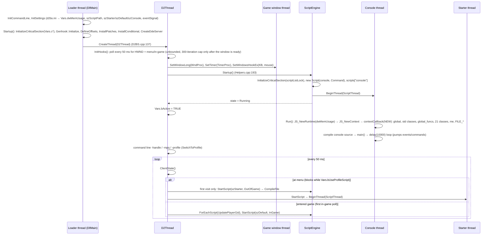
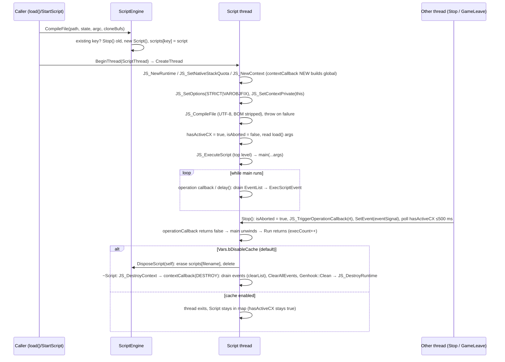
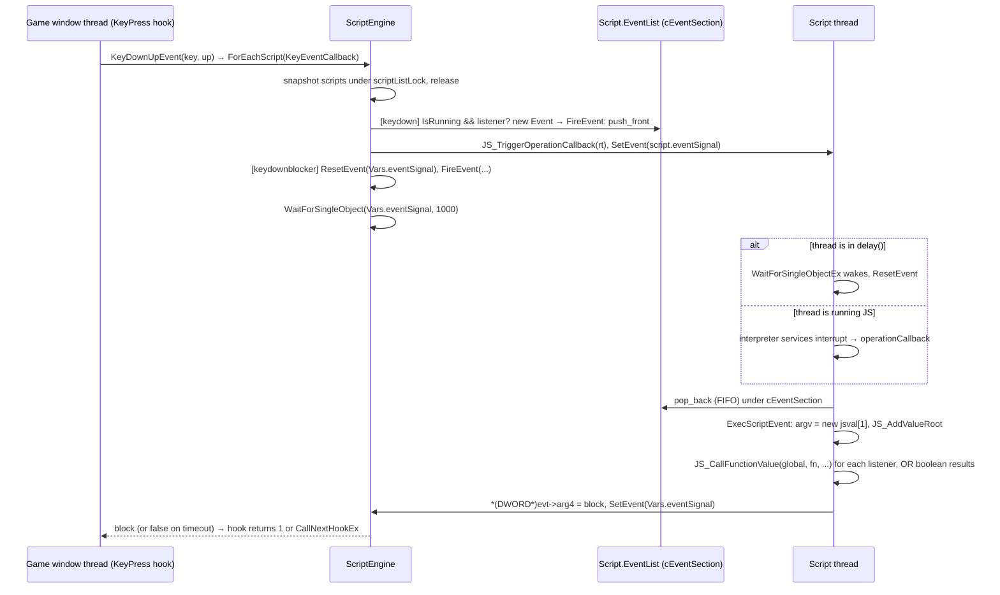

# SpiderMonkey embedding

Scope: how D2BS embeds Mozilla SpiderMonkey, and therefore what a replacement has to take over: the engine version and dialect, the runtime/context/thread topology, how the global object is built, the binding macros, the script lifecycle (`ScriptEngine` / `Script`), how events and timers reach a script, GC and rooting, the `Sandbox` class, and every lock the engine touches. Everything here comes from the C++ in the repo root and the headers in `dependencies/include`. A claim that the source can't settle is listed under [Open questions](#13-open-questions). The per-function API catalogue is in [`../js-api/`](../js-api/README.md), the full JSAPI symbol list in [`jsapi-inventory.md`](jsapi-inventory.md), and process-wide threads and config in [`../architecture.md`](../architecture.md).

## Contents

1. [Version and build](#1-version-and-build)
2. [Runtime / context / thread topology](#2-runtime--context--thread-topology)
3. [Global object setup](#3-global-object-setup)
4. [Binding machinery (`js32.h` / `js32.cpp` / `AutoRoot`)](#4-binding-machinery)
5. [Script lifecycle](#5-script-lifecycle)
6. [Events and timers integration](#6-events-and-timers-integration)
7. [GC, rooting and thread rules](#7-gc-rooting-and-thread-rules)
8. [Sandbox](#8-sandbox)
9. [Locks and synchronisation objects](#9-locks-and-synchronisation-objects)
10. [Removal impact checklist](#10-removal-impact-checklist)
11. [Defects and quirks (engine level)](#11-defects-and-quirks-engine-level)
12. [Legacy-doc discrepancies](#12-legacy-doc-discrepancies)
13. [Open questions](#13-open-questions)

---

## 1. Version and build

### 1.1 Which SpiderMonkey

The engine is **SpiderMonkey built from a `moz22` `mozilla-release` checkout (by its directory name, the Firefox 22 release branch; libs dated 2013), built non-thread-safe**. Evidence:

| Evidence | Location | What it shows |
|---|---|---|
| Object paths `c:\moz22\mozilla-release\js\src\build-unsafe\*.obj` | `dependencies/libs/release/js_static.lib.desc` | Built from a "moz22" mozilla-release checkout. The build dir is named `build-unsafe`, i.e. no `JS_THREADSAFE`. |
| `AsmJS.obj`, `AsmJSLink.obj`, `AsmJSSignalHandlers.obj`, IonMonkey objs (`CodeGenerator-x86.obj`, `Bailouts-x86.obj` …) | `js_static.lib.desc` | asm.js (OdinMonkey) and IonMonkey are compiled in. |
| `js_static.zip` contains `js_static.lib`, 127,572,822 bytes, dated 2013-09-10 | `dependencies/libs/release/js_static.zip` (unzip listing) | Release static lib, zipped. It must be extracted before linking. |
| Debug DLL strings `c:\moz22\mozilla-release\js\src\build-dd\dist\include\...`. Imports `MSVCR100D.dll`, `MSVCP100D.dll`, no `nspr4.dll` | `dependencies/libs/debug/mozjs.dll` | Debug build ("dd") of the same tree, built with VS2010 runtime, also without NSPR (so also non-threadsafe). |
| `JavaScript-C 1.8.5+ 2011-04-16` | string in `mozjs.dll` | The value `JS_GetImplementationVersion()` returns. Mozilla never bumped it after 1.8.5, so it is **not** the real version. |
| `#define JS_VERSION 185` | `dependencies/include/jsversion.h:14` | JS language level 1.8.5. |
| `/* #undef JS_THREADSAFE */`, `#define JS_GC_ZEAL 1`, `#define JS_METHODJIT 1`, `/* #undef JS_HAS_CTYPES */` | `dependencies/include/js-config.h` | Single-threaded build, GC zeal compiled in, JaegerMonkey method JIT present, no ctypes. |
| `JS_NewRuntime(uint32_t maxbytes, JSUseHelperThreads)` | `dependencies/include/jsapi.h:1793-1800` | Two-argument `JS_NewRuntime` with a helper-thread switch (newer than the classic 1.8.5 `JS_NewRuntime(maxbytes)`). |
| `JS_NewGlobalObject(cx, clasp, principals, JS::ZoneSpecifier zoneSpec = JS::FreshZone)` | `jsapi.h:3142-3143` | Zones exist (not present in 1.8.5). |
| `JSOPTION_METHODJIT` (bit 14), `JSOPTION_TYPE_INFERENCE` (18), `JSOPTION_ION` (20), `JSOPTION_ASMJS` (21) | `jsapi.h:1996-2012` | JaegerMonkey (method JIT), IonMonkey and asm.js option bits all exist side by side, consistent with the `moz22` object paths. |
| "Most of the time, the garbage collector's conservative stack scanner works…" | `dependencies/include/js/Anchor.h:27` | GC still uses **conservative stack scanning**. `JSGC_USE_EXACT_ROOTING` is not defined (only referenced at `js/RootingAPI.h:438`). |

### 1.2 How D2BS builds against it

| Config | JS library | JS-relevant defines | Source |
|---|---|---|---|
| Debug | `dependencies\libs\debug\mozjs.lib` (import lib, needs `mozjs.dll` at runtime) | `DEBUG;_DEBUG;…` (no `XP_WIN` in the project; `js32.h:4-6` defines it) | `D2BS.vcxproj:84`, `:109` |
| Release | `dependencies\libs\release\js_static.lib` (inside `js_static.zip`) | `XP_WIN;STATIC_JS_API;MOZILLA_STRICT_API;…` | `D2BS.vcxproj:138`, `:164` |
| Packaging | `dependencies\libs\release\mozjs.lib` (**not in the repo**) | no `XP_WIN` / `STATIC_JS_API` | `D2BS.vcxproj:206`, `:230` |

- Every engine file reaches SpiderMonkey through `js32.h`. It defines `XP_WIN` (`js32.h:4-6`) and includes `dependencies\include\jsapi.h` and `jsfriendapi.h` (`js32.h:13-14`).
- `DEBUG` is defined for the Debug config (`D2BS.vcxproj:84`). SpiderMonkey's headers switch inline code and required exported symbols on `DEBUG`. For example, `AssertArgumentsAreSane` is an exported function under `DEBUG` and an inline no-op otherwise (`jsapi.h:74-86`). So Debug D2BS must link the debug `mozjs.dll` and Release must link the non-debug lib, exactly as configured.
- `build.bat` calls the VS 9.0 (2008) `vcvarsall.bat` (`build.bat:1`), but the libs are VS2010 builds (MSVCR100D import). See [`../architecture.md`](../architecture.md) for the build itself and [`jsapi-inventory.md`](jsapi-inventory.md) for link-level coupling.

### 1.3 JSAPI dialect implications

A replacement or port has to deal with these, and any code moved to a newer SpiderMonkey would break on them:

| Dialect feature | Where | Note |
|---|---|---|
| `JSBool` is `int`, `JS_TRUE`/`JS_FALSE` | `dependencies/include/jstypes.h:191` | All natives return `JSBool`. |
| `jsval` is `JS::Value` (64-bit NaN-boxed). Its default ctor leaves it **uninitialised** | `js/Value.h:1594`, `js/Value.h:861` | Matters for `new jsval[n]` arrays (§11). |
| `JSNative = JSBool (*)(JSContext*, unsigned argc, JS::Value* vp)`. `JS_ARGV(cx,vp) = vp+2`, `JS_SET_RVAL(cx,vp,v) = *vp = v`, `JS_THIS_OBJECT` | `js/CallArgs.h:46`, `:317-321` | D2BS uses the macro style, not `JS::CallArgs`. |
| Return-value slot: "The initial contents of this value are unspecified … If the method … succeeds by returning true, you *must* set this" | `js/CallArgs.h:134-143` | Several D2BS natives return `JS_TRUE` without ever setting it (list in §4.3), so what JS receives from them is unspecified by the API. |
| Property ops take handles: `JSPropertyOp(cx, JSHandleObject, JSHandleId, JSMutableHandleValue)`, `JSStrictPropertyOp(…, JSBool strict, JSMutableHandleValue)` | `jsapi.h:804-815` | **The only place handles appear**, via `JSAPI_PROP`/`JSAPI_STRICT_PROP` (`js32.h:141-142`). Everything else passes raw `JSObject*`/`jsval`. The only `JS::Rooted*` use is `JS::RootedObject` in `JS_CompileFile` (`js32.cpp:51`). |
| `JSPropertySpec {name, int8_t tinyid, uint8_t flags, getter wrapper, setter wrapper}`. `JSOP_WRAPPER`/`JSOP_NULLWRAPPER` | `jsapi.h:3028-3034`, `:3020-3021` | All D2BS getters dispatch on the **tinyid** (`switch (JSVAL_TO_INT(ID))`, e.g. `JSScript.cpp:28`). tinyid is `int8_t`, so ids ≤ 127. `me_tinyid` runs from 90 (`ME_ACCOUNT`, `JSUnit.h:122`) to 125 (`ME_CHARFLAGS`, last entry of the enum), two short of the `int8_t` limit; `unit_tinyid` ends at 53 (`UNIT_TARGETY`). Later SpiderMonkey removed shortids. |
| `JSFunctionSpec {name, JSNativeWrapper call, nargs, flags, selfHostedName}`. `JS_FS`/`JS_FN` (the latter ORs `JSFUN_STUB_GSOPS`) | `jsapi.h:3041-3047`, `:3060-3063` | |
| Finalizers are `JSFinalizeOp(JSFreeOp*, JSObject*)`. Private data comes from `JS_GetPrivate(obj)` (no cx) | `jsapi.h:920` | D2BS re-adds cx-taking overloads (`js32.cpp:65-70`). |
| `JSClass` layout: 8 mandatory ops, then `checkAccess, call, hasInstance, construct, trace`, `reserved[40]` | `jsapi.h:2780-2802` | `JSCLASS_SPEC` fills `construct` with the class ctor (§4). |
| Requests (`JS_BeginRequest`/`JS_EndRequest`) still exist, but the build has no `JS_THREADSAFE` | `jsapi.h:1817-1824`, `js-config.h` | Request-depth assertions compile only under `JS_THREADSAFE && DEBUG` (`jsapi.h:54-72`, `:1882-1899`). Requests are not a synchronisation tool here (§7.4). |
| `JS_SetOperationCallback(cx, cb)` / `JS_TriggerOperationCallback(rt)` interrupt model | `jsapi.h:4011-4030` | The core of D2BS's event pump (§2.5). |
| Runtimes are owned by one thread | `jsapi.h:4804-4817` | "practically all entry points into the JS engine check that a runtime … is only touched by its owner thread". Ownership can only be moved with `JS_ClearRuntimeThread` + `JS_SetRuntimeThread`; D2BS's calls to them are commented out (`Script.cpp:52`, `:54`, `:122`). |
| `JSAutoStructuredCloneBuffer` with `write(cx, v)` / `read(cx, vp)` | `jsapi.h:4416-4470` | Used for `load()` arguments and `scriptmsg` payloads. |
| Typed arrays from jsfriendapi (`JS_NewUint8Array`, `JS_IsArrayBufferObject`, `JS_GetArrayBufferData`) | `ScriptEngine.cpp:746`, `JSCore.cpp:584-591` | Packet events and `sendPacket`/`getPacket`. |

---

## 2. Runtime / context / thread topology

### 2.1 Summary

```
process
 ├─ D2Thread (D2BS.cpp:137)             ── polls ClientState(), starts starter/default scripts, Shutdown
 ├─ game main/window thread             ── WndProc, keyboard/mouse hooks, TimerProc, draw & game-code intercepts
 │                                         (produces events; never runs JS)
 ├─ console Script thread               ── own JSRuntime + JSContext + global   (ScriptState Command)
 └─ one thread per loaded Script        ── own JSRuntime + JSContext + global   (InGame / OutOfGame)
```

- **One `JSRuntime` and one `JSContext` per `Script`, created on that script's own thread.** This is confirmed: `Script::Run` (`Script.cpp:118`) calls `JS_NewRuntime(Vars.dwMemUsage, JS_NO_HELPER_THREADS)` (`Script.cpp:120`) and then `JS_NewContext(runtime, 0x2000)` (`Script.cpp:125`). `Run` executes inside `ScriptThread` (`Script.cpp:473-484`), so each runtime's owner thread is the script thread.
- **`ScriptEngine` owns no runtime.** `ScriptEngine::runtime` and `ScriptEngine::context` (`ScriptEngine.h:24-25`) are initialised to `NULL` (`ScriptEngine.cpp:19`, `:26`) and never assigned. `GetRuntime()`/`GetGlobalContext()` (`ScriptEngine.h:55-60`) therefore always return `NULL`. The `if (runtime)` teardown in `Shutdown` (`ScriptEngine.cpp:155-160`) never runs, so `JS_ShutDown()` is never called. Two callers still use the NULL values: `sandbox_ctor` (`JSSandbox.cpp:8`, §8) and the one-argument `AutoRoot(jsval)` ctor (`AutoRoot.cpp:7`, §4.4).
- `ScriptEngine` owns the **script registry** (`static ScriptMap scripts`, `std::map<std::wstring, Script*>`, `ScriptEngine.h:13`, `:34`), the console `Script*` (`:26`), the engine state machine (`:17`, `:27`), the timer list `DelayedExecList` + key counter (`:28-29`), and `scriptListLock` (`:30`).

### 2.2 Per-script runtime/context parameters

| Parameter | Value | Source |
|---|---|---|
| Runtime heap ceiling (`maxbytes`) | `Vars.dwMemUsage` bytes = ini `[settings] MemoryLimit` (MiB, default `"100"`; `< 1` becomes 50) × 1 MiB | `Script.cpp:120`; `Helpers.cpp:125`, `:156-160` |
| Helper threads | `JS_NO_HELPER_THREADS` | `Script.cpp:120` |
| Native stack quota | `50000` bytes | `Script.cpp:121` |
| Context stack chunk size | `0x2000` (8 KiB) | `Script.cpp:125` |
| Context callback | `contextCallback` (builds the global, §3) | `Script.cpp:123`; `ScriptEngine.cpp:329` |
| Error reporter | `reportError`, set twice (in `contextCallback` and again after `JS_NewContext`) | `ScriptEngine.cpp:333`; `Script.cpp:129` |
| Operation callback | `operationCallback`, set twice | `ScriptEngine.cpp:334`; `Script.cpp:130` |
| Version | `JSVERSION_LATEST`, set twice | `ScriptEngine.cpp:336`; `Script.cpp:132` |
| Options | `contextCallback` sets `METHODJIT \| TYPE_INFERENCE \| ION \| VAROBJFIX \| ASMJS \| STRICT` (`ScriptEngine.cpp:337`). `Run` then **overwrites** them with `JS_SetOptions(context, JSOPTION_STRICT \| JSOPTION_VAROBJFIX)` (`Script.cpp:131`). **Effective: STRICT + VAROBJFIX only.** The JIT-enable bits end up cleared. | |
| GC mode | `JS_SetGCParameter(rt, JSGC_MODE, 2)`, i.e. `JSGC_MODE_INCREMENTAL` (`jsapi.h:2729`) | `ScriptEngine.cpp:341` |
| Context private | `this` (the `Script*`). Natives recover their script with `JS_GetContextPrivate(cx)` | `Script.cpp:135` |
| GC callback | none. `ScriptEngine::gcCallback` is declared (`ScriptEngine.h:70`) but its body is commented out (`ScriptEngine.cpp:393-426`). `JS_SetGCCallback` is never called. | |
| Other callbacks | none. The only `JS_Set*Callback`/`*Reporter` calls in the codebase are the context callback (`Script.cpp:123`), error reporter (`Script.cpp:129`, `ScriptEngine.cpp:333`) and operation callback (`Script.cpp:130`, `ScriptEngine.cpp:334`). No security, compartment, wrap, debug or finalize callbacks; no `JS_SetRuntimePrivate`, `JS_SetGlobalObject` or `JSAutoCompartment`. | grep over root `*.cpp` |

`JSOPTION_STRICT` here means "warn on dubious practice" (`jsapi.h:1952`), not ES5 strict mode (that is `JSOPTION_STRICT_MODE`, `jsapi.h:2006`). Scripts can toggle it with `js_strict()` (`JSCore.cpp:512-530`).

The memory limit is per runtime, so it is per script. `Vars.dwMemUsage` is an `int` (`D2BS.h:74`). Multiplying by 1 MiB overflows when `MemoryLimit` ≥ 2048 (`Helpers.cpp:160`).

### 2.3 Error reporter (`reportError`, `ScriptEngine.cpp:428`)

- It classifies the report as warning or error and strict or non-strict, using `JSREPORT_IS_WARNING`/`JSREPORT_IS_STRICT` (`:429-432`).
- It shortens the displayed file name by skipping `wcslen(Vars.szPath)` characters (no prefix check), unless the name is `Command Line` or `<unknown>` (`:433-436`). A NULL `report->filename` becomes `<unknown>`.
- It `Log()`s the full report (code, file, line, message, `linebuf`) and `Print()`s a coloured one-liner (`:438-439`).
- If `Vars.bQuitOnError` is set, the report is an error and the client is in game, it calls `D2CLIENT_ExitGame()` **from the script thread** (`:446-447`). Otherwise it calls `Console::ShowBuffer()` (`:449`).

### 2.4 Who creates what, and when

| Object | Created by / thread | Destroyed by / thread |
|---|---|---|
| `JSRuntime` + `JSContext` + global of a script | `Script::Run` on the script thread (`Script.cpp:120-125`) | `Script::~Script` (`Script.cpp:44-67`, `JS_DestroyContext` `:53`, `JS_DestroyRuntime` `:55`). On the script thread when reached through `ScriptThread` → `DisposeScript`; otherwise see §5.6. |
| Same, for the console | `ScriptEngine::Startup` → `console->BeginThread(ScriptThread)` (`ScriptEngine.cpp:132`) | Never explicitly. `Shutdown` stops it (`ScriptEngine.cpp:147`); disposal is attempted via `ForEachScript(::DisposeScript)` (`:150`). |
| Sandbox context | `sandbox_ctor` on the calling script's thread, against `ScriptEngine::GetRuntime()` == NULL (`JSSandbox.cpp:8`) | `sandbox_finalize` (`JSSandbox.cpp:164-171`) |

### 2.5 The operation callback (`operationCallback`, `ScriptEngine.cpp:260`)

It runs on the script thread whenever SpiderMonkey services an interrupt. An interrupt is either requested with `JS_TriggerOperationCallback(rt)` from any thread (`jsapi.h:4011-4013`) or raised internally by the engine, e.g. for GC (`jsapi.h:4015-4017`). In order, it:

1. Has a debugger hook (`:272-303`) that would send a JS stack via `WM_COPYDATA` (`dwData` 164344) to a window. It is dead code: `debug_wnd` is hard-coded `NULL` (`:272`; the `FindWindow` call is commented out).
2. **Pause**: if `isPaused`, sets `isReallyPaused = true`, then loops `Sleep(50); JS_MaybeGC(cx);` until resumed, then clears `isReallyPaused` (`:304-313`).
3. **Abort / out-of-game rule**: computes `stop = IsAborted() || (GetState() == InGame && ClientState() == ClientStateMenu)` (`:315`).
4. If not stopping, it **drains the script's event queue**. Each iteration does `EnterCriticalSection(&Vars.cEventSection)` → `EventList.back()` / `pop_back()` → leave → `ExecScriptEvent(evt, false)`, rechecking `stop` before every event (`:316-322`).
5. Returns `!stop` (`:323`, `:325`). Returning `false` terminates the script's execution uncatchably. That is how `Script::Stop()` and leaving a game kill running JS.

The callback does **no GC** (the periodic `JS_GC` is commented out at `:265-270`). It also does not disconnect itself while running handlers. `jsapi.h:4019-4021` warns that "additional callbacks can occur inside the callback handler if it re-enters the JS engine. The embedding must ensure that the callback is disconnected before attempting such re-entry". D2BS re-enters through `JS_CallFunctionValue` inside `ExecScriptEvent`, so handlers can run nested inside other handlers.

**Every `JS_TriggerOperationCallback` caller.** All of them go through `Script::TriggerOperationCallback()` (`Script.h:171-174`), which does `if (hasActiveCX) JS_TriggerOperationCallback(runtime)`, except the last row:

| Caller | Location | Purpose |
|---|---|---|
| `Script::RunCommand` | `Script.cpp:100` | Console command queued |
| `Script::Pause` | `Script.cpp:220` | Enter pause loop |
| `Script::Resume` | `Script.cpp:236` | Leave pause loop |
| `Script::Stop` | `Script.cpp:266` | Abort |
| `Script::FireEvent` (only if `IsRunning()`) | `Script.cpp:425-427` | Event queued |
| `script_send` (`D2BSScript.send`) | `JSScript.cpp:127` | `scriptmsg` queued |
| `StopScript` (ForEachScript helper used by `StopAll`) | `ScriptEngine.cpp:248` | Abort, called even for Command-state scripts |
| `RunCommandThread` (direct `JS_TriggerOperationCallback(JS_GetRuntime(cx))`) | `Script.cpp:469` | **Dead code**: the thread is never started (`Script.cpp:89` is commented out) |
| (periodic trigger from `D2Thread`) | `D2Handlers.cpp:110-113` | **Commented out** |

Nothing triggers the callback periodically. A script in a tight JS loop gets it only when an event, `Stop`/`Pause`/`Resume` or the engine itself raises it.

---

## 3. Global object setup

All of this runs in `contextCallback(cx, JSCONTEXT_NEW)` (`ScriptEngine.cpp:329-375`). `JS_NewContext` calls it right after the context is created. If it returns false, the context is destroyed and `JS_NewContext` returns NULL, and "the callback is not called again" (no `JSCONTEXT_DESTROY`, so the NULL context private is never dereferenced) (`jsapi.h:983-995`). `Script::Run` then throws `"Couldn't create the context"` (`Script.cpp:126-127`) and the runtime is leaked. At this point `JS_SetContextPrivate` has **not** been called yet (`Script.cpp:135` runs later), so the callback must not use the context private, and it doesn't.

| Step | Code | Source |
|---|---|---|
| 1 | `JS_BeginRequest(cx)` | `ScriptEngine.cpp:331` |
| 2 | error reporter, operation callback, version, options (§2.2) | `ScriptEngine.cpp:333-337` |
| 3 | `globalObject = JS_NewGlobalObject(cx, &global_obj, NULL)` (default `JS::FreshZone`) | `ScriptEngine.cpp:340` |
| 4 | `JS_SetGCParameter(rt, JSGC_MODE, 2)` | `ScriptEngine.cpp:341` |
| 5 | `JS_InitStandardClasses(cx, globalObject)`. Per `jsapi.h:2145`, this "sets cx's global object to obj if it was null". That is the **only** thing that binds the global to the context: `JS_SetGlobalObject` and `JSAutoCompartment` are never used. `Script::Run` later reads it back with `JS_GetGlobalObject(context)` (`Script.cpp:139`). | `ScriptEngine.cpp:343-344` |
| 6 | `JS_DefineFunctions(cx, globalObject, global_funcs)`: 108 natives, §3.2 | `ScriptEngine.cpp:345-346` |
| 7 | Allocates the `myUnit` that backs `me`: zeroed, `dwMode = dwClassId = -1`, `dwType = UNIT_PLAYER`, `dwUnitId` = current player id or 0, `_dwPrivateType = PRIVATE_UNIT` | `ScriptEngine.cpp:348-356` |
| 8 | For each `global_classes` entry: `ScriptEngine::InitClass(...)` → `JS_InitClass(cx, global, NULL /*parent proto*/, classp, classp->construct, 0 /*nargs*/, props, methods, s_props, s_methods)`. A failure throws `std::exception("Couldn't initialize the class")` out of the callback. | `ScriptEngine.cpp:358-359`; `ScriptEngine.cpp:230-234` |
| 9 | `meObject = BuildObject(cx, &unit_class, unit_methods, me_props, lpUnit)`, then `JS_DefineProperty(global, "me", …, JSPROP_PERMANENT_VAR)` | `ScriptEngine.cpp:361-366` |
| 10 | Constants via `DEFCONST` → `ScriptEngine::DefineConstant` (`JS_DefineProperty(…, INT_TO_JSVAL(value), NULL, NULL, JSPROP_PERMANENT_VAR)`). Failure throws. | `ScriptEngine.cpp:368-372`; `:236-239` |
| 11 | `JS_EndRequest(cx)`. If an earlier step failed, the callback returns `JS_FALSE` without ending the request. | `ScriptEngine.cpp:374` |

### 3.1 The global class

`global_obj` is `{"global", JSCLASS_GLOBAL_FLAGS, JS_PropertyStub ×3, JS_StrictPropertyStub, JS_EnumerateStub, JS_ResolveStub, JS_ConvertStub, NULL finalize, JSCLASS_NO_OPTIONAL_MEMBERS}` (`JSGlobalClasses.cpp:19-21`). It has no private data and no resolve hook. Standard classes are initialised eagerly (step 5).

### 3.2 Global functions (`global_funcs`, `JSGlobalFuncs.h:23-79`)

`global_funcs` is a `static` array defined in a header. Only `ScriptEngine.cpp` includes that header, so there is exactly one copy. Every entry is `JS_FN(name, native, nargs, FUNCTION_FLAGS)`, where `FUNCTION_FLAGS = JSFUN_STUB_GSOPS` (`js32.h:134`). 108 functions are registered (`createCharacter` is commented out at `JSGlobalFuncs.h:55`). Two pairs are aliases: `utf8ToEuc` = `stringToEUC` (`my_stringToEUC`), and `clearTimeout` = `clearInterval` (`my_clearInterval`) (`JSGlobalFuncs.h:40-42`).

| Group (header comment) | Lines | Names | Detail doc |
|---|---|---|---|
| "get" functions (28) | `JSGlobalFuncs.h:24-37` | getUnit, getPath, getCollision, getMercHP, getCursorType, getSkillByName, getSkillById, getLocaleString, getTextSize, getThreadPriority, getUIFlag, getTradeInfo, getWaypoint, getScript, getScripts, getRoom, getParty, getPresetUnit, getPresetUnits, getArea, getBaseStat, getControl, getControls, getPlayerFlag, getTickCount, getInteractedNPC, getIsTalkingNPC, getDialogLines | [globals-game](../js-api/globals-game.md), [unit-methods](../js-api/unit-methods.md), [world](../js-api/world.md), [utility-classes](../js-api/utility-classes.md) |
| utility (33) | `JSGlobalFuncs.h:39-51` | print, stringToEUC, utf8ToEuc, setTimeout, clearTimeout, setInterval, clearInterval, delay, load, isIncluded, include, stop, stacktrace, rand, copy, paste, sendCopyData, sendDDE, keystate, addEventListener, removeEventListener, clearEvent, clearAllEvents, js_strict, version, scriptBroadcast, sqlite_version, sqlite_memusage, dopen, debugLog, showConsole, hideConsole, handler | [globals-core](../js-api/globals-core.md) |
| out of game (7) | `JSGlobalFuncs.h:53-58` | login, selectCharacter, createGame, joinGame, addProfile, getLocation, loadMpq | [out-of-game](../js-api/out-of-game.md) |
| game actions (28) | `JSGlobalFuncs.h:60-71` | submitItem, getMouseCoords, copyUnit, clickMap, acceptTrade, tradeOk, beep, clickItem, getDistance, gold, checkCollision, playSound, quit, quitGame, say, clickParty, weaponSwitch, transmute, useStatPoint, useSkillPoint, takeScreenshot, moveNPC, getPacket, sendPacket, getIP, sendClick, sendKey, revealLevel | [globals-game](../js-api/globals-game.md), [globals-core](../js-api/globals-core.md) |
| drawing (2) | `JSGlobalFuncs.h:72-73` | screenToAutomap, automapToScreen | [screenhooks](../js-api/screenhooks.md) |
| hash (10) | `JSGlobalFuncs.h:75-79` | md5, sha1, sha256, sha384, sha512, md5_file, sha1_file, sha256_file, sha384_file, sha512_file | [globals-core](../js-api/globals-core.md) |

### 3.3 Global classes (`global_classes`, `JSGlobalClasses.cpp:143-168`)

Registration order is the array order. The comment at `js32.h:53-54` reads "Ordering is critical here! If your object has a defined prototype, THAT PROTOTYPE MUST BE LISTED ABOVE IT". In practice that rule is **inert**: every entry has `proto = 0`, and `InitClass` always passes `NULL` as the parent prototype and ignores `JSClassSpec.proto`, `.ctor` and `.argc` (`ScriptEngine.cpp:232`). The constructor actually used is `JSClass.construct`, which `JSCLASS_SPEC` fills from its last argument (`js32.h:163-164`). The JS-visible name is `JSClass.name`.

| # | JS name (`JSClass.name`) | C++ class | Constructable? | Methods / props / static methods | Finalizer | Source |
|---|---|---|---|---|---|---|
| 1 | `Unit` | `unit_class` | no (`EMPTY_CTOR`, `JSUnit.cpp:11`) | unit_methods / unit_props / – | `unit_finalize` | `JSGlobalClasses.cpp:108`, `JSGlobalClasses.cpp:145` |
| 2 | `PresetUnit` | `presetunit_class` | no | – / presetunit_props / – | `presetunit_finalize` | `JSGlobalClasses.cpp:72`, `JSGlobalClasses.cpp:146` |
| 3 | `Area` | `area_class` | no | – / area_props / – | `area_finalize` | `JSGlobalClasses.cpp:104`, `JSGlobalClasses.cpp:147` |
| 4 | `Control` | `control_class` | no | control_funcs / control_props / – | `control_finalize` | `JSGlobalClasses.cpp:100`, `JSGlobalClasses.cpp:148` |
| 5 | `Folder` | `folder_class` | no | dir_methods / dir_props / – | `dir_finalize` | `JSGlobalClasses.cpp:96`, `JSGlobalClasses.cpp:149` |
| 6 | `Exit` | `exit_class` | no | – / exit_props / – | `exit_finalize` | `JSGlobalClasses.cpp:92`, `JSGlobalClasses.cpp:150` |
| 7 | `Party` | `party_class` | no | party_methods / party_props / – | none | `JSGlobalClasses.cpp:76`, `JSGlobalClasses.cpp:151` |
| 8 | `Room` | `room_class` | no | room_methods / room_props / – | none | `JSGlobalClasses.cpp:68`, `JSGlobalClasses.cpp:152` |
| 9 | `File` | `file_class` | no | file_methods / file_props / file_s_methods | `file_finalize` | `JSGlobalClasses.cpp:84`, `JSGlobalClasses.cpp:154` |
| 10 | `Socket` | `socket_class` | no | socket_methods / socket_props / socket_s_methods | `socket_finalize` | `JSGlobalClasses.cpp:88`, `JSGlobalClasses.cpp:155` |
| 11 | `FileTools` | `filetools_class` (flags `NULL`: no private slot) | no | – / – / filetools_s_methods | none | `JSGlobalClasses.cpp:80`, `JSGlobalClasses.cpp:156` |
| 12 | `SQLite` | `sqlite_db` | **yes** (`sqlite_ctor`, `JSSQLite.cpp:80`) | sqlite_methods / sqlite_props / – | `sqlite_finalize` | `JSGlobalClasses.cpp:32`, `JSGlobalClasses.cpp:157` |
| 13 | `DBStatement` | `sqlite_stmt` | no | sqlite_stmt_methods / sqlite_stmt_props / – | `sqlite_stmt_finalize` | `JSGlobalClasses.cpp:36`, `JSGlobalClasses.cpp:158` |
| 14 | `Sandbox` | `sandbox_class` (custom add/del/get/set ops) | **yes** (`sandbox_ctor`) | sandbox_methods / – / – | `sandbox_finalize` | `JSGlobalClasses.cpp:64`, `JSGlobalClasses.cpp:159` |
| 15 | `D2BSScript` | `script_class` | no (`JSScript.cpp:7`) | script_methods / script_props / – | none | `JSGlobalClasses.cpp:40`, `JSGlobalClasses.cpp:160` |
| 16–20 | `Frame`, `Box`, `Line`, `Text`, `Image` | `frame_class` … `image_class` | **yes** (`JSScreenHook.cpp:37`, `:169`, `:319`, `:451`, `:600`) | *_methods / *_props / – | `hook_finalize` | `JSGlobalClasses.cpp:44-62`, `JSGlobalClasses.cpp:162-166` |
| 21 | `Profile` | `profile_class` | **yes** (`CLASS_CTOR(profile)`, `JSProfile.cpp:16`) | profile_methods / profile_props / – | `profile_finalize` | `JSGlobalClasses.cpp:112`, `JSGlobalClasses.cpp:167` |

Classes that are defined but **not registered**: `ProfileType` (`profileType_class`, `JSGlobalClasses.cpp:116`, ctor `EMPTY_CTOR(profileType)` `JSProfile.cpp:154`; never instantiated, its only other mention is a commented-out spec at `JSGlobalClasses.cpp:184`) and `DailogLine` (spelled that way; `dialogLine_class`, `:120`). `DailogLine` is only instantiated through `BuildObject` by `getDialogLines` (`JSGame.cpp:191`). Each registered class's prototype object is itself an instance with a `NULL` private, so getters must tolerate a NULL private (e.g. `JSScript.cpp:22-23`).

### 3.4 `me`

`me` is a `Unit`-class object with `unit_methods` and **`me_props`** (not `unit_props`). It is defined on the global as read-only, enumerable and permanent (`ScriptEngine.cpp:361-366`). `Script::Run` caches its private in `Script::me` (`Script.cpp:140-144`). On every game join, `D2Thread` rewrites `me->dwUnitId` for every script through `ForEachScript(UpdatePlayerGid)` and `ScriptEngine::UpdateConsole()` (`D2Handlers.cpp:84-85`; `Script.cpp:213-215`). That is a plain struct write from `D2Thread`, not a JSAPI call. Property semantics are in [`../js-api/unit-properties.md`](../js-api/unit-properties.md).

### 3.5 Every constant

`DEFCONST` / `DefineConstant` are used exactly three times. There are no other `DefineConstant` or global `JS_DefineProperty` calls besides `me` (grep: `ScriptEngine.cpp:237`, `:365` are the only global definitions):

| JS name | Value | Value comes from | Flags |
|---|---|---|---|
| `FILE_READ` | 0 | anonymous enum, `JSFile.h:67` | `JSPROP_PERMANENT_VAR` (READONLY \| ENUMERATE \| PERMANENT, `js32.h:100`) |
| `FILE_WRITE` | 1 | `JSFile.h:68` | same |
| `FILE_APPEND` | 2 | `JSFile.h:69` | same |

So the full set of global names is: SpiderMonkey's standard classes and functions, the 108 natives, the 21 classes, `me`, and the three constants.

---

## 4. Binding machinery

### 4.1 Macros in `js32.h`

| Macro / decl | Expansion / meaning | Line |
|---|---|---|
| `JSAPI_FUNC(name)` | `JSBool name(JSContext* cx, uint argc, jsval* vp)` (a `JSNative`) | `js32.h:133` |
| `JSAPI_PROP(name)` | `JSBool name(JSContext* cx, JSHandleObject obj, JSHandleId id, JSMutableHandleValue vp)` | `js32.h:141` |
| `JSAPI_STRICT_PROP(name)` | same plus `JSBool strict` before `vp` | `js32.h:142` |
| `CLASS_CTOR(name)` | `JSBool name##_ctor(JSContext*, uint, jsval*)` | `js32.h:103` |
| `EMPTY_CTOR(name)` | defines `name##_ctor` that does `THROW_ERROR(cx, "Invalid Operation")` | `js32.h:136-139` |
| `FUNCTION_FLAGS` | `JSFUN_STUB_GSOPS` | `js32.h:134` |
| `THROW_ERROR(cx, msg)` | `{ JS_ReportError(cx, msg); return JS_FALSE; }` | `js32.h:113-117` |
| `THROW_WARNING(cx, vp, msg)` | `{ JS_ReportWarning(cx, msg); JS_SET_RVAL(cx, vp, JSVAL_FALSE); return JS_TRUE; }`: the script continues and gets `false` | `js32.h:118-123` |
| `JSPROP_PERMANENT_VAR` / `JSPROP_STATIC_VAR` | `READONLY\|ENUMERATE\|PERMANENT` / `ENUMERATE\|PERMANENT` (parenthesised) | `js32.h:100-101` |
| `JSPROP_DEFAULT` / `JSPROP_STATIC` | `ENUMERATE\|PERMANENT` / `ENUMERATE\|PERMANENT\|READONLY`, i.e. the same sets as `JSPROP_STATIC_VAR` / `JSPROP_PERMANENT_VAR` respectively (names crossed over), and **not parenthesised** | `js32.h:130-131` |
| `JS_AddValueRoot/StringRoot/ObjectRoot/GCThingRoot(cx, vp)` | redirect to the `JS_AddNamed*Root` variants with an auto name `"File.cpp:LINE -> expr"` (`NUM`/`NAME`, `js32.h:43-44`) | `js32.h:45-48` |
| `JS_AddRoot(cx, vp)` / `JS_RemoveRoot(cx, vp)` | always **object** roots: `JS_AddObjectRoot(cx,(JSObject**)(vp))` / `JS_RemoveObjectRoot(...)`. `JS_RemoveRoot` carries its own trailing `;` | `js32.h:96-97` |
| `JSVAL_IS_FUNCTION(cx, v)` | `!JSVAL_IS_PRIMITIVE(v) && JS_ObjectIsFunction(cx, JSVAL_TO_OBJECT(v))` | `js32.h:98` |
| `JS_PS/JS_PS_END`, `JS_CS/JS_CS_END`, `JS_MS/JS_MS_END` | aggregate initialisers for `JSPropertySpec`, `JSClassSpec`, `JSModuleSpec` (`JS_CS`/`JS_MS` used only in comments) | `js32.h:146-161` |
| `JSCLASS_SPEC(add, del, get, set, enumerate, resolve, convert, finalize, ctor)` | `…, finalize, NULL /*checkAccess*/, NULL /*call*/, NULL /*hasInstance*/, ctor /*construct*/, NULL /*trace*/` | `js32.h:163-164` |
| `JSCLASS_DEFAULT_WITH_CTOR(ctor)`, `JSCLASS_DEFAULT_STANDARD_MEMBERS` | stub-filled variants (only referenced in comments) | `js32.h:166-171` |
| `struct JSClassSpec {classp, proto, ctor, argc, methods, properties, static_methods, static_properties}` | registration record (§3.3) | `js32.h:55-64` |
| `struct JSModuleSpec` | unused | `js32.h:66-71` |
| `JS_DefineClasses`, `JS_GetProtoForClass`, `JS_NewObjectWithProto` | declared `EXPORT`, **never defined or used** | `js32.h:126-128` |
| `template Converter<T>`, `JS_ArrayToVector`, `JS_VectorToArray` | jsval⇄C++ converters. **Unused** (`JS_VectorToArray` would leak its `new jsval[]` and does not root) | `js32.h:173-243` |

### 4.2 Helpers in `js32.cpp`

| Function | Behaviour | Line |
|---|---|---|
| `BuildObject(cx, classp, funcs, props, priv, proto, parent)` | `JS_BeginRequest`; `JS_NewObject(cx, classp, proto, parent)`; temporary object root; `JS_DefineFunctions`, `JS_DefineProperties`, then `JS_SetPrivate(priv)` if non-NULL; unroot; `JS_EndRequest`. Returns `NULL` on failure (and leaks nothing, but the caller still owns `priv`). The standard way natives create `Unit`, `D2BSScript`, `Room`, … objects. | `js32.cpp:8-28` |
| `JS_CompileFile(cx, global, std::wstring fileName)` | Reads the whole file in binary (`std::ifstream`), replaces a UTF-8 BOM with three spaces, and compiles with `JS::CompileOptions opts(cx); opts.setUTF8(true).setFileAndLine(ansiName, 1); JS::Compile(cx, obj, opts, str.c_str(), str.size())`. Script source is therefore **UTF-8** and the filename is converted to ANSI. It adds and immediately removes a script root (`:55-56`), so the returned `JSScript*` is **unrooted**. | `js32.cpp:29-61` |
| `JSVAL_IS_OBJECT(v)` | shim for the removed macro: `!JSVAL_IS_PRIMITIVE(v)`. Unlike the old JSAPI macro, **`null` is not an object** | `js32.cpp:62-64` |
| `JS_GetPrivate(cx, obj)` / `JS_SetPrivate(cx, obj, data)` | cx-taking overloads that forward to the 1.8.5+ cx-less API | `js32.cpp:65-70` |

### 4.3 How natives receive arguments, return values and report errors

- **Arguments.** `JS_ARGV(cx, vp)[i]` (`vp + 2`). Many natives read `JS_ARGV[0..n]` without checking `argc` (`my_load` `JSCore.cpp:177`, `my_include` `:221`, `my_isIncluded` `:281`, `my_addEventListener` `:471`, `my_copy` `:336`). With fewer actual args than the declared `nargs`, SpiderMonkey pads with `undefined`. Beyond `nargs` the slots are not guaranteed. Example: `setTimeout`/`setInterval` are registered with `nargs = 0` (`JSGlobalFuncs.h:41-42`) but always read `JS_ARGV[0]` and `JS_ARGV[1]`, also after reporting `argc < 2` (`JSCore.cpp:81-84`, `:101-104`). A `JSVAL_TO_STRING` on a padded `undefined` (e.g. `load()` with no argument, nargs 1) yields an invalid `JSString*`.
- **`this`.** `JS_THIS_OBJECT(cx, vp)`. Private data comes from `JS_GetInstancePrivate(cx, obj, &class, NULL)` or the `JS_GetPrivate(cx, obj)` shim.
- **Owning script.** `(Script*)JS_GetContextPrivate(cx)` (e.g. `JSCore.cpp:85`, `:133`, `:171`, `:215`, `:474`).
- **Return.** `JS_SET_RVAL(cx, vp, v)` from natives. Property ops use `vp.set(...)`/`vp.setInt32(...)`/`vp.setString(...)` on the `JSMutableHandleValue` (`JSScript.cpp:30-42`). Engine-level natives that return `JS_TRUE` on some path **without** setting the return value (unspecified result, `js/CallArgs.h:134-143`): `delay` (`JSCore.cpp:125-166`), `addEventListener`/`removeEventListener`/`clearEvent`/`clearAllEvents` (`JSCore.cpp:470-510`), `js_strict` with ≥ 1 argument (`:518-529`), `copy` (`:335-353`), `debugLog` (`:307-334`), every failure path of `new Sandbox()` and `Sandbox.evaluate` on a non-compilable unit (§8).
- **Strings.** Wide: `JS_GetStringCharsZ` → `const jschar*` used as `wchar_t*`; new strings via `JS_NewUCStringCopyZ` / `JS_InternUCString`. Narrow: `JS_EncodeStringToUTF8` + `JS_free`, `JS_NewStringCopyZ`. Code-page conversion: `AnsiToUnicode`/`UnicodeToAnsi` (`Helpers.cpp:16`, `:24`, results are `new[]`-allocated, so the caller must `delete[]`).
- **Errors.**
  - `THROW_ERROR` → `JS_ReportError` + `JS_FALSE`. Under the standard JSAPI contract this becomes a catchable exception when JS is on the stack, otherwise it reaches `reportError`.
  - `THROW_WARNING` → `reportError` with a warning; returns `false` to JS.
  - Returning `JS_FALSE` with **no** pending exception terminates the script uncatchably. `stop()` relies on this: `my_stop` always returns `JS_FALSE` (`JSCore.cpp:246`).
- **Request brackets.** Natives often wrap work in `JS_BeginRequest`/`JS_EndRequest` (e.g. `JSCore.cpp:53-61`) even though they already run inside a request. See §7.4.

### 4.4 `AutoRoot` and `JSAutoRoot`

| Class | Semantics | Used by |
|---|---|---|
| `AutoRoot` (`AutoRoot.h:8-33`, `AutoRoot.cpp`) | Holds a `jsval` and a `JSContext*`. The ctor calls `Take()` = `JS_AddNamedValueRoot(cx, &var, "AutoRoot")` (`AutoRoot.cpp:22-26`). The dtor wraps `JS_RemoveValueRoot` in a request (`:10-20`). `count` is a manual refcount: `Release()` decrements, and if it goes below 0 (in `Release` or at destruction) it prints to `stderr`, calls `DebugBreak()` and then `exit(3)` (`:28-35`, `:11-15`). It does not affect rooting. `ClearEvent` calls `Release()` then `delete` (count 1 → 0); `UnregisterEvent` deletes without `Release()` (`Script.cpp:391-392`). **The one-argument ctor uses `ScriptEngine::GetGlobalContext()`, which is `NULL`** (`AutoRoot.cpp:7`). The default ctor leaves `cx` uninitialised (`AutoRoot.h:17-18`). `operator==` compares the addresses of the two `var` members, so it is true only for the same object (`AutoRoot.h:30-32`). | Event listener storage: `Script::RegisterEvent` → `new AutoRoot(context, evtFunc)` (`Script.cpp:355`). Screen-hook click/hover callbacks (`ScreenHook.cpp:231`, `:257`). |
| `JSAutoRoot` (`js32.h:73-93`) | RAII value root on a heap `jsval` | **Unused** |

---

## 5. Script lifecycle

### 5.1 Types and state

- `enum ScriptState { InGame, OutOfGame, Command }` (`Script.h:13`). `Command` is the console.
- `enum EngineState { Starting, Running, Paused, Stopping, Stopped }` (`ScriptEngine.h:17`). `Paused` is never set.
- Per-`Script` fields (`Script.h:106-207`):
  - `fileName`: lowercased, `/` replaced by `\` (`Script.cpp:33-40`), or `"Command Line"` (`:24-25`).
  - `execCount`, `scriptState`, `context`, `script` (`JSScript*`), `runtime`, `me`.
  - `argc`/`argv` (structured-clone buffers).
  - `globalObject`, `scriptObject` (always NULL).
  - Flags `isPaused`, `isReallyPaused`, `isAborted`; `isLocked` is unused.
  - Include tables `includes`/`inProgress` (`IncludeList = std::map<std::wstring,bool>`, `Script.h:17`).
  - `threadHandle`, `threadId`, per-script `CRITICAL_SECTION lock`.
  - `functions` (`FunctionMap`: event name → `std::list<AutoRoot*>`, `Script.h:18-19`), `EventList` (`std::list<Event*>`).
  - `eventSignal`: a manual-reset Win32 event (`Script.cpp:22`).
  - `hasActiveCX`, described in the source as "hack to get away from JS_IsRunning" (`Script.h:178`).
- `Script` constructors are private. Only `ScriptEngine` (a friend) can create or delete one (`Script.h:128-135`).

### 5.2 `ScriptEngine` API

| Member | Behaviour | Source |
|---|---|---|
| `Startup()` | Runs only if `Stopped`. Sets `Starting`, `InitializeCriticalSection(&scriptListLock)` (the `lock` init is commented out), and locks the list. Creates the console as `new Script(szScriptPath\szConsole, Command)`, or `new Script(L"", Command)` if `DefaultConsoleScript` is empty. Inserts it as `scripts[L"console"]`, calls `console->BeginThread(ScriptThread)`, sets `Running`, unlocks. Always returns TRUE. There is **no `try`**: if `DefaultConsoleScript` names a missing file, the `Script` ctor's `"File not found"` exception (`Script.cpp:27-31`) leaves `Startup` with `scriptListLock` still held and `state == Starting`, and propagates out of `InitHooks` into `D2Thread` (`Helpers.cpp:193`), which has no handler either. | `ScriptEngine.cpp:117-138` |
| `Shutdown()` | Runs only if `Running`. Locks the list and sets `Stopping`, then calls `StopAll(true)`, which **returns immediately because the state is no longer `Running`** (`:169-170`). Then `console->Stop(true, true)`, `ForEachScript(::DisposeScript)`, `scripts.clear()`. The runtime block is dead (§2.1). Unlocks, `DeleteCriticalSection(&lock)` (never initialised), sets `Stopped`. Called from `D2Thread` when `Vars.bActive` drops (`D2Handlers.cpp:116`). | `ScriptEngine.cpp:140-166` |
| `GetState()` | Returns the plain `static EngineState state` (no synchronisation; read from several threads, e.g. the `WM_COPYDATA` spin at `D2Handlers.cpp:186`) | `ScriptEngine.h:39-41` |
| `scripts` (public static `ScriptMap`) | The registry is a **public** member and is iterated directly by `JSScript.cpp` (`getNext` `:57-62`, `getScript` `:168-171`, `getScripts` `:197`) under `LockScriptList` | `ScriptEngine.h:34` |
| `CompileFile(file, state, argc, argv, recompile)` | Returns NULL unless `Running`. Lowercases `file` (no slash normalisation) to form the map key. If the key exists, calls `Stop()` (default arguments: up to 500 ms wait, **on the caller's thread**, e.g. the game thread for a console/chat `load`) on the old script. Then `new Script(...)` (which throws `"File not found"` if `_waccess` fails, `Script.cpp:27-31`) and `scripts[key] = script`, **without `scriptListLock`**. On exception it prints `what()`, calls `LeaveCriticalSection(&lock)` (never entered or initialised), and returns NULL. `recompile` is unused. **Nothing is compiled here.** Compilation happens on the new thread in `Run`. | `ScriptEngine.cpp:31-54` |
| `RunCommand(cmd)` | If `Running`, `console->RunCommand(cmd)` (§5.7) | `ScriptEngine.cpp:56-69` |
| `DisposeScript(script)` | Under `scriptListLock`, erases by `script->GetFilename()`. If on the script's own thread, `delete script`. Otherwise it queues a `"DisposeMe"` event to the script ("bad things happen if we delete from another thread"). | `ScriptEngine.cpp:71-90` |
| `LockScriptList(loc)` / `UnLockScriptList(loc)` | Enter/leave `scriptListLock`. `loc` is only used by commented-out logging. | `ScriptEngine.cpp:91-98` |
| `ForEachScript(cb, argv, argc)` | Takes a **snapshot** of the map values into a vector under `scriptListLock`, releases the lock, then calls `cb(script, argv, argc)` for each. Returns true if any callback returned true. Returns false if the map is empty or `cb` is NULL. | `ScriptEngine.cpp:204-228` |
| `GetCount(active, unexecuted)` | 0 unless `Running`. Otherwise, under `scriptListLock`, `scripts.size()` minus filters (`active=false` excludes running, non-aborted scripts; `unexecuted=false` excludes never-executed, non-running scripts). Includes the console. | `ScriptEngine.cpp:99-115` |
| `StopAll(force)` | If `Running`, `ForEachScript(StopScript, &force)`. `StopScript` triggers the operation callback, then `Stop(force, state == Stopping)` for every non-`Command` script. Because `StopAll` only runs while `Running`, the `reallyForce` argument is always false here. Callers: `stop()` without a truthy argument (`JSCore.cpp:244`), console/chat `stop` and `reload` (`Helpers.cpp:272`, `:234`), `Shutdown` (no-op, see above). | `ScriptEngine.cpp:168-176`, `:247-252` |
| `FlushCache()` | Returns if not `Running`, if already flushing, or if **`Vars.bDisableCache`** (the default). Otherwise, under `Vars.cFlushCacheSection`, `ForEachScript(::DisposeScript)`. | `ScriptEngine.cpp:181-202` |
| `UpdateConsole()` | `console->UpdatePlayerGid()` | `ScriptEngine.cpp:178-180` |
| `InitClass`, `DefineConstant` | §3 | `ScriptEngine.cpp:230-239` |
| `AddDelayedEvent`, `RemoveDelayedEvent` | timers, §6.4 | `ScriptEngine.cpp:798-836` |
| `GetRuntime()`, `GetGlobalContext()` | always NULL (§2.1) | `ScriptEngine.h:55-60` |
| `ExecEventAsync`, `gcCallback`; free functions `ExecEventOnScript`, `FuncThread`, `EventThread`, `callEventFunction`; struct `EventHelper` | **declared, never defined or used** | `ScriptEngine.h:63`, `:70`, `:75-81`; `Script.h:216-218` |
| `StopIngameScript` (helper) | `Stop(true)` on `InGame` scripts | `ScriptEngine.cpp:254-258` |

### 5.3 `Script` API

| Member | Behaviour | Source |
|---|---|---|
| ctor | `InitializeCriticalSection(&lock)`; `eventSignal = CreateEvent(NULL, TRUE /*manual*/, FALSE, NULL)`. Uses `"Command Line"` only for a `Command` script with an empty path; otherwise throws `"File not found"` if `_waccess` fails and stores the lowercased, `/`→`\` name. `me`, `runtime` and `isLocked` are **not** initialised (absent from the init list). | `Script.cpp:15-42` |
| `BeginThread(fn)` | Under `lock`: if no live thread (`GetExitCodeThread` fails or the thread is not `STILL_ACTIVE`), `CreateThread(0, 0, fn, this, 0, &threadId)`: default security, **default stack size**, runs immediately. **No priority is set anywhere in the codebase.** On failure sets `threadHandle = INVALID_HANDLE_VALUE`. | `Script.cpp:104-116` |
| `Run()` | §5.4 | `Script.cpp:118-211` |
| `Stop(force, reallyForce)` | No-op if already aborted (checked before taking the lock). Under `lock`: sets `isAborted = true`, clears the pause flags, prints `"Script <name> ended"` for non-Command scripts, triggers the operation callback, `SetEvent(eventSignal)`. If called from another thread, polls `hasActiveCX` every 10 ms for at most 50 / 30 / 10 iterations (normal / force / reallyForce, i.e. 500 / 300 / 100 ms). `hasActiveCX` only drops when the context is destroyed (`~Script` `Script.cpp:46`, `contextCallback` DESTROY `ScriptEngine.cpp:378`), so the wait ends early only if the script is actually being torn down; otherwise (e.g. a finished script kept by the cache) it runs to the limit. **It holds `lock` while waiting.** Callers: `CompileFile` (`ScriptEngine.cpp:40`), `Shutdown` (console, `:147`), `StopScript` (`:250`), `StopIngameScript` (`:256`), `stop(true)` (`JSCore.cpp:242`), `D2BSScript.stop` (`JSScript.cpp:82`). | `Script.cpp:251-280` |
| `Pause()` / `Resume()` | Set or clear `isPaused` (unless aborted), trigger the operation callback, `SetEvent`. The pause takes effect in `operationCallback` (§2.5), i.e. the next time the script executes JS; a script paused inside `delay()` keeps looping in `delay()` and still drains already-queued events until a handler or the return to JS services the interrupt. Only callers: `D2BSScript.pause`/`.resume` (`JSScript.cpp:92`, `:102`). | `Script.cpp:217-238` |
| `Join()` | Reads `threadHandle` under `lock`, then `WaitForSingleObject(h, INFINITE)`. No event pumping while waiting. | `Script.cpp:224-231` |
| `IsRunning()` | `context && !(isAborted \|\| isPaused \|\| !hasActiveCX)` | `Script.cpp:340-342` |
| `GetShortFilename()` | `"Command Line"` as is; otherwise `fileName.c_str() + wcslen(Vars.szScriptPath) + 1`, i.e. it **skips that many characters without checking the prefix**, using the *current* `Vars.szScriptPath` (which `SwitchToProfile` can change). `Stop()` prints with the same arithmetic (`Script.cpp:261`). | `Script.cpp:244-249` |
| `GetThreadId()` | `-1` if no thread handle | `Script.cpp:73-75` |
| Inline accessors | `GetFilename`, `GetContext`, `GetRuntime`, `GetGlobalObject`, `GetScriptObject` (always NULL), `GetState`, `IsReallyPaused`/`SetPauseState` (used only by `operationCallback`), `TriggerOperationCallback` (§2.5) | `Script.h:144-174` |
| Other accessors | `IsPaused()`, `IsAborted()` (plain reads), `GetExecutionCount()` (`execCount`, incremented at the end of `Run`) | `Script.cpp:240-242`, `:344-346`, `:69-71` |
| Public data members | `threadId`, `functions` (listener map), `LastGC` (§7.3), `hasActiveCX`, `eventSignal`, `EventList` (event queue, §6). All are touched directly by other files (e.g. `JSScript.cpp:125`, `Events.cpp:306`, `JSCore.cpp:140-152`) | `Script.h:134-136`, `:177-179`, `:206` |
| `Include(file)` / `IsIncluded(file)` | §5.5 | `Script.cpp:282-338` |
| `RegisterEvent` / `UnregisterEvent` / `IsRegisteredEvent` / `ClearEvent` / `ClearAllEvents` / `IsListenerRegistered` | §6.1 | `Script.cpp:348-418` |
| `FireEvent(evt)` | §6.2 | `Script.cpp:419-430` |
| `RunCommand(cmd)` | §5.7 | `Script.cpp:77-102` |
| `UpdatePlayerGid()` | `me->dwUnitId = player id or 0` | `Script.cpp:213-215` |
| `SetContext(cx)` | "Hack. Include from console needs to run on the RunCommandThread / cx" (`Script.h:183-187`). **Never called.** | |
| `Lock()` / `Unlock()` | public wrappers on `lock`, "needed for events walking function list" (`Script.h:190-195`). **Never called.** | |
| dtor | `isAborted = true; hasActiveCX = false`; ends the request if `JS_IsInRequest(runtime)`. Under `lock`: `JS_DestroyContext` (fires `contextCallback(JSCONTEXT_DESTROY)`, §5.6), `JS_DestroyRuntime`, closes handles. Then `DeleteCriticalSection`. | `Script.cpp:44-67` |

### 5.4 `Script::Run` and the per-script thread

The thread proc is `ScriptThread` (`Script.cpp:473-484`):

- In `DEBUG` builds it names the thread after `GetShortFilename()`, using the MSVC `0x406D1388` exception trick (`Script.cpp:432-452`, `:476-478`).
- It then calls `script->Run()`.
- When `Run` returns, **if `Vars.bDisableCache`** (ini `DisableCache`, default `"true"`, `Helpers.cpp:124`) it calls `ScriptEngine::DisposeScript(script)` on its own thread, which deletes the script. With the cache enabled, the finished `Script` stays in the map (§5.6).

`Run()`:

1. Creates the runtime and context (§2.2). `contextCallback` builds the global (§3).
2. Overrides options, sets the context private, `JS_BeginRequest` (`Script.cpp:129-137`).
3. Reads `me`'s private (`:139-144`).
4. Compiles:
   - `Command` with a console file: `JS_CompileFile` (`:147-148`).
   - `Command` without one: compiles the built-in source `function main() {print('ÿc2D2BSÿc0 :: Started Console'); while (true){delay(10000)};}` via `JS_CompileScript(..., "Command Line", 1)` (`:150-151`). For `Command` scripts the `JSScript*` member is then rooted with `JS_AddNamedScriptRoot(..., "console script")` (`:153`).
   - Other states: `JS_CompileFile(context, globalObject, fileName)` (`:155`). **No root.**
5. If compilation fails (`script == NULL`) it throws `"Couldn't compile the script"` (`:157-158`). The catch block destroys the context but not the runtime, calls `LeaveCriticalSection(&lock)` (never entered here) and **rethrows** (`:163-172`). `ScriptThread` has no `try`, so the exception leaves the thread proc (§11, open question).
6. `JS_EndRequest`.
7. `if (IsRunning()) return;` (`:174`). This is dead: `hasActiveCX` is still false at this point.
8. `hasActiveCX = true; isAborted = false;` (`:176-177`). This **clears any `Stop()` issued before the thread got here**.
9. In a new request, reads the `load()` args: `argv[i]->read(context, &argvalue[i])` into a `new jsval[argc]`. The return value is unchecked, and value-roots are added (`:180-188`).
10. `JS_ExecuteScript(global, script)` runs the top-level code. Then, if the global `main` is a function, `JS_CallFunctionValue(global, main, argc, argvalue)` (`:192-195`). `main`'s return value is ignored.
11. Removes the roots and ends the request. **The clone buffers and `argvalue` are never freed** (the comment at `:201-205` says freeing crashed). `execCount++`.

A script's lifetime is `top-level code + main()`. When `main` returns, the thread ends **regardless of registered listeners or pending timers**. Scripts that want events must stay inside `main`, normally in a `while(true) delay(n)` loop.

### 5.5 Compilation, caching and includes

- **Compilation** happens on the script thread in `Run`, through `JS_CompileFile` (§4.2). The "cache" is not a compiled-script cache. It is only the choice between deleting finished `Script` objects (`DisableCache=true`, the default) and keeping them in `ScriptEngine::scripts` (`DisableCache=false`). Every `CompileFile` creates a new `Script` and recompiles (`ScriptEngine.cpp:42`; `Script.cpp:155`). `FlushCache` and `Reload` only dispose kept objects (`ScriptEngine.cpp:181-202`; `Helpers.cpp:231-250`).
- **`include(file)`** (`JSCore.cpp:212-235`):
  - Builds `szScriptPath\libs\<file>`, length-checked against `_MAX_FNAME + _MAX_PATH - len(szScriptPath) - 6`.
  - Returns `false` if the file does not exist (`_waccess`). Otherwise returns `Script::Include(path)` (`Script.cpp:296-338`).
  - `Script::Include` lowercases and slash-normalises the path. It returns `true` without doing anything if the path is already in `includes`, is in `inProgress` (cycle guard), or equals the script's own file.
  - Otherwise it compiles with `JS_CompileFile` into the script's **own global**, marks the path `inProgress`, and `JS_ExecuteScript`s it. On success it records the path in `includes`; on failure it calls `JS_ReportPendingException`.
  - **`Script::lock` is held for the entire compile + execute of the included file** (`Script.cpp:298`, `:335`). See §9.3.
- **`isIncluded(file)`** builds the same `libs\` path and queries `IsIncluded` (`JSCore.cpp:280-293`; `Script.cpp:282-294`).
- Neither `include` nor `load` rejects `..` or absolute components. They only concatenate onto `szScriptPath` (`JSCore.cpp:189`, `:229`). Path security for other natives is covered in [`../js-api/utility-classes.md`](../js-api/utility-classes.md).
- **`load(file, ...args)`** (`JSCore.cpp:168-210`):
  - Builds `szScriptPath\<file>` and normalises `/` to `\`.
  - The new script inherits the caller's state. A `Command` caller produces `InGame` if the client is in game, else `OutOfGame` (`:184-186`).
  - Each extra argument is written into a `new JSAutoStructuredCloneBuffer` **using the caller's `cx` on the caller's thread** (`:192-196`); the `write` result is ignored. The buffers are passed to `CompileFile`, then the thread is started with `BeginThread(ScriptThread)`.
  - **It always returns `null`**: the `D2BSScript` return is commented out (`:202-203`). On failure it prints `File "<file>" not found.` (`:206`).
  - With `argc == 0`, `new JSAutoStructuredCloneBuffer*[argc - 1]` gets size `0xFFFFFFFF`, and `JS_ARGV[0]` is used as a string unconditionally (`:177`, `:192`).

### 5.6 Disposal and the `JSCONTEXT_DESTROY` path

`contextCallback(cx, JSCONTEXT_DESTROY)` (`ScriptEngine.cpp:376-389`), invoked by `JS_DestroyContext` inside `~Script`, runs these steps:

1. `script->hasActiveCX = false`.
2. Drains `EventList` with `ExecScriptEvent(evt, true)` (`clearList` mode: free the payload, don't call JS).
3. `ClearAllEvents()` (deletes every listener `AutoRoot`).
4. `Genhook::Clean(script)` (detaches the script's screen hooks; see [`../js-api/screenhooks.md`](../js-api/screenhooks.md)).

Disposal routes:

| Route | Thread | Effect |
|---|---|---|
| `ScriptThread` end, `DisableCache=true` | script thread | `DisposeScript` → `delete` (normal path) |
| `FlushCache` (`flush`/`reload` console commands), `DisableCache=false` | caller (game thread for console/chat commands) | `"DisposeMe"` queued to each script. If the script thread has already exited, nothing ever consumes it and the `Script` and its runtime **leak**. If it is still running, the event is executed in its operation callback or `delay()` loop as `ScriptEngine::DisposeScript(evt->owner)` → `delete script` **while that script's JS frames are still on the stack** (`ScriptEngine.cpp:792-794`). |
| `Shutdown` | `D2Thread` | same `"DisposeMe"` mechanism for every script (`ScriptEngine.cpp:150`), then `scripts.clear()` |
| `CompileFile` on an existing key | caller | the old `Script` is `Stop()`ped and **overwritten in the map** (`ScriptEngine.cpp:39-43`). With the cache enabled it is never deleted. With it disabled, the old thread's later `DisposeScript` erases **by filename**, which removes the *new* script's entry (`ScriptEngine.cpp:76-77`). |

### 5.7 Console command evaluation

Entry points that end in `ScriptEngine::RunCommand` → `Script::RunCommand` on the console script:

| Origin | Path | Thread |
|---|---|---|
| Console prompt (Enter key) | `KeyPress` hook → `Console::ExecuteCommand` (`D2Handlers.cpp:250-252`, `Console.cpp:28-36`) → `ProcessCommand(cmd, true)`. Built-ins are handled; **anything else** → `ExecCommand(cmd)` (`Helpers.cpp:307-309`) | game window thread |
| In-game chat `.exec <code>` | `GameInput`/`ChannelInput` intercepts → `ProcessCommand(msg+1, false)` → `exec` → `ExecCommand(command + 5)` (`D2Handlers.cpp:121-143`; `Helpers.cpp:304-306`). Other unknown `.xxx` falls through to the `chatinput` event. | game thread |
| `WM_COPYDATA` with `dwData == 0x1337` | `GameEventHandler` spins `Sleep(100)` until the engine is `Running`, then `RunCommand(AnsiToUnicode(lpData))` (`D2Handlers.cpp:184-189`) | window thread |
| DDE `XTYP_EXECUTE` | `DdeCallback` → `RunCommand(pslzItem)` (`dde.cpp:22-24`). **Broken**: `pslzItem` is converted from the still-empty buffer before `DdeGetData` fills it (`dde.cpp:10-11`), so the command is always `""`. `XTYP_POKE` → `SwitchToProfile` has the same bug (`dde.cpp:15-17`). | DDEML callback thread (see [`../architecture.md`](../architecture.md)) |

Built-in console/chat commands, in `ProcessCommand` (`Helpers.cpp:252-313`):

| Command | Action |
|---|---|
| `start` | start the starter or default script for the current state |
| `stop` | `StopAll` |
| `flush` | `FlushCache` |
| `load <file>` | `StartScript` with the current starter state |
| `reload` | `StopAll` + `FlushCache` + `Sleep(500)` + start starter/default |
| `exec <code>` | chat only |
| `crash`, `profile <name>` | only `#if DEBUG` |

`Script::RunCommand` (`Script.cpp:77-102`) builds `Event{name="Command", arg1=_wcsdup(cmd)}`, `push_front`s it under `cEventSection`, triggers the operation callback and `SetEvent`s the console's `eventSignal`. The console thread executes it in `ExecScriptEvent` (`ScriptEngine.cpp:687-708`):

- The code is wrapped as `try{ <cmd> } catch (error){print(error)}` and evaluated with `JS_EvaluateUCScript(cx, global, …, "Command Line", 0, &rval)` **in the console script's global**, so state persists across commands.
- A non-null, non-undefined result is converted to a string and `Print`ed.
- The wrapper is part of the same source text, so a **syntax error** in the command is not caught by it: compilation fails and the error goes to `reportError` (§2.3). Runtime exceptions are printed by the `catch`. The `JS_EvaluateUCScript` failure status itself is ignored.
- With the built-in console source, the console sits in `delay(10000)` forever, so commands are picked up by the `delay()` pump (§6.3).
- `RunCommandThread` (`Script.cpp:454-471`) is an older direct-eval thread and is unused.

### 5.8 Starter/default scripts and game transitions

Configuration (`InitSettings`, `Helpers.cpp:107-162`, section `[settings]` of `d2bs.ini`):

| Key | Default | Meaning |
|---|---|---|
| `ScriptPath` | `scripts` | `Vars.szScriptPath = szPath + ScriptPath` |
| `DefaultConsoleScript` | `""` | `Vars.szConsole` |
| `DefaultGameScript` | `default.dbj` | `Vars.szDefault` |
| `DefaultStarterScript` | `starter.dbj` | `Vars.szStarter` |
| `MemoryLimit` | `100` | §2.2 |
| `DisableCache` | `true` | §5.5 |
| `StartAtMenu` | `true` | If at the menu right after `ScriptEngine::Startup`, `InitHooks` clicks the first menu control (`clickControl(*p_D2WIN_FirstControl)`, `Helpers.cpp:198-199`) |
| `UseProfileScript` | `false` | While set, `D2Thread` blocks at the menu (below) and `GameJoined`/`MenuEntered` start nothing (`Helpers.cpp:316`, `:329`) |
| `QuitOnError` | `false` | §2.3 |

`SwitchToProfile` (`Helpers.cpp:80-105`) **does nothing and returns false unless `bUseProfileScript` is TRUE and the profile exists** (`Helpers.cpp:81-82`). Otherwise it reads `ScriptPath` (default `scripts`), `DefaultConsoleScript`, `DefaultGameScript`, `DefaultStarterScript` from the `[<profile>]` section, overrides `szScriptPath` and every non-empty script name, sets `Vars.szProfile` and clears `bUseProfileScript`. Callers: `-profile` on the command line (`D2Handlers.cpp:57-65`, once, before the main loop), `WM_COPYDATA` with `dwData == 0x31337` (`D2Handlers.cpp:190-194`), DDE `XTYP_POKE` (broken, §5.7) and the `DEBUG`-only `profile` console command (`Helpers.cpp:295-301`). The console script is created once, in `ScriptEngine::Startup` (which `InitHooks` runs before the `-profile` handling, `D2Handlers.cpp:34` vs `:57`), so a profile's `DefaultConsoleScript` never affects the running console. Full config is in [`../architecture.md`](../architecture.md).

| Moment | What happens | Thread / source |
|---|---|---|
| Engine start | `InitHooks` polls every 50 ms for the game window and menu/in-game state, installs WndProc, timer and hooks, calls `ScriptEngine::Startup()` (console thread starts), sets `Vars.bActive = TRUE`. The 300-iteration limit (then `MessageBox` "Failed to set hooks" and `return false`) only counts iterations that got past the window/state checks, because the `continue`s skip `i++`; waiting for the window itself is unbounded. Then `D2Thread` handles `-handle`, `-mpq`, `-profile` (`D2Handlers.cpp:41-65`) and enters its 50 ms loop. | `D2Thread`; `Helpers.cpp:164-208` |
| First time at the menu | `MenuEntered(true)` → if `!bUseProfileScript`, `StartScript(szStarter, OutOfGame)`. Later menu visits pass `beginStarter = false`, so **the starter is auto-started once per process**. While `bUseProfileScript` is set, `D2Thread` spins in `Sleep(100)` before this point, which stalls its whole loop (no game-join handling, no chicken checks, no `Shutdown` on `bActive = FALSE`) until a successful `SwitchToProfile` clears the flag. | `D2Thread`; `D2Handlers.cpp:93-104`; `Helpers.cpp:328-339` |
| Game joined (first in-game poll) | `Sleep(500)`, `D2CLIENT_InitInventory()`, update `me` ids for all scripts, then `GameJoined()` → `StartScript(szDefault, InGame)` unless `bUseProfileScript`. `OutOfGame` scripts keep running. | `D2Thread`; `D2Handlers.cpp:72-90`; `Helpers.cpp:315-326` |
| In game, every 50 ms | max-game-time and chicken HP/MP checks → `D2CLIENT_ExitGame()`, called from `D2Thread` (not the game thread) | `D2Thread`; `D2Handlers.cpp:73-77` |
| Game left | `GameLeave_Intercept` (patched call, `Patch.h:20`; `D2Intercepts.cpp:223-227`) → `GameLeave()` → `ForEachScript(StopIngameScript)` (each `InGame` script: `Stop(true)`, up to 300 ms wait **on the game thread**) + `ActMap::ClearCache()` | game thread; `D2Handlers.cpp:506-524` |
| At the menu, `InGame` scripts | The operation callback returns false, and event processing (operation callback and `delay()`) is skipped, whenever `state == InGame && ClientState() == ClientStateMenu` (`ScriptEngine.cpp:315`; `JSCore.cpp:145`) | script thread |
| Shutdown | `Vars.bActive = FALSE` → `D2Thread` leaves its loop → `ScriptEngine::Shutdown()` | `D2BS.cpp:143-149`; `D2Handlers.cpp:116` |

`StartScript(name, state)` = `CompileFile(szScriptPath\name, state)` + `BeginThread(ScriptThread)` (`Helpers.cpp:224-229`). `GetStarterScriptName()` / `GetStarterScriptState()` choose `szDefault`/`InGame` when in game and `szStarter`/`OutOfGame` at the menu (`Helpers.cpp:210-217`).

### 5.9 Diagrams

**Engine startup**



**A script's thread lifecycle**



---

## 6. Events and timers integration

The full event catalogue (names, arguments, origins, blocking semantics) is in [`../js-api/events.md`](../js-api/events.md). This section covers only the engine mechanics.

### 6.1 Listener storage

- `addEventListener(name, fn)` → `Script::RegisterEvent` (`JSCore.cpp:470-481`; `Script.cpp:352-359`). Under `Script::lock`, if `fn` is a function and `name` is non-empty, it appends `new AutoRoot(context, fn)` to `functions[name]`. **Duplicates are allowed**, and any name is accepted. Unknown names never fire. If the arguments are not `(string, function)` the call silently does nothing; an empty name throws `"Event name is invalid!"` (leaking the encoded name, `JSCore.cpp:477-478`).
- `removeEventListener` → `UnregisterEvent` removes the first `AutoRoot` whose value `==` `fn`, deletes it, and erases the name when the list becomes empty (`Script.cpp:378-399`).
- `clearEvent(name)` → `ClearEvent`: `Release` + `delete` each, then `clear()`. It uses `functions[name]`, which **creates an empty entry** if the name was absent (`Script.cpp:401-410`).
- `clearAllEvents()` → `ClearAllEvents` (`:412-418`).
- `IsListenerRegistered(name)` = `functions.count(name) > 0` (`Script.cpp:348-350`). A name with an empty list (left over from `clearEvent`) counts as registered.

### 6.2 Production: `Event`, `FireEvent`, gating

- `struct Event` (`Script.h:22-104`): `owner`, `object` (unused), `functions` (used by screen-hook events instead of `owner->functions`), `argv`/`argc` (structured clones for `scriptmsg`), `name` (`_strdup`), `arg1..arg5` (heap copies of the payload), `count`. The inline `threadFinished()` (`Script.h:36-103`) is a two-thread cleanup helper that is **never called**.
- Producers are the `*Event` functions in `Events.cpp`, called from game hooks and intercepts on game threads, plus `scriptBroadcast`, `D2BSScript.send`, timers, screen hooks and `RunCommand`.
- Each producer runs `ScriptEngine::ForEachScript(callback, &helper, n)`. The callback checks `script->IsRunning() && script->IsListenerRegistered(name)` (e.g. `Events.cpp:6`). **Paused, aborted, finished-and-disposed and not-yet-started scripts receive nothing.**
- If both checks pass, the callback allocates an `Event` and calls `script->FireEvent(evt)`.
- `Script::FireEvent` (`Script.cpp:419-430`) does `push_front` under `Vars.cEventSection`, then `TriggerOperationCallback()` if running, then `SetEvent(eventSignal)`.
- `D2BSScript.send` pushes directly and triggers the operation callback **without `SetEvent`** (`JSScript.cpp:124-127`). A target sleeping in `delay(n)` therefore only sees the message after its wait times out.
- **Blocking events**, where the producer needs a verdict:

  | Event | Timeout | Source |
  |---|---|---|
  | `keydownblocker` / `keyupblocker` | 1000 ms | `Events.cpp:56-75` |
  | `chatmsgblocker` / `chatinputblocker` / `whispermsgblocker` | 500 ms | `Events.cpp:189-209` |
  | `gamepacket` / `gamepacketsent` / `realmpacket` | 500 ms | `Events.cpp:293-330` |
  | `ScreenHookClick` | 3000 ms | `ScreenHook.cpp:214-247`. Not gated by `IsRunning()`: only `owner && JSVAL_IS_FUNCTION(owner cx, clicked)` (`:219`), so a paused script costs the full 3000 ms. The mouse hook calls it from `Genhook::ForEachVisibleHook`, which holds `Genhook::globalSection` for the whole wait (`ScreenHook.cpp:89-105`; `D2Handlers.cpp:316`). |

  The producer `ResetEvent(Vars.eventSignal)`s, fires the event, and `WaitForSingleObject(Vars.eventSignal, timeout)`s. The consumer writes the OR of the handlers' `true` results into `*(DWORD*)evt->arg4` and `SetEvent(Vars.eventSignal)`.
  - `Vars.eventSignal` is **one process-wide manual-reset event** (`Helpers.cpp:155`), shared by every blocking producer on every thread.
  - Scripts are waited on **sequentially**, so the worst case is (#scripts × timeout).
  - On timeout the producer returns `false` and leaks the `Event`.
  - Packet events are executed **synchronously** when the producer is already on the owner script's thread, e.g. a `sendPacket` from that script triggering `gamepacketsent` (`Events.cpp:306-307`).
  - When the producer is the game thread, packet events temporarily release `Vars.cGameLoopSection` around the wait (`Events.cpp:312-314`, `:347-355`). The other blocking events do not.

### 6.3 Consumption: where JS listeners actually run

Events run **only on the owner script's thread**, at three pump points:

| Pump | Source | Notes |
|---|---|---|
| `operationCallback` | `ScriptEngine.cpp:315-322` | whenever an interrupt is serviced while JS runs |
| `delay(ms)` | `JSCore.cpp:125-166` | `WaitForSingleObjectEx(eventSignal, remaining, TRUE /*alertable*/)` → `ResetEvent` → break if aborted → drain the queue (unless `InGame` at the menu) → GC check (§7.3) → loop until `ms` elapsed. `delay(0)` only warns. |
| `SetSkill` wait loop (`Unit.setSkill`) | `D2Helpers.cpp:238`, `:268-284` | same pattern for up to 11 × 100 ms ("run events to avoid packet block deadlock") |

`ExecScriptEvent(evt, clearList)` (`ScriptEngine.cpp:452-797`) is a chain of `strcmp` on `evt->name`. For each name it:

- builds a `new jsval[n]` from the payload and value-roots it;
- calls every function in `evt->owner->functions[name]` (or `evt->functions` for `ScreenHookClick`/`ScreenHookHover`) with `JS_CallFunctionValue(cx, global /*this*/, fn, n, argv, &rval)`, ignoring the return status;
- ORs boolean returns for blocking names;
- unroots and frees the payload.

The queue is FIFO (`push_front` / `pop_back`). Handlers run with the script's global as `this`. **Iteration over the listener list is unlocked and unguarded against the handler modifying it** (§11).

| `evt->name` | JS args | Line |
|---|---|---|
| `itemaction` | gid, mode, code, global | `ScriptEngine.cpp:458` |
| `gameevent` | mode, param1, param2, name1, name2 | `ScriptEngine.cpp:492` |
| `copydata` | mode, msg | `ScriptEngine.cpp:522` |
| `chatmsg`, `chatinput`, `whispermsg`, `*blocker` | nick, msg | `ScriptEngine.cpp:546` |
| `mousemove`, `ScreenHookHover` | x, y (hover passes `argc+1` = 3) | `ScriptEngine.cpp:578` |
| `mouseclick` | button, x, y, up | `ScriptEngine.cpp:606` |
| `keyup`, `keydown`, `keydownblocker`, `memana`, `melife`, `playerassign` | value | `ScriptEngine.cpp:634` |
| `ScreenHookClick` | button, x, y | `ScriptEngine.cpp:660` |
| `Command` | console eval (§5.7) | `ScriptEngine.cpp:687` |
| `scriptmsg` | structured-clone `read` of each arg | `ScriptEngine.cpp:709` |
| `gamepacket`, `gamepacketsent`, `realmpacket` | `Uint8Array` | `ScriptEngine.cpp:738` |
| `setTimeout`, `setInterval` | none | `ScriptEngine.cpp:776` |
| `DisposeMe` | `ScriptEngine::DisposeScript(owner)` | `ScriptEngine.cpp:792` |

`keyupblocker` is produced (`Events.cpp:55`) but has **no branch**, so no handler runs and the producer always waits the full 1000 ms.

**Inter-script messaging.**

- `scriptBroadcast(...args)` → `ScriptBroadcastEvent` → for each running script with a `scriptmsg` listener, **including the sender**, writes `argc` clone buffers with the sender's `cx` (`JSCore.cpp:532-539`; `Events.cpp:148-171`).
- `D2BSScript.send(...args)` does the same for one script (`JSScript.cpp:107-131`).
- Reading happens with the receiver's `cx` in its runtime (`ScriptEngine.cpp:713-715`). Structured clone is the only mechanism that crosses runtimes.



### 6.4 Timers: `setTimeout` / `setInterval` / `clearTimeout` / `clearInterval`

Implementation (`JSCore.cpp:78-124`; `ScriptEngine.cpp:798-840`):

1. `setTimeout(fn, ms)` / `setInterval(fn, ms)`:
   - Reports an error if `argc < 2` or `ms` is not a number, but **continues anyway** (`JSCore.cpp:81-82`).
   - If `fn` is a function **and** `ms` is a number, it `RegisterEvent("setTimeout"|"setInterval", fn)` (a normal listener) and builds an `Event{owner=self, name, arg3=new jsval(fn)}` (`JSCore.cpp:84-91`). Otherwise it returns `null` (set at `:79`).
   - Returns `ScriptEngine::AddDelayedEvent(evt, JSVAL_TO_INT(ms))`. `JSVAL_TO_INT` is wrong for double-typed numbers (e.g. `1.5`, or any value SpiderMonkey stores as a double).
   - `clearTimeout`/`clearInterval` report an error unless called with exactly one number, but still call `RemoveDelayedEvent(JSVAL_TO_INT(arg0))` (`JSCore.cpp:117-124`).
2. `AddDelayedEvent`:
   - `++delayedExecKey` (a `static int` member of `ScriptEngine`, `ScriptEngine.h:29`, zero-initialised, **not atomic**); `arg1 = new DWORD(key)`; `arg2 = CreateWaitableTimer(NULL, TRUE, NULL)`.
   - Due time is relative, `-ms × 10000` (100 ns units). The product is computed in 32-bit `int` before it is stored in the `__int64` (`start = freq * -10000`, `ScriptEngine.cpp:804`), so it overflows for `ms > 214748` (about 3.6 minutes). Period is `ms` for `setInterval`, 0 for `setTimeout`.
   - Under `cEventSection`: `DelayedExecList.push_back(evt)`; `SetWaitableTimer(timer, due, period, EventTimerProc, evt, FALSE)`.
3. `EventTimerProc` is an **APC completion routine**. Windows queues it to the thread that called `SetWaitableTimer` (the script thread), and it runs only while that thread is in an *alertable* wait: `delay()`'s `WaitForSingleObjectEx(..., TRUE)` or the `SetSkill` loop. It calls `owner->FireEvent(evt)`, so the same `Event` object is queued (again, for intervals).
4. `ExecScriptEvent("setTimeout"|"setInterval")` calls **every** function registered under that name, not just the one tied to this timer (`ScriptEngine.cpp:780-782`). For `setTimeout` it then calls `RemoveDelayedEvent(key)`.
5. `RemoveDelayedEvent(key)` (also `clearTimeout`/`clearInterval`):
   - Walks `DelayedExecList` **without** entering `cEventSection`. For matches: `CancelWaitableTimer`, `CloseHandle`, `owner->UnregisterEvent(name, *arg3)`, frees the `Event`, erases it.
   - Then calls `LeaveCriticalSection(&Vars.cEventSection)` **without a matching Enter** (`ScriptEngine.cpp:835`).
   - Keys are global, so any script can cancel any other script's timer.
   - Calling `clearInterval(id)` from inside that interval's own handler frees the `Event` (and erases a listener from the list being iterated) while `ExecScriptEvent` is still using both (`ScriptEngine.cpp:780-788`).

Consequences:

- Timers only fire while the owning script is inside `delay()`.
- When a script ends, its `DelayedExecList` entries remain with a dangling `owner`, and their APCs target a dead thread.

---

## 7. GC, rooting and thread rules

### 7.1 Roots used

| Root | Where | Released |
|---|---|---|
| Listener functions (`AutoRoot`, named `"AutoRoot"`) | `Script.cpp:355` | `UnregisterEvent` / `ClearEvent` / `ClearAllEvents` (`Script.cpp:392`, `:404-408`) |
| Screen-hook click callback (`AutoRoot` on the owner's cx) | `ScreenHook.cpp:231` (created on the *mouse-hook* thread) | `ScreenHook.cpp:243` (same thread) |
| Event argument arrays (`JS_AddValueRoot` per element) | `ScriptEngine.cpp:472-473`, `:502-503`, … — only **after** all elements are built in the `new jsval[]` heap array, so in branches that create two strings (`gameevent` `:499-500`, chat `:552-553`) and in `scriptmsg` (clone reads `:714-715` before roots `:717-718`) earlier GC things sit unrooted on the heap while later ones allocate | right after the handlers run |
| Packet `Uint8Array` (`JS_AddRoot` → object root) | `ScriptEngine.cpp:749` | `ScriptEngine.cpp:764` |
| `main`/`dummy`/arg values in `Run` | `Script.cpp:187-191`; the `load()` arguments are all read (`:184-185`) before any is rooted | `Script.cpp:196-199` |
| Console `JSScript*` member | `Script.cpp:153` | never |
| `BuildObject` temporary | `js32.cpp:15` | `js32.cpp:24` |
| `getScripts` result array | `JSScript.cpp:194` | `JSScript.cpp:206` |
| Screen-hook hover handler (`Genhook::hovered`, a `jsval` in the C++ hook) | `JS_AddRoot(owner cx, &hovered)` in `SetHoverHandler` (`ScreenHook.cpp:307`): an **object** root registered on the address of a `jsval` (`js32.h:96`) | Only when a new handler replaces it (`ScreenHook.cpp:302-303`). `~Genhook` does not remove it (commented out, `ScreenHook.cpp:191-196`), so a deleted hook leaves a root pointing into freed memory. |
| Screen-hook click handler (`Genhook::clicked`) | **none**: `SetClickHandler` just assigns; the rooting code is commented out (`ScreenHook.cpp:265-292`). D2BS does nothing else to keep the function alive; a handler passed only as a constructor argument (e.g. `frame_ctor`, `JSScreenHook.cpp:57-58`, `:73`) is referenced only by that C++ field. Whether the `click` property's own slot (flags `JSPROP_STATIC_VAR`, not `JSPROP_SHARED`, `JSScreenHook.h:25`) keeps an assigned handler alive depends on SpiderMonkey internals. | |
| Screen-hook JS object (`Genhook::self`) | **none** (rooting commented out, `ScreenHook.cpp:180-181`). An unreachable hook object is finalized by GC, and `hook_finalize` deletes the C++ hook (§7.2). | |
| `DBStatement` current row (`DBStmt::current_row`) | `JSSQLite.cpp:364` | next step / `close()` (`JSSQLite.cpp:504`, `:545`) |
| `Area.exits` cached array (`pArea->ExitArray`) | `JSArea.cpp:36` | at the end of the same getter (`JSArea.cpp:65`), after which the cached `JSObject*` in the C++ struct is unrooted |
| Sandbox wrapper `res` | `JSSandbox.cpp:30` | `:42`, but **not** on the failure path at `:35-40`, which leaves a root on a dead stack slot (§8) |
| `RunCommandThread` `rval` | `Script.cpp:459` (`JS_AddNamedValueRoot`) | `Script.cpp:467` via `JS_RemoveRoot` (an object-root removal); dead code |
| Non-console `JSScript*` from `JS_CompileFile` | **none.** It is rooted and unrooted back to back (`js32.cpp:55-56`), and the result lives in a heap field (`Script::script`), which the conservative stack scanner (`js/Anchor.h:27-37`) does not see. Between compile and `JS_ExecuteScript`, `Run` reads structured clones, which allocate. | |

`JSAutoRoot` is unused (§4.4). Other natives root ad hoc; see [`jsapi-inventory.md`](jsapi-inventory.md).

### 7.2 Finalizers

Finalizers (`JSFreeOp*` signature) are listed in §3.3. They run on the owning runtime's thread during GC and in `JS_DestroyRuntime`. `hook_finalize` takes `Genhook::globalSection` before deleting the hook (`JSScreenHook.cpp:8-16`), because the draw path on the game thread iterates the same lists. `sandbox_finalize` destroys the sandbox context (`JSSandbox.cpp:164-171`).

### 7.3 Manual GC triggers

| Call | Where | Condition |
|---|---|---|
| `JS_GC(rt)` | `delay()` loop, `JSCore.cpp:152-156` | `JSGC_BYTES - Script::LastGC > 524288` (0.5 MiB), checked after each wake. Then `LastGC = JSGC_BYTES`. Unsigned arithmetic: if the heap shrinks below `LastGC`, the next check triggers a GC. |
| `JS_MaybeGC(cx)` | pause loop, `ScriptEngine.cpp:310` | every 50 ms while paused |
| `JS_GC` in the operation callback | `ScriptEngine.cpp:268` | commented out |
| `JS_SetGCZeal` | `ScriptEngine.cpp:339` | commented out |

Everything else is SpiderMonkey's own scheduling, bounded by the per-runtime `maxbytes` (§2.2) and incremental mode. `D2BSScript.memory` reports `JS_GetGCParameter(rt, JSGC_BYTES)` (`JSScript.cpp:41-42`).

### 7.4 Requests and the single-thread-runtime rule

- This SpiderMonkey requires each runtime, and everything in it, to be used only from its owner thread (`jsapi.h:4804-4817`). The one documented cross-thread entry point is `JS_TriggerOperationCallback(rt)` (`jsapi.h:4011-4013`).
- `JS_BeginRequest`/`JS_EndRequest` appear all over the code (e.g. `BuildObject`, every `ExecScriptEvent` branch, `AutoRoot::~AutoRoot`). In this non-`JS_THREADSAFE` build they provide **no cross-thread exclusion**. D2BS's design gives each runtime to one thread, which honours the rule as long as only that thread touches it.
- Request call sites (grep of root `*.cpp`, `JS_BeginRequest`/`JS_EndRequest` counts; ends exceed begins where early-return paths each end the request): `ScriptEngine.cpp` 14/14, `Script.cpp` 4/6, `js32.cpp` 1/1, `AutoRoot.cpp` 1/1, `JSCore.cpp` 12/22, `JSGame.cpp` 22/34, `JSUnit.cpp` 18/25, `JSRoom.cpp` 7/12, `JSControl.cpp` 7/9, `JSFile.cpp` 4/4, `JSPresetUnit.cpp` 3/4, `JSScreenHook.cpp` 3/6, `JSArea.cpp` 2/3, `JSParty.cpp` 2/3, `JSDirectory.cpp` 2/2, `JSMenu.cpp` 1/2, `JSFileTools.cpp` 1/1, `JSSQLite.cpp` 1/1, `JSScript.cpp` 1/1, **`JSSocket.cpp` 1/0** (`socket_getProperty` begins a request at `JSSocket.cpp:32` and never ends it). `~Script` ends one request only if `JS_IsInRequest(runtime)` (`Script.cpp:48-49`).
- Thread-affinity APIs: none are live. `JS_SetRuntimeThread`/`JS_ClearRuntimeThread` are commented out (`Script.cpp:52`, `:54`, `:122`), as are the pre-1.8.5 `JS_SetContextThread`/`JS_ClearContextThread` (`JSSandbox.cpp:167`, `ScreenHook.cpp:276`, `:286`, `:291`) and `JS_SuspendRequest`/`JS_ResumeRequest` around blocking calls (`JSCore.cpp:67`, `:72`, `:323`, `:329`, `:411`, `:413`; `JSGame.cpp:285`, `:289`, `:1063`, `:1066`). `JS_AbortIfWrongThread` is never called.
- Thread ownership is honoured for runtime creation, compilation, execution, event handlers (always on the script thread), self-disposal, and the `DisposeMe` indirection.

Places that **touch a script's runtime from another thread**:

| Code | Foreign thread | What it does on the other runtime |
|---|---|---|
| `Genhook::Click` (`ScreenHook.cpp:219`, `:231`, `:243`) | game window thread (mouse hook) | `JS_ObjectIsFunction(owner cx)`; `JS_AddNamedValueRoot`; later a request plus `JS_RemoveValueRoot` |
| `Genhook::Hover` (`ScreenHook.cpp:257`) | game thread (path disabled at `D2Handlers.cpp:343`) | `new AutoRoot((cx, hovered))` uses the comma operator, so the one-arg ctor runs with `cx = NULL` |
| `clearTimeout/clearInterval(id)` of another script's timer (`ScriptEngine.cpp:826`) | caller's script thread | `UnregisterEvent` → `delete AutoRoot` → `JS_RemoveValueRoot` on the owner's cx |
| `D2BSScript.memory` getter (`JSScript.cpp:42`) | caller's script thread | `JS_GetGCParameter(other rt, JSGC_BYTES)` |
| `ScriptEngine::DisposeScript` "DisposeMe" executed during shutdown/flush | owner thread, but with JS on the stack | destroys the runtime under running frames (§5.6) |
| `Script::TriggerOperationCallback` | any | allowed by the API, but it races with `~Script` (TOCTOU on `hasActiveCX`, a plain `bool`, `Script.h:178`) |

Not JSAPI, but cross-thread state: `UpdatePlayerGid` writes `me`'s backing struct from `D2Thread` (`D2Handlers.cpp:84`). `Script` flags (`isPaused`, `isAborted`, `hasActiveCX`) are plain, non-volatile `bool`s written from several threads.

---

## 8. Sandbox

`new Sandbox()` (`sandbox_ctor`, `JSSandbox.cpp:6-46`) is meant to provide a second context with its own plain global (standard classes only, **no D2BS natives**) that the creating script can evaluate code in.

| Step | Code | Source |
|---|---|---|
| context | `JS_NewContext(ScriptEngine::GetRuntime(), 0x2000)`. **The runtime is NULL** (§2.1). Even if `ScriptEngine::runtime` were ever assigned, it would not be the caller's runtime, so every later sandbox call from the script thread would touch a runtime that thread does not own. If `JS_NewContext` returns NULL the native returns `JS_TRUE` without a value (`:9-12`). | `JSSandbox.cpp:8` |
| inner global | `JS_NewObject(box->context, &global_obj, NULL, NULL)`: a `global`-class object made with `JS_NewObject`, not `JS_NewGlobalObject` | `JSSandbox.cpp:13` |
| std classes | `JS_InitStandardClasses(box->context, innerObj)` | `JSSandbox.cpp:20` |
| wrapper | `res = JS_NewObject(cx, &sandbox_class, NULL, NULL)` on the **caller's** context, object-rooted (`:30`), with `sandbox_methods` defined on it and `box` as its private. Returns `res`, ignoring the constructor's `this`. Every failure path returns `JS_TRUE` without setting a value (unspecified result, `js/CallArgs.h:134-143`). The `!res \|\| !JS_DefineFunctions` failure path (`:35-40`) calls `JS_RemoveRoot(cx, &box->innerObj)` on a root that was never added and **never removes the root on `&res`**, leaving a root that points at a dead stack slot. The inner object itself is never rooted. | `JSSandbox.cpp:29-45` |

Exposed surface:

| JS member | Behaviour | Source |
|---|---|---|
| `evaluate(code)` | If `JS_BufferIsCompilableUnit` and `JS_EvaluateScript(box->context, innerObj, code, …, "sandbox", 0, &result)` succeed, returns `result`. Otherwise returns `JS_TRUE` without setting a value (unspecified). Throws `"Invalid parameter, string expected"` if the first argument is not a string and `"Invalid execution object!"` if `this` has no sandbox private. The UTF-8 `code` buffer is never freed. | `JSSandbox.cpp:173-186` |
| `include(file)` | Intends to compile and run `szScriptPath\libs\<file>` in the inner global. **Never executes**: the guard `box->list.count(file) == -1` can't be true, since `count` returns 0 or 1 (unsigned). Returns `false` (or throws `"Invalid parameter, file expected"` for a non-string). | `JSSandbox.cpp:188-214`, `:196` |
| `isIncluded(file)` | Looks up the full path in `box->list`. `include` would have stored the bare name, so this always returns `false`. | `JSSandbox.cpp:216-226` |
| `clearScope()` | No-op (`JS_ClearScope` is commented out) | `JSSandbox.cpp:228-233` |
| property get/set/add/del on the wrapper | Forwarded by name into `innerObj` through `box->context`; integer ids are stringified. Get: returns the inner `JS_LookupProperty` result whenever that call succeeds (an absent inner property yields `undefined`); the lookup on the wrapper itself (`JS_LookupProperty(cx, obj, …)`) runs only when there is no box or the inner lookup failed. Add: defines the property on the inner object (`JSPROP_ENUMERATE`) unless it already exists there. Several paths return `JS_FALSE` without setting an exception (add with a non-int/non-string id `:80`, del/get/set when there is no box or the inner call fails `:104`, `:136`, `:161`), which aborts the calling script uncatchably (§4.3). | `JSSandbox.cpp:48-162` |
| finalizer | `JS_DestroyContext(box->context); delete box` | `JSSandbox.cpp:164-171` |

Practical status: as written, `Sandbox` can't work, because its context is created on a NULL runtime (see [Open questions](#13-open-questions)). Legacy docs (`doc/Sandbox.h`) describe a working sandbox and call the method `isInclude`; the code registers `isIncluded` (`JSSandbox.h:26-27`).

---

## 9. Locks and synchronisation objects

### 9.1 Inventory

| Object | Kind | Init / delete | Guards | Used at |
|---|---|---|---|---|
| `ScriptEngine::scriptListLock` | CRITICAL_SECTION | `ScriptEngine.cpp:120` / never | `ScriptEngine::scripts` | `Startup` (`:123-135`), `Shutdown` (`:144-161`), `DisposeScript` (`:72-79`), `GetCount` (`:102-112`), `ForEachScript` snapshot (`:210-217`), `getScript`/`getScripts`/`getNext`/`send` (`JSScript.cpp:54-72`, `:113-128`, `:170-172`, `:195-204`). **Not taken by** `CompileFile`'s insert (`ScriptEngine.cpp:39-43`) or by `my_getScript`'s `scripts.size()` (`JSScript.cpp:168`). |
| `ScriptEngine::lock` | CRITICAL_SECTION (public) | **never initialised** (`ScriptEngine.cpp:121` commented out) / `DeleteCriticalSection` at `:163` | nothing | Only `LeaveCriticalSection` in the `CompileFile` catch (`:47`). Every `Enter` in the codebase is commented out. |
| `Script::lock` | CRITICAL_SECTION, one per script | `Script.cpp:18` / `:66` | thread handle, include tables, listener map, destruction | `BeginThread` (`:105-115`), `Stop` (`:255-279`, **held while sleeping**), `Join` (`:225-227`), `Include` (`:298-335`, **held while included code runs**), `RegisterEvent`/`UnregisterEvent`/`ClearEvent`/`ClearAllEvents` (`:353-417`), `~Script` (`:51-65`). Unbalanced `Leave` in `Run`'s catch (`:170`); `Include` returns without leaving it if `_wcsdup` fails (`:298-301`). Not taken by `ExecScriptEvent`'s listener iteration or `IsRegisteredEvent`. Public `Lock()`/`Unlock()` wrappers exist but are never called (§5.3). |
| `Vars.cEventSection` | CRITICAL_SECTION | `D2BS.cpp:109` / never | every `Script::EventList` push/pop; `DelayedExecList` push | `Script.cpp:97-99`, `:421-423`; `JSScript.cpp:124-126`; `ScriptEngine.cpp:317-320`, `:380-383`, `:810-813`; `JSCore.cpp:146-149`; `D2Helpers.cpp:276-279`. **Unbalanced `Leave`** at `ScriptEngine.cpp:835`. `EventList.size()` is read without it (`ScriptEngine.cpp:316`, `JSCore.cpp:145`). |
| `Vars.cFlushCacheSection` | CRITICAL_SECTION | `D2BS.cpp:119` / `:171` | `FlushCache` | `ScriptEngine.cpp:192-200` |
| `Vars.cGameLoopSection` | CRITICAL_SECTION | `D2BS.cpp:121` / `:173` | game-state access by natives vs the game loop | The game thread holds it except for short windows in `TimerProc`/`GameDraw` (`D2Handlers.cpp:493-504`, `:410-418`). Natives take it via `AutoCriticalRoom` (`CriticalSections.h:31-55`). All 17 uses heap-allocate it with `new` (`D2Helpers.cpp:173`; `JSGame.cpp:125`, `:151`, `:181`, `:364`, `:1474`; `JSPresetUnit.cpp:79`, `:162`; `JSRoom.cpp:89`, `:142`, `:219`, `:340`, `:443`, `:460`; `JSUnit.cpp:448`, `:1470`; `Room.cpp:14`), so the lock is released only by an explicit `delete` on every exit path (see §9.3 item 4). The manual `CriticalRoom` class (`CriticalSections.h:5-29`) is unused. Both bump `Vars.SectionCount` (interlocked) while waiting, and `GameDraw`/`TimerProc` only yield the lock when it is non-zero (`D2Handlers.cpp:410`, `:500`). Packet events release and retake it (`Events.cpp:347-355`). Detail: [`../architecture.md`](../architecture.md). |
| `Vars.cPrintSection` | CRITICAL_SECTION | `D2BS.cpp:113` / `:165` | `Vars.qPrintBuffer` (`Print` from any thread → `FlushPrint` on the draw thread) | `Core.cpp:60-62`; `D2Handlers.cpp:354-364` |
| `Vars.cConsoleSection` | CRITICAL_SECTION | `D2BS.cpp:120` / `:172` | console buffers | `Console.cpp` (`:23` … `:254`) |
| `Genhook::globalSection` | CRITICAL_SECTION | static storage (`ScreenHook.cpp:14`); initialised by `Genhook::Initialize` / deleted by `Genhook::Destroy` (`ScreenHook.h:66-73`), called from `Startup` / `Shutdown` (`D2BS.cpp:131`, `:154`) | `Genhook::visible` / `invisible` lists | `ForEachHook`/`ForEachVisibleHook`/`ForEachInvisibleHook` hold it **while running the callback** (`ScreenHook.cpp:58-105`, `:126-141`), including `ClickHook` → `Genhook::Click`'s 3000 ms wait; `ForEachVisibleHookUnLocked` only snapshots under it (`:107-123`). Also hook ctor/dtor (`:184-186`, `:198-208`), `hook_finalize` and `hook_remove` (`JSScreenHook.cpp:8-16`, `:18-20`), `Genhook::Clean` (from `contextCallback` DESTROY). Per-hook `Genhook::Lock()`/`Unlock()` are no-ops (`ScreenHook.h:182-185`). |
| `Vars.cTextHookSection`, `cImageHookSection`, `cBoxHookSection`, `cFrameHookSection`, `cLineHookSection` | CRITICAL_SECTION each | `D2BS.cpp:114-118` / `:166-170` | the draw call of each hook type | `ScreenHook.cpp:324-326`, `:357-359`, `:422-424`, `:446-448`, `:400-402`; only on the draw path |
| `Vars.cFileSection` | CRITICAL_SECTION | `D2BS.cpp:123` / `:175` | `FileTools.writeText` / `appendText` | `JSFileTools.cpp:192-211`, `:221-240` |
| `Vars.eventSignal` | manual-reset Win32 event, global | `Helpers.cpp:155` (`CreateEventA(NULL, TRUE, FALSE, NULL)`) / never closed | verdicts for blocking events | §6.2 |
| `Script::eventSignal` | manual-reset Win32 event, per script | `Script.cpp:22` / `:61` | wakes `delay()` | §6.3 |
| Waitable timers | one per timer | `ScriptEngine.cpp:801` / `:824` | §6.4 | |
| `CSyncObj` (`SyncObj.h`) | CRITICAL_SECTION wrapper whose `Lock`/`Unlock` **do not lock** (only set `IsLocked`, `SyncObj.h:29-34`) | | base of `ArrayEx`/`Matrix` (`ArrayEx.h:56`, `Matrix.h:33`) | map/pathing (see [`../js-api/world.md`](../js-api/world.md)) |
| `TimedAlloc` (`TimedAlloc.h`) | STL allocator with timing counters, not a lock | | used by `getPath`'s A* (`JSGame.cpp:280`) | |

`Vars.cRoomSection`, `cMiscSection` and `cScreenhookSection` are initialised and deleted (`D2BS.cpp:110-112`, `:162-164`) but **never entered**; `cUnitListSection` (`D2BS.cpp:122`, `:174`) is entered only in commented-out code (`Unit.cpp:56`, `:153`; `D2Handlers.cpp:445-461`). `cEventSection` is never deleted. `ScriptEngine::state` and the `Script` flags are unsynchronised plain variables.

### 9.2 Acquisition orders seen in the code

| Order | Where |
|---|---|
| `scriptListLock` → `Script::lock` | `Startup` → `BeginThread` (`ScriptEngine.cpp:123`, `:132`); `Shutdown` → `console->Stop` (`:144`, `:147`) |
| `scriptListLock` → `cEventSection` | `script_send` (`JSScript.cpp:113-126`, clone-buffer writes also run under the list lock); `Shutdown` (holds the list lock across `ForEachScript(::DisposeScript)`) → `DisposeScript` → `FireEvent` (`ScriptEngine.cpp:144-150`, `:88`) |
| `cFlushCacheSection` → `scriptListLock` (released) then `cFlushCacheSection` → `cEventSection` | `FlushCache` → `ForEachScript` → `DisposeScript`: the list lock is left at `ScriptEngine.cpp:79` before `FireEvent` at `:88`, so `scriptListLock` and `cEventSection` are not nested here (`:192-200`) |
| `Genhook::globalSection` (game thread) → wait for a script thread (`Vars.eventSignal`, ≤ 3000 ms) | mouse hook → `ForEachVisibleHook(ClickHook)` → `Genhook::Click` (`D2Handlers.cpp:316`; `ScreenHook.cpp:89-105`, `:230-236`); also `cEventSection` inside `FireEvent` |
| `Script::lock` (in `~Script`) → `cEventSection`, `Genhook::globalSection` | `JS_DestroyContext` → `contextCallback` DESTROY drains the queue and calls `Genhook::Clean` while `~Script` holds `lock` (`Script.cpp:51-53`; `ScriptEngine.cpp:380-388`; `ScreenHook.cpp:149`) |
| `cGameLoopSection` (game thread) → `Script::lock` | `GameLeave` → `StopIngameScript` → `Stop` (`D2Handlers.cpp:520`; `Script.cpp:255`) |
| `Script::lock` → *anything JS can reach* (`cGameLoopSection`, `scriptListLock`, `cEventSection`, `Genhook::globalSection`, …) | `Script::Include` executes arbitrary JS under `lock` (`Script.cpp:298-335`) |
| `cEventSection` → nothing (leaf) | except `SetWaitableTimer` under it (`ScriptEngine.cpp:810-813`) |

`ForEachScript` runs callbacks **without** `scriptListLock` (snapshot, `ScriptEngine.cpp:210-224`). Blocking-event waits are therefore not done under the list lock. The trade-off is that a callback may run against a `Script*` that its own thread deletes concurrently.

### 9.3 Deadlock and stall risks visible in the code

1. **Include vs GameLeave (deadlock).** Script thread A is inside `include()` and holds `A.lock`. The included top-level code calls a native that enters `cGameLoopSection` (any `AutoCriticalRoom` user) and blocks, because the game thread holds that lock. The game thread meanwhile runs `GameLeave` → `A.Stop(true)` → `EnterCriticalSection(&A.lock)` and blocks too. Neither side has a timeout. The cycle is `Script.cpp:298`, `CriticalSections.h:37`, `D2Handlers.cpp:520`, `Script.cpp:255`.
2. **Blocking events while holding the game lock (stall).** Key, chat and screen-hook producers run on the game window thread, which holds `cGameLoopSection`, and do not release it while waiting. A blocker handler that calls a game-state native waits for the lock, and the producer times out after 500 / 1000 / 3000 ms per script. Only packet events release the lock (`Events.cpp:312-314`).
3. **`Stop()` sleeps while holding `Script::lock`** for up to 500 ms (`Script.cpp:255-279`). `GameLeave` does this on the game thread, once per `InGame` script.
4. **Leaked game lock.** `GetLevel` returns `nullptr` when `!GameReady()` without deleting its `AutoCriticalRoom`, so the calling script thread keeps `cGameLoopSection` (`D2Helpers.cpp:173-176`).
5. **Corrupted `cEventSection`.** The unbalanced `LeaveCriticalSection` at `ScriptEngine.cpp:835` runs on every `clearTimeout`/`clearInterval` and every fired `setTimeout`. Leaving a CRITICAL_SECTION the thread does not own is undefined behaviour in Win32 and can break the mutual exclusion of every event queue.
6. **`Join()` without pumping** (`Script.cpp:224-231`). Joining yourself, or the console (which never ends), blocks forever. Joining a script that waits on the joiner deadlocks.
7. **`WM_COPYDATA 0x1337`** spins `Sleep(100)` inside the window procedure until the engine is running (`D2Handlers.cpp:186-188`), which stalls the game's message pump. After `Shutdown` (`bActive = FALSE`, state `Stopped`) the condition never becomes true again, so such a message hangs the window thread permanently.
8. **Screen-hook click vs hook operations (stall).** While a `ScreenHookClick` verdict is awaited (≤ 3000 ms per hook), the game thread holds `Genhook::globalSection`. A click handler (or a GC finalizing a hook in the same script) that creates a hook (`ScreenHook.cpp:184`), removes one (`JSScreenHook.cpp:20`) or finalizes one (`JSScreenHook.cpp:10`) blocks on that lock, so the producer always times out, and drawing (`Genhook::DrawAll` → `ForEachVisibleHook`) is blocked for the same period.
9. **`Startup` failure keeps `scriptListLock`.** A missing `DefaultConsoleScript` throws out of `ScriptEngine::Startup` after `LockScriptList` (`ScriptEngine.cpp:123-127`), so the list lock stays owned by `D2Thread` and the engine stays `Starting` (§5.2).

---

## 10. Removal impact checklist

Everything below is something SpiderMonkey and the embedding code do today. An RPC replacement must either reimplement each item or deliberately drop it. Per-symbol coupling is in [`jsapi-inventory.md`](jsapi-inventory.md). Design synthesis is in [`../rpc-considerations.md`](../rpc-considerations.md).

| Responsibility | Today | Facts a replacement must preserve or change |
|---|---|---|
| **Isolation unit** | One OS thread + one `JSRuntime` + one context + one global per script (§2). The console is a script too. | Per-client/session state, crash isolation (today a compile failure can take down the process, §11) |
| **Memory limits** | Per-runtime `maxbytes` = `MemoryLimit` MiB (§2.2); GC every 0.5 MiB of growth during `delay()` (§7.3) | Equivalent per-session quotas, if wanted |
| **Recursion limit** | `JS_SetNativeStackQuota(50000)` | n/a for RPC |
| **Script registry** | `ScriptEngine::scripts` keyed by lowercase path; `"console"` entry; `getScript(s)`, `D2BSScript` objects holding raw `Script*` (§5.2) | Stable session IDs instead of raw pointers or path keys |
| **Loading** | `ScriptPath`, `libs\` for includes, UTF-8 + BOM strip, include-once with a cycle guard, `load()` args by structured clone (§5.5) | If server-side scripting is kept: a file resolver plus argument serialisation |
| **Auto-start** | Starter once at the first menu, default on each game join, profile gating, `reload`/`start` commands (§5.8) | Equivalent lifecycle hooks/notifications for remote controllers |
| **Game-transition policy** | `InGame` scripts are stopped on `GameLeave` (game thread) and can't run at the menu (operation-callback rule). `OutOfGame` scripts survive. | Session-scoped "in-game" capabilities that are revoked on leave |
| **Stop/pause/resume/join** | Interrupt-driven via the operation callback; uncatchable termination; pause busy-waits in the callback (§2.5, §5.3) | Cancellation semantics for in-flight RPC calls |
| **Event delivery** | Per-script FIFO queue, gated by `IsRunning()` and listener presence; executed only at pump points (§6.3). Blocking verdicts with 500/1000/3000 ms timeouts through one global event (§6.2). | Subscription model, back-pressure (queues are unbounded today), verdict protocol with deadlines, and which producer thread holds `cGameLoopSection` |
| **Timers** | Waitable timers + APC; fire only inside `delay()` (§6.4) | A real scheduler, or delegate timing to clients |
| **Inter-script messaging** | `scriptBroadcast` (includes the sender), `D2BSScript.send`, structured clone between runtimes (§6.3) | Pub/sub between RPC clients |
| **Console eval** | `RunCommand` → console script `Command` event → `try{…}catch(e){print(e)}` eval in a persistent global (§5.7). Entry points: console prompt, chat `.exec`, `WM_COPYDATA 0x1337`, DDE execute (broken) | Whether an eval endpoint survives at all |
| **Output** | `print` → `Print` queue → drawn by `FlushPrint` on the draw thread; `reportError` → log + console + optional `ExitGame` (§2.3) | Log/console streaming to clients |
| **Game-thread synchronisation** | Natives enter `cGameLoopSection` via `AutoCriticalRoom`; the game thread opens a window each frame (§9) | RPC handler threads must take the same lock, or marshal onto the game thread |
| **Object lifetimes** | Finalizers free `Unit`/`File`/`Socket`/`SQLite`/hook/… privates on GC (§3.3, §7.2); `Genhook::Clean` on context destroy | Explicit handle lifetimes and session-end cleanup (hooks, files, sockets, DBs) |
| **`me`** | Per-script `Unit` object whose gid is rewritten on game join (§3.4) | A "self" handle that tracks re-joins |
| **Constants** | `FILE_READ/WRITE/APPEND` (§3.5) | Enum values in the RPC schema |
| **Engine shutdown** | `D2Thread` → `ScriptEngine::Shutdown`: only the console is stopped (the `StopAll` call is a no-op, §5.2); every script gets a `DisposeMe` event; the map is cleared; `JS_ShutDown` is never called (§2.1, §5.6) | An orderly session teardown (notify, cancel, release handles) that does not depend on each script reaching a pump point |
| **Profile switching** | `SwitchToProfile` via `-profile`, `WM_COPYDATA 0x31337`, (broken) DDE poke; gated by `UseProfileScript`, which also blocks `D2Thread` at the menu (§5.8) | Whether profile selection becomes an RPC call, and what replaces the `D2Thread` gate |

---

## 11. Defects and quirks (engine level)

These come from reading the code; none was verified at runtime. Ordered roughly by impact.

| # | Finding | Location |
|---|---|---|
| 1 | `RemoveDelayedEvent` leaves `Vars.cEventSection` without entering it. Every `clearTimeout`/`clearInterval` and every fired `setTimeout` does this, corrupting the lock that guards all event queues. | `ScriptEngine.cpp:818-836` (`:835`) |
| 2 | `ScriptEngine::runtime`/`context` are never assigned, so `Sandbox` creates its context on a NULL runtime and `AutoRoot(jsval)` roots against a NULL context (used through the comma-operator bug in `Genhook::Hover`). | `ScriptEngine.cpp:19`, `:26`; `JSSandbox.cpp:8`; `AutoRoot.cpp:7`; `ScreenHook.cpp:257` |
| 3 | A compile failure throws `std::exception` out of `Script::Run`. `ScriptThread` has no handler, so the exception escapes the thread proc and reaches the process-wide filter (`ExceptionHandler` returns `EXCEPTION_EXECUTE_HANDLER`). The catch also leaves `Script::lock` without entering it and destroys the context without the runtime. | `Script.cpp:157-172`, `:473-484`; `D2BS.cpp:93`; `Helpers.cpp:396` |
| 4 | Setting the effective context options to `STRICT\|VAROBJFIX` after `contextCallback` enabled METHODJIT/TI/ION/ASMJS clears all JIT bits. | `ScriptEngine.cpp:337`; `Script.cpp:131` |
| 5 | `setTimeout`/`setInterval` callbacks: every timer fire calls **all** functions registered under that name. `JSVAL_TO_INT` is used on possibly-double numbers. Errors are reported but execution continues. Keys are global, non-atomic and cancellable cross-script. Timers fire only inside `delay()` (APC), and stale entries keep dangling `owner` pointers after a script ends. `clearInterval` while the interval's `Event` is still queued frees an object that is later executed. | `JSCore.cpp:78-124`; `ScriptEngine.cpp:776-791`, `:798-840` |
| 6 | `ExecScriptEvent("Command")` has no `!clearList` guard (it uses an uninitialised `cx` during context destruction) and no `return`, so it falls through to `strcmp` on the `evt->name` it just freed. | `ScriptEngine.cpp:453-456`, `:687-709` |
| 7 | A `"DisposeMe"` event executed on the owner thread deletes the `Script` (runtime and context) while its JS frames are still on the stack; the pump loop then reads the freed `EventList`. The `DisposeMe` branch has no `clearList` guard either: a second queued `DisposeMe` (e.g. `flush` twice, or `flush` then shutdown) is executed by the `contextCallback` DESTROY drain inside `~Script`, and on the owner thread `DisposeScript` then `delete`s the `Script` that is already being destroyed. The `DisposeMe` `Event` itself is never freed. | `ScriptEngine.cpp:792-794`, `:316-322`; `JSCore.cpp:145-151` |
| 8 | `Shutdown` sets `Stopping` before `StopAll(true)`, and `StopAll` returns unless the state is `Running`, so no script is stopped. It then disposes via `DisposeMe` (finding 7). | `ScriptEngine.cpp:145-146`, `:169-170` |
| 9 | Map key vs filename mismatch. `CompileFile` keys by the lowercased raw path (no `/`→`\`). `Script` stores a normalised name. `DisposeScript` erases by the stored name, so a path containing `/` (e.g. `load foo/bar.dbj` from the console) leaves a dangling map entry after delete. Re-loading a running script makes the old thread's dispose erase the **new** entry, and the old `Script` is orphaned (leaked in cache mode). | `ScriptEngine.cpp:35-43`, `:74-77`; `Script.cpp:33-39`; `Helpers.cpp:224-229` |
| 10 | `CompileFile` mutates `scripts` without `scriptListLock`, racing `ForEachScript` snapshots on other threads. | `ScriptEngine.cpp:39-43` |
| 11 | `ScriptEngine::lock` is never initialised but is left (`CompileFile` catch) and deleted (`Shutdown`). | `ScriptEngine.cpp:22`, `:47`, `:121`, `:163` |
| 12 | `keyupblocker` is dispatched but has no `ExecScriptEvent` branch, so its handlers never run and each key-up waits 1000 ms per listening script. | `Events.cpp:55-75`; `ScriptEngine.cpp:634-659` |
| 13 | One global manual-reset `Vars.eventSignal` serves all blocking producers on all threads. A late `SetEvent` from a timed-out event, or a concurrent producer, can wake the wrong waiter, which then reads a verdict that hasn't been written yet. Timed-out events are leaked. The packet producer also keeps its wait result in a function-`static DWORD result` shared by all producer threads. | `Helpers.cpp:155`; `Events.cpp:63-67`, `:197-201`, `:309-317`, `:311`; `ScreenHook.cpp:230-236` |
| 14 | Listener lists are iterated without `Script::lock`. A handler that calls `removeEventListener`/`clearEvent`/`clearAllEvents` on the event being dispatched invalidates the iterator. | `ScriptEngine.cpp:476`, `:506`, … ; `Script.cpp:378-418` |
| 15 | Every `ExecScriptEvent` branch leaks its `new jsval[n]`. `Run` leaks `argvalue` and the clone buffers. `JS_CallFunctionValue` failures are ignored. | `ScriptEngine.cpp:465`, `:494`, `:524`, `:550`, `:580`, `:608`, `:638`, `:663`, `:713`; `Script.cpp:183`, `:201-205` |
| 16 | `ScreenHookHover` calls handlers with `evt->argc + 1` (3) args from a 2-element array. | `ScriptEngine.cpp:589-591` |
| 17 | The operation callback runs event handlers re-entrantly (the callback is not disconnected), contrary to `jsapi.h:4019-4021`. | `ScriptEngine.cpp:316-322` |
| 18 | `Run` resets `isAborted = false`, discarding a `Stop()` issued before the thread started. `Script::me` is uninitialised until `Run`, but `UpdatePlayerGid` may run earlier (game join). | `Script.cpp:177`, `:16-17`, `:213-215`; `D2Handlers.cpp:84` |
| 19 | Non-console `JSScript*` is unrooted between compile and execute. | `js32.cpp:55-56`; `Script.cpp:155-192` |
| 20 | Cache mode (`DisableCache=false`): finished scripts keep `hasActiveCX == true` and their listeners, so `IsRunning()` stays true. Events are still queued to them (unbounded growth), blocking producers wait the full timeout on them, `Stop()` on them always waits its full 500 / 300 ms (e.g. once per finished `InGame` script on every `GameLeave`), and `FlushCache` queues `DisposeMe` to dead threads, so they leak. | `Script.cpp:176`, `:271-277`, `:340-342`, `:480-481`; `ScriptEngine.cpp:181-202` |
| 21 | `D2BSScript.send` doesn't `SetEvent` the target's `eventSignal` (delivery is delayed until the target's `delay()` times out) and leaks its `Event` when the target isn't running. | `JSScript.cpp:107-131` |
| 22 | DDE execute/poke always pass an empty string (conversion happens before `DdeGetData`). | `dde.cpp:10-11`, `:15-24` |
| 23 | `getThreadPriority()` returns `(uint)GetCurrentThread()`, i.e. the pseudo-handle `-2`, not a priority. | `JSCore.cpp:275-278` |
| 24 | `stop()`: `argc > 0 && A \|\| B` evaluates `B` (which reads `JS_ARGV[0]`) even with `argc == 0`. With no or falsy args it stops **all** non-console scripts, including the caller. It always returns `JS_FALSE`. | `JSCore.cpp:237-247` |
| 25 | `Sandbox.include` never runs (`count(...) == -1`). `isIncluded` uses a different key. `clearScope` is a no-op. | `JSSandbox.cpp:196`, `:222`, `:228-233` |
| 26 | `Genhook::Clean` (called from `contextCallback` DESTROY) iterates `visible` but erases through `invisible.erase(it)` with a `visible` iterator. | `ScreenHook.cpp:151-155`; `ScriptEngine.cpp:388` |
| 27 | `ForEachScript` callbacks run on a snapshot, so a script can be deleted by its own thread while a producer's callback is using it. | `ScriptEngine.cpp:210-224` |
| 28 | `MemoryLimit ≥ 2048` overflows the `int` `Vars.dwMemUsage`. | `Helpers.cpp:156-160`; `D2BS.h:74` |
| 29 | Declared-but-undefined engine APIs (`ExecEventAsync`, `gcCallback`, `ExecEventOnScript`, `FuncThread`, `EventThread`, `callEventFunction`, `JS_DefineClasses`, `JS_GetProtoForClass`, `JS_NewObjectWithProto`); unused `RunCommandThread`, `Script::SetContext`, `Script::Lock/Unlock`, `JSAutoRoot`, `Converter`, `Event::threadFinished`. | `ScriptEngine.h:63`, `:70`, `:75`; `Script.h:36`, `:185-195`, `:214-218`; `js32.h:73-93`, `:126-128`, `:173-243` |
| 30 | `ScriptEngine::Startup` has no exception handling: a `DefaultConsoleScript` that does not exist throws out of it with `scriptListLock` held and the state stuck at `Starting`, and the exception continues out of `InitHooks`/`D2Thread`. | `ScriptEngine.cpp:117-138`; `Script.cpp:27-31`; `Helpers.cpp:193` |
| 31 | `Sandbox` constructor failure path after `JS_AddRoot(cx, &res)` removes a never-added root (`&box->innerObj`) instead of `&res`, leaving a root on a dead stack slot in the caller's runtime. | `JSSandbox.cpp:30-40` |
| 32 | Screen-hook handler rooting: `clicked` is never rooted; `hovered` is rooted as an object root on a `jsval` address and the root is not removed when the hook is deleted; the hook's own JS object (`self`) is unrooted. | `ScreenHook.cpp:180-181`, `:191-196`, `:265-311` |
| 33 | `AddDelayedEvent` computes `freq * -10000` in 32-bit `int`, so delays above 214748 ms overflow. | `ScriptEngine.cpp:803-804` |
| 34 | `socket_getProperty` begins a request and never ends it. | `JSSocket.cpp:32` |
| 35 | Natives that return `JS_TRUE` without setting the return value (`delay`, `addEventListener`, `removeEventListener`, `clearEvent`, `clearAllEvents`, `js_strict(x)`, `copy`, `debugLog`, `Sandbox` failure paths) violate the `CallArgs` contract; the value JS sees is unspecified. | `js/CallArgs.h:134-143`; §4.3 |
| 36 | `GetShortFilename()` and `Stop()`'s message skip `wcslen(Vars.szScriptPath) + 1` characters without checking that the path starts with it; after `SwitchToProfile` changes `szScriptPath` the offset can point past the string. | `Script.cpp:244-249`, `:261` |
| 37 | All 17 `AutoCriticalRoom` uses are `new`-allocated, so every early return must `delete` it by hand; `GetLevel` misses one (§9.3 item 4). | `CriticalSections.h:31-55`; §9.1 |

---

## 12. Legacy-doc discrepancies

| Item | Legacy docs | Code |
|---|---|---|
| `load()` return | "returns the new script object … Otherwise null" (`doc/globalFuncs.h:783-793`) | Always `null` (`JSCore.cpp:202-203`) |
| `delay()` mechanism | "suspending the context, sleeping, then resuming … 50ms are slept away" (`doc/globalFuncs.h:772-781`) | Alertable wait on the script's `eventSignal`, pumping events and timers and running GC (`JSCore.cpp:125-166`); `delay(0)` only warns |
| `stop()` | "Conditionally stop current script" with `1`/`true` (`doc/globalFuncs.h:816-830`) | Without a truthy arg it stops **all** non-console scripts; it always aborts the caller (`JSCore.cpp:237-247`) |
| `scriptBroadcast` | "Broadcast a message to all other scripts" (`doc/globalFuncs.h:1081-1086`) | The sender also receives it if it listens (`Events.cpp:148-171`) |
| `Sandbox.isInclude` | name `isInclude` (`doc/Sandbox.h:32`; `README.md:4662`) | Registered as `isIncluded` (`JSSandbox.h:26-27`); the class doesn't work at all (§8) |
| `D2BSScript.type` | `int` 0 = InGame, 1 = OutOfGame or Command (`doc/D2BSScript.h`) | Boolean: `false` for InGame, `true` otherwise (`JSScript.cpp:32-34`) |
| `D2BSScript.memory` | undocumented | `JSGC_BYTES` of the script's runtime (`JSScript.cpp:41-42`) |
| `setTimeout`, `setInterval`, `clearTimeout`, `clearInterval` | not documented anywhere (`doc/`, `README.md`) | Registered at `JSGlobalFuncs.h:41-42` |
| `getScript()` ("Get the current or first context", `README.md:21-24`) | describes "context" | Returns `D2BSScript` objects wrapping raw `Script*`; the first-map-entry case is in lowercase-path order with `"console"` among the keys (`JSScript.cpp:142-187`) |

---

## 13. Open questions

1. **Requests in this build.** `jsapi.cpp` isn't in the repo, so it can't be confirmed that `JS_BeginRequest`/`JS_EndRequest` compile to no-ops without `JS_THREADSAFE`. The headers only show the assertion helpers being conditional (`jsapi.h:54-72`, `:1882-1899`). This also decides whether the never-ended request in `socket_getProperty` (`JSSocket.cpp:32`) has any effect.
2. **Owner-thread checks.** `jsapi.h:4804-4810` says entry points check runtime ownership. Whether those checks are compiled into the release `js_static.lib` (and so would fire for the cross-thread calls in §7.4) can't be told from the headers.
3. **Sandbox at runtime.** `JS_NewContext(NULL, …)` is outside the API contract. Whether it crashes or returns NULL depends on SpiderMonkey internals that aren't in the repo. If it returns NULL, `sandbox_ctor` returns `JS_TRUE` without setting a return value (`JSSandbox.cpp:9-12`), and what `new Sandbox()` then evaluates to (or whether the engine rejects a non-object constructor result) is likewise not determinable from the headers.
4. **Compile-error exception.** Does a C++ exception escaping `ScriptThread` actually terminate the process under the D2BS unhandled-exception filter (`D2BS.cpp:93`), or do D2BS builds survive in practice? This needs a runtime test.
5. **Handler exceptions.** `ExecScriptEvent` ignores `JS_CallFunctionValue` failures while JS frames are live under the operation callback. Whether the pending exception is reported, swallowed or surfaces in the interrupted frame depends on SpiderMonkey 22 internals. `JSOPTION_DONT_REPORT_UNCAUGHT` is not set (`jsapi.h:1973-1978`).
6. **Structured-clone failures.** What `JSAutoStructuredCloneBuffer::write` leaves behind (pending exception on the caller's cx, empty buffer) when `load()`/`send()`/`scriptBroadcast()` are passed non-cloneable values such as functions or `Unit` objects. The results are unchecked (`JSCore.cpp:195`; `Events.cpp:160`; `JSScript.cpp:121`), and `Run` then roots and passes a possibly uninitialised `jsval` (`Script.cpp:183-188`; `js/Value.h:861`).
7. **Producer threads.** Which game thread runs the packet and realm intercepts and the DDEML callback isn't visible in the engine code. See [`../architecture.md`](../architecture.md) and [`../js-api/events.md`](../js-api/events.md).
8. **JIT effect.** With the JIT bits cleared (finding 4), the scripts presumably run interpreted. Measured performance and any engine-internal enabling of the JITs can't be confirmed without the engine source.
9. **Header/lib match.** Whether the shipped headers came from the same `build-unsafe` configuration as `js_static.lib`. `js-config.h` agrees: non-threadsafe, `JS_METHODJIT`, `JS_GC_ZEAL`. The Packaging configuration references a `mozjs.lib` that isn't in the repo.
10. **`JS_ReportError` followed by `return JS_TRUE`.** `setTimeout`, `setInterval`, `clearTimeout` and `clearInterval` report an error for bad arguments and then return success (`JSCore.cpp:81-82`, `:101-102`, `:119-120`). Whether this leaves a pending exception that surfaces later in the caller, is reported immediately through `reportError`, or is dropped depends on SpiderMonkey 22's error-to-exception conversion, which isn't in the repo.
11. **Teardown order inside `JS_DestroyContext`.** `~Script` destroys the only context of its runtime. Whether SpiderMonkey runs a GC (and therefore class finalizers such as `hook_finalize`) during `JS_DestroyContext`, i.e. before or after `contextCallback`'s `Genhook::Clean`, or only in `JS_DestroyRuntime`, can't be told from the headers.
